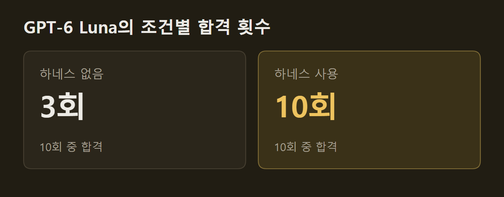

> 이 글은 아래 원문을 우리말로 간추려 정리한 글입니다. 정확한 내용은 원문을 확인하십시오.
>
> 원문: [martinfowler.com/articles/are-harnesses-worth-the-cost.html](https://martinfowler.com/articles/are-harnesses-worth-the-cost.html)  
> 원문을 소개한 뉴스레터: TLDR

코딩 에이전트에게 API 서비스를 맡기면 요구사항에 분명히 적힌 세부 동작 몇 가지를 빠뜨린 채 일을 끝내는 경우가 있다. Specmatic에서 일하는 저자는 [Are Harnesses Worth the Cost?](https://martinfowler.com/articles/are-harnesses-worth-the-cost.html)에서 '행동 하네스(behavioral harness)'가 드는 비용만큼 효과를 내는지 실험했다. 행동 하네스는 에이전트가 코드를 짜는 동안 인터페이스 명세와 예시로 방향을 잡아 주고, 자동 테스트 결과를 에이전트에게 되돌려 주는 개발 환경이다. 실험에서는 고성능 모델 GPT-6 Sol과 비용을 낮춘 모델 GPT-6 Luna가 같은 서비스를 조건마다 10번씩 만들었고, 저자는 하네스를 쓴 경우와 쓰지 않은 경우의 합격 횟수, 토큰, 시간, 비용을 견주었다.

```요약
요약: 행동 하네스를 써도 GPT-6 Sol의 합격 횟수는 달라지지 않았지만, GPT-6 Luna는 10회 중 3회에서 10회 모두로 합격 횟수가 늘었고 실행당 추정 비용은 하네스 없는 Sol보다 약 33% 낮았다.
```

```용어
행동 하네스: 에이전트가 개발하는 동안 가이드와 센서를 함께 제공하는 개발 환경이다.
가이드와 센서: 가이드는 에이전트가 행동하기 전에 틀리기 쉬운 곳을 알려 주는 명세·예시·지침이다. 센서는 행동한 결과를 검사해 에이전트에게 되돌려 주는 테스트다.
BFF: 앱이 호출하는 HTTP API를 제공하고, 그 뒤에서 다른 서비스를 호출해 응답을 만드는 서버다.
인수 테스트: 완성된 서비스를 밖에서 호출해 요구한 대로 동작하는지 확인하는 테스트다. 이 실험에서는 178개를 모두 통과해야 합격으로 쳤다.
계약: 서비스 사이에 오가는 요청·응답과 메시지의 형식을 기계가 읽을 수 있게 적은 명세다. OpenAPI는 HTTP API를, AsyncAPI는 Kafka 메시지를 기술한다.
```

## 1. 실험 설계: 두 개발 조건과 독립 평가

실험은 개발 단계와 평가 단계를 나눴다. 두 조건 모두 같은 애플리케이션 요구서(application brief)와 기본 저장소 지침을 받고 서로 분리된 작업 공간에서 시작했지만, 하네스 조건의 에이전트만 API 명세와 예시, 도구를 더 받았다. 개발하는 동안 피드백을 주는 단계는 '내부 루프(inner loop)'라 부르고, 에이전트가 일을 마친 뒤 결과물을 178개 자동 인수 테스트(acceptance test)로 검사하는 단계는 '외부 루프(outer loop)'라 부른다.

두 조건의 결과물은 똑같은 평가를 받았고, 내부 루프는 평가용 테스트의 정답에 접근할 수 없었다. 다음 그림에서 왼쪽은 하네스를 쓴 조건이고 오른쪽은 쓰지 않은 조건이다. 아래쪽 초록 영역은 두 조건의 결과물을 같은 방식으로 검사하는 평가 하네스다.

")

합격 기준은 엄격했다. 애플리케이션이 정상적으로 기동하고 178개 테스트를 모두 통과해야 합격이었고, 신뢰성은 반복 실행에서 합격한 결과물이 얼마나 꾸준히 나오는지로 정의했다. 시도마다 독립된 Docker 컨테이너와 새 Codex 홈 디렉터리를 썼기 때문에, 인증 정보와 언어 의존성 캐시를 빼면 앞선 실행의 세션, 메모리, 스킬은 다음 실행으로 넘어가지 않았다.

## 2. 과제: 상품 탐색용 BFF 서비스

에이전트가 만든 서비스는 상품 탐색을 맡는 BFF(backend-for-frontend)다. 이 서비스는 앱이 호출할 HTTP API를 제공하고, 들어온 요청과 하위 서비스의 응답을 검증하며, 주문 API(Order API)를 호출해야 했다. 또 가용 상품 검색이 성공하면 돌려받은 상품 가운데 첫 번째만 Kafka에 발행해야 했다. 모든 상품을 그대로 흘려보내면 선택 동작을 구현하지 않고도 통과할 수 있으므로, 이를 막으려고 둔 조건이다.

")

요구서는 쉽게 눈에 띄지 않는 동작까지 정해 두었다. 상품 생성 요청이 시간 초과되면 BFF는 202 응답을 보내면서, 나중에 결과를 조회할 수 있는 링크를 헤더에 담아야 했다. 일시적인 검색 실패에는 재시도 간격을 담은 429로 답하고, 하위 서비스를 쓸 수 없거나 이벤트 발행에 실패하면 503으로 답해야 했다. 하위 서비스가 성공 응답을 보내더라도 그 응답이 요청한 상품 필터를 어기면 502를 돌려줘야 했다.

검색이 성공했을 때의 처리 순서는 다음 그림과 같다. BFF는 Order 서비스에서 일치하는 상품 목록을 받아 첫 상품을 Kafka에 발행하고, 확인(ack)을 받은 뒤에야 앱에 응답한다. 감사(Audit) 서비스는 그 이벤트를 따로 읽어 간다.

")

이 과제는 HTTP 규칙, 비동기 이벤트, 스키마 경계, 장애 대응 정책을 한꺼번에 맞춰야 하므로 단순한 CRUD 엔드포인트를 만드는 일보다 어렵다. 반면 요구서는 기능 요구, 아키텍처와 기술 제약, 외부 인터페이스, 응답 형태, 실패 동작을 이례적으로 자세히 적어 두었고, 이 점은 하네스 없는 에이전트에게도 유리했다. 요구서가 덜 완전할 때 결과가 어떻게 달라질지는 아직 알 수 없다고 저자는 밝혔다.

## 3. 행동 하네스의 구성과 피드백 순서

하네스는 Birgitta Böckeler의 구분을 빌려 가이드(guide)와 센서(sensor)를 함께 갖췄다. 가이드는 에이전트가 행동하기 전에 틀리기 쉬운 곳을 짚어 첫 시도가 맞을 가능성을 높인다. 센서는 행동한 결과를 관찰해 에이전트가 스스로 고칠 수 있도록 피드백을 준다.

가이드는 계약(contract), 예시, 스킬로 이루어졌다. OpenAPI 명세는 BFF와 하위 Order API를, AsyncAPI 명세는 Kafka를 기술했고, 이 명세들은 요구사항을 새로 만들지 않고 요구서의 내용을 기계가 읽을 수 있는 형태로 보완했다. 예시는 하위 서비스 시간 초과, 잘못된 페이로드, 필터 위반, 재시도 순서, Kafka 이벤트 확인까지 포함했다. API 개발 스킬은 의존 서비스를 흉내 내는 방법과 실패를 진단하는 방법을 담았다.

센서는 계약 준수 여부, HTTP 응답 값, 밖에서 확인할 수 있는 부수 효과를 검사했다. 예를 들어 하위 목(mock) 서버가 실제로 호출되었는지, Kafka에 메시지가 발행되었는지를 확인한 뒤 테스트 결과와 API 커버리지 보고서를 에이전트에게 돌려주었다. 검사 자체는 LLM의 판단 없이 결정론적 도구가 수행했지만, 결과를 해석해 무엇을 고칠지 정하는 일은 에이전트가 맡았다.

다음 그림은 하네스를 이루는 요소와 피드백 경로를 보여 준다. 보라색 칸은 Specmatic으로 구현한 부분이고, 점선 화살표는 각 칸이 어느 명세에서 만들어졌는지를 가리킨다. 저자는 같은 기능을 갖춘 다른 계약 테스트·서비스 가상화 도구로도 이 하네스를 만들 수 있다고 밝혔다.

")

에이전트는 구현에 앞서 요구서와 명세, 예시를 읽고, 스킬의 지시에 따라 필요한 동작마다 하위 서비스와의 상호작용과 검증 항목을 연결한 문서를 만들었다. 그다음 프로젝트의 테스트 명령 하나로 설정과 예시를 검증하고, 빌드와 단위 검사를 실행하고, 목 서버와 애플리케이션을 띄운 뒤 API 테스트를 돌렸다. 이 피드백은 에이전트가 테스트 명령을 직접 실행해야만 돌아왔고, 코드를 고칠 때마다 저절로 돌지는 않았다.

테스트 하나는 준비(arrange), 실행(act), 확인(assert) 순서로 진행된다. 다음 그림처럼 테스트가 목 서버에 기대 응답을 설정하고 BFF에 요청을 보내면, BFF가 내보내는 요청은 OpenAPI 명세로, Kafka 메시지는 AsyncAPI 명세로 검증된다. 마지막으로 목 서버가 쓰였는지와 메시지 내용이 맞는지 확인한 뒤 결과와 커버리지를 에이전트에게 보낸다.

")

이런 하네스를 설계할 때 가장 어려운 점은 가이드와 센서가 서로 어긋나지 않게 하는 것이다. 이를 위해 테스트를 돌리기 전에 '예시 검증' 명령으로 예시 페이로드가 명세에 맞는지 먼저 확인했고, 센서는 그 명세와 예시를 기준으로 구현을 검사했다. 에이전트가 요구사항을 해석해 구현과 테스트를 모두 쓰면 같은 오독이 양쪽에 함께 들어갈 수 있다. 이 때문에 에이전트는 명세와 예시를 바꾸지 말고 구현이나 실행 설정을 고치라는 지시를 받았다.

## 4. 두 모델의 합격 횟수와 실행 비용

GPT-6 Sol은 하네스 유무와 관계없이 10회 모두 합격했다. Codex에서 낮은 추론 강도로 실행한 Sol은 두 조건 모두에서 매번 178개 테스트를 통과했고, 하네스 없는 조건에서도 `/goal` 프롬프트 한 번이면 사람이 디버깅하지 않아도 됐다. 다만 하네스를 쓰면 Sol은 토큰을 약 10.5배, 시간을 3배 가까이, 추정 비용을 약 7배 더 썼다.

10회 평균으로 보면 하네스를 쓴 Sol은 실행당 약 1,133만 토큰, 19분 53초, 2.679달러가 들었고, 하네스 없는 Sol은 약 108만 토큰, 6분 51초, 0.406달러가 들었다. 저자가 탐색 삼아 낮은 추론 강도로 돌려 본 Claude Sonnet 4.6, Claude Opus 4.6, Gemini 3.8 Flash도 하네스 없이 첫 시도에 과제를 마쳤다.

GPT-6 Luna는 하네스가 있을 때만 꾸준히 합격했다. Sol은 복잡한 전문 작업용 대표 모델이고, Luna는 비용에 민감한 대량 작업용 모델로 이전 GPT-5 계열의 nano 등급에 가깝다. 같은 조건에서 실험한 결과 Luna는 하네스 없이 10회 중 3회만 합격했고, 하네스가 있을 때는 10회 모두 합격했다.



하네스는 Luna에 없던 능력을 더해 준 것이 아니라, 10회 중 3회이던 합격을 10회 모두로 늘렸다. 하네스 없는 Luna도 기능 검사의 94.8%를 통과했으므로, 과제를 통째로 놓쳤다기보다 까다로운 경계 사례에서 실패한 것이다. 그 대가로 하네스는 실행당 평균 약 1,707만 토큰, 19분 4초, 추정 비용 0.187달러를 더 썼고, 토큰 사용량은 하네스 없는 Luna 실행의 약 3.9배였다.

## 5. 하네스 없는 Luna가 놓친 세부 동작

하네스 없이 실패한 Luna의 Java 애플리케이션은 문법 오류나 요구서 오해 때문에 실패하지 않았다. 각각 178개 검사 중 최소 144개를 통과했고, 실패는 지연 생성 흐름과 몇 가지 프로토콜 세부 사항에 몰렸다. 그럴듯하게 짠 구현이라도 프로토콜 경계, 장애 복구 경로, 서비스 사이의 연결 지점에서는 시스템 전체로 보아 실패할 수 있다는 뜻이다.

**지연 생성 흐름이 시간 초과 지점에서 깨졌다.** 하위 상품 생성이 시간 초과되면 BFF는 202와 조회 링크를 돌려주고, 뒤에서 재시도해 최종적으로 하위 서비스의 201 응답을 보여 줘야 했다. 그러나 애플리케이션 4개는 503을, 2개는 400을, 1개는 429를 돌려주었다. 여러 구현이 시간 초과를 좁은 예외 타입으로만 판별했는데, 실제 예외가 기록에 남지 않은 경우가 많아 이는 유력한 설명일 뿐 확인된 원인은 아니다.

이 실패는 다음 검사의 실패로 이어졌다. 7회 실행에서는 시간 초과에 잘못 응답한 탓에 조회 URL이 나오지 않았고, 그 URL을 쓰는 뒤쪽 평가 검사도 실패했다. 저자는 이 실패를 별도 결함으로 세지 않고 202 흐름이 깨진 결과로 보았다.

**Kafka 메시지는 도착했지만 계약을 어겼다.** 3회 실행에서는 기대한 메시지가 모두 Kafka에 도착했는데도 평가기가 발행을 불합격 처리했다. 애플리케이션 둘은 Spring의 JSON 직렬화기를 쓰면서 예상에 없던 `__TypeId__` 헤더를 붙였고, 다른 하나는 값이 있으면 배열이어야 하는 선택 필드를 `"categories": null`로 내보냈다.

**오류 응답이 정해진 HTTP 계약과 달랐다.** 지원하지 않는 미디어 타입에는 보통 415를 쓰지만, 요구서가 이런 잘못된 요청에 400을 요구했기 때문에 평가기는 415를 위반으로 셌다. 또 다른 경우에는 잘못된 요청이 범용 500 처리기로 넘어갔고, 존재하지 않는 조회 대상에 엉뚱한 형식으로 응답하기도 했다.

설정 이름이 어긋난 사례도 있었다. 생성된 클라이언트는 `ORDER_API_API_KEY`를 읽었지만 실행 기록에는 `ORDER_API_KEY`가 주어졌고, 일반 상품 생성이 201 대신 503을 돌려준 원인으로는 이 불일치가 유력하다. 하네스를 쓴 실행에서는 계약 기반 목 서버와 설정 검사가 배포 전에 이런 환경 변수를 검증했다.

이 실패들에 대한 저자의 해석은 '주의 실수(attention lapse)'다. 지연 생성 흐름, Kafka 메시지 계약, 정확한 오류 응답은 모두 요구서에 분명히 적혀 있었지만, 구현이 진행되면서 요구사항이 코드에서 빠지거나 덜 구현되었다는 것이다. 라이브러리 선택, 반복적인 설정 코드, 의존성 주입, 비동기 연결을 점점 커지는 컨텍스트 안에서 함께 다룬 것이 원인일 수 있지만, 실험이 원인을 확인하지는 않았다.

하네스는 이런 빈틈을 드러내는 역할을 했다. 저자는 이를 '실행 가능한 주의(executable attention)'라고 이름 붙였는데, 글로 적힌 요구사항을 실행 환경의 피드백으로 바꿔 센서가 실패를 보고할 때 빠뜨린 요구사항을 에이전트가 다시 다루게 한다는 뜻이다. Sol은 관찰한 모든 실행에서 요구서의 세부 사항을 지켰고, Luna는 결과가 실행마다 달랐으므로 이 역할이 Luna에서만 차이를 냈다.

## 6. 일관된 결과의 비용과 실험의 범위

두 모델의 결과를 나란히 놓으면 하네스 피드백에 드는 비용이 보인다. 여기서 비용은 기록된 토큰 사용량과 모델 가격으로 계산한 API 기준 추정치이고, 실제 청구액이 아니다. 다음 그림에서 가로축은 추정 비용(달러), 세로축은 실행 시간(분)이며, 보라색 점이 Sol, 주황색 점이 Luna다.

")

하네스를 쓴 Luna는 실행당 평균 0.273달러로, 하네스 없는 Sol의 0.406달러보다 약 33% 적게 들었고, 두 조건 모두 10회 중 10회 합격했다. 다만 실행 시간은 35분으로 하네스 없는 Sol의 6분 51초보다 길었다. 이 비교는 자동 생성 비용과 기계 시간만 잰 것이어서, 계약·예시·검증 기준·하네스를 만들고 관리하는 사람의 노력과 불합격 결과를 찾아 고치는 노력은 들어 있지 않다.

실험 범위도 좁다. 모델마다 10쌍을 실행했고, 대상은 새로 만드는(greenfield) Java 서비스 하나였으며, 두 모델 모두 낮은 추론 강도로 돌렸다. 기존 코드 수정, 다른 언어나 추론 설정, 모호한 요구서에서도 같은 양상이 나오는지는 시험하지 않았다. 또 하네스가 가이드와 센서를 한꺼번에 더했기 때문에 각각이 얼마나 기여했는지도 가를 수 없다.

이 결과를 바탕으로 저자는 모델 성능에 따라 달라지는 것이 독립 검증의 필요 여부가 아니라 센서를 돌리는 시점과 빈도라고 정리했다. 결과가 실행마다 다른 비용 최적화 모델은 개발 내내 하네스를 돌리고, 첫 시도에 꾸준히 통과하는 고성능 모델은 같은 테스트를 합격 판정 직전에 한 번만 돌리자는 것이 저자의 권고다. Sol의 10회 합격도 독립 평가를 거쳐 확인되었으므로, 다음 실험에서는 '마지막 관문만' 두는 조건을 시험해 그 부담과 관문이 잡아내는 불일치의 빈도를 잴 계획이다.

행동 하네스가 모든 모델에 이득이라는 저자의 처음 가정은 이 실험에서 맞지 않았다. Sol은 하네스를 써도 합격 횟수가 그대로였고 시간과 비용만 늘었지만, Luna는 하네스를 쓰면 매번 합격했고 실행당 비용도 하네스 없는 Sol보다 낮았다. 단가, 지연 시간, 데이터 보호, 사내 실행 같은 조건에 맞는 가벼운 모델을 하네스로 안정적으로 쓸 수 있다면, 팀이 고를 수 있는 실용적인 선택지가 된다는 것이 저자의 결론이다.

## 출처와 작성 방식

- 원문: [martinfowler.com/articles/are-harnesses-worth-the-cost.html](https://martinfowler.com/articles/are-harnesses-worth-the-cost.html)
- 원문을 소개한 뉴스레터: TLDR
- 그림: 아래에 출처가 적힌 그림은 원문에 실린 그림을 인용한 것이며 저작권은 원저작자에게 있습니다. 출처가 없는 그래프는 원문에 적힌 값으로 직접 그린 것입니다.
- 작성 방식: 직접 만든 뉴스 정리 파이프라인(VISER)으로 생성하고 검수한 글입니다. 본문의 수치와 주장은 원문에서 가져온 것입니다.
- 정리 주차: 2026-W42
