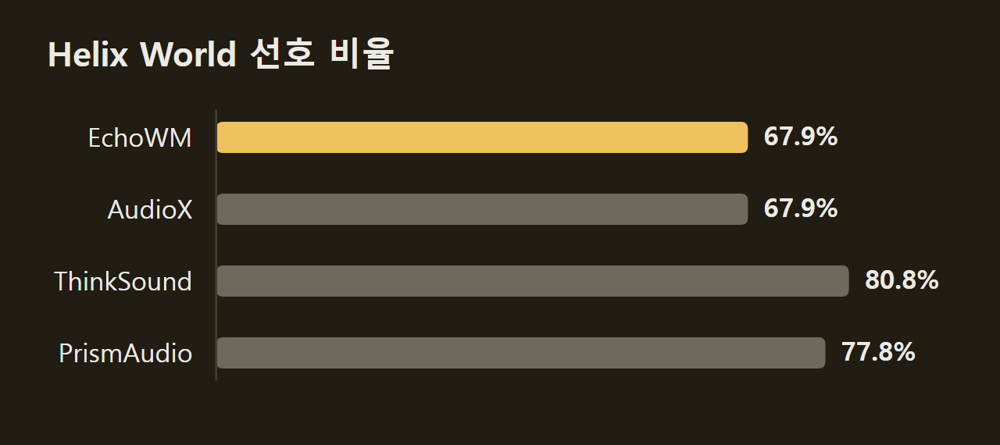
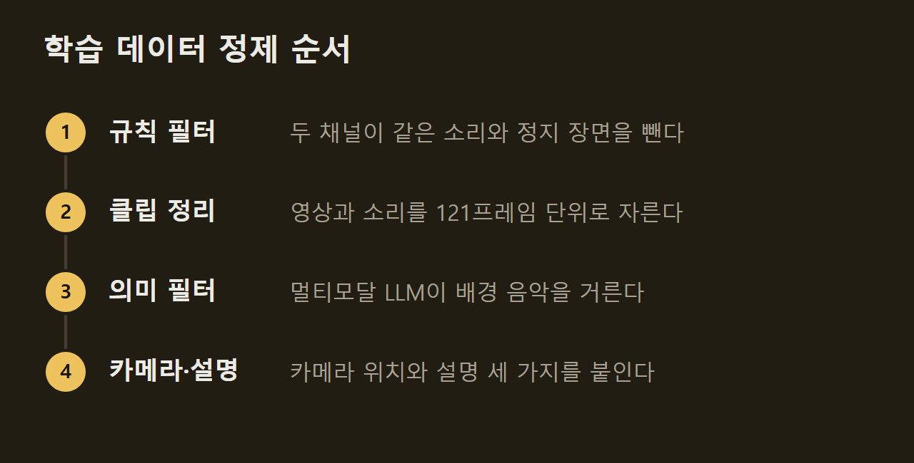

> 이 글은 아래 원문을 우리말로 간추려 정리한 글입니다. 정확한 내용은 원문을 확인하십시오.
>
> 원문: [noiz.ai/lp/blog/meet-helix-world](https://noiz.ai/lp/blog/meet-helix-world)  
> 원문을 소개한 뉴스레터: TLDR AI

사용자가 키보드로 움직이면 인공지능이 그 움직임에 맞춰 가상 장면을 실시간으로 그려 내는 모델을 세계 모델이라 부른다. 다만 지금까지 나온 세계 모델은 대부분 소리를 내지 못한다. Noiz AI와 홍콩과기대(HKUST)가 공개한 [Helix World](https://noiz.ai/lp/blog/meet-helix-world)는 사진 한 장에서 시작한다. 사용자가 WASD 키로 이동하고 방향키로 시선을 돌리면, 이 모델은 그 조작에 맞춰 다음 영상과 좌우 스테레오 소리를 함께 만든다.

```요약
요약: Helix World는 사진 한 장에서 영상과 스테레오 소리를 함께 만드는 세계 모델로, NVIDIA H800 GPU 한 대에서 실시간보다 빠른 RTF 0.77로 돌면서 WBench 79.9점을 받았다.
```

```용어
세계 모델(world model): 사용자의 조작에 따라 다음 장면을 이어서 생성해, 둘러볼 수 있는 가상 환경을 만드는 모델이다.
RTF(real-time factor): 출력 영상 1초를 만드는 데 드는 계산 시간(초)이다. 1보다 작으면 실시간보다 빠르다.
스테레오 패닝: 소리를 왼쪽 채널과 오른쪽 채널에 나눠 실어 소리가 나는 방향을 나타내는 방식이다.
증류: 큰 모델(교사)의 출력을 본보기로 삼아 더 빠른 모델(학생)을 학습시키는 방법이다.
```

## 1. 세계 모델에 소리가 필요한 이유

소리에는 화면이 전하지 못하는 정보가 담긴다. 표면이 무엇으로 되어 있는지, 두 물체가 얼마나 세게 부딪혔는지, 화면 밖에서 무슨 일이 일어나는지가 그렇다. 몰입형 장면이라면 고개를 돌릴 때 소리도 왼쪽 귀와 오른쪽 귀 사이를 옮겨 가야 한다.

영상을 다 만든 뒤 소리를 덧입히는 방식으로는 이 문제를 풀 수 없다. 영상을 보고 소리를 만드는 모델은 카메라 궤적과 사용자의 조작을 보지 못하므로 시점이 움직여도 소리가 따라 바뀌지 않고, 영상 뒤에 따로 돌리는 만큼 지연도 늘어난다. 반면 영상과 소리를 함께 만드는 기존 양방향 모델에는 조작을 받는 입력이 없으며, 이를 단순히 스트리밍 방식으로 바꾸면 오류가 쌓여 화면과 소리가 함께 나빠진다.

## 2. 사진 한 장에서 시작하는 데모

사용자는 데모에서 시작 사진을 고르거나 직접 올리며, 모델은 이를 768×512 해상도로 받는다. 텍스트 프롬프트는 넣지 않아도 되고, 비워 두면 첫 화면을 보고 장면 설명을 자동으로 만든다. 생성은 약 1.3초 길이의 구간 단위로 이어진다. 키 입력이나 새 프롬프트가 다음 구간부터 반영되므로 장면이 진행되는 도중에도 방향을 바꿀 수 있다.

다음 그림은 원형 경기장에서 창을 든 1인칭 장면을 띄운 데모 화면이다. 왼쪽 아래에 이동용 WASD 키가, 오른쪽 아래에 시선용 방향키가 있고, 장면을 바꾸는 프롬프트는 아래쪽 입력창에 적는다.

")

## 3. 화질과 생성 속도 비교

Helix World는 실시간보다 빠르게 도는 모델 가운데 WBench 내비게이션 점수가 가장 높다. RTF는 NVIDIA H800 한 대에서 영상과 오디오 디코딩까지 포함해 쟀으며, Helix World는 RTF 0.77에서 79.9점을 받았다. 같은 실시간 구간에 있는 SANA-WM은 76.0점, Matrix-Game 3는 71.3점이다.

다음 그림의 가로축은 로그 눈금으로 그린 RTF이고 세로축은 WBench 점수다. 왼쪽 파란 영역이 실시간보다 빠른 구간이며, 노란 점은 소리를 함께 만드는 모델이다.

")

Helix World보다 점수가 높은 세 모델은 영상 1초에 1.98~4.29초의 계산이 필요하고, 그중 둘은 소리를 내지 않는다. 따라서 화질만 보면 Helix World는 가장 강한 무음 모델(Alaya-EVOKE-Turbo, 82.0점)보다 조금 낮다. 또 실시간 속도는 데이터센터용 H800에서 잰 값이며, 일반 소비자용 GPU에서의 속도는 논문에 없다.

## 4. 카메라 방향에 맞춘 공간 음향 평가

연구진은 카메라 움직임과 소리를 함께 평가하려고 HelixBench를 만들어 모델과 같이 공개했다. 기존 세계 모델 벤치마크는 영상만 평가하고, 오디오·비디오 벤치마크는 카메라가 움직이지 않는 짧은 클립을 쓰기 때문이다. HelixBench는 사람이 확인한 1,015개 사례로 이루어진다. 이 벤치마크의 공간 점수는 화면 속에서 소리 나는 물체의 위치와 좌우 스테레오 패닝이 함께 움직이는 정도를 잰다.

Helix World의 공간 점수는 41.8로, 소리를 만드는 또 다른 세계 모델인 EchoWM의 12.7보다 높다. 비교 대상에는 Helix World 영상의 소리를 지우고 AudioX, ThinkSound, PrismAudio로 소리를 다시 입힌 방식도 들어 있으며, 이 경우 화면은 같고 소리만 바뀐다. AudioX 방식(−5.7)과 PrismAudio 방식(−9.5)은 점수가 음수로 나왔다. 연구진은 영상만 보고 소리를 만드는 모델이 소리 나는 물체가 카메라 기준으로 어디 있는지 모르기 때문이라고 설명했다.

")

다만 Helix World가 모든 지표에서 앞서지는 않는다. 음질과 소리·화면의 의미 일치에서는 가장 좋았지만, 소리가 화면 속 사건과 어긋나는 시간(DeSync)은 LTX-2.3(0.40초)과 ThinkSound 방식(0.42초)이 Helix World(0.59초)보다 짧았다.

사용자 연구에서도 차이는 주로 소리에서 나왔다. 소리를 켠 영상을 견주자 참가자들은 EchoWM보다 Helix World를 67.9% 대 20.8%로, ThinkSound 방식보다 80.8% 대 9.6%로 더 많이 골랐다. 반면 소리를 끄고 견주었을 때는 LingBot-World v2와 39.5%씩 비겼고, EchoWM에는 26.3% 대 44.7%로 밀렸다.



## 5. 학습 데이터와 교사·학생 모델

이 작업에서 가장 큰 걸림돌은 학습 데이터였다. 대부분의 영상 자료는 소리가 배경 음악이나 내레이션이거나 두 채널이 똑같은 가짜 스테레오여서 쓸 수 없다. 이 때문에 연구진은 원본 영상 4,100시간을 비용이 낮은 단계부터 네 단계로 걸렀고, 그 결과 210만 개 클립, 3,000시간이 남았다(수율 73.1%).



모델은 공개된 오디오·비디오 생성 모델 LTX-2.3을 바탕으로 한다. 연구진은 여기에 카메라 궤적과 키보드 입력을 조건으로 넣었고, 화면과 소리를 잇는 교차 어텐션이 카메라 움직임을 스테레오 패닝으로 바꾼다. 이렇게 만든 교사 모델은 클립 전체를 한꺼번에 보고 생성하는 양방향 모델이어서 실시간 입력에는 반응하지 못한다.

그래서 연구진은 교사 모델을 블록 단위로 차례차례 생성하는 인과적 학생 모델로 증류했다. 학생 모델이 자기 출력을 이어 받으며 학습하면 긴 생성에서 품질이 점점 흐트러지므로, 생성 중간 상태마다 교사 모델의 목표값으로 학생을 직접 바로잡는 손실을 더했다. 학습 방식만 바꿔 견준 실험에서 WBench 점수는 77.9에서 79.1로 올랐고, 30초 길이의 생성도 안정적으로 유지됐다.

정리하면 Helix World는 영상과 공간 음향을 함께 만들면서 H800 한 대에서 실시간보다 빠르게 돌고, 실시간 모델 가운데 WBench 점수가 가장 높다. 사용자 연구에서 나타난 우위는 주로 카메라 방향을 따르는 소리에서 나왔다. 논문은 arXiv에, 코드는 GitHub에, 미리보기 체크포인트는 Hugging Face에 공개됐으며 데모는 helixworld.org에서 써 볼 수 있다.

## 출처와 작성 방식

- 원문: [noiz.ai/lp/blog/meet-helix-world](https://noiz.ai/lp/blog/meet-helix-world)
- 원문을 소개한 뉴스레터: TLDR AI
- 그림: 아래에 출처가 적힌 그림은 원문에 실린 그림을 인용한 것이며 저작권은 원저작자에게 있습니다. 출처가 없는 그래프는 원문에 적힌 값으로 직접 그린 것입니다.
- 작성 방식: 직접 만든 뉴스 정리 파이프라인(VISER)으로 생성하고 검수한 글입니다. 본문의 수치와 주장은 원문에서 가져온 것입니다.
- 정리 주차: 2026-W42
