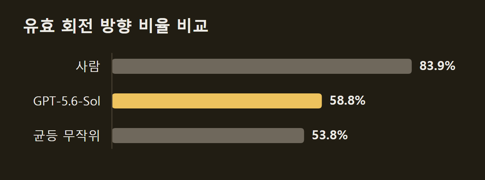
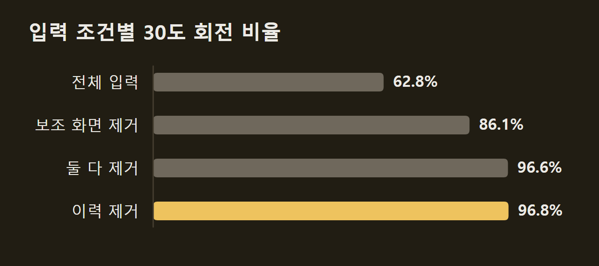
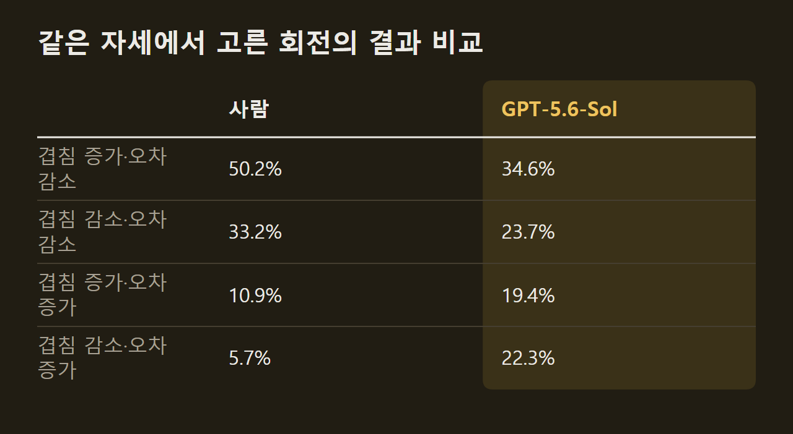

> 이 글은 아래 원문을 우리말로 간추려 정리한 글입니다. 정확한 내용은 원문을 확인하십시오.
>
> 원문: [arxiv.org/abs/2610.17665](https://arxiv.org/abs/2610.17665)  
> 원문을 소개한 뉴스레터: Roboflow

로봇이나 화면 속 에이전트처럼 시각-언어 모델(VLM)이 직접 행동하는 일이 늘고 있다. 이런 모델은 2D 이미지만 보고 물체의 3D 모양과 방향을 짐작한 뒤 그 짐작대로 정확히 움직여야 한다. 샤먼대학교 연구진은 이 능력을 재는 [RoTA-Bench](https://arxiv.org/abs/2610.17665)를 내놓았다. 모델에게 목표 실루엣과 엉뚱하게 돌아간 3D 물체의 현재 모습을 보여 주면, 모델은 회전 동작을 하나씩 고르고 결과 화면을 다시 확인하면서 물체의 그림자 모양이 목표와 겹칠 때까지 돌린다.

```요약
요약: RoTA-Bench는 VLM이 2D 화면만 보고 3D 물체를 돌려 목표 실루엣에 맞출 수 있는지 재는 벤치마크로, 시험 과제 100개에서 가장 높은 성공률을 낸 GPT-5.6-Sol도 17.0%에 그쳤고 학부생 참가자는 400회를 모두 성공했다.
```

```용어
투영 IoU: 현재 물체의 실루엣과 목표 실루엣이 겹치는 넓이를 둘을 합친 넓이로 나눈 값이다. 0.90 이상이면 과제에 성공한 것으로 친다.
포즈 오차: 현재 3D 자세를 목표 자세로 되돌리는 데 필요한 가장 작은 회전 각도다. 연구진이 분석에만 쓰고 모델에게는 보여 주지 않는다.
유효 방향 비율: 고른 회전축과 방향이 포즈 오차를 줄일 수 있는 방향이었던 비율이다. 각도는 따지지 않는다.
상호작용 이력: 앞선 단계의 화면, 모델의 응답, 고른 동작을 시간순으로 모은 기록이다.
```

## 1. 실루엣을 맞추는 회전 과제의 규칙

**모델은 매 단계 세 장의 이미지를 보고 회전 하나를 고른다.** 첫 장은 바뀌지 않는 목표 실루엣이고, 셋째 장은 현재 물체를 정면에서 투영(projection)한 실루엣이다. 흑백 실루엣만으로는 깊이와 가려진 부분을 알 수 없으므로, 같은 시점에서 가까운 면을 밝게 칠한 깊이 음영 보조 화면(depth-shaded view)을 둘째 장으로 함께 준다.

동작은 카메라에 고정된 세 축의 회전이다. 위아래로 기울이는 피치(pitch), 좌우로 돌리는 요(yaw), 화면 안에서 시계 방향이나 반시계 방향으로 돌리는 롤(roll)에 방향 두 가지와 각도 네 가지(1도, 5도, 10도, 30도)를 곱하면 24가지 회전이 나온다. 큰 각도로 대략 맞춘 뒤 작은 각도로 다듬을 수 있도록 각도를 여러 단계로 둔 것이고, 모델은 회전 대신 멈춤(STOP)을 고를 수도 있다.

투영 IoU가 0.90 이상이 되면 과제에 성공한다. 연구진은 회전 단위가 정해져 있어 완전히 일치시키기 어려우므로 이 정도 여유를 두었다고 설명했다. 반면 성공하지 못한 채 멈춤을 고르거나, 결정을 48번 하거나, 12번 연속으로 회전해도 최고 IoU가 오르지 않으면 실패로 끝난다. IoU 수치, 물체의 실제 자세, 정답 경로는 모델과 사람 모두에게 보이지 않는다.

다음 화면은 사람 참가자가 쓴 조작 화면이다. 오른쪽 위에 목표 실루엣, 보조 화면, 현재 실루엣이 차례로 놓이고, 아래에는 지나간 단계의 상태와 그때 고른 동작이 시간순으로 붙는다. 사람은 버튼을 누르고 모델은 같은 동작을 JSON으로 답하며, 받는 화면과 규칙은 양쪽이 같다.

")

## 2. 아이콘에서 과제를 자동으로 만드는 방법

**연구진은 3D 모델 저장소 대신 2D 아이콘으로 물체를 만들었다.** 의자나 컵처럼 익숙한 모양을 쓰면 모델이 사전 학습에서 익힌 지식으로 답을 짐작할 수 있기 때문이다. 이에 따라 공개 아이콘 모음인 Game-icons에서 조각나지 않고 지나치게 길쭉하지 않은 아이콘을 골라 흑백 마스크로 바꾸었다.

아이콘의 평면 점들은 반지름이 정해진 구 안에서 앞뒤로 두께를 주어 입체로 만든다. 가운데는 두껍고 가장자리로 갈수록 얇아지는 형태라서 정면에서 보면 원래 아이콘 모양이 그대로 나온다. 또한 물체가 늘 구 안에 들어 있으므로 어느 방향으로 돌려도 화면 밖으로 잘려 나가지 않는다.

**처음 자세는 정면 자세를 거꾸로 돌려 만든다.** 정면 자세에서 30도 회전을 6~16번 무작위로 적용하되, 바로 앞 회전을 되돌리는 동작은 고르지 않는다. 회전은 모두 되돌릴 수 있으므로 적용한 순서를 거꾸로 실행하면 반드시 목표로 돌아가고, 이 때문에 모든 과제는 풀 수 있다는 것이 보장된다. 이렇게 만든 과제는 674개이고, 과제마다 쓴 아이콘이 다르다.

거꾸로 돌리는 경로는 해법이 될 수 있지만 대개 필요 이상으로 길다. 이를 줄이려고 연구진은 빔 탐색(beam search)과 30도 회전만 쓰는 너비 우선 탐색(BFS, breadth-first search)으로 더 짧은 참고 경로를 찾았다. 그 결과 674개 중 585개(86.8%)에서 더 짧은 경로를 찾았고, 평균 길이는 11.04단계에서 6.54단계로 줄었다. 다만 연구진은 이 경로가 가장 짧은 경로라는 보장은 없다고 밝혔다.

")

시험 과제는 참고 경로가 4단계 이상인 642개 가운데 경로 길이별 비율에 맞춰 100개를 뽑았다. 나머지 574개는 이후 학습과 연구에 쓰도록 남겨 두었다. 연구진은 아이콘으로 만든 물체가 복잡한 3D 모양을 다 담지 못하고, 목표가 하나뿐인 회전 과제가 연속적인 실제 물리 환경보다 단순하다는 점을 한계로 꼽았다.

아이콘을 고른 효과는 별도 비교에서도 드러난다. 경로 길이 분포를 똑같이 맞춘 30개짜리 과제 세트 두 개에서, GPT-5.6-Sol은 실제 물체를 본뜬 Poly Haven 메시 과제에서 평균 최종 IoU 0.72와 6/30 성공을 기록했다. 아이콘 과제에서는 0.57과 5/30이었다. 연구진은 두 세트의 과제가 일대일로 짝지어지지는 않았다고 단서를 달면서도, 익숙한 모양인지 여부가 성능에 영향을 줄 수 있다고 해석했다.

## 3. 모델과 사람의 성공률 차이

**평가 대상은 VLM 9개, 에이전트 구성 2개, 학부생 20명이다.** 에이전트 구성인 ReAct와 Magentic은 모두 GPT-5.6-Sol을 바탕으로 한다. 학부생은 1인당 연속된 과제 20개를 풀었으므로 시험 과제 100개 전체를 네 번 푼 셈이고, 연습 없이 바로 시작했다. 모델은 온도 0으로 호출했으며, 비공개 모델의 API 비용은 모두 1,482.07달러였다.

다음 그림의 왼쪽은 과제 674개를 참고 경로 길이별로 나눈 분포이고, 가운데는 티셔츠 과제를 푸는 예시다. 오른쪽은 방식별 성공률과 최종 IoU다. 가운데 예시에서는 회전 24번 만에 IoU가 0.90을 넘었다.

")

**모델의 성공률은 17.0%를 넘지 못했다.** 성공률이 가장 높은 모델은 GPT-5.6-Sol(17.0%)이었고, ReAct(16.0%)와 Gemini 3.6 Flash(10.0%)가 뒤를 이었다. 반면 사람은 400회를 모두 성공했고, 평균 16.2번 회전해 최종 IoU 0.92에 이르렀다. 다만 GPT-5.6-Sol의 95% 신뢰구간이 10.9~25.6%로 넓어서, 연구진은 순위만으로 모델 간 차이가 확실하다고 볼 수 없다고 밝혔다.

**일부 모델은 무작위로 돌리는 것과 거의 같은 결과를 냈다.** Claude Sonnet 5, Claude Opus 5, Qwen 3.7 Plus는 한 과제도 풀지 못했고, 최종 IoU(0.48~0.50)도 무작위 회전(0.47)보다 조금 높은 수준이었다. 공간 추론용으로 만든 SpatioLM-InternVL3.5는 동작의 91.1%가 '오른쪽으로 10도'(YAW_POS 10도) 하나로 굳어 버렸고, 최종 IoU 0.46으로 무작위보다도 낮았다.

정답 정보를 쓰는 기준선 두 개를 보면 무엇이 어려운지가 드러난다. 둘 다 매 단계 24가지 회전을 미리 모두 실행해 본 뒤 하나를 고르는데, 바로 다음 IoU가 가장 높아지는 회전을 고르는 기준선은 39.0%만 성공했다. 이와 달리 실제 포즈 오차가 가장 작아지는 회전을 고르는 기준선은 평균 8.32단계 만에 100.0% 성공했다. 화면상의 겹침만 매번 늘려서는 많은 과제를 풀 수 없지만, 3D 자세 차이를 알면 모든 과제를 풀 수 있다는 뜻이다.

## 4. 회전 방향과 각도를 고르는 능력

**모델의 실패는 덜 둘러본 탓이 아니다.** 한 과제를 푸는 동안 물체 표면을 본 비율은 GPT-5.6-Sol이 79.6%, 사람이 83.1%로 비슷했다. 다만 연구진은 둘러본 총량이 비슷해도 어느 부분을 보고 그것을 어떻게 썼는지는 다를 수 있다고 덧붙였다.

연구진은 회전 하나를 방향(축과 부호)과 각도로 나누어 따졌다. 방향은 3D 자세 차이가 어느 쪽인지를, 각도는 그 차이가 얼마나 큰지를 추정한 결과에 해당한다. 이렇게 나누어 보면 모델은 두 가지 모두 사람보다 못했다.

**방향 선택에서 모델은 무작위와 큰 차이가 없었다.** GPT-5.6-Sol의 유효 방향 비율은 58.8%로 사람(83.9%)보다 25.2%p 낮았고, 균등 무작위(53.8%)보다는 조금 높았다. 다른 주요 모델도 52.4~61.9%에 머물렀다.



**각도 선택도 사람보다 부정확했다.** 유효한 방향을 고른 경우만 보면, GPT-5.6-Sol이 고른 각도와 가장 좋은 각도의 차이는 평균 6.5도로 사람(3.0도)의 두 배를 넘었다. 이 차이 때문에 생긴 포즈 오차도 회전 한 번에 평균 2.3도로 사람(1.0도)보다 컸다.

방향과 각도 중 어느 쪽을 고쳤을 때 효과가 더 큰지도 따로 쟀다. GPT-5.6-Sol이 거쳐 간 상태 2,366개에서 각도는 그대로 두고 방향만 가장 좋은 것으로 바꾸면, 다음 단계의 포즈 오차가 평균 15.6도 줄었다. 반면 방향은 두고 각도만 바꾸면 5.7도, 둘 다 바꾸면 20.0도가 줄었다.

## 5. 상호작용 이력이 세밀한 조정에 미치는 영향

**지난 단계의 기록을 지우자 GPT-5.6-Sol은 거의 30도로만 돌렸다.** 연구진은 시험 과제 중 앞쪽 30개에서 보조 화면과 상호작용 이력을 각각 빼거나 둘 다 빼는 제거 실험(ablation)을 했다. 이 30개는 참고 경로 길이 분포가 시험 과제 100개와 거의 같다.

전체 입력을 준 경우 30개 중 5개(16.7%)를 풀었다. 보조 화면을 빼면 1개(3.3%)로 줄었지만 최종 IoU는 0.57에서 0.55로 조금 내려가는 데 그쳤다. 반면 이력을 빼면 한 과제도 풀지 못했고, 최종 IoU도 0.48로 무작위 회전과 같은 수준까지 떨어졌다.

**제거 조건과 상관없이 바뀐 것은 방향이 아니라 각도였다.** 유효 방향 비율은 모든 조건에서 54.9~56.5%로 거의 같았다. 이와 달리 30도 회전의 비율은 전체 입력에서 62.8%였다가 보조 화면을 빼면 86.1%, 둘 다 빼면 96.6%, 이력만 빼면 96.8%로 올라갔다.



이력이 없으면 1도 회전은 12.2%에서 0.2%로 줄어 미세 조정이 거의 사라졌다. 연구진은 이력이 어느 쪽으로 돌릴지보다 얼마나 돌릴지를 정하는 데 더 도움이 되고, 앞선 화면과 동작을 보면 크게 돌린 다음 언제 작게 다듬어야 할지 알 수 있는 것으로 해석했다. 다만 둘 다 뺀 조건에서 오히려 2개를 푼 이유는 이 30회 실행만으로 설명할 수 없다고 밝혔다.

## 6. 화면상 겹침과 3D 자세가 엇갈리는 경우

**GPT-5.6-Sol은 회전 각도를 정할 때 3D 자세보다 화면상 겹침을 따랐다.** GPT-5.6-Sol의 회전 각도는 회전 직전의 IoU와 강하게 관련됐고, 포즈 오차와는 약하게 관련됐다. 사람의 각도는 둘 모두와 강하게 관련됐으며, 다른 모델 대부분은 GPT-5.6-Sol과 같은 경향을 보였다. 연구진은 이를 두고 모델은 주로 실루엣 겹침을 보고 각도를 정하는 반면, 사람은 겹침과 3D 자세 차이를 함께 쓰는 것으로 보인다고 해석했다.

조건을 최대한 같게 놓고 비교하려고 연구진은 사람과 GPT-5.6-Sol이 똑같은 자세에 놓였던 순간 211쌍(과제 51개)을 골라 각자 고른 회전의 결과를 견주었다. 그 시점까지 물체 표면을 본 비율은 사람 42.0%, 모델 46.2%로 비슷했다. 회전 결과는 IoU가 오르는지 내리는지와 포즈 오차가 줄어드는지 늘어나는지에 따라 네 가지로 나누었다.



**사람은 겹침이 잠깐 줄어도 3D 자세를 바로잡는 쪽을 골랐다.** 겹침이 줄지만 포즈 오차도 줄어드는 회전이 사람은 33.2%, 모델은 23.7%였다. 반대로 겹침은 늘지만 포즈 오차도 커지는 회전은 모델이 19.4%로 사람(10.9%)의 두 배 가까이 됐고, 둘 다 나빠지는 회전도 모델이 22.3%로 사람(5.7%)보다 훨씬 많았다. 다만 연구진은 이 결과가 같은 상태에서 드러난 행동을 설명할 뿐, 모델 내부의 특정 작동 방식이나 3D 추론 전반의 한계를 증명하지는 않는다고 선을 그었다.

RoTA-Bench에서 드러난 결과는 세 가지다. 사람과 모델 사이에는 성공률 차이가 크고, 화면상 겹침이 나아지는 것과 실제 3D 자세가 나아지는 것은 서로 엇갈릴 수 있으며, 모델의 세밀한 각도 조정은 상호작용 이력이 있어야 나타난다. 연구진은 이 결과가 이미지 한 장을 알아보거나 맞추는 것을 넘어, 시각 정보를 정밀한 3D 조작으로 바꾸는 일이 아직 어렵다는 것을 보여 준다고 결론지었다.

## 출처와 작성 방식

- 원문: [arxiv.org/abs/2610.17665](https://arxiv.org/abs/2610.17665)
- 원문을 소개한 뉴스레터: Roboflow
- 그림: 아래에 출처가 적힌 그림은 원문에 실린 그림을 인용한 것이며 저작권은 원저작자에게 있습니다. 출처가 없는 그래프는 원문에 적힌 값으로 직접 그린 것입니다.
- 작성 방식: 직접 만든 뉴스 정리 파이프라인(VISER)으로 생성하고 검수한 글입니다. 본문의 수치와 주장은 원문에서 가져온 것입니다.
- 정리 주차: 2026-W43
