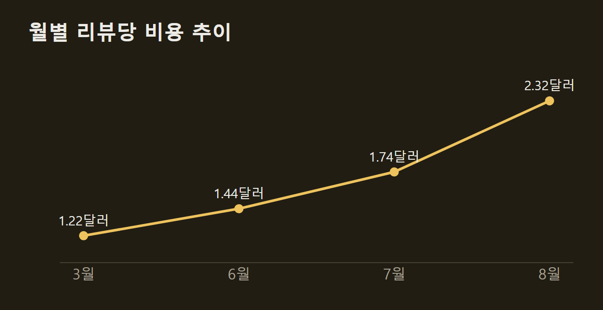
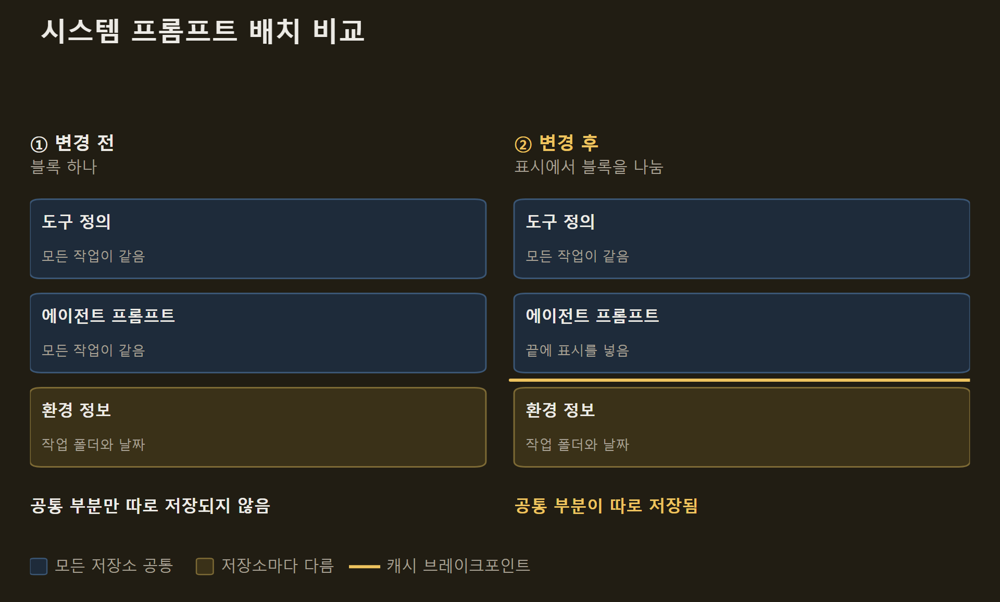
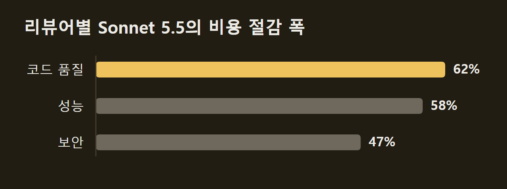

> 이 글은 아래 원문을 우리말로 간추려 정리한 글입니다. 정확한 내용은 원문을 확인하십시오.
>
> 원문: [blog.cloudflare.com/obsessive-inference-optimization](https://blog.cloudflare.com/obsessive-inference-optimization)  
> 원문을 소개한 뉴스레터: TLDR

[Cloudflare](https://blog.cloudflare.com/obsessive-inference-optimization)는 사내 머지 리퀘스트를 AI 코드 리뷰어로 검토한다. 코디네이터 에이전트가 코드 품질·보안·성능처럼 분야를 나눠 맡은 리뷰어들에게 일을 넘기고, 그 결과를 모아 리뷰 댓글로 올린다. 그런데 4월에 1.19달러였던 리뷰 한 건의 평균 비용이 8월 말에는 약 2.46달러까지 올랐다. 이에 Cloudflare는 9월 중순부터 토큰이 어디에 쓰이는지 추적해 줄였고, 그 과정과 결과를 공개했다.

```요약
요약: Cloudflare는 프롬프트 캐시 구조를 고치고 호출 수를 줄이고 모델과 노력 수준을 바꿔 리뷰 한 건의 평균 비용을 2.43달러에서 0.77달러로 68% 낮췄으며, 높은 노력 수준으로 돌린 코드 품질 리뷰는 실제 문제를 예전만큼 찾았다.
```

```용어
프롬프트 캐시: 모델이 이미 계산한 프롬프트 앞부분을 저장해 두었다가 다음 요청에서 다시 쓰는 기능이다. 캐시에 쓸 때는 일반 입력 가격의 1.25배, 읽을 때는 0.1배가 든다.
접두사(prefix): 대화 맨 앞에서부터 이어지는 부분이다. 캐시는 이 앞부분이 그대로일 때만 다시 쓸 수 있다.
캐시 브레이크포인트(cache breakpoint): 캐시에 저장할 접두사가 끝나는 지점이다. 접두사는 이 지점이 있는 곳에서만 저장된다.
노력 수준(effort): 모델이 한 작업에 얼마나 공을 들일지 정하는 설정이다. 기사에서는 중간(medium)과 높음(high)을 견줬다.
코디네이터: 리뷰 작업을 받아 전문 리뷰어들에게 나눠 주는 에이전트다.
```

## 1. 리뷰 비용이 두 배로 늘어난 원인

리뷰 구조는 바뀌지 않았는데도 비용은 계속 올랐다. 리뷰 등급 구성을 고정하고 계산한 리뷰당 비용은 3월 1.22달러에서 6월 1.44달러, 7월 1.74달러를 거쳐 8월 2.32달러가 됐다. 가장 비싼 '전체 리뷰' 등급의 비중이 3월 59%에서 8월 65%로 늘어난 것도 일부 원인이다. Cloudflare는 모델 성능이 좋아지면서 엔지니어가 더 크고 복잡한 변경을 올리기 때문이라고 본다.



다만 증가분 대부분은 모델 교체에서 나왔다. 8월 초 모든 리뷰어를 Anthropic 모델로 옮기자 작업당 비용이 1.38달러에서 2.03달러로 올랐는데, 자체 평가에서 이 작업에는 Anthropic 모델이 더 나은 성적을 냈기 때문이다. 특히 사내 표준을 검토하는 Codex 리뷰어는 Claude Opus 4.7로 옮기면서 리뷰당 약 0.25달러에서 0.88달러가 되어 코디네이터보다 비싸졌다.

캐시 적중률이 올라도 토큰이 늘면 비용은 오른다. 캐시 적중률은 4월 85.7%에서 9월 97%로 높아졌지만, 그사이 리뷰당 토큰 수는 91만 개에서 299만 개로 세 배 넘게 늘었다. 그래서 캐시 읽기 단가가 낮아도 전체 비용은 크게 올랐다.

## 2. 토큰이 쓰인 곳과 캐시가 동작하는 방식

비용 대부분은 모델이 이미 봤거나 곧 다시 볼 컨텍스트에 들었다. 최적화 직전의 지출은 출력 토큰 약 23%, 캐시 쓰기 43%, 캐시 읽기 34%였다. 예를 들어 코드 품질 리뷰어는 리뷰 한 번에 LLM(large language model)을 평균 16.6번 호출하면서 캐시에 7만 2천 토큰을 쓰고 108만 토큰을 읽었다. 호출할 때마다 대화 전체를 컨텍스트로 보내기 때문이다.

Anthropic의 프롬프트 캐시는 대화의 접두사가 바뀌지 않았을 때만 다시 쓸 수 있다. 리뷰 세션의 도구 정의, 시스템 프롬프트, 첫 메시지는 거의 바뀌지 않으므로 캐시하기에 알맞다. 반면 접두사는 캐시 브레이크포인트가 끝내는 자리에서만 저장되고, 아무도 읽지 않으면 5분 뒤 사라진다.

이 때문에 Cloudflare가 할 일은 두 가지로 좁혀졌다. 하나는 세션의 첫 요청이 캐시에 쓰는 대신 캐시를 읽게 하는 것이고, 다른 하나는 세션마다 호출 수를 줄이는 것이다.

## 3. 모든 저장소가 함께 쓰는 캐시 접두사

세션 첫 요청은 캐시를 거의 활용하지 못하고 있었다. 9월 14일부터 각 리뷰어의 첫 호출 토큰 사용량과 첫 시스템 블록의 해시를 기록해 보니, 첫 요청이 캐시된 접두사를 찾은 비율은 14~26%에 그쳤다. 모든 세션은 어느 저장소에서나 똑같은 1만 1천~2만 1천 토큰의 도구 정의와 에이전트 프롬프트로 시작하므로, 원래대로라면 거의 모두 캐시를 읽었어야 한다.

원인은 OpenCode v1이 시스템 프롬프트를 만드는 방식에 있었다. v1은 에이전트 프롬프트 뒤에 작업 폴더와 날짜가 든 환경 정보를 붙여 한 블록으로 만들고, 그 블록 끝에만 브레이크포인트를 뒀다. 그래서 공통 부분이 따로 저장되지 않았고, 한 저장소의 리뷰가 다른 저장소에서 써 둔 캐시를 다시 쓸 수 없었다.

9월 16일 Cloudflare는 에이전트 프롬프트 끝에 표시를 넣고, 플러그인 훅이 그 자리에서 블록을 둘로 나누게 했다. 이로써 모든 작업에 공통인 앞쪽 절반이 자체 브레이크포인트를 갖게 됐다. 이 상태를 지키려고 스킬 목록을 끄고 도구 설명이 작업마다 바뀌지 않게 하는 등, 저장소마다 다른 내용을 그 앞에서 모두 뺐다. 다음 그림의 왼쪽은 변경 전, 오른쪽은 변경 후의 배치다.



같은 날 Codex 리뷰어의 참조 색인도 프롬프트 안으로 옮겼다. 그전에는 세션마다 사내 표준 표, 스킬 파일, 참조 파일 목록을 도구 호출로 읽느라 처음 세 턴을 썼다. 이 변경으로 Codex 리뷰어의 실행당 비용은 1.12달러에서 0.72달러로 줄었고, 두 변경을 합쳐 리뷰당 비용은 2.47달러에서 2.02달러로 내려갔다.

## 4. 호출 수를 줄인 작은 변경들

9월 21일과 23일에 배포한 변경들은 하나하나는 작았지만, 합쳐서 리뷰마다 약 0.20달러를 줄였다. 주요 변경은 다음과 같다.

- **쓸 수 없는 도구를 목록에서 뺐다.** 하위 리뷰어는 세션의 57~76%에서 최종 댓글 도구를 불렀다가 서버 검사에 막혀 복구에 호출을 한 번 더 썼다. 이 도구를 빼자 낭비되던 호출이 없어지고 요청마다 도구 정의가 약 2,900 토큰 줄었다.
- **파일을 한꺼번에 읽게 했다.** 코드 품질 리뷰어 턴의 64%는 파일 하나를 읽는 호출 한 번이었다. 이제 리뷰어는 첫 응답에서 공통 컨텍스트와 모든 패치를 150KB까지 읽는다.
- **재검토 때 볼 것이 없으면 건너뛴다.** 작업의 약 3분의 2는 같은 머지 리퀘스트를 다시 검토하는 일이다. 전체 등급 재검토에서는 `AGENTS.md` 리뷰를 56%, 성능 리뷰를 23%, 문서 리뷰를 13% 건너뛴다.
- **리뷰를 올리면 바로 멈춘다.** 전에는 아무도 보지 않는 요약을 쓰려고 모델이 대화 전체를 한 번 더 읽었다. 이 턴을 없애 작업당 약 0.07달러를 아꼈다.
- **취소된 작업을 실제로 멈춘다.** GitLab의 Kubernetes 실행기는 취소 신호를 스크립트에 보내지 않아, 취소된 446건 중 358건이 리뷰를 끝까지 돌렸다. 이제 작업이 15초마다 자기 상태를 확인한다.

가장 손이 많이 간 변경은 세 리뷰어가 접두사 하나를 함께 쓰게 한 것이다. 코드 품질·보안·성능 리뷰어는 같은 도구, 공통 규칙 파일, 모든 패치가 든 머지 리퀘스트로 이루어진 똑같은 첫 요청을 보내고, 각자의 지시문은 그 뒤에 붙인다. 그 결과 셋 중 하나가 캐시에 쓰고 나머지 둘은 그 캐시를 읽는다.

캐시는 그것을 쓴 응답이 스트리밍을 시작한 뒤에야 읽을 수 있지만, 세 리뷰어는 동시에 출발한다. 그래서 두 번째와 세 번째 리뷰어는 첫 리뷰어의 응답이 시작될 때까지 최대 20초 기다렸다가 첫 요청을 보낸다. 그만큼 조금 느려지지만 리뷰어마다 약 9센트를 아낀다.

## 5. 모델과 노력 수준 실험

절감액의 더 큰 부분은 코드 수정이 아니라 모델과 노력 수준 변경에서 나왔다. 배포와 설정 변경 시점마다 기간을 나눠 보면 전체 절감액 1.67달러 가운데 코드 변경이 0.65달러, 모델과 노력 수준 변경이 1.06달러를 차지한다. 다만 각 단계는 변경 전후의 평일 시간대를 견준 값이어서 통계적으로 엄밀한 대조 실험은 아니다.

코디네이터는 Opus 5.5의 중간 노력 수준으로 정리됐다. 같은 모델에서 중간 노력이 전체 등급 작업을 20% 빨리 끝내자 다른 두 조합을 뺐고, 이후 무작위 분할 실험에서 Opus 5.5 중간 노력은 Opus 5와 견주어 리뷰 결과와 심각한 지적에서 측정 가능한 차이가 없었다. Opus 5.5는 Opus 5보다 토큰당 가격도 낮지만, 가격 차이로 설명되는 절감은 약 0.20달러다. 나머지는 토큰을 덜 쓴 결과로, 9월 초와 견주어 리뷰당 캐시 읽기는 82%, 출력은 67% 줄었다.

토큰당 가격이 같은 모델끼리도 비용 차이가 컸다. 10월 3일 Cloudflare는 모든 Sonnet 리뷰어를 Sonnet 5와 Sonnet 5.5에 반씩 배정했는데, 2일 반 뒤 Sonnet 5.5의 실행당 비용이 Sonnet 5보다 코드 품질에서 62% 낮았다. 전체 등급 리뷰에서 두 모델의 심각·경고 지적 수가 비슷해, 10월 5일 모두 Sonnet 5.5로 옮겼다.



비용이 줄어든 것은 호출 수가 크게 줄었기 때문이다. Sonnet 5.5 중간 노력에서 코드 품질 리뷰어의 실행당 호출은 6.2회에서 1.7회로 줄었고, 실행의 절반 넘게 다른 파일을 하나도 열지 않고 호출 한 번으로 끝났다. 리뷰가 얕아졌을 수 있다는 걱정은 6절의 품질 점검에서 다뤘다.

10월 5일부터는 코드 품질 리뷰어를 Sonnet 5.5의 중간 노력과 높은 노력에 반씩 나눠 돌렸다. 하루 뒤 높은 노력은 실행당 비용이 61% 더 들었지만 심각·경고 지적을 58% 더 올렸고, 늘어난 비용은 리뷰당 약 2센트였다. Cloudflare는 코드 품질을 높은 노력으로 옮기기로 했으며, 0.77달러라는 비용도 이를 전제로 계산한 값이다.

## 6. 속도와 리뷰 품질의 변화

호출이 줄면서 리뷰도 빨라졌다. 중간값 리뷰 시간은 4분 9초에서 1분 32초로 줄었고, 9월 14일 이전 4주 동안 37.9%였던 5분 넘는 리뷰는 0.7%가 됐다. 다만 8월의 중간값은 4월보다 14% 느렸으므로, 이 개선의 상당 부분은 예전 속도를 되찾은 것이다.

심각한 지적의 수는 눈에 띄게 줄었다. 8월 말과 견주어 Sonnet 5.5 높은 노력의 코드 품질 리뷰어는 심각·경고 지적을 40% 적게 올리고, 중간 노력에 남은 보안과 성능 리뷰어는 각각 56%, 71% 적게 올린다. Cloudflare는 이것이 실제 문제를 놓친 결과인지, 잡음이 줄어든 결과인지를 두 방향에서 확인했다.

**작성자가 지적을 반영한 비율이 올랐다.** Cloudflare는 리뷰한 커밋과 작성자의 다음 푸시를 견줘, 지적이 가리킨 줄이 바뀌었으면 반영한 것으로 셌다. 지적에서 30~40줄 떨어진 줄도 약 15% 바뀌었는데, 이는 우연히 바뀌는 비율의 기준선이다. 코드 품질 리뷰어의 심각한 지적이 반영된 비율은 34%에서 59%로 올랐고, 리뷰 1,000건당 반영된 지적은 145건에서 132건으로 오차 범위 안에 머물렀다.

**판정 모델은 부풀려진 심각도가 줄었다고 봤다.** 서로 다른 회사의 모델 두 개가 세 Sonnet 리뷰어의 지적 657건을 어느 기간 것인지 모른 채 diff와 함께 판정했고, 의견이 갈리면 세 번째 모델이 정했다. 리뷰당 중요한 지적은 0.28건에서 0.30건으로 구간이 겹쳤고, 사라진 것은 주로 사소한 지적과 중복이었다. 반면 실제보다 심각하게 매겨진 심각·경고 지적은 리뷰당 0.46건에서 0.14건으로 70% 줄었다.

결과는 리뷰어마다 달랐다. 코드 품질은 높은 노력에서 실제 문제를 예전만큼 찾았지만, 중간 노력에서는 반영된 지적이 높은 노력의 약 4분의 1이었다. 성능 리뷰어는 중요한 지적이 약 64% 줄어 전체 등급 리뷰 24건마다 중요한 지적을 하나 덜 냈고, 보안은 약 4분의 1 줄었지만 통계적으로 유의하지 않았다.

두 확인 방법에는 한계가 있다. 판정 모델도 결국 모델이고 그룹마다 지적이 35~66건뿐이며, '현재' 기간은 하루다. 그래도 두 방법의 결과는 서로 맞았고, 판정 없이 끝난 리뷰는 0.79%에서 0.27%로 줄었다.

정리하면 리뷰 한 건의 평균 비용은 2.43달러에서 0.77달러로, 중간값 시간은 4분 9초에서 1분 32초로 줄었다. 가장 큰 단일 절감은 세션 첫 요청에 실제로 무엇이 전달되는지 확인하고, 커밋·머지 리퀘스트·저장소가 달라도 메시지 순서가 최대한 같도록 맞춘 데서 나왔다. 나머지 절감은 모델과 노력 수준 조합을 거듭 실험해 얻었고, Cloudflare는 다음 단계로 성능과 보안 리뷰어를 높은 노력 수준에서 시험한다.

## 출처와 작성 방식

- 원문: [blog.cloudflare.com/obsessive-inference-optimization](https://blog.cloudflare.com/obsessive-inference-optimization)
- 원문을 소개한 뉴스레터: TLDR
- 그래프: 원문에 적힌 값으로 직접 그린 그림입니다.
- 작성 방식: 직접 만든 뉴스 정리 파이프라인(VISER)으로 생성하고 검수한 글입니다. 본문의 수치와 주장은 원문에서 가져온 것입니다.
- 정리 주차: 2026-W43
