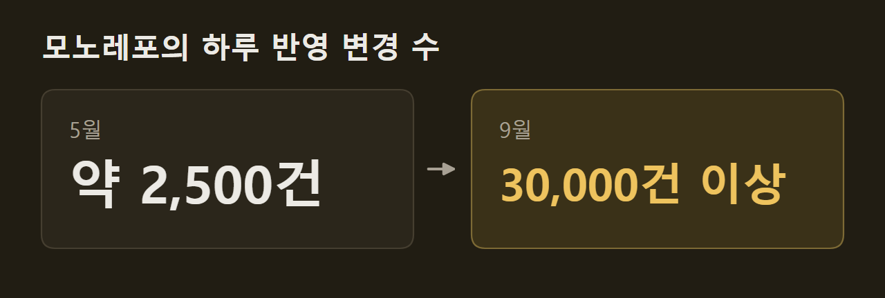
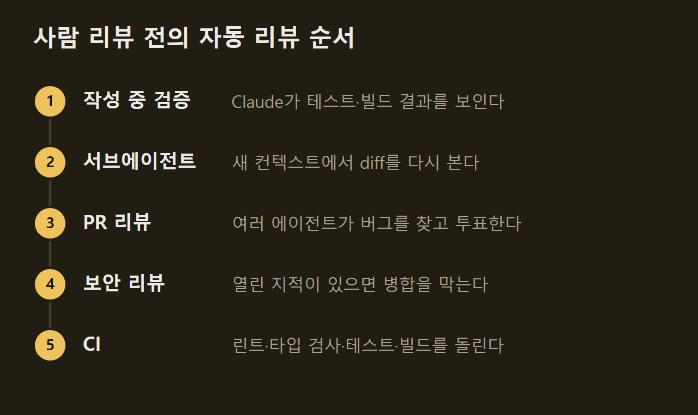
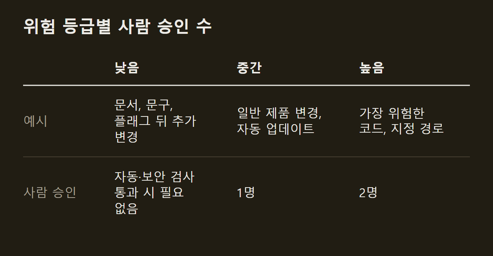

> 이 글은 아래 원문을 우리말로 간추려 정리한 글입니다. 정확한 내용은 원문을 확인하십시오.
>
> 원문: [claude.dev/blog/solving-code-review-at-anthropic](https://claude.dev/blog/solving-code-review-at-anthropic/)  
> 원문을 소개한 뉴스레터: TLDR AI

에이전트가 코드를 쓰기 시작하면 변경 건수가 늘어나고, 사람이 한 줄씩 읽어서는 그 양을 따라갈 수 없다. Anthropic의 [Claude Code 팀](https://claude.dev/blog/solving-code-review-at-anthropic/)은 Claude가 Claude Code 코드의 약 90%를 쓰는 상황에 맞춰 리뷰 절차를 새로 짰다. 이 절차에서는 코드를 읽는 일 대부분을 자동 리뷰가 맡고, 사람의 승인은 변경의 위험도에 따라 필요 없음, 한 명, 두 명 가운데 하나로 정한다. 자동 리뷰를 거치면 사람이 보기 전에 Claude가 테스트를 돌려 결과를 보이고 여러 에이전트가 버그와 보안 문제를 찾아 고쳐 두며, 그래도 잘못 들어간 변경은 빨리 되돌린다.

```요약
요약: Claude Code 팀은 코드를 읽는 일 대부분을 자동 리뷰에 맡기고 위험도에 따라 사람 승인 수를 달리했으며, 6월부터 9월까지 병합된 PR이 2배 이상 늘어나는 동안 되돌린 PR의 비율은 40% 이상 줄었다.
```

```용어
PR: 풀 리퀘스트(pull request)를 줄인 말이다. 코드 변경을 본 저장소에 합쳐 달라고 올리는 요청이다.
되돌리기(revert): 이미 병합한 변경을 취소해 이전 상태로 돌리는 일이다.
diff: 변경 전후 코드의 차이를 줄 단위로 보인 것이다.
서브에이전트(subagent): 주 에이전트가 맡긴 일을 별도 컨텍스트에서 처리하는 보조 에이전트다.
플래그(feature flag): 배포하지 않고도 기능을 켜고 끌 수 있게 하는 설정이다.
```

## 1. 늘어난 변경량과 리뷰의 목표

에이전트가 코드를 쓰면서 변경량이 크게 늘었다. 여러 프로젝트를 한 저장소에 모아 둔 Anthropic의 모노레포(monorepo)에서는 하루에 반영되는 변경이 올해 5월 약 2,500건에서 9월 30,000건 이상으로 늘었다. Claude Code는 모노레포와 떨어진 별도 저장소에서 개발하지만 같은 부담을 받고 있으며, 이 속도에서는 사람이 한 줄씩 읽는 리뷰가 거의 불가능하다.



팀은 코드 리뷰가 두 가지 일을 한다고 정리한다. 하나는 배포 전에 문제를 찾아 고치는 일이고, 다른 하나는 팀 전체가 코드베이스를 이해하는 일이다. 다만 팀은 "사람이 코드를 읽었는가"라는 물음이 정확한 기준이 아니라고 본다. 따져야 할 것은 이 변경에서 무엇이 잘못될 수 있고, 자동 검사와 사람 가운데 누가 그것을 잡아야 하는지다.

이 관점에 따라 리뷰 시점도 바뀌었다. 예전의 리뷰는 코드를 쓰고 PR을 연 뒤 동료를 기다리는 마지막 관문이었다. 지금은 코드를 쓰는 동안 리뷰가 계속 돌아가므로, 대부분의 변경은 사람에게 가기 전에 Claude가 적어도 한 번 리뷰하고 고친 상태다.

**목표는 변경당 사람의 시간을 줄이는 것이다.** 팀은 CLI, 데스크톱·웹 앱, 모바일 앱 저장소의 PR 대부분이 사람 한 명 이하의 개입으로 병합되기를 목표로 삼았고, 그 한 명은 작성자 자신이어도 된다. 사람의 시간은 PR당 사람 승인 수(중앙값과 95번째 백분위수), 사람이 단 댓글 수, PR이 사람을 기다린 시간으로 잰다.

**되돌리기와 장애 비율은 올라가면 안 되는 보호 지표(guardrail)다.** 리뷰에 쓰는 시간을 줄여도 잘못된 코드를 고치는 데 시간이 더 들면 아낀 것이 없다. 이 때문에 두 비율이 오르면 팀은 사람의 시간이 줄어든 것이 아니라 다른 곳으로 옮겨 갔을 뿐이라고 판단한다.

## 2. 사람이 보기 전에 거치는 자동 리뷰

리뷰의 상당 부분은 PR이 만들어지기 전에 끝난다. 팀은 Claude에게 테스트, 빌드, 디자인과 견줄 스크린샷처럼 직접 실행할 수 있는 검증 수단을 주고, 다 됐다고 말하는 대신 실행 결과를 보이게 한다. 그다음 새 컨텍스트에서 시작한 서브에이전트가 diff를 다시 리뷰한다. 많은 팀원은 PR을 열기 전에 버그를 찾는 스킬, diff를 단순하게 다듬는 스킬, 동작을 처음부터 끝까지 확인하는 스킬도 돌린다.

Claude Code를 만든 Boris Cherny는 좋은 결과를 얻으려면 Claude에게 작업을 검증할 수단을 주는 것이 아마 가장 중요하다고 말했다. 그는 검증 수단이 있으면 최종 결과가 2~3배 나아진다고 추정했다.

자동 리뷰가 같은 지적을 되풀이하면 팀은 그 원인을 고친다. 해당 스킬을 손보거나, 린트 규칙을 더하거나, 지시 파일을 고치는 식이다. 지시 파일 가운데 `CLAUDE.md`는 프로젝트의 기술 스택, 규칙, 목표, 목표가 아닌 것을 Claude에게 알린다. 리뷰할 때마다 이 파일을 읽으므로 팀은 이를 짧게 두고 자세한 내용은 다른 문서에 맡긴다.

`REVIEW.md`는 코드 담당자가 자기 영역에서 무엇이 중요한지 리뷰어에게 알리려고 쓰는 파일이다. 잘 쓴 파일은 짧고, 그 저장소에서 무엇을 실패로 보는지 적는다. 예를 들어 문서는 내용이 사실과 다르면 실패이고, 설정은 요청을 엉뚱한 곳으로 보내면 실패다. 이런 파일은 사소한 지적의 개수에 상한을 두며, 이름만 보고 추측하지 말고 파일과 줄 번호를 근거로 들라고 요구한다.

모든 PR은 사람이 보기 전에 Claude의 리뷰를 받는다. Claude는 diff를 저장소 전체와 PR에 적힌 의도에 비춰 읽고, 변경이 문제를 풀었는지, 시스템에 맞는지, 다른 곳을 망가뜨리지 않는지 따진다. 이 리뷰의 공개 버전인 Code Review for Claude Code는 Team과 Enterprise 요금제에서 정식으로 제공되고, `/code-review` 명령은 더 가벼운 버전을 로컬에서 돌린다.

자동 리뷰를 들이자 실질적인 지적을 받는 PR이 크게 늘었다. 연구 미리보기(research preview)를 시작한 뒤 내부 PR 가운데 실질적인 리뷰 댓글을 받은 비율이 16%에서 54%로 올랐다. 1,000줄이 넘는 PR은 대부분 지적을 받지만 작은 PR은 대부분 지적 없이 통과한다. 관리자는 저장소마다 Quick, Standard, Deep 가운데 하나를 고르며, Deep은 버그 하나를 놓쳤을 때의 비용이 늘어나는 리뷰 시간보다 큰 곳에 쓴다.

지적은 사람에게 가기 전에 다른 에이전트의 확인을 거친다. 여러 에이전트가 동시에 버그를 찾고 나면 별도의 에이전트들이 지적마다 투표하며, 실제 문제라고 동의한 수가 충분한 지적만 게시된다. 스타일, 진단, 정리에 관한 지적은 버리는데, 팀은 이 거름 규칙을 자기 PR로 A/B 테스트한 뒤에 남겼다. 남은 지적은 심각도 순으로 해당 줄에 댓글로 달리고 Important, Nit, Pre-existing 가운데 하나가 붙으므로, PR이 만들지 않은 기존 버그가 작성자의 잘못으로 보이지 않는다.

모든 지적에는 답해야 한다. 작성자는 지적을 고치거나 이유를 적고 스레드를 닫는다. 밤사이 에이전트가 수정을 맡는 경우가 많아서, 작성자가 돌아오면 한 차례 더 리뷰를 거친 PR이 기다리고 있다.

보안도 따로 자동 리뷰를 받는다. 버그 리뷰나 보안 리뷰의 지적이 하나라도 열려 있으면 PR을 병합할 수 없다. 오탐이면 짧은 이유를 적고 스레드를 닫으면 되고, 이후 커밋이 문제를 고치면 지적은 저절로 닫힌다.

마지막으로 린트, 타입 검사, 모든 플랫폼의 테스트, 빌드가 돈다. 일반적인 CLI PR은 사람이 보기 전에 수십 개의 검사를 거친다. PR 템플릿은 변경을 어떻게 테스트했고 어떻게 되돌릴지 묻는데, 이 칸은 Claude가 채울 수 있지만 내용을 확인하고 승인하는 사람은 변경을 요청한 사람이다.



## 3. 위험 등급에 따른 사람 승인

변경마다 위험이 다르므로 리뷰도 달리한다. 문서 수정과 자동 업데이트 기능 변경을 같은 무게로 보지 않는다는 뜻이다. 문서, 문구, 내부 전용 기능, 플래그 뒤에 둔 추가 변경은 낮은 등급이며, 자동 리뷰와 보안 검사를 통과하면 사람 승인이 필요 없다. 일반 제품 변경과 캐시, 자동 업데이트, 시스템 프롬프트처럼 민감한 영역의 변경은 중간 등급으로 한 명의 승인을 받고, 가장 위험한 코드와 언제나 두 사람이 봐야 하는 일부 경로는 높은 등급으로 두 명의 승인을 받는다.



**등급은 작성자가 아니라 변경이 정한다.** 분류기가 변경을 읽고 등급을 고르면, 두 번째 분류기는 등급상 필요하지 않더라도 이 변경에 사람이 더 필요한지 따진다. 담당자가 민감하다고 지정한 경로와 CI 워크플로 파일은 언제나 사람이 봐야 한다.

**가벼운 승인 경로는 신뢰 목록의 작성자만 쓴다.** 저장소의 신뢰 목록에 든 작성자는 대개 그 저장소를 맡은 팀이고, 그 밖의 작성자는 두 번째 사람의 승인을 받아야 한다. 에이전트의 승인은 사람의 승인으로 치지 않는다. 그래서 자동 리뷰는 위험이 낮은 변경을 통과시킬 수는 있어도 사람이 맡아야 할 승인을 대신하지 못한다.

**변경을 지시한 사람이 그 변경을 책임진다.** 에이전트가 쓴 PR에서는 에이전트를 지시한 사람이 필수 리뷰어 한 명으로 계산되며, 직접 코드를 쓴 경우와 같다. 승인은 특정 커밋 하나에만 유효하다. 따라서 에이전트의 푸시나 손으로 충돌을 해결한 병합처럼 시스템이 보증할 수 없는 커밋이 더해지면 다시 승인을 받아야 한다.

병합 단계와 배포 단계에도 확인 절차가 있다. 머지 큐(merge queue)는 변경을 main에 적용한 상태로 모든 검사를 다시 돌리므로, 따로는 통과한 두 PR이 합쳐져 main을 깨뜨리는 일이 없다. 새 동작은 보통 플래그 뒤에 두어 Anthropic 직원에게 먼저 내놓고, 공개 릴리스는 latest 채널에 먼저 나간 뒤 stable 채널이 뒤따른다.

그래도 빠져나가는 실수에 대비해 팀은 빨리 알아채는 쪽에 무게를 둔다. 플래그는 배포 없이 끌 수 있고, Claude Code 팀은 주 단위로 당번(on-call)을 돌리며, 장애 리뷰에서는 어느 층이 문제를 잡았어야 했는지 묻는다. 다만 잘못된 병합을 알아채는 일은 아직 작성자와 당번, 되돌리기·장애 대시보드에 달려 있다. 이 수치가 움직일 때 승인 기준을 자동으로 높이는 장치인 '서킷 브레이커(circuit breaker)'는 아직 없고, 엔지니어들은 사람 없이 병합되는 코드를 늘리기 전에 이 장치부터 갖추기를 원한다.

## 4. 리뷰 회차 제한과 잡음 측정

리뷰어도 매일 평가를 받는다. 팀은 장애를 일으킨 과거 PR을 그 뒤에 이어진 수정과 되돌리기까지 함께 모았고, 해당 코드를 아는 엔지니어가 버그와 그 위치를 하나씩 확인했다. 리뷰어는 이 평가 세트로 매일 채점받는다.

잡음은 사람들이 댓글에 어떻게 반응했는지로 잰다. 버그가 아닌 것까지 많이 지적하면 버그를 더 잡기 쉬워지므로, 이를 견제할 지표가 필요하다. 팀은 리뷰어의 댓글을 받은 사람의 반응에 따라 고쳤음, 틀렸다고 함, 의도한 동작이라고 함, 중요하지 않다고 판단함으로 나누어 센다. 문제가 없다고 알려진 PR에도 리뷰어를 돌려, 누군가 해로운 변경을 하게 만들 지적이 얼마나 자주 나오는지 센다.

작성자가 에이전트이면 잡음의 비용이 커진다. 사람은 사소한 지적을 몇 초 만에 넘기지만, 에이전트는 그것을 고치므로 커밋이 하나 늘고 리뷰도 한 번 더 돈다. 팀이 문서로 정한 우선순위는 실제 버그를 잡는 것이 먼저이고, 리뷰 회차를 줄이는 것이 그다음이다.

**리뷰는 정해진 횟수 안에 끝나야 한다.** 에이전트 작성자와 에이전트 리뷰어는 서로에게 끝없이 일을 줄 수 있다. 실제로 한 CLI PR은 밤사이 50번이 넘는 리뷰와 수정을 거친 뒤에야 작성자가 이를 멈췄다. 리뷰어가 계속 지적한 내용에 `git blame`을 돌려 보니 약 59%는 리뷰어가 처음 봤을 때부터 있던 코드였으므로, 리뷰어는 새 버그를 찾은 것이 아니라 회차마다 오래된 버그를 몇 개씩 더 찾고 있었다.

여러 회차를 기본으로 돌리던 팀의 습관도 문제를 키웠다. 위험한 변경이라면 회차를 늘릴 가치가 있지만 모든 PR에 그럴 필요는 없다. 이제 팀은 재현율과 함께 통과까지 걸린 회차를 추적하며, 재리뷰 규칙을 다음처럼 바꿨다.

- 세 회차가 지나면 리뷰어는 작성자에게 접근 방식을 다시 생각해 보라고 요청한다.
- 처음 몇 회차가 지나면 새로 바뀐 diff만 다시 리뷰한다.
- 버그가 있는 한 줄이 아니라 버그의 유형을 지적해, 작성자가 같은 유형을 모두 고치게 한다.
- 이미 게시한 지적은 다시 올리지 않는다.

리뷰 에이전트는 매일 밤 기존 코드도 훑는다. 오래된 버그가 다른 곳에서 문제를 일으키기 전에 찾기 위해서다.

## 5. 사람이 맡는 일과 코드 이해의 공유

사람은 자동 리뷰가 대신할 수 없는 판단을 맡는다. 일상적인 실수 하나를 잡으려고 시니어 엔지니어를 집중 작업에서 빼내면 자동 리뷰보다 훨씬 큰 비용이 든다. 팀원들이 계속 책임지는 일은 다음과 같다.

- 방향, 취향, 범위를 보고 무엇을 만들지 정한다.
- 결제, 자동 업데이트, CI 워크플로처럼 위험한 코드를 리뷰한다.
- 다른 사람이 따라 할 패턴을 정하는 아키텍처를 리뷰한다.
- 테스트 출력, 실행한 명령과 결과, 스크린샷, 리뷰어의 지적 같은 증거를 읽는다.
- 누가 코드를 쳤든 배포된 모든 변경의 결과를 책임진다.

코드 이해를 나누는 일, 곧 리뷰의 두 번째 역할에는 정해진 절차가 없다. 팀원 누구도 Claude Code 전체 구조를 머릿속에 담고 있지 않고, 팀은 그럴 필요도 없다고 본다. 코드의 한 부분을 알고 싶은 사람은 Claude에게 바로 그 부분의 설명 문서를 써 달라고 한다. 설명 문서는 몇 분이면 나오고, 지금 있는 코드를 그대로 반영한다. 일부 팀원은 Claude에게 그 부분을 시각화하고 자기가 배우기 편한 방식으로 설명하는 작은 아티팩트를 만들게 한다.

다음 그림의 왼쪽은 코드베이스 가운데 알고 싶은 부분인 managed settings를 고르는 장면이다. 오른쪽 위는 Claude가 쓰는 설명 문서이고, 점선으로 그린 오른쪽 아래는 일부 팀원이 만드는 작은 아티팩트다.

")

팀은 사람의 주의를 잘 쓰려면 사소한 diff를 한 줄씩 읽는 것보다 이 방식이 낫다고 본다. 한 줄짜리 문구 수정에서는 배울 것이 거의 없지만, 곧 고칠 모듈의 설명 문서에서는 배울 것이 많다. 공개 Slack 채널에서 일하는 문화도 이해를 넓히는 데 쓰이며, 팀원들은 다른 사람이 무엇을 만드는지 작업이 진행되는 동안 볼 수 있다.

작거나 중간 규모의 변경을 병합한 뒤 문제가 생기면 대개 작성자가 직접 고치는 것이 팀의 규범이다. 이 규범이 무리 없이 돌아가는 것은 변경이 작아서 리뷰, 디버깅, 되돌리기가 쉽고 플래그, 되돌리기, 단계적 릴리스로 대부분의 실수를 몇 분 안에 무를 수 있기 때문이다. 잘못됐을 때 영향이 큰 코드일수록 더 많은 사람과 검사를 거치며, 회귀는 텔레메트리와 내부 사용에서 빨리 드러난다.

작성자가 고치는 것은 책임을 묻는 일이 아니다. 작성자가 고치는 것은 맥락을 가장 많이 알기 때문이고, 장애 리뷰는 사람이 아니라 시스템을 들여다본다. 반면 에이전트 덕분에 일을 시작하는 비용이 낮아지면서 병합하지 말아야 할 작업도 생긴다. 보통은 채널의 누군가가 이유를 묻거나 이전 결정을 짚거나 더 단순한 방법을 제안하고, 작성자는 PR을 닫거나 고친다. 코드를 빨리 쓴 만큼 PR을 닫아도 손해로 느끼지 않는다.

팀은 같은 방식을 도입하려는 팀을 위한 점검 항목도 정리해 두었고, 그 대부분을 지금 있는 도구로 갖출 수 있다고 밝혔다. Code Review 제품은 승인 없이 지적만 게시하므로 PR 승인은 여전히 사람이 한다. 다만 팀의 저장소에서는 어떤 저위험 변경을 자동 검사만으로 병합할지 담당자가 정하며, 그 기준은 계속 바뀌고 있다. 리뷰가 무언가를 놓치면 팀은 모델이 무엇을 보지 못했는지 묻고 그 답을 `CLAUDE.md`, 스킬, 새 검사에 반영하며, 목표는 변경당 사람의 시간을 줄이면서 되돌리기를 예전보다 늘리지 않는 것이다.

## 출처와 작성 방식

- 원문: [claude.dev/blog/solving-code-review-at-anthropic](https://claude.dev/blog/solving-code-review-at-anthropic/)
- 원문을 소개한 뉴스레터: TLDR AI
- 그림: 아래에 출처가 적힌 그림은 원문에 실린 그림을 인용한 것이며 저작권은 원저작자에게 있습니다. 출처가 없는 그래프는 원문에 적힌 값으로 직접 그린 것입니다.
- 작성 방식: 직접 만든 뉴스 정리 파이프라인(VISER)으로 생성하고 검수한 글입니다. 본문의 수치와 주장은 원문에서 가져온 것입니다.
- 정리 주차: 2026-W43
