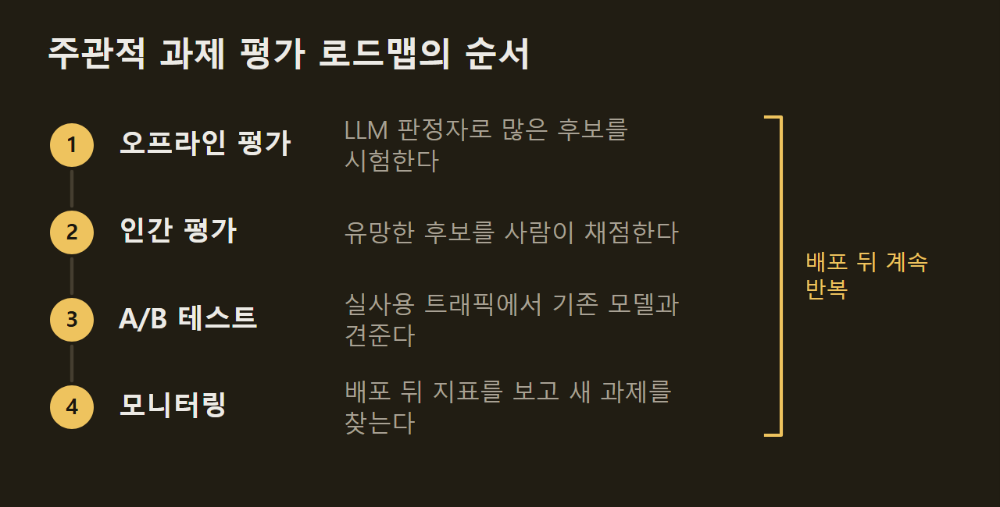

> 이 글은 아래 원문을 우리말로 간추려 정리한 글입니다. 정확한 내용은 원문을 확인하십시오.
>
> 원문: [cameronrwolfe.substack.com/p/subjective-evals](https://cameronrwolfe.substack.com/p/subjective-evals)  
> 원문을 소개한 뉴스레터: Deep (Learning) Focus

LLM 에이전트가 푸는 과제의 범위는 넓다. 수학 문제처럼 정답이 하나로 정해진 과제가 있고, 창작 글처럼 사람마다 좋고 나쁨을 다르게 보는 과제도 있다. Netflix의 연구 과학자 Cameron R. Wolfe는 AI Engineer 콘퍼런스 발표의 참고 자료로 [Deep (Learning) Focus](https://cameronrwolfe.substack.com/p/subjective-evals) 뉴스레터에 평가 절차를 정리했다. 이 절차는 정답을 기계로 확인할 수 없는 과제를 대상으로 하고, 사람이 정한 품질 기준에서 출발해 LLM 판정자로 후보를 거른 뒤 실제 서비스의 A/B 테스트로 확인하는 세 단계 로드맵이다.

```요약
요약: 주관적 과제에서 에이전트를 평가하는 세 단계 로드맵으로, 사람이 합의한 품질 기준을 LLM 판정자와 실서비스 A/B 테스트로 넓히고, 모든 평가 결과에 신뢰구간 같은 불확실성 지표를 붙이는 것을 전제로 한다.
```

```용어
롤아웃(rollout): 에이전트가 과제 하나를 한 번 실행한 기록이다. 메시지, 행동, 도구 호출로 된 궤적과 최종 결과를 담는다.
LLM 판정자(LLM judge): 정해진 품질 기준에 따라 다른 모델의 출력을 채점하는 LLM이다.
루브릭(rubric): 풀이의 품질을 과제별 확인 항목 목록으로 나눈 채점표다. 항목마다 LLM 판정자가 따로 판정한다.
메타평가(meta-evaluation): LLM 판정자나 루브릭의 판정이 실제 품질을 얼마나 잘 반영하는지 사람의 판단과 견주어 재는 일이다.
검정력 분석(power analysis): 원하는 크기의 개선을 잡아내는 데 필요한 평가 표본 수를 미리 계산하는 통계 기법이다.
```

## 1. 에이전트 평가가 어려운 세 가지 이유

평가는 지금의 AI 연구에서 가장 어려운 문제 가운데 하나다. 벤치마크 점수만 겨냥해 모델을 맞추는 현상(benchmaxxing)이 자주 보고되고, 대부분의 모델이 만점에 가까워져 벤치마크가 모델 사이의 차이를 보여 주지 못하는 포화(saturation)도 흔하다. 새 벤치마크가 계속 나오는 반면 이미 자리 잡은 벤치마크가 비판을 받거나 운영이 중단되기도 한다. 다음 그림은 웹 탐색, 컴퓨터 사용, 코딩, 수학 같은 분야별로 2023년부터 2026년까지 나온 벤치마크를 연도순으로 늘어놓은 것이다.

")

벤치마크가 이렇게 늘었는데도 에이전트의 능력을 재기 어려운 데에는 세 가지 이유가 있다. 첫째로 에이전트가 다루는 과제와 분야가 넓어서 과제 수가 정해진 평가 세트에 다 담기 어렵다. 둘째로 에이전트는 같은 과제를 다시 실행해도 다른 출력을 내므로 점수가 시행마다 흔들린다. 셋째로 현실적인 과제는 오래 걸리고 복잡한 경우가 많아 평가 비용이 크다.

이 때문에 벤치마크 점수가 올랐다고 해서 에이전트가 나아졌다고 단정할 수 없다. 벤치마크가 에이전트의 실제 쓰임을 반영하지 못할 수 있고, 오른 점수가 실행마다 출력이 달라지는 성질에서 생긴 우연일 수도 있다. 다음 그림은 세 문제에 각각의 대응을 짝지었다. 범위 문제에는 반복 가능한 로드맵으로 분야별 평가를 만들고, 잡음 문제에는 원인을 찾아 줄이며, 비용 문제에는 정해진 평가 세트에서 정보를 최대한 얻도록 과제를 골라 대응한다.

")

## 2. 평가의 구조와 검증 가능성의 스펙트럼

에이전트 평가는 정해진 과제 모음에서 에이전트가 성공한 과제의 비율을 재는 일이다. 과제 하나는 프롬프트, 지시문, 실행 환경, 도구, 성공 기준으로 이루어지고, 모델과 이를 감싸 실행하는 하네스(harness)가 과제를 수행해 롤아웃을 만든다. 롤아웃은 메시지·행동·도구 호출·추론으로 된 궤적과, 최종 답이나 최종 환경 상태로 된 결과를 남긴다. 채점기(grader)는 이 결과를 받아 통과 또는 실패를 판정한다.

")

비용을 줄이려고 과제 수를 적게 두는 경우가 많고, 여기에 실행마다 출력이 달라지는 성질이 겹치면 평가 결과가 크게 흔들린다. 따라서 평가에서 쓸모 있는 정보를 얻으려면 두 조건이 필요하다. 하나는 과제가 에이전트가 실제로 마주칠 다양한 과제를 대표하는 것이고, 다른 하나는 관찰된 개선이 통계적으로 의미가 있는지 판단할 만큼 잡음과 불확실성을 따지는 것이다.

과제는 정답을 기계로 확인할 수 있는 정도에 따라 한 줄로 늘어선다. 수학은 문자열 비교나 기호 검증으로 답을 확인할 수 있고, 결정론적 검증이 사소한 표기 차이에도 틀리게 판정할 만큼 엄격하면 목적에 맞춘 LLM 검증기를 쓰기도 한다. 반면 반대쪽 끝의 창작 글쓰기는 통과·실패 기준만으로 품질을 다 판단할 수 없어서 전문가나 LLM 판정자에게 판단을 맡겨야 한다.

다음 그림의 가운데 띠가 이 스펙트럼이다. 왼쪽의 창작 글쓰기와 채팅에서 시작해 딥 리서치, 업무 과제, 소프트웨어 엔지니어링을 지나 오른쪽의 경시 프로그래밍과 수학으로 갈수록 검증이 쉬워진다. 아래 오른쪽은 수학 문제의 최종 답 72를 정답과 문자열로 맞춰 보는 예이고, 아래 왼쪽은 LLM 판정자가 짧은 창작 문단에 5점 만점에 4점을 주는 예다. 위 오른쪽의 세 상자는 6절에서 다룰 로드맵이다.

")

주관적 과제에서는 사람이든 LLM이든 믿을 만한 판정을 얻는 것부터 어렵다. 기준이 주관적이면 평가자끼리 의견이 자주 갈리고, 이 불일치가 원래 있던 잡음에 더해진다. 다만 결정론적 검증기도 늘 정확하지는 않다. 예를 들어 코딩 과제의 테스트 모음이 틀린 풀이를 통과시키거나, 올바른 동작을 확인하기에 테스트가 모자랄 수 있다.

## 3. LLM 판정자와 루브릭, 그리고 메타평가

LLM 판정자는 사람이 채점하듯 정해진 품질 기준을 여러 과제에 똑같이 적용한다. 다음 그림은 G-Eval이 채점하는 순서다. 과제 소개와 평가 기준(여기서는 1~5점 척도의 일관성)을 넣으면 LLM이 평가 단계를 스스로 적고, 그 단계에 따라 뉴스 요약문을 채점한다. 오른쪽 아래 막대는 점수별 확률이며, G-Eval은 점수를 이 확률로 가중해 더한 2.59점을 최종 점수로 쓴다.

")

루브릭은 품질을 구체적인 확인 항목의 목록으로 나눈다. 항목은 보통 과제마다 따로 만들고 LLM 판정자가 항목을 하나씩 판정하므로, 전체 인상 하나에 기대지 않고 품질의 구체적인 면을 확인할 수 있다. 예를 들어 딥 리서치 에이전트 DR Tulu의 학습에서는 'Netflix가 『백 년의 고독』을 어떻게 드라마로 옮겼는가'라는 질문에 'Netflix의 각색이 마콘도를 그대로 재현하지 않았다는 점을 언급한다' 같은 항목이 붙는다.

다음 그림의 오른쪽 위 식처럼 DR Tulu는 항목별 판정에 가중치를 곱해 더한 값을 보상으로 쓴다. 학습이 진행되면 정책 모델이 검색으로 찾아낸 내용을 바탕으로 루브릭 항목도 새로 만든다. 그림 아래쪽의 ①~④가 학습 단계마다 새로 생긴 항목이다.

")

LLM 판정자와 루브릭은 사람의 평가를 자동으로 대신하는 수단이지만, 판정이 한쪽으로 치우치는 체계적 편향을 보일 수 있다. 그래서 점수를 믿기 전에 메타평가로 판정의 정확도를 재야 한다. 사람이 만든 골드 데이터셋과 판정자의 예측이 얼마나 맞는지 상관계수, 분류 정확도, 평가자 간 신뢰도 지표로 잰다. 판정 점수가 이탈률 같은 서비스 지표를 예측하는지 확인하는 방법도 있다.

## 4. 잡음을 다루는 세 가지 통계 기법

Wolfe는 평가 결과에 늘 불확실성 지표를 붙여야 한다고 강조하고, 이를 위해 검정력 분석, 신뢰구간, 재샘플링을 쓴다. 이 지표가 없으면 잡음을 실제 능력 향상으로 잘못 읽을 수 있다. 세 기법은 점수 하나에 신뢰도를 덧붙이는 동시에, 평가의 분산을 줄여 통계적으로 유의한 결론에 이를 가능성을 높인다.

**검정력 분석은 필요한 과제 수를 미리 정한다.** 계산에는 잡아내려는 최소 개선 폭(효과 크기), 점수의 예상 변동, 원하는 유의수준과 검정력이 들어간다. 점수의 변동은 표본 평가 데이터로 추정하지만, 최소 개선 폭과 유의수준은 평가 목적에 맞춰 직접 정한다. 효과 크기가 크고 분산이 작을수록 필요한 표본 수가 줄고, 반대면 늘어난다.

다음 그림은 두 모델 A와 B를 견줄 때 쓰는 표본 수 공식이다. 괄호 안에는 과제마다 두 모델 점수가 얼마나 다른지에서 오는 분산 ω²와, 과제 안의 분산 σ²를 재샘플링 횟수 K로 나눈 두 항이 들어 있다. 분모의 δ는 잡아내려는 최소 개선 폭이다.

")

**신뢰구간은 점수가 흔들릴 수 있는 폭을 보인다.** 평가 점수는 정해진 수의 과제로 잰 추정값이어서 다른 과제 세트로 재면 달라진다. 중심극한정리에 따르면 서로 독립인 표본이 충분할 때 평균의 분포는 정규분포에 가까워진다. 따라서 점수의 표준편차를 표본 수의 제곱근으로 나눠 표준오차(SE)를 구하고, 95% 신뢰구간을 평균 ± 1.96 × SE로 잡는다.

")

과제가 서로 독립이 아니면 이 계산은 불확실성을 실제보다 작게 잡는다. 같은 코드베이스나 같은 문서에서 나온 과제 여럿이 그런 경우이고, 이때는 과제 사이의 상관을 반영하는 군집 표준오차(clustered standard errors)를 쓴다. 두 에이전트를 견줄 때는 같은 과제에서 두 점수의 차이를 짝지어 신뢰구간을 구하면 구간이 더 좁아질 수 있다.

**재샘플링은 과제 안의 잡음만 줄인다.** 과제마다 에이전트를 여러 번 실행하고 판정도 여러 번 받아 평균을 내면 과제별 기대 성능을 더 안정적으로 추정할 수 있다. 하지만 과제 사이의 변동은 그대로이므로 신뢰구간이 반드시 좁아지지는 않는다. 앞의 공식에서 K가 σ² 항만 나누고 ω²에는 영향을 주지 않는 것도 이 때문이다.

## 5. 평가 과제를 고르는 다섯 가지 기준

평가에서 믿을 만한 결론을 얻으려면 과제의 양만큼 질도 중요하다. 필요한 과제 수는 검정력 분석으로 정하지만, 어떤 과제를 넣을지는 다양성, 현실성, 난이도, 변별력, 정확성 다섯 기준으로 따진다.

첫째는 다양성이다. 평가 세트가 에이전트가 실제로 풀 과제 전반을 담지 못하고 잘하는 과제 위주로 짜이면 점수가 부풀려진다. 예를 들어 GDPval은 과제를 경제 부문, 직업, 구체적인 업무 활동 순으로 나뉘는 위계형 분류체계로 정리했다. 분류체계를 두면 범위를 확인하기 쉽고, 영역별로 성능을 따로 분석할 수 있으며, 다른 영역을 건드리지 않고 한 영역만 고치거나 새 분야로 넓힐 수 있다.

둘째는 현실성으로, 과제가 에이전트의 실제 쓰임을 반영해야 한다는 조건이다. CursorBench는 실제 Cursor 세션에서 과제를 가져오고, SWE-Lancer는 Upwork에 올라온 유료 프리랜서 소프트웨어 과제로 평가 예제를 만든다. 실사용에서 가져온 과제일수록 벤치마크 점수가 실제 능력에 가까워진다.

셋째는 난이도다. 거의 모든 에이전트가 거의 모든 과제를 풀면 벤치마크로 능력을 견줄 수 없으므로, 과제의 출처로 난이도를 추정하거나(MMLU), 전문가가 어려운 문제를 쓰고 다른 전문가가 확인하거나(GPQA), 모델의 성공률이 낮은 과제를 골라낸다. Terminal-Bench는 모델 기반 선별과 사람의 검토를 함께 쓴다. 이와 함께 강한 에이전트가 계속 실패하는 과제는 LLM 감사자에게 넘겨, 그 실패가 에이전트의 실패인지 과제나 채점기의 문제인지 가린다.

넷째는 변별력이다. 어려운 과제가 늘 변별력이 있지는 않아서, 모든 에이전트가 실패하는 과제로는 어느 에이전트가 나은지 알 수 없다. 심리측정학에서 나온 문항반응이론(IRT, Item Response Theory)은 응시자의 능력과 문항의 난이도·변별력으로 정답을 맞힐 확률을 추정한다. DatBench와 tinyBenchmarks는 이 방법으로 정보가 많은 평가 표본을 찾는다.

다섯째는 정확성으로, 과제와 채점 기준 자체가 맞아야 한다. MiMo-V2.6 연구진은 과제마다 코딩 에이전트를 4회 실행하고, 감사 에이전트가 문제 설명, 테스트, 참조 패치, 네 롤아웃의 패치와 대화 기록을 함께 보며 풀이를 하나씩 판정하게 했다. 감사자가 틀렸다고 본 풀이가 테스트를 통과하면 검증이 불완전하다는 위양성 후보로, 맞았다고 본 풀이가 실패하면 테스트가 지나치게 엄격하거나 실행이 실패했다는 위음성 후보로 표시한다. 보통은 모델 감사로 검증 규모를 넓히고, 어렵거나 모호한 사례만 사람이 깊이 확인한다.

## 6. 인간 평가에서 프로덕션 모니터링까지의 로드맵

로드맵은 인간 평가, 오프라인 평가, 프로덕션 모니터링으로 이루어진다. Wolfe는 인간 평가를 '북극성(North Star)'이라고 부르는데, 주관적 과제에서 품질을 정의하고 재는 최종 기준이라는 뜻이다. 나머지 두 요소는 이 기준을 자동으로 넓히거나 실사용 데이터로 확인한다.

**인간 평가는 품질 가이드라인에서 시작한다.** 소수의 분야 전문가와 함께 일관성, 정확성, 명확성 같은 몇 가지 품질 기준을 정하고, 기준마다 이진 척도나 리커트 척도의 채점법과 구체적인 예시를 붙인다. 전문가 집단이 작을수록 가이드라인을 고치고 합의하는 속도가 빠르다. 연구자가 이미 그 분야의 전문가라면(코딩 등) 직접 이 역할을 맡을 수 있다.

**가이드라인은 보정을 거쳐야 쓸 수 있다.** 같은 데이터를 여러 사람이 평가하고, Fleiss' kappa나 Krippendorff's alpha로 평가자 간 일치도를 잰 뒤, 의견이 갈린 원인에 맞춰 설명과 예시를 고친다. 보정을 되풀이해도 일치도가 낮은 기준은 단순하게 바꾸거나, 더 구체적인 항목으로 나누거나, 아예 뺀다. 새 평가자가 들어오거나 지침의 세부를 잊으면서 일치도가 떨어질 수도 있으므로, 평가 기간 내내 일부 과제를 여러 명에게 맡기거나 결과를 아는 과제를 다시 평가하게 해 일치도를 잰다.

**오프라인 평가는 사람 대신 판정자로 채점한다.** 새 후보를 모두 사람이 평가하면 실험 속도가 느려지므로 LLM 판정자나 루브릭 판정자로 자동 채점하고, 사람의 평가는 가장 유망한 후보에만 쓴다. 판정자는 인간 평가에서 나온 골드 데이터로 메타평가하며, 판정자와 사람 사이의 일치도를 사람 평가자끼리의 일치도만큼 끌어올리는 것이 실무 목표다. 이렇게 만든 벤치마크는 검정력 분석으로 크기를 정하고, 모든 결과에 신뢰구간을 붙이며, 에이전트 실행과 판정을 모두 재샘플링해 분산을 줄인다.

인간 평가 결과가 좋아도 곧바로 배포하지는 않는다. 프로덕션 모니터링은 세션 길이·이탈률 같은 암묵적 지표와 좋아요·싫어요·선호 피드백 같은 명시적 지표를 기존 기준 모델과 A/B 테스트로 견준다. 이는 전면 배포에 앞서 실사용 트래픽에서 품질을 확인하는 단계적 배포이며, 배포 뒤에도 지표를 계속 지켜보며 우려스러운 흐름을 잡아낸다. 또한 실사용에서 찾은 새 쓰임, 어려운 과제, 반복되는 실패 유형은 다시 인간 평가와 오프라인 평가에 넣는다.

세 요소는 한 순서로 이어진다. 오프라인 평가로 많은 아이디어를 시험하고, 가장 유망한 후보를 인간 평가로 넘기고, 통과한 후보를 A/B 테스트로 확인한 뒤 전면 배포한다. 배포한 뒤에는 모니터링에서 새 평가 과제를 찾아 평가 과정을 고치고, 이 순서를 다시 밟는다.



틀을 갖춘 뒤에도 평가 기준, 사람과 판정자의 보정, 평가 과제는 계속 고친다. 더 어려운 과제를 모으는 난이도 개선, 잘못된 레이블이나 모호한 질문을 고치는 품질 개선, 다루는 주제를 넓히는 다양성 개선이 대표적인 방법이다. 한 분야에서 쓴 이 틀을 다른 분야에 다시 적용해 새 평가 세트를 만들 수도 있다.

Wolfe가 내린 결론은 이렇다. 주관적 과제의 평가는 사람이 합의한 품질 기준, 그 기준을 따르도록 보정한 자동 판정, 실사용 A/B 테스트를 겹쳐 쓸 때 믿을 만해진다. 단계마다 검정력 분석, 신뢰구간, 재샘플링으로 잡음을 줄이고 불확실성을 밝혀야 하며, 에이전트의 능력이 오르는 만큼 평가도 실사용에 맞춰 계속 고쳐야 한다.

## 출처와 작성 방식

- 원문: [cameronrwolfe.substack.com/p/subjective-evals](https://cameronrwolfe.substack.com/p/subjective-evals)
- 원문을 소개한 뉴스레터: Deep (Learning) Focus
- 그림: 아래에 출처가 적힌 그림은 원문에 실린 그림을 인용한 것이며 저작권은 원저작자에게 있습니다. 출처가 없는 그래프는 원문에 적힌 값으로 직접 그린 것입니다.
- 작성 방식: 직접 만든 뉴스 정리 파이프라인(VISER)으로 생성하고 검수한 글입니다. 본문의 수치와 주장은 원문에서 가져온 것입니다.
- 정리 주차: 2026-W43
