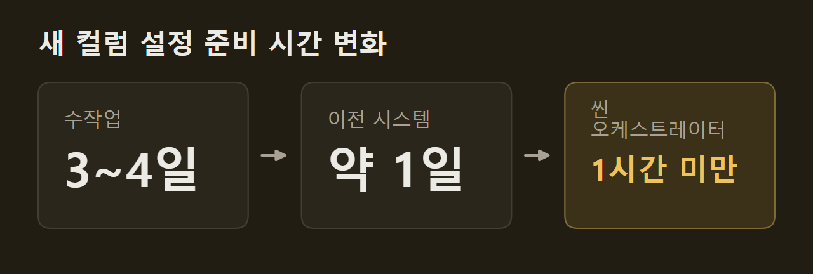
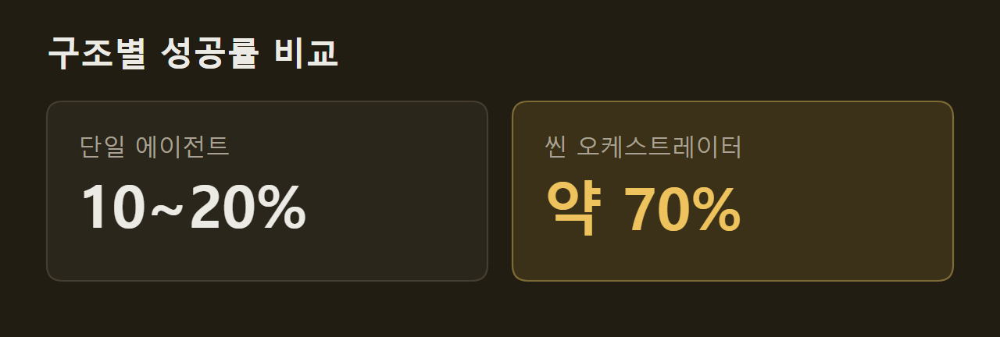

> 이 글은 아래 원문을 우리말로 간추려 정리한 글입니다. 정확한 내용은 원문을 확인하십시오.
>
> 원문: [engineering.fb.com/2026/10/19/ml-applications/thin-orchestrator-ai-agent-architecture](https://engineering.fb.com/2026/10/19/ml-applications/thin-orchestrator-ai-agent-architecture/)  
> 원문을 소개한 뉴스레터: TLDR AI

Meta 추천 시스템에 데이터 컬럼 하나를 새로 더하려면 코드 저장소 3곳과 프로그래밍 언어 3개에 걸쳐, 최대 6단계 파이프라인이 서로 어긋나지 않게 고쳐야 한다. Meta는 이 작업을 AI 에이전트에 맡기면서 요청을 받아 알맞은 전문 에이전트에 넘기는 1,300줄짜리 오케스트레이터와 14개 하위 에이전트로 시스템을 나눴고, 이 구조를 [씬 오케스트레이터(thin orchestrator)](https://engineering.fb.com/2026/10/19/ml-applications/thin-orchestrator-ai-agent-architecture/) 패턴이라고 부른다. 사용자가 요청하면 오케스트레이터가 요청 종류를 가리고 필요한 값을 모아 넘기며, 실제 코드와 설정은 하위 에이전트가 만든다.

```요약
요약: Meta는 도메인 판단을 하지 않는 오케스트레이터와 14개 전문 하위 에이전트로 데이터 컬럼 온보딩을 자동화했고, 새 컬럼의 설정 준비 시간을 이전 시스템의 약 1일에서 1시간 미만으로 줄였다.
```

```용어
오케스트레이터: 요청을 분류하고 필요한 값을 모아 알맞은 하위 에이전트에 일을 넘기는 중앙 구성 요소다.
하위 에이전트(subagent): 한 분야의 지식만 불러와 실제 작업을 하는 전문 에이전트다.
데이터 컬럼 온보딩(onboarding): 새 데이터 컬럼을 설정, 서비스, 파이프라인에 등록해 데이터가 흐르게 하는 작업이다.
워크플로 템플릿: 어떤 하위 에이전트를 어떤 순서로 부를지 미리 정해 둔 단계 목록이다.
결정론적: 같은 입력에 언제나 같은 결과를 내며, LLM 추론에 기대지 않는다는 뜻이다.
```

## 1. 단일 에이전트가 실패한 이유

Meta가 처음 만든 단일 에이전트는 지식을 많이 넣을수록 오히려 성능이 떨어졌다. 설정 스키마, 코드 생성 규칙, 파이프라인 경로, 검증 요건, 10개 이상 데이터 소스의 채우기 방식을 한 에이전트에 모두 넣은 결과다. 컨텍스트가 일정 수준을 넘자 이 에이전트는 한 하위 시스템의 필드 이름 규칙을 다른 시스템에 적용하거나, 다른 데이터 소스용 코드 생성 방식을 가져다 쓰는 환각을 일으켰다.

Meta가 따로 평가한 다른 단일 에이전트 방식도 결과가 프롬프트 손질에 좌우됐다. 엔지니어가 작업마다 시스템 프롬프트를 따로 써 주면 성공률이 70~80%였지만, 그렇게 하지 않으면 10~20%로 떨어졌다. Meta는 이를 프롬프트가 아니라 구조의 문제로 판단했다.

이 판단의 근거로 Meta는 Mount Sinai 연구진의 사전 공개 논문을 들었다. 작업 80개를 한꺼번에 처리하는 조건에서 단일 에이전트의 정확도는 16.6%까지 떨어졌지만, 오케스트레이션한 다중 에이전트는 65.3%를 유지했고 토큰 사용량도 최대 65분의 1로 줄었다.

## 2. 오케스트레이터와 하위 에이전트의 역할 분담

오케스트레이터는 도메인 작업을 하지 않는다. 요청 의도를 분류하고, 필요한 필드를 모으고, 신뢰성 점검을 한 뒤 하위 에이전트에 일을 넘길 뿐이며 코드를 추론하거나 설정을 만들지 않는다. 반면 14개 하위 에이전트는 각자 자기 분야의 컨텍스트만 갖는다. 예를 들어 스키마 관리 에이전트는 설정 레지스트리를, 채우기 에이전트는 10개 데이터 소스별 코드 생성을 맡는다.

오케스트레이터는 모든 요청을 다음 7단계로 처리한다.

1. 해당 하위 에이전트의 지시 파일을 읽는다.
2. 대상이 이미 있는지 확인해 중복을 막는다.
3. 사용자에게서 필요한 필드를 받는다.
4. 저장소 종류나 기존 설정처럼 추론할 수 있는 값을 찾는다.
5. 활성 경고나 필수 검토자가 있는지 점검한다.
6. 전체 컨텍스트를 담아 하위 에이전트에 일을 넘긴다.
7. 결과를 받아 오류를 알리거나 성공을 확인한다.

이 가운데 LLM 추론이 들어가는 단계는 6단계 하나다. 이 추론도 자기 분야의 지식만 불러온 격리된 하위 에이전트 안에서 일어난다.

## 3. 워크플로 템플릿과 지식 파일

새 쓰임새가 생기면 Meta는 에이전트를 새로 만들지 않고 템플릿을 하나 더 쓴다. 워크플로 템플릿은 단계 순서를 고정한 결정론적 상태 기계여서 LLM이 고를 수 있는 범위를 좁힌다. 예를 들어 컬럼 온보딩은 스키마, 검증, 채우기, 테스트 순서로 진행한다. 파이프라인 이전을 지원해야 했을 때도 Meta는 새 에이전트 코드를 쓰지 않고 기존 에이전트의 순서를 바꾼 템플릿만 추가했다.

다음 그림의 가운데는 도메인 지식이 없는 워크플로 관리 계층이다. 오른쪽에는 스키마 관리, 검증, 온보딩, 테스트처럼 범위가 정해진 템플릿 안에 도메인 지식이 따로 들어 있다.

")

하위 에이전트는 모두 같은 틀을 따른다. 불러올 지식 파일, 위임 전에 모을 값, 단계별 실행 계획, 모노레포에서 관련 코드를 찾는 방법, 흔한 오류의 해결법을 같은 순서로 적는다. 이 때문에 15번째 에이전트도 첫 번째와 구조가 같다. 25개가 넘는 지식 파일은 하위 에이전트가 실행될 때 불러오므로, 파일을 고치면 오케스트레이터를 바꾸지 않아도 다음 세션부터 새 내용이 쓰인다.

## 4. 운영 결과: 준비 시간과 성공률

새 컬럼 하나의 설정 준비 시간은 1시간 미만으로 줄었다. 사람이 직접 하면 3~4일, Meta가 이전에 쓰던 설정 기반 시스템으로는 약 1일이 걸린 작업이다.



작업마다 프롬프트를 따로 손질하지 않아도 성공률은 약 70%다. 같은 조건에서 앞서 평가한 단일 에이전트 방식은 10~20%였다.



운영 지표도 함께 공개됐다. 운영 환경에 반영된 코드 변경은 1,282건이고 그중 되돌린 비율은 약 0.2%이며, 처리한 데이터 컬럼은 1,384개다. 같은 에이전트로 5개 워크플로 분야를 지원하고, 변경의 약 3분의 2는 사람이 크게 고치지 않은 채 반영된다. 출시 시점의 SWE-bench 방식 평가 점수는 약 95.5%였다.

## 5. 얇은 오케스트레이터가 안정적인 이유

Meta는 구조의 경계를 계산 방식의 경계와 맞춘 것을 이유로 든다.

- **결정론적 판단은 결정론적으로 둔다.** 어느 하위 에이전트가 맡을지는 라우팅 문제이므로 LLM을 쓰지 않는다.
- **컨텍스트를 격리한다.** 데이터 소스 A의 채우기 에이전트는 B의 방식을 보지 못하므로 둘을 섞을 수 없다.
- **실패가 퍼지지 않는다.** 하위 에이전트가 실패하면 오케스트레이터가 다시 시도하거나 사람에게 넘기며, 다른 에이전트의 컨텍스트는 영향을 받지 않는다.
- **층마다 따로 개선된다.** 모델을 바꾸면 14개 에이전트가 함께 나아지고, 지식 파일이나 템플릿은 에이전트를 건드리지 않고 고칠 수 있다.

반대로 모든 지식을 가진 오케스트레이터가 환각을 일으키면 잘못된 에이전트를 부르거나 신뢰성 점검을 건너뛰게 되고, 그 오류가 뒤따르는 모든 단계로 번진다. Meta는 앞으로 지식 파일과 템플릿만 더해 새 파이프라인 분야로 넓히고, 운영 중 드러난 실패 유형을 바탕으로 지식 파일 개선안을 자동으로 만들되 반영은 사람이 검토한 뒤에 할 계획이다. 가장 적게 일하는 오케스트레이터를 얇게 두고 하위 에이전트에 깊은 분야 지식을 맡길 때 시스템 전체가 더 안정적으로 동작한다는 것이 Meta의 결론이다.

## 출처와 작성 방식

- 원문: [engineering.fb.com/2026/10/19/ml-applications/thin-orchestrator-ai-agent-architecture](https://engineering.fb.com/2026/10/19/ml-applications/thin-orchestrator-ai-agent-architecture/)
- 원문을 소개한 뉴스레터: TLDR AI
- 그림: 아래에 출처가 적힌 그림은 원문에 실린 그림을 인용한 것이며 저작권은 원저작자에게 있습니다. 출처가 없는 그래프는 원문에 적힌 값으로 직접 그린 것입니다.
- 작성 방식: 직접 만든 뉴스 정리 파이프라인(VISER)으로 생성하고 검수한 글입니다. 본문의 수치와 주장은 원문에서 가져온 것입니다.
- 정리 주차: 2026-W43
