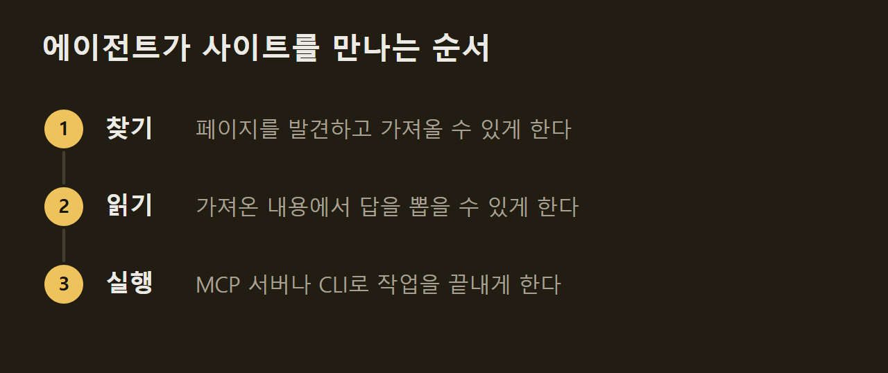
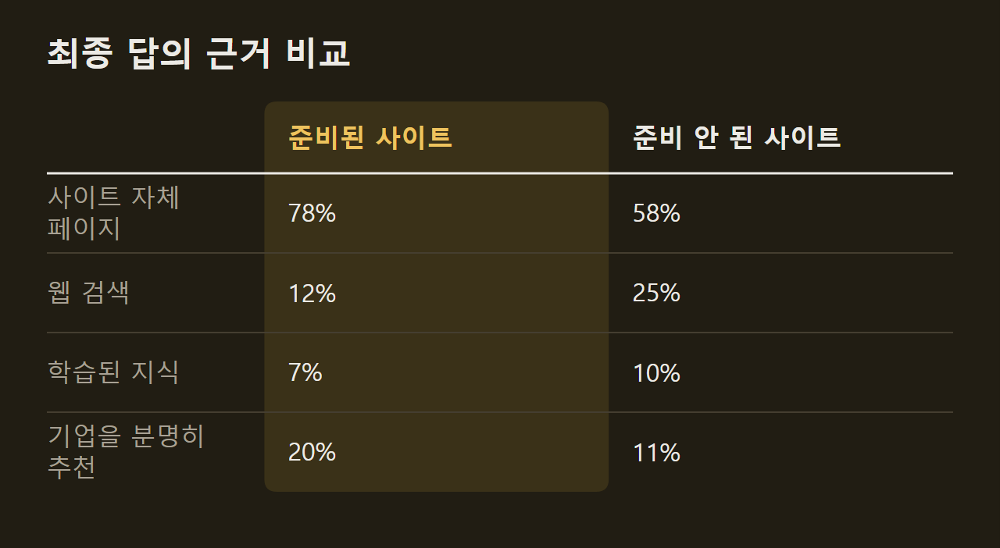
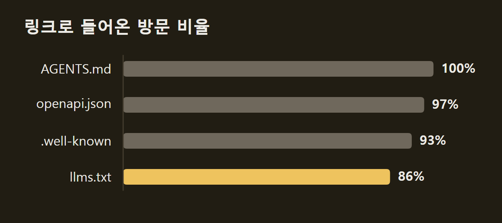
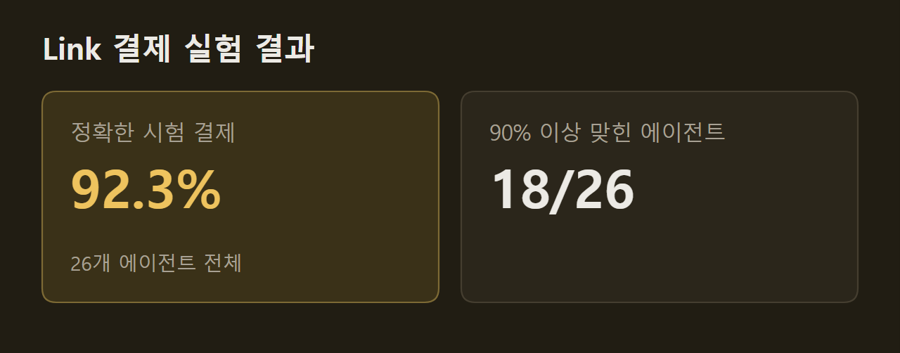

> 이 글은 아래 원문을 우리말로 간추려 정리한 글입니다. 정확한 내용은 원문을 확인하십시오.
>
> 원문: [agentready.org](https://www.agentready.org/)  
> 원문을 소개한 뉴스레터: TLDR

AI 에이전트는 사용자를 대신해 웹사이트를 찾아 읽고, 답을 만들거나 결제 같은 작업까지 끝낸다. MCP(Model Context Protocol), A2A, llms.txt처럼 에이전트를 위한 규약은 여럿 나왔지만, 에이전트를 맞을 준비가 됐다는 것이 무슨 뜻인지 정한 공통 정의는 없었다. [AgentReady](https://www.agentready.org/)는 제품이 에이전트에게 발견되고, 읽히고, 작업을 끝내는 데까지 무엇을 갖춰야 하는지 항목별로 적은 공개 사양이다. 사양을 만든 쪽은 ora.ai 연구소와 함께 25만 건이 넘는 실제 에이전트 실행 기록과 통제 실험을 분석해 항목을 정했다.

```요약
요약: AgentReady는 에이전트가 제품을 찾고 읽고 실행하는 데 필요한 요건을 정한 공개 사양이며, 실행 기록과 실험에서 에이전트를 실패하게 만든 변화는 답을 자바스크립트 뒤에 숨기는 것과 접근을 막는 것 두 가지뿐이었다.
```

```용어
robots.txt: 사이트가 어떤 크롤러에게 어떤 경로를 가져가도 되는지 적어 두는 파일이다.
봇 관리 도구(bot manager): 자동화된 요청을 걸러 내는 보안 장치로, 에이전트에게 403 응답이나 확인 페이지를 돌려줄 수 있다.
llms.txt: 사이트의 주요 페이지를 설명과 함께 모아 둔 에이전트용 색인 파일이다.
MCP 서버: 에이전트가 도구를 호출해 문서 검색이나 실제 작업을 하도록 표준 규약으로 기능을 내놓는 서버다.
초기 HTML: 브라우저가 자바스크립트를 실행하기 전에 서버가 처음 돌려주는 페이지 내용이다.
```

## 1. 찾기·읽기·실행으로 나눈 사양

AgentReady는 에이전트가 사이트를 만나는 순서대로 항목을 찾기, 읽기, 실행으로 나눈다. 찾기와 읽기는 모든 사이트가 갖춰야 할 기본이다. 실행은 제품이 읽히는 데서 그치지 않고 에이전트가 작업을 끝내야 할 때 해당하며, 이 경우 에이전트가 거쳐 갈 MCP 서버나 CLI가 있어야 한다.



항목마다 `AR-FIND-01` 같은 고정 식별자와 강도가 붙는다. MUST는 그것이 없으면 에이전트가 실패하는 항목이고, SHOULD는 에이전트가 어디로 가는지에 측정 가능한 영향을 주거나 실행을 안정시키는 항목이며, MAY는 새로 생기는 관례다. 근거도 구분해 표시한다. STUDIES는 ora.ai의 실행 기록과 실험(데이터셋은 공개되어 있다), ORA SCANNER는 점수를 매긴 사이트 전체의 실시간 접근 가능 여부이고, 표시가 없는 문장은 권고다.

특정 규약이나 업체를 밀지 않는다는 점도 사양에 밝혀 두었다. 에이전트의 행동이 바뀌면 항목도 측정값에 따라 고친다.

## 2. 찾기 단계: 크롤러 허용과 1차 문서

에이전트는 찾아서 가져올 수 있는 페이지만 인용할 수 있다. 에이전트는 URL을 받거나 기억해 내고, 링크를 따라가거나, 크롤러가 만든 검색 색인에서 페이지를 찾는다. 크롤러를 막은 페이지는 그 색인에 아예 들어가지 못하고, 사용자에게 답하는 도중에 페이지를 가져오는 일도 막힐 수 있다. 이 때문에 사양은 답을 최신 상태의 1차 문서(first-party docs) 페이지 한 곳에 싣고, 크롤 정책을 크롤러 이름 허용 목록이 아니라 모든 에이전트에 똑같이 적용되는 규칙 하나로 쓰라고 권한다.

**사이트를 읽지 못해도 에이전트는 답을 낸다.** Ora 연구진은 1,056개 기업 사이트에서 에이전트 탐색 37,927회를 분석했다. 같은 업종에서 브랜드 인지도와 외부 인용 정도가 비슷한 준비된 사이트와 준비되지 않은 사이트를 짝지어 견주었다. 준비되지 않은 사이트에서는 최종 답이 사이트 자체 페이지에 근거한 비율이 58%에 그쳤고, 웹 검색에 근거한 비율은 25%로 준비된 사이트의 두 배를 넘었다.



답의 정확도에서도 차이가 났다. 131개 기업의 답 2,499개를 각 기업 사이트와 사실 하나하나 대조하자, 다른 곳에서 근거를 가져온 답은 사이트에서 가져온 답보다 묻는 사실을 하나도 담지 못할 가능성이 3.7배 높았다(25% 대 7%). 반면 준비된 기업은 답에서 분명히 추천받는 빈도가 1.9배였다. 사이트에서 막다른 길에 부딪힌 탐색의 약 99%에서도 에이전트는 답을 냈고, 준비되지 않은 사이트는 에이전트를 2.1배 자주 막았으며 탐색 횟수도 23% 많았다. 이 연구는 Claude와 GPT 모델 위의 에이전트 구성 네 가지로 진행했고, GPT 구성 둘은 Tavily로 웹을 검색했다.

1차 문서는 인용의 출처가 된다. 추적한 실행에서 답의 82%는 에이전트가 가져온 페이지로 거슬러 올라갔다. 근거를 찾은 답 844개 가운데 47%가 문서 페이지에서 나와 다른 어떤 유형보다 많았다. 2026년 4월 스캐너 보고서는 약 5만 개 사이트 가운데 88%가 robots.txt를 두었고, 80%가 주요 AI 크롤러 모두에게 열려 있었으며, 약 10곳 중 1곳은 이들을 완전히 막았다고 집계했다.

**봇 관리 도구는 robots.txt와 별개다.** 웹 방화벽(WAF)이나 봇 관리 도구가 에이전트에게 403이나 확인 페이지를 돌려주면 robots.txt를 아무리 열어 두어도 에이전트는 막힌다. 사양은 업체가 공개한 IP 범위나 Web Bot Auth 서명으로 검증된 에이전트를 통과시키고, 요청을 줄여야 할 때는 확인 페이지 대신 429로 답하라고 권한다.

크롤러가 하는 일은 학습용(GPTBot, ClaudeBot), 검색 색인용(OAI-SearchBot, Claude-SearchBot), 사용자 요청에 따른 가져오기(ChatGPT-User, Claude-User)로 나뉜다. 각각 자기 규칙을 따르므로 학습 크롤러만 막으면 검색 색인과 에이전트 답에서 빠지지 않고도 학습에서 빠질 수 있다. 다만 `User-agent: GPTBot`처럼 더 구체적인 규칙은 모든 크롤러에 적용되는 규칙보다 우선하고, 사용자 요청에 따른 가져오기는 robots.txt를 아예 보지 않을 수 있다. 확인할 때는 curl만으로는 부족하다. 봇 차단 장치는 user-agent 문자열보다 요청이 어디서 왔는지를 더 따지므로, 사양은 OpenAI와 Anthropic이 공개한 IP 범위로 서버 로그를 찾아 200 응답이 나갔는지 보는 방법을 믿을 만한 확인으로 든다.

## 3. 읽기 단계: 초기 HTML에 둔 답

에이전트를 실패하게 만든 변화는 답을 자바스크립트 뒤에 숨기는 것과 접근을 막는 것 두 가지뿐이었다. 연구진은 문서 사이트 하나를 설정 19가지로 내보내고, 주제 5개를 클라이언트 두 종류로 물어 모두 190번 확인했다. 한 클라이언트는 자바스크립트를 실행하지 않고 페이지만 가져왔고, 다른 하나는 자바스크립트를 실행했다. 실패한 설정은 세 가지였으며, 자바스크립트로 숨긴 답은 가져오기만 하는 클라이언트에서만 실패했고 접근 차단은 두 클라이언트 모두에서 실패했다.

반면 콘텐츠 협상(content negotiation), `.md` 주소, 에이전트 감지는 성공 여부를 바꾸지 못했다. 에이전트는 사람과 같은 홈페이지와 문서를 읽었으므로, 클라이언트에서 렌더링하는 사이트라도 답은 초기 HTML에 있어야 한다. 홈페이지는 실행의 69%에서 방문되었고 그중 92%에서 첫 단계였으며, 홈페이지를 거친 실행의 59%는 다음에 문서 페이지로 갔다. 문서 페이지는 실행의 83%에서 방문되었고, 실행마다 평균 3.4쪽쯤 읽혀 가장 많이 가져온 유형이었다.

**가격은 질문 유형 중 차이가 가장 컸다.** 사이트 자체 페이지에서 만든 가격 답은 60%가 정확했지만 다른 곳에서 만든 답은 37%만 정확했다. 에이전트가 사이트를 읽지 못하면 "영업팀에 견적을 문의하라"로 넘기는 답도 22%로, 읽었을 때의 15%보다 많았다. 그래서 사양은 요금제, 무료 등급, 한도를 이미지나 계산기, 영업 문의 양식이 아닌 HTML 글자로 싣게 한다.

HTML에 있다고 해서 읽힌다는 뜻은 아니다. 대부분의 에이전트는 페이지 글자만 읽고 `<script>` 요소는 읽지 않으므로, JSON-LD나 JSON 설정에만 있는 사실은 보이지 않는다. 예를 들어 Elementor와 함께 살펴본 WordPress 사이트에서는 가격 전환 버튼 뒤의 연간 요금이 JSON으로만 제공되었다. 또 없는 경로에는 404를 돌려주어야 하며, 단일 페이지 앱(single-page app)이 모든 경로에 200을 돌려주어 죽은 URL이 살아 있는 것처럼 보인 사례가 있었다. 에이전트가 답에 코드를 넣은 119회 가운데 61%는 사이트에서 가져온 페이지의 줄을 그대로 옮겼다는 점에서, 언어를 표시한 코드 블록도 SHOULD 항목에 들어갔다.

## 4. 에이전트용 파일이 읽히는 경로

에이전트용 파일은 대개 링크를 따라 열렸다. 에이전트는 홈페이지를 본 뒤 이런 파일을 열었고, 파일 종류에 따라 방문의 86~100%가 경로를 짐작해서가 아니라 링크를 따라 들어왔다. 이 때문에 사양은 각 파일을 푸터나 `<head>`의 메타데이터처럼 에이전트가 이미 보는 자리에 링크로 걸게 한다.



llms.txt는 416회 가져온 가운데 86%가 그것을 가리키는 페이지에서 들어왔다. 이 파일을 읽은 329회 가운데 셋 중 하나는 목록에 있는 페이지를 이어서 가져왔고, 36%는 그 내용에서 최종 답을 끌어냈다. `.well-known` 경로는 실행의 약 23%에서 방문되었고, openapi.json은 이 파일을 둔 사이트 7곳의 실행 541회 중 21%에서 쓰였다. 반면 sitemap.xml은 실행의 4%에서만 직접 가져와 에이전트가 가장 덜 건드리는 파일에 속했지만, 크롤러와 검색 엔진에는 여전히 표준이라 SHOULD로 남았다.

에이전트는 웹 가져오기 3,470회 중 약 65%에서 마크다운을 요청했고, 형식을 지정한 2,361회에서는 96%가 마크다운이었다. 다만 형식은 작업 성공을 가르지 않았으므로, 사양은 `.md` 사본보다 HTML이 먼저 제대로 동작하게 하라고 권한다.

## 5. 실행 단계: MCP 서버나 CLI

문서를 읽는 것만으로는 에이전트가 작업을 끝낼 수 없다. 작업을 끝내려면 API, MCP 서버, WebMCP 도구, SDK, CLI 가운데 하나와 에이전트가 끝까지 통과할 수 있는 인증이 필요하고, 유료 제품이면 결제 수단도 있어야 한다. 사양은 MCP 서버나 CLI를 MUST로 두고, 채팅과 IDE에서 일하는 에이전트에게는 MCP 서버를, 셸에서 일하는 에이전트에게는 CLI를 맞춘다. 요건만 채우려고 빈 기능을 내놓지 말라는 단서도 붙였다.

세부 권고는 단계마다 다르다. 인증은 스스로 키를 발급받을 수 있게 하고, 사용자를 대신하는 접근에는 메타데이터를 찾을 수 있는 OAuth 2.0을 쓴다. 문서용 MCP는 공개하고 제품 MCP는 OAuth로 보호하며, WebMCP는 웹 화면 자체에 도구를 등록하는 방식으로 W3C Community Group 초안 단계에 있다. 유료 제품에는 호출 단위 결제(x402, MPP)나 쇼핑 결제(UCP, ACP)를 쓰라고 하며, 검증된 에이전트 앞에 CAPTCHA를 두지 말라고 한다.

**Link 결제에서는 시험 결제 대부분이 맞았다.** Ora 연구진이 에이전트 앱 5개와 모델 6개를 조합한 26개 에이전트에게 똑같은 결제 과제 33개를 맡기자, Stripe Link로 결제한 에이전트는 시험 결제의 92.3%를 올바르게 처리했다. 실패한 61회 가운데 27회는 에이전트가 사람에게 승인을 요청하고 그대로 멈춘 경우였다. 이 실험은 Stripe 시험 모드와 가상 상점에서 실제 돈 없이 진행했고, 요청을 몇 초 안에 모두 승인하는 대체 지갑을 썼다.



사이트를 직접 점수 매기는 공개 도구로는 is-agentic.com, ora.ai, Mintlify Agent Score가 있고, Tavily는 에이전트가 시장을 검색할 때 누가 발견되는지 보고서로 보여 준다. 어느 것도 사양 자체는 아니며, 점검 항목과 가중치는 사양과 따로 바뀔 수 있다. 2026년 10월 v2.0에서는 MCP 서버나 CLI가 MUST가 되었고 WebMCP가 MAY에서 SHOULD로 올라갔으며, AI 카탈로그, 1차 페이지의 가격, Link 결제, NLWeb이 새 항목으로 들어갔다.

AgentReady의 요건은 에이전트가 사이트에 들어와 답을 읽게 하는 것과 작업을 끝낼 도구를 주는 것으로 모인다. 측정에서 에이전트를 실패하게 만든 것은 접근 차단과 자바스크립트 뒤에 숨긴 답뿐이었고, 그 밖의 항목은 찾기, 읽기, 실행 순서에 따라 정리되어 있다. 사양 원문과 근거 데이터셋은 GitHub에 공개되어 있으며, 새로 측정한 에이전트 행동에 따라 권고를 고친다.

## 출처와 작성 방식

- 원문: [agentready.org](https://www.agentready.org/)
- 원문을 소개한 뉴스레터: TLDR
- 그래프: 원문에 적힌 값으로 직접 그린 그림입니다.
- 작성 방식: 직접 만든 뉴스 정리 파이프라인(VISER)으로 생성하고 검수한 글입니다. 본문의 수치와 주장은 원문에서 가져온 것입니다.
- 정리 주차: 2026-W43
