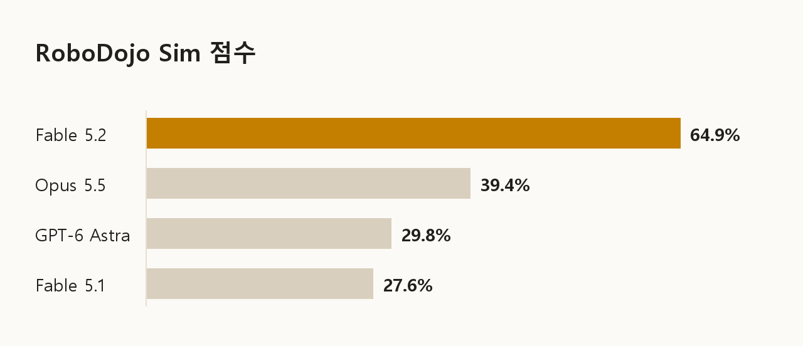

> 이 글은 아래 원문을 우리말로 간추려 정리한 글입니다. 정확한 내용은 원문을 확인하십시오.
>
> 원문: [anthropic.com/claude-fable-and-mythos-5-2](https://www.anthropic.com/claude-fable-and-mythos-5-2)  
> 원문을 소개한 뉴스레터: AlphaSignal

[Claude Fable 5.2와 Mythos 5.2](https://www.anthropic.com/claude-fable-and-mythos-5-2)는 코드, 과학 문제, 하드웨어 설계 같은 복잡하고 열린 기술 과제를 맡기면 완성된 소프트웨어, 증명, 장치 설계를 내놓는 Anthropic의 상위 모델이다. 소프트웨어 엔지니어, 연구자, 보안과 생명과학 분야 기관이 쓰며, 같은 기반 모델에 안전장치 수준만 달리해 일반 사용자용 Fable과 검증된 기관용 Mythos로 나눴다.

```요약
요약: Anthropic이 이전 세대보다 출력이 최대 30% 빠르고 값이 낮아진 Claude Fable 5.2와 Mythos 5.2를 공개했다.
```

```용어
어드바이저(Advisor): Haiku, Sonnet, Opus 같은 모델이 더 어려운 문제를 만났을 때 상담하는 상위 모델의 역할이다.
오케스트레이터(Orchestrator): 큰 작업을 나누어 단순한 일을 작은 모델에게 맡기고 전체를 조율하는 모델의 역할이다.
증류 공격(distillation attack): 강력한 모델의 출력을 모아 다른 모델을 학습시켜 능력을 빼내려는 시도다.
홀로그래피 쌍대성(holographic duality): 중력이 있는 특정 우주를 중력이 없는 양자 이론으로 정확히 기술할 수 있다는 생각이다.
형식화(formalization): 수학 증명을 컴퓨터가 단계별로 검증할 수 있는 언어로 옮기는 작업이다.
```

## 1. 모델 구성과 가격: 같은 모델, 다른 안전장치

Anthropic은 Fable 5.2와 Mythos 5.2가 같은 기반 모델이라고 밝혔다. Fable에는 사이버보안과 생물학 분야의 오용을 막는 강한 안전장치를 걸어 모든 사용자에게 열었고, Mythos는 확대된 생명과학·사이버 검증 프로그램(Life Sciences and Cyber Verification Programs)에 신청해 승인받은 기관이 쓴다. 두 모델은 코딩, 추론, 시각 분야가 이전보다 나아졌고, 테스터들은 표현도 더 명확해졌다고 평가했다.

출력 속도는 Fable 5.1과 Mythos 5.1보다 최대 30% 빠르면서 값은 더 낮아져 입력 100만 토큰당 8달러, 출력 100만 토큰당 40달러다. 선택 기능인 빠른 모드(fast mode)를 켜면 토큰 생성이 최대 2.5배 빨라지며, 이때 값은 입력 16달러, 출력 80달러다.

Anthropic은 대부분의 코딩과 지식 작업에는 Opus 5.5에서 시작하라고 권한다. 작업 범위와 난이도에 따라 위로는 Fable이나 Mythos, 아래로는 Sonnet 5.5나 Haiku 5.5로 옮기면 된다는 설명이다. Fable 5.2는 작은 모델이 상담하는 어드바이저나 단순한 일을 작은 모델에 넘기는 오케스트레이터 역할도 할 수 있다.

안전 면에서는 출시 전에 샌드박스 탈출 같은 우려 행동을 들여다보는 새 평가를 만들어 시험했다. 회사는 정렬 실패로 인한 고위험이 여전히 낮다고 보며, 대부분의 정렬 지표에서 최근 모델과 같거나 나은 성적을 냈다고 밝혔다. 사이버와 생물학 안전장치는 Fable 5.1만큼 견고하되 불필요한 차단은 줄었고, 증류 공격에 대한 보호는 지금까지 가장 강하게 구현했다.

")

## 2. 벤치마크와 효율: Opus 5.5를 넘어선 성적

Anthropic이 공개한 표에서 Fable 5.2는 평가한 거의 모든 능력에서 Opus 5.5를 앞섰다. 점수는 별도 표기가 없으면 안전장치를 켠 상태에서 각 모델의 최고 노력 수준으로 잰 값이다. 에이전트 코딩 평가 FrontierCode 2.0에서는 Xhigh effort 기준 49.1%로 Fable 5.1의 32.4%, Opus 5.5의 45.5%보다 높았다. FrontierSWE v2는 69.9%(Opus 5.5 62.3%), 과학 연구 에이전트 평가 Terminal-Bench-Science 0.1은 74.6%(Mythos 5.2 75.3%)였다.

차이가 가장 두드러진 곳은 Remote Labor Index와 로봇 평가다. Remote Labor Index는 High effort 기준 41.3%로 Opus 5.5의 21.3%와 큰 격차를 보였고, 도구를 쓴 Humanity's Last Exam은 74.2%로 Opus 5.5의 67.7%보다 높았다. 모든 항목에서 앞선 것은 아니어서, AutomationBench에서는 Gemini 4 Carbon이 53.9%로 Fable 5.2의 51.4%를 웃돌았다. 도구 없이 차트를 읽는 Chartography에서도 Fable 5.2의 73.4%가 GPT-6 Astra 71.0%, Gemini 4 Carbon 72.5%와 근소한 차이였다.

효율도 개선됐다. Claude 앱과 Claude Code의 기본값인 Medium effort에서 Fable 5.2는 어려운 작업을 Fable 5.1보다 적은 토큰으로 끝낸다. FrontierCode 2.0 초기 시험에서는 High effort의 Fable 5.2가 Max effort의 Opus 5.5와 비슷한 점수를 냈고, 작업당 비용은 대략 절반이었다. Xhigh effort에서는 시험한 공개 모델 중 가장 높은 점수를 받았다.

")

## 3. 코딩: 서비스 이전과 운영체제 시제품

Anthropic은 자사 핵심 코드베이스에 병합되는 변경의 90% 이상을 이제 Claude가 사람의 지도 아래 작성한다고 밝혔다. Fable 5.2로는 까다로운 버그를 몇 분 만에 고쳤고 모든 서비스의 성능을 최적화했다. Fable 5.2의 초기 버전으로 구성한 에이전트 팀은 핵심 프로덕션 서비스를 Python에서 Rust로 옮겼는데, 이 서비스는 더 효율적이고 안정적이며 시작이 약 26배 빠르다.

엔지니어 한 명이 시도한 실험에서는 빈 폴더에서 출발한 Fable 5.2가 1,000개가 넘는 하위 에이전트를 조율해 8일 동안 쉬지 않고 코드를 짜고 시험하고 검토했다. 결과물은 노트북에서 부팅되는 운영체제로, 기기를 돌리는 자체 커널과 디스크·키보드·네트워크 드라이버, 영구 파일 저장소, 창 시스템, 로그인 화면, 설치 프로그램, Claude 기능까지 갖췄다. 회사는 모호한 요청에서도 공학적 판단이 좋은 결과를 낸다고 평가했다.

## 4. 사이버보안: Mythos 5.2의 역할

Anthropic은 Mythos 5.2를 사이버보안 엔지니어링에서 가장 유능한 모델이라고 소개한다. 내부 평가 CVE Rediscovery에서 Opus 5.5보다 10.2%, Mythos 5.1보다 14.4% 많은 취약점을 찾았고, 표의 점수는 89.6%다. 한 보안 업체는 Mythos 5.2가 확인한 버그 여섯 건 중 한 건을 시험한 다른 최전선 모델이 모두 놓쳤다고 전했다. 판단의 정확도도 나아져서, 한 테스터는 이전 모델이 약 20건 중 1건꼴로 심각도를 부풀렸지만 Mythos 5.2는 한 건도 과장하지 않았다고 보고했다.

접근 경로는 두 가지다. 사이버 검증 프로그램을 통해 Mythos 5.2의 능력을 쓸 수 있고, Claude Enterprise 고객은 프로그램 회원이 아니어도 코드베이스의 취약점을 훑는 Claude Security를 쓸 수 있다. Claude Security는 이제 Mythos 5.2를 쓰며, 코드가 바뀔 때 저장소를 지켜보고 발견 사항이 고쳐졌는지 추적하고 추가 맥락을 학습하며 API와 MCP로 사용자 도구와 연결되도록 갱신됐다. Fable 5.2의 안전장치는 사이버보안 관련 작업 대부분을 막는다.

## 5. 과학과 수학: 물리 난제, 단백질 구조, 증명 형식화

Anthropic은 Fable 5.2가 블랙홀과 관련한 이론물리 미해결 문제 두 가지를 풀었다고 밝혔다. 두 결과 모두 홀로그래피 쌍대성에 기대고 있다. 첫 문제는 1983년에 중력이 있는 우주가 뜨거워지면 물이 끓듯 블랙홀이 갑자기 생긴다는 점이 확인됐지만, 그 방법은 상대성이론이 통하는 큰 우주에서만 쓸 수 있었다는 것이다. 양자 기술만 쓸 수 있는 아주 작은 우주에서도 같은지 가려내는 계산은 2003년에 제시됐으나 너무 번거로워 끝내지 못했는데, Fable 5.2가 대체로 자율적으로 마무리해 거기서도 전이가 갑작스럽다는 결과를 얻었다. 두 번째 문제에서는 단순화한 우주에서 양자 중력 후보 이론을 배제하는 데 15년 넘게 쓰인 기법의 정확한 한계를 찾았다.

단백질 분야에서는 Mythos 5.2가 유전자 치료 전달체로 쓰이는 아데노연관바이러스의 단백질 껍질(캡시드, capsid) 전체 구조를 예측하는 새 방법을 찾았다. AlphaFold 같은 기존 모델은 개별 단백질을 예측하지만 캡시드는 수십 개의 단백질로 이뤄진다. Mythos 5.2는 오픈소스 접힘 모델 두 개를 겹치는 단백질 사슬 묶음에 돌리고, 알려진 캡시드의 대칭 정보로 결과를 합치는 코드를 썼다. Anthropic의 시험에서는 시도한 34개 중 28개를 정확히 모델링했다.

수학에서는 증명을 컴퓨터가 검증할 수 있는 언어로 옮기는 형식화에서 성과가 컸다. 미공개 연구용 Claude가 사람 연구자의 안내와 전용 도구에 의지해 페르마의 마지막 정리를 처음 형식화하는 데는 11일이 걸렸다. 반면 Fable 5.2 에이전트 1,000개 팀은 최소한의 사람 개입으로 30시간 만에 끝냈고, 최소한의 프롬프트에서 출발해 협업 방식을 스스로 만들었다. 첫 형식화보다 행동 토큰은 3분의 1만 쓰였고 증명은 7배 짧았다. 같은 1,000개 에이전트 구성의 Opus 5.5는 18시간에 형식화의 26%만 끝냈고 30시간이 지나도 진전이 거의 없었다.

## 6. 하드웨어와 로봇: 물리 세계로 넓어진 활용

Anthropic은 회로 기판 설계·제조사 Diode와 협업해 Fable 5.2의 하드웨어 설계 능력을 시험했다. 한 문단짜리 프롬프트로 회로 기판, 3D 프린팅 외장, 소프트웨어를 갖춘 전자 기기 세 가지를 만들게 했고, 대상은 집용 음성 비서 허브, USB 스피커폰, 휴대용 가상 펫이었다. Claude는 스스로 명세를 쓰고 미국 유통사의 부품을 골랐으며 4층 회로 기판을 배선하고 외장을 CAD로 모델링하고 소프트웨어를 짰다. 각 기판은 사람의 개입을 최소화한 채 하루 안에 제조 준비를 마쳤고, Diode가 기판을 만든 뒤에는 Claude가 엔지니어들에게 시험과 조립을 안내했다. 세 기기는 전기적 수정 없이 모두 동작했다.

로봇 제어에서도 이전 모델보다 크게 나아졌고, 명시적으로 훈련하지 않은 작업에서도 마찬가지였다. Fable 5.2가 제어한 로봇은 퍼즐 큐브 풀기, 병뚜껑 풀기, 로봇 그림 그리기 같은 작업을 해냈다. 카메라 영상으로 시뮬레이션 양팔 로봇을 제어하는 공개 벤치마크 RoboDojo에서는 같은 하니스로 돌린 다른 최전선 모델을 앞섰고, 로봇 전용으로 만든 AI 시스템 대부분보다도 높았다.



## 출처와 작성 방식

- 원문: [anthropic.com/claude-fable-and-mythos-5-2](https://www.anthropic.com/claude-fable-and-mythos-5-2)
- 원문을 소개한 뉴스레터: AlphaSignal
- 함께 본 글: [Anthropic's Claude Fable 5.2 solves open physics problems and designs working hardware](https://assets.claude.com/d9fab5459563a779c65b97040ad4d2e41f0b9464.pdf) (AlphaSignal 소개)
- 그림: 아래에 출처가 적힌 그림은 원문에 실린 그림을 인용한 것이며 저작권은 원저작자에게 있습니다. 출처가 없는 그래프는 원문에 적힌 값으로 직접 그린 것입니다.
- 작성 방식: 직접 만든 뉴스 정리 파이프라인(서재)으로 생성하고 검수한 글입니다. 본문의 수치와 주장은 원문에서 가져온 것입니다.
- 정리 주차: 2026-W46
