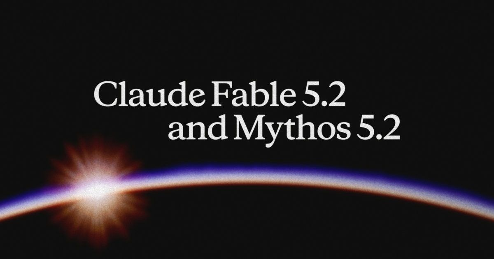
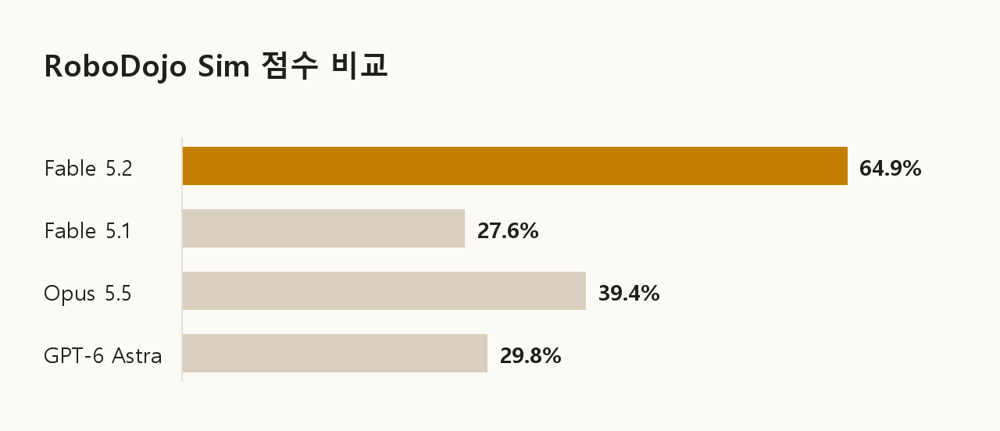

[Claude Fable 5.2](https://www.anthropic.com/claude-fable-and-mythos-5-2)는 코딩, 추론, 시각 이해가 개선된 Anthropic의 최상위 모델로, 복잡한 개발·연구 과제를 맡기면 마이그레이션 코드, 설계 결과물, 증명 같은 완성된 산출물을 내놓는다. 같은 모델을 보안 전문가용으로 풀어 둔 Mythos 5.2도 함께 나왔다. 소프트웨어 엔지니어, 보안 조직, 과학 연구자가 주로 쓴다.

```요약
요약: Anthropic이 이전 버전보다 출력이 최대 30% 빠르고 값이 낮아진 Claude Fable 5.2와 Mythos 5.2를 내놓았고, 코딩, 과학, 하드웨어, 로봇 제어에서 성능이 크게 올랐다.
```

> **숫자**: 페르마의 마지막 정리 형식화: Fable 5.2 에이전트 1,000개로 30시간(첫 시도 11일)

### 1. 같은 모델, 두 가지 배포

Fable과 Mythos는 바탕이 같은 모델이다. 차이는 안전장치에 있다. Fable은 사이버보안과 생물학 분야에 강한 안전장치를 걸어 모든 사용자에게 열었고, Mythos는 생명과학·사이버 검증 프로그램을 통해 신청한 기관에만 제공한다. 이전 버전보다 설명이 더 명확해졌고 출력 속도는 최대 30% 빨라졌으며, 가격은 입력 100만 토큰당 8달러, 출력 100만 토큰당 40달러로 내려갔다. 선택 사항인 빠른 모드는 생성 속도를 최대 2.5배로 높이는 대신 값이 두 배다.

벤치마크에서는 대부분의 항목에서 Opus 5.5보다 앞선다. 에이전트 코딩 평가 FrontierCode 2.0에서 Fable 5.2는 가장 높은 노력 수준으로 49.1%를 기록해 Fable 5.1의 32.4%, Opus 5.5의 45.5%를 넘었다. 초기 시험에서는 High 수준의 Fable 5.2가 Max 수준의 Opus 5.5와 비슷한 점수를 작업당 비용 절반쯤으로 냈다. 다만 Anthropic은 일상적인 코딩과 지식 작업에는 Opus 5.5로 시작하고, 필요할 때 위아래 모델로 옮기라고 권한다. Fable은 하위 모델이 어려운 문제를 물어보는 조언자나, 단순한 일을 작은 모델에 나눠 주는 지휘자 역할도 할 수 있다.

안전성 면에서는 출시 전에 샌드박스 탈출 같은 행동을 보는 새 평가까지 포함해 시험을 거쳤다. 사이버·생물학 안전장치는 Fable 5.1만큼 견고하면서 불필요한 차단은 줄었고, 증류 공격에 대한 보호는 지금까지 가장 강하다고 한다.



*Claude Fable 5.2와 Claude Mythos 5.2 출시를 알리는 대표 이미지. (출처: www.anthropic.com, https://www.anthropic.com/claude-fable-and-mythos-5-2)*

### 2. 코딩과 보안

Anthropic 핵심 코드에 합쳐지는 변경의 90% 이상이 이미 Claude가 쓴 것이다. Fable 5.2 이전 버전으로 구성한 에이전트 팀은 핵심 운영 서비스를 Python에서 Rust로 옮겼고, 그 결과 서비스는 더 효율적이고 안정적이며 시작이 약 26배 빨라졌다. 한 엔지니어의 실험에서는 빈 폴더에서 출발한 Fable 5.2가 서브에이전트 1,000여 개를 조율해 8일 동안 코드를 쓰고 시험하고 검토했다. 결과물은 노트북에서 부팅되는 운영체제로, 드라이버, 파일 저장소, 창 화면, 로그인, 설치 프로그램까지 갖췄다.

보안은 Mythos 5.2의 영역이다. Fable 5.2의 안전장치는 보안 관련 작업 대부분을 막는다. 내부 평가 CVE Rediscovery에서 Mythos 5.2는 Opus 5.5보다 취약점을 10.2%, Mythos 5.1보다 14.4% 더 찾았다. 한 보안 업체는 Mythos 5.2가 확인한 버그의 6분의 1을 시험한 다른 최상위 모델이 모두 놓쳤다고 전했다. 심각도를 부풀리는 일도 줄어, 한 시험자는 이전 모델이 20건 가운데 1건꼴로 과장했지만 Mythos 5.2는 한 건도 과장하지 않았다고 했다. Claude Enterprise 고객은 검증 프로그램 가입 없이도 Mythos 5.2를 쓰는 Claude Security로 코드베이스의 취약점을 점검할 수 있다.

### 3. 과학과 수학

Fable 5.2는 블랙홀과 관련한 이론물리 미해결 문제 두 건을 풀었다. 하나는 1983년에 큰 우주에서 블랙홀이 물이 끓듯 갑자기 생긴다고 밝혀졌는데, 아주 작은 우주에서도 그런지 확인하는 2003년의 계산이다. 너무 방대해 아무도 끝내지 못한 이 계산을 대체로 자율적으로 마치고, 작은 우주에서도 전이가 급격함을 확인했다. 다른 하나는 양자 중력 후보 이론을 걸러내는 15년 넘은 기법의 정확한 한계를 찾은 것이다.

Mythos 5.2는 유전자 치료 전달체로 쓰이는 바이러스 껍질 캡시드의 전체 구조를 예측하는 새 방법을 찾았다. 기존 단백질 접힘 모델을 겹치는 사슬 묶음마다 돌리고, 캡시드의 알려진 대칭성으로 결과를 합치는 방식이다. 시도한 34종 가운데 28종을 정확히 모델링했다.

수학에서는 증명을 컴퓨터가 단계별로 검증할 수 있는 언어로 옮기는 형식화 성과가 두드러진다. 연구용 모델이 사람의 안내를 받아 페르마의 마지막 정리를 형식화하는 데 11일이 걸렸다. Fable 5.2 에이전트 1,000개는 최소한의 지시만으로 스스로 협업 방식을 만들어 30시간 만에 끝냈고, 행동 토큰은 3분의 1, 증명 길이는 7분의 1이었다. 같은 구성의 Opus 5.5는 18시간 동안 26%만 진행했다.

### 4. 하드웨어와 로봇

한 문단짜리 지시만으로 Fable 5.2에게 가정용 음성 비서 허브, USB 스피커폰, 휴대용 가상 반려동물 기기를 설계하게 했다. 회로 기판 제조사 Diode와 협력한 이 실험에서 Claude는 사양을 직접 쓰고, 미국 유통사의 부품을 고르고, 4층 기판을 배선하고, 3D 프린트용 외형을 모델링하고, 소프트웨어까지 짰다. 기판은 각각 하루 안에 제작 준비를 마쳤고, 조립과 시험은 Claude가 엔지니어들을 안내했다. 세 기기 모두 전기적 수정 없이 동작했다.

로봇 제어도 크게 좋아졌다. 직접 훈련하지 않은 작업에서도 퍼즐 큐브 풀기, 병뚜껑 열기, 로봇 그림 그리기를 해냈다. 카메라 영상으로 양팔 로봇을 제어하는 공개 벤치마크 RoboDojo에서는 같은 환경에서 돌린 다른 최상위 모델은 물론, 로봇 제어 전용으로 만든 대부분의 AI 시스템보다 높은 점수를 냈다.



*각 모델의 최고 노력 수준 기준이며 Anthropic이 내부에서 실행한 결과다.*

### 출처와 작성 방식

- [Anthropic ships Claude Fable 5.2, 30% faster and cheaper than before](https://www.anthropic.com/claude-fable-and-mythos-5-2) (AlphaSignal 소개)
- [Anthropic's Claude Fable 5.2 solves open physics problems and designs working hardware](https://assets.claude.com/d9fab5459563a779c65b97040ad4d2e41f0b9464.pdf) (AlphaSignal 소개)

이 글은 서재가 한 주에 받은 뉴스레터에서 고른 소식을 원문을 읽고 다시 쓴 것이다. 그래프는 원문에 적힌 값만 그렸다. 원문 그림은 인용이며 저작권은 원저작자에게 있다.