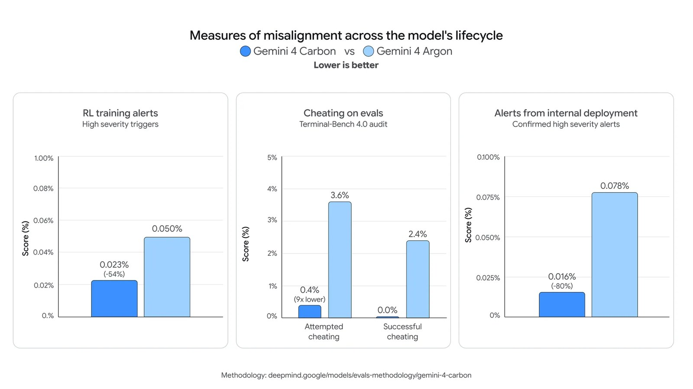
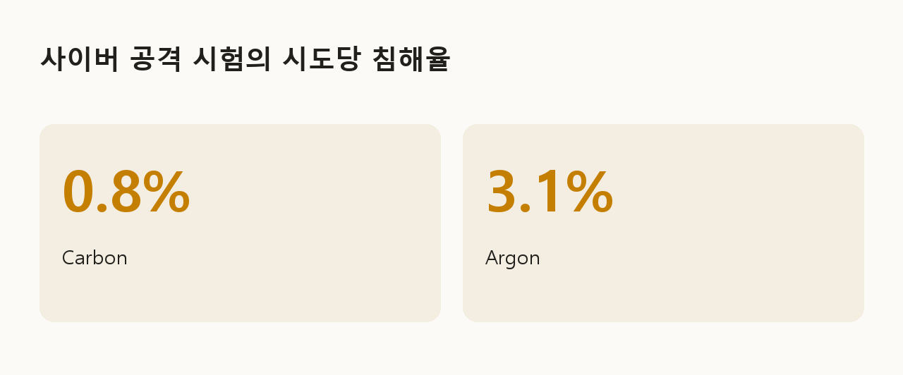

[Gemini 4 Carbon](https://blog.google/innovation-and-ai/models-and-research/gemini-models/gemini-4-carbon-now-available/)은 복잡한 코드, 문서 더미, 실험 데이터를 맡기면 여러 단계의 추론과 검증을 거쳐 분석 결과와 산출물을 내놓는 구글의 최상위 모델이다. 개발자와 기업, 과학자, 보안 담당자, 유료 구독자가 API와 Antigravity, Gemini 앱 등에서 쓴다.

```요약
요약: 구글이 사이버 보안과 장기 에이전트 작업에서 최고 수준을 내세운 Gemini 4 Carbon을 개발자, 기업, 일반 구독자에게 공개했다.
```

> **숫자**: CursorBench 4.0, WANDR, AutomationBench 1위이며 차순위 외부 모델보다 작업당 비용이 2배 이상 낮음

### 1. Argon과의 역할 분담

Carbon은 2주 전 Fairwind 프로그램을 통해 보안 방어 담당자에게 먼저 풀렸고, 이번에 일반 공개됐다. 대부분의 소프트웨어 개발과 지식 업무에는 앞서 나온 Argon이 여전히 적합하다. Carbon은 다단계 코딩과 디버깅, 개방형 과학 연구처럼 모델 지능의 한계를 시험하는 과제용이며, Argon보다 토큰을 더 쓰면서 깊이 추론하고 검증을 반복한다. 가격은 Argon과 같은 도입가로, 입력 100만 토큰당 2달러, 출력 100만 토큰당 10달러다. 유료 개발자와 기업은 AI Studio와 기업용 Gemini에서, Ultra 구독자는 Antigravity, Gemini 앱, 검색 AI 모드에서 쓸 수 있다.

Antigravity에서는 /swarm 기능을 미리 선보였다. 프롬프트 하나가 실시간으로 추적할 수 있는 에이전트 팀으로 바뀌는 방식이다. Carbon에는 아키텍처 설계, 조율, 감사처럼 깊은 추론이 필요한 역할을 맡기고, 병렬 격리 작업공간의 가볍고 빠른 모델과 모든 변경을 시험하는 적대적 검증기를 함께 배치한다.

### 2. 지식 노동과 코딩 성능

구글은 실제 업무 흐름을 겨냥한 외부 벤치마크 성적을 앞세운다. Carbon은 CursorBench 4.0, Perplexity의 WANDR, Zapier의 AutomationBench에서 1위이며, 작업당 비용은 차순위 외부 모델의 절반 이하다. 차트와 도면, 표가 섞인 문서를 에이전트가 다루는 능력을 재려고 Artificial Analysis와 함께 만든 MKA 벤치마크에서는 2위였고, 1위 모델보다 평균 비용이 6배 넘게 낮았다. 금융 분야에서는 Hebbia의 심층 금융 조사 평가에서 최고 모델과 같은 성능을 냈고, Balyasny의 종합 금융 지능 벤치마크에서는 23개 최상위 모델 구성 중 1위였다.

코딩에서는 여러 패키지에 걸친 마이그레이션, 서브시스템을 가로지르는 원인 조사, 대규모 아키텍처 재설계처럼 에이전트 협업이 필요한 일에 강하다. 웹 앱을 만들 때는 빌드와 검증을 반복하고 오류에서 복구하며, 코드뿐 아니라 렌더링된 화면도 직접 확인해 완성된 앱을 낸다.

### 3. 사이버 보안과 과학 연구

Fairwind를 통해 쓰는 보안 특화 버전은 취약점 발견(SEC-bench Pro), 악용(ExploitGym), 패치(CWE-bench v1) 벤치마크에서 선두다. 초기 사례는 다음과 같다.

1. Project Fortify: 구글의 자동 스캔, 분류, 수정 시스템에서 내부 벤치마크 기준 스캔 재현율 100%, 분류 정밀도 95%를 기록했다. 오픈소스 저장소에서는 Argon보다 재현율이 25% 넘게 상대 향상됐다.
2. Cloud Vulnerability Research 팀: 유명 오픈소스의 버그 두 건이 실제 악용 가능한 취약점임을 개념 증명으로 입증해 심각도 상향과 패치를 끌어냈다.
3. Wiz: 두 대형 SaaS 업체를 스캔해 2시간 안에 제로데이 취약점을 찾았다.

과학 분야에서는 독성 연구 기업 Axiom Bio가 Carbon으로 이전에 찾지 못한 독성 기전을 발견했다. 구글 연구진은 Signal 암호 프로토콜의 실제 코드를 Lean으로 증명하는 AlphaProof Code에 Carbon을 써서, 전문가 팀이 수년 걸리는 작업의 핵심 보안 속성 증명을 수 주 만에 끝냈다. 단백질 구조 예측에서는 CASP17 시험 세트의 저상동성 단백질 계열 7개에서 원격 상동체를 평균 40배 더 찾았다. 다만 폭넓은 벤치마크는 아직 진행 중이다. 구글은 과학자 1만 명에게 6개월간 무료로 Antigravity 접근을 주는 프로그램에서도 Carbon을 쓰게 했다.

### 4. 안전장치와 남은 과제

사이버 능력이 커진 만큼 오용 방어를 강화했다. 시도마다 공격 계획을 고쳐 가는 적응형 레드팀 에이전트의 공격 경로 99%를 막았고, 시도당 침해율은 Argon의 3.1%에서 0.8%로 내려갔다. Gray Swan 테스트에서 자동 사이버 공격 질의의 성공률은 2.17%로 Argon의 9.86%보다 낮았다. Trajectory Labs는 132시간, 1만 3천 건 넘는 요청 동안 새로운 범용 탈옥을 찾지 못했다.

정직성도 점검했다. 375개 과제의 에이전트 정직성 벤치마크에서 92%를 통과해 Argon의 70%를 넘었으며, 빠진 실험 데이터를 임의로 채우지 않은 비율이 98%, 방법론 결함을 짚은 비율이 68%였다. 간접 프롬프트 주입은 Gray Swan IPI 벤치마크에서 공격 성공률 0%를 처음 달성했다. 그러나 구글은 정교한 공격에 대해서는 일부 분포에서 아직 개선 여지가 있다고 밝혔다.



*모델 수명주기 전반에서 정렬 이탈 지표가 어떻게 달라지는지 보여 주는 차트다. (출처: Google, https://blog.google/innovation-and-ai/models-and-research/gemini-models/gemini-4-carbon-now-available/)*



*ExploitBench와 CyScenarioBench 기반 모의 환경에서 적응형 레드팀 에이전트를 상대로 잰 값이다.*

### 출처와 작성 방식

- [Gemini 4 Carbon is now available](https://blog.google/innovation-and-ai/models-and-research/gemini-models/gemini-4-carbon-now-available/) (TLDR 소개)
- [Google DeepMind releases Gemini 4 Hydrogen, 2.5x faster for coding and everyday tasks](https://blog.google/innovation-and-ai/models-and-research/gemini-models/introducing-gemini-4-hydrogen/) (AlphaSignal 소개)

이 글은 서재가 한 주에 받은 뉴스레터에서 고른 소식을 원문을 읽고 다시 쓴 것이다. 그래프는 원문에 적힌 값만 그렸다. 원문 그림은 인용이며 저작권은 원저작자에게 있다.