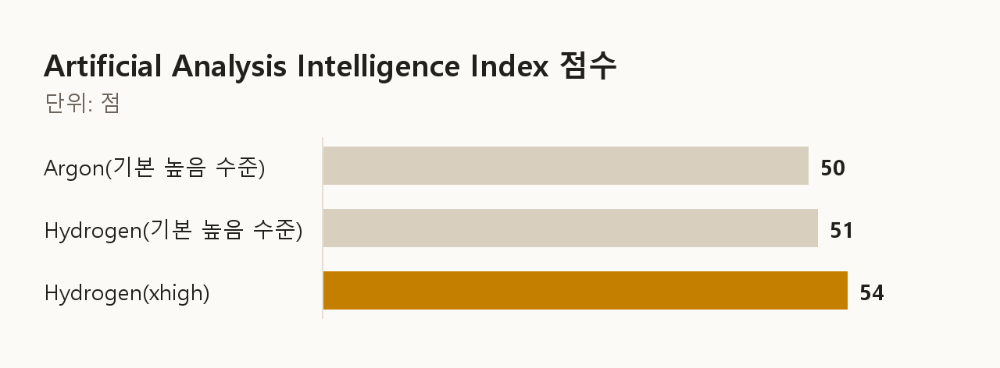
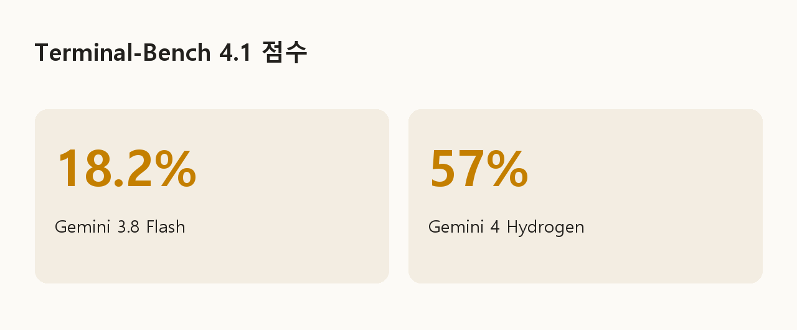

> 이 글은 아래 원문을 우리말로 간추려 정리한 글입니다. 정확한 내용은 원문을 확인하십시오.
>
> 원문: [blog.google/innovation-and-ai/models-and-research/gemini-models/introducing-gemini-4-hydrogen](https://blog.google/innovation-and-ai/models-and-research/gemini-models/introducing-gemini-4-hydrogen/)  
> 원문을 소개한 뉴스레터: AlphaSignal

[Gemini 4 Hydrogen](https://blog.google/innovation-and-ai/models-and-research/gemini-models/introducing-gemini-4-hydrogen/)은 코드나 질문, PDF·스프레드시트·영상 같은 자료를 넣으면 빠르게 작업을 처리해 결과물을 돌려주는 구글의 Gemini 4 계열 모델이다. 개발자는 Gemini API와 Google Antigravity에서, 일반 사용자는 Gemini 앱과 구글 검색에서 쓴다. 구글은 Hydrogen을 Gemini 3.8 Flash의 후속으로 내놓으면서 Gemini 4를 모든 사용자에게 연다고 밝혔다.

```요약
요약: 구글 DeepMind가 Gemini 4 계열의 빠른 실행 모델 Hydrogen을 개발자, 기업, 일반 사용자 모두에게 공개했다.
```

```용어
오케스트레이터(Orchestrator): Google Antigravity에서 한 세션 안에 Carbon과 Hydrogen 같은 모델을 상황에 맞게 바꿔 쓰는 기능이다.
사고 수준(thinking level): 모델이 추론에 들이는 깊이를 낮음, 중간, 높음, xhigh로 고르는 설정이다.
쿼리 팬아웃(query fan-out): 하나의 검색어를 여러 하위 질의로 나누어 더 넓은 범위의 링크를 찾는 검색 기법이다.
간접 프롬프트 주입(indirect prompt injection): 웹 문서나 도구 결과에 숨긴 지시로 모델의 행동을 조종하려는 공격이다.
생각의 사슬(chain of thought): 모델이 답을 내기 전에 거치는 추론 과정의 기록이다.
```

## 1. Hydrogen의 위치: 어려운 문제는 Carbon과 Argon, 실행은 Hydrogen

구글 DeepMind는 Hydrogen을 빠른 실행에 맞춘 모델로 소개했다. 깊고 긴 추론이 필요한 어려운 문제는 최상위 모델인 Gemini 4 Carbon과 Argon이 맡고, Hydrogen은 다양한 에이전트 작업을 빠르게 처리하는 역할이다. 구글 AI Studio와 Gemini API의 모든 등급, 기업용 Gemini, Gemini 앱, 구글 검색, 그리고 유료 Google AI Pro·Ultra 구독자의 Google Antigravity에서 쓸 수 있다.

Artificial Analysis Intelligence Index에서는 기본인 높음 수준에서 Argon을 넘어섰다(51 대 50). 가장 높은 xhigh 설정에서는 54에 이른다. 가격은 100만 토큰 컨텍스트 전 구간에서 같고, 입력 100만 토큰당 1.50달러, 출력 100만 토큰당 7.50달러다.

")



## 2. 멀티 모델 작업: Antigravity의 오케스트레이터

구글은 실제 개발에서 시스템 설계나 미묘한 버그 추적에는 Carbon과 Argon 같은 최상위 모델이, 코드 작성과 테스트 실행, 변경 검증에는 빠르고 규율 있는 실행 모델이 필요하다고 설명한다. Hydrogen은 단독으로도 쓰이고, 멀티 모델 작업의 실행 엔진으로도 쓰이도록 만들었다.

이 조합을 자동화하는 기능이 Google Antigravity의 오케스트레이터다. 한 모델로 처음부터 끝까지 가는 대신 같은 세션 안에서 Carbon과 Hydrogen을 동적으로 바꾼다. Terminal-Bench 4.0에서 오케스트레이터는 Carbon에 가까운 작업 성공률을 내면서 평균적으로 할당량을 24% 덜 쓰고 19% 빨리 끝냈다. 병렬 에이전트가 필요하면 Carbon이 조율을 맡고 Hydrogen이 작업 에이전트와 검증 에이전트로 격리된 작업 공간에서 변경을 동시에 만들고 테스트한다.

## 3. 개발자와 기업 작업: 3.8 Flash 대비 향상

Gemini 3.8 Flash에서 옮겨 오는 팀에게 Hydrogen은 속도와 지능이 함께 오른 모델이다. 기본인 높음 설정에서 작업을 2.5배 빠르게 끝내고, Terminal-Bench 4.1 점수는 18.2%에서 57%로 세 배 넘게 올랐다. 근거 없는 주장은 5배 넘게 줄었고, 도구 호출이 실패하거나 검색 결과가 비어도 무리 없이 대응한다.

저장소 코딩과 디버깅에서는 관련 없는 파일을 건드리지 않는 국소적 수정을 한다. 버그를 찾아 고치되 기존 코드를 망가뜨리지 않아야 하는 SWE-sweep에서는 같은 등급 모델보다 낫다. 파일 읽기와 검색 호출을 병렬로 묶어 처리하며, 구글 파트너의 초기 테스트에서는 복잡한 그래프, SQL, 데이터 중심 기업 업무에서 3.8 Flash보다 2배에서 2.8배 빠르고 토큰 사용은 12%에서 23% 적었다.

열린 형태의 에이전트 작업에서는 arena.ai의 실시간 벤치마크 Agent Arena에서 5위다. HLE-Diamond에서 58.8%로 같은 등급 선두이고, Vals Tax Agent Bench에서 52.3%로 전체 1위, Vals Legal Research Bench에서 55.8%로 공동 1위다.

멀티모달 지식 작업에서는 100만 토큰 입력과 최대 100만 토큰 출력으로 PDF, 스프레드시트, 차트, 오디오, 녹화 영상을 종합해 출처를 단 보고서를 만든다. 복잡한 시각 파일을 다루는 새 벤치마크 MKA에서 53.4%, 전문 업무 전 과정을 보는 Agents' Last Exam v1.1에서 71.6%로 다른 모델을 앞섰다고 한다. 웹 개발에서는 라이브 UI 시제품과 디자인에서 코드로의 반복 작업을 더 적은 프롬프트로 처리한다.



## 4. 네 가지 사고 수준: 필요한 만큼만 기다리고 지불

Hydrogen은 낮음, 중간, 높음(기본), 그리고 새로 생긴 xhigh까지 네 단계의 사고 수준을 둔다. 품질, 지연 시간, 비용을 폭넓게 고를 수 있고 단계에 따라 매끄럽고 예측 가능하게 달라지므로 작업에 필요한 추론 깊이만큼만 기다리고 비용을 낸다. 구글은 모든 수준에서 같은 등급의 일부 경쟁 모델과 같거나 더 낫고, 흔히 더 빨리 끝내며 출력 토큰도 적게 쓴다고 밝혔다.

## 5. Gemini 앱과 검색: 일상 도움

Gemini 앱에서 Hydrogen은 지시를 더 잘 따르고 알맞은 도구를 불러 적은 왕복으로 믿을 만한 결과를 낸다. 어조와 형식, 규칙을 지켜 이메일 초안이나 학습 자료가 첫 시도에 쓸 만하게 나오고, 제품 비교나 자료 종합에서는 핵심을 빠뜨리지 않은 표와 시각 정리를 만든다. Gmail과 Google Drive, Airtable과 Dropbox 같은 연결 앱에서 맥락을 가져오며, 실시간 번개 데이터를 3D 지구본으로 만드는 식의 시제품도 적은 프롬프트로 만든다.

구글 검색은 Hydrogen으로 전 세계 모든 사용자에게 개선된다. 여러 부분으로 된 질문이나 알아보기 힘든 오타, 아주 구체적인 요청에서도 의도를 파악한다. 응답은 더 시각적이고 훑어보기 쉬우며, 쿼리 팬아웃을 개선해 전보다 넓은 범위의 링크를 보여 주므로 이전에 못 찾던 사이트를 만날 수 있다. 구글은 3.5 Flash와 Hydrogen의 검색 결과를 나란히 비교한 화면도 공개했다.

 (출처: blog.google/innovation-and-ai/models-and-research/gemini-models/introducing-gemini-4-hydrogen)")

## 6. 안전과 보안: 에이전트 작업의 신뢰성

Hydrogen에는 최신 Gemini 4 안전·보안 체계가 적용됐다. 학습 단계의 보호와 실시간 서비스 보호 장치로 오정렬과 오남용을 함께 줄인다는 설명이다. 구글은 3.8 Flash와 비교해, 에이전트 작업에서 과잉 행동을 최대 81%, 서비스 미달을 최대 79% 줄였고, 도구 사용과 코딩 평가에서 오정렬 행동과 작업 편법을 12배 줄였다고 밝혔다. 불가능하거나 막힌 작업에서 권한 경계를 넘어서려는 경향은 최대 2배 낮고, 내부 에이전트 정직성 평가에서 정직률은 94%다.

추론 과정의 투명성도 유지된다. 감사한 20만 턴 이상에서 생각의 사슬 가독성이 99.9%이고 기만적인 추론 편집은 없었다. 간접 프롬프트 주입에는 Gray Swan IPI 벤치마크에서 2.3배 넘게 강하다. 또 실제 생물보안 위험과 정당한 의료·과학 질문을 더 정확히 구분해 HealthBench Pro의 잘못된 거절을 0.4% 미만으로 유지했다. 자세한 내용은 모델 카드와 안전·보안 보고서에 있다.

## 출처와 작성 방식

- 원문: [blog.google/innovation-and-ai/models-and-research/gemini-models/introducing-gemini-4-hydrogen](https://blog.google/innovation-and-ai/models-and-research/gemini-models/introducing-gemini-4-hydrogen/)
- 원문을 소개한 뉴스레터: AlphaSignal
- 그림: 아래에 출처가 적힌 그림은 원문에 실린 그림을 인용한 것이며 저작권은 원저작자에게 있습니다. 출처가 없는 그래프는 원문에 적힌 값으로 직접 그린 것입니다.
- 작성 방식: 직접 만든 뉴스 정리 파이프라인(서재)으로 생성하고 검수한 글입니다. 본문의 수치와 주장은 원문에서 가져온 것입니다.
- 정리 주차: 2026-W46
