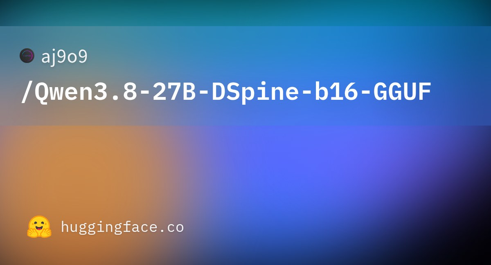

[Qwen3.8-27B-DSpine-b16 GGUF](https://huggingface.co/aj9o9/Qwen3.8-27B-DSpine-b16-GGUF)는 Qwen3.8-27B와 함께 띄우면 토큰 16개 분량의 초안을 한 번에 만들어 주는 드래프트 모델이다. 본체 모델이 이 초안을 검증해 맞는 만큼 받아들이므로 답의 내용은 유지하면서 생성 속도가 올라간다. 텐센트가 공개한 DSpine을 GGUF로 변환한 것으로, 로컬에서 llama.cpp로 27B 모델을 돌리는 사용자가 쓴다.



*원문 대표 그림 (출처: huggingface.co, https://huggingface.co/aj9o9/Qwen3.8-27B-DSpine-b16-GGUF)*

```요약
요약: Qwen3.8-27B용 DSpine 드래프트 모델의 GGUF 변환본으로, RTX 3090 한 장에서 추측 디코딩 없이 돌릴 때보다 코드와 수학에서 크게 빠르지만 문맥 길이와 GPU에 따라 효과가 달라진다.
```

> **숫자**: RTX 3090에서 혼합 작업 약 90 tok/s, 추측 디코딩 없이는 약 28 tok/s

### 1. DSpine의 구조

DSpine은 DFlash를 확장한 5층짜리 드래프트 모델이다. 본체 모델의 다섯 개 층에서 은닉 상태를 읽어 16개 토큰을 한 블록으로 병렬 생성하고, 본체가 이를 한꺼번에 검증한다. DFlash와 달리 블록 안의 토큰끼리 앞뒤 관계를 반영하도록 세 가지를 더했다.

1. 인과적 블록 어텐션: 블록 안에서 각 위치는 자기보다 앞선 위치만 참조한다.
2. 코드 브리지: 매 층 뒤에서 각 위치가 직전 위치의 예측 토큰 코드로 만든 메시지를 받는다. 앞뒤 의존 관계가 신경망 깊이 전체로 전달된다.
3. 직렬 마지막 쓰기 정제: 위치마다 상위 16개 후보를 두고 후보별 정확한 코드로 마지막 브리지 쓰기를 다시 계산해 16×16 전이표를 만든다. 추측 디코더는 마지막으로 수락된 토큰에서 출발해 이 표를 따라 초안 사슬을 고른다.

배포 파일에는 드래프트 모델만 들어 있어 Qwen3.8-27B 본체 GGUF를 따로 받아야 한다. 권장 파일은 1.26GB짜리 Q4_K_M이고, 코드 브리지 텐서는 BF16으로 남겨 두었다. 아직 공식 llama.cpp는 DSpine을 지원하지 않아 작성자의 포크 브랜치로 빌드해야 하며, 일반 빌드는 이 파일을 잘못 돌리는 대신 로드를 거부한다.

### 2. RTX 3090에서의 속도

Q4_K_M 본체를 올린 RTX 3090 한 장에서 코드와 수학은 약 125 tok/s, 여러 대화 작업을 섞으면 약 90 tok/s가 나온다. 같은 조건에서 DFlash2는 약 52 tok/s, 추측 디코딩을 쓰지 않으면 약 28 tok/s이다. 전체로는 3.2배, 코드에서는 최대 4.5배 빠르다.

문맥이 깊어지면 격차가 줄어든다. 소설 본문을 채운 실험에서 깊이 0일 때 DSpine은 48.0 tok/s로 추측 없는 28~29 tok/s를 크게 앞섰지만, 깊이 32,768에서는 31.1 대 23.8까지 좁혀졌다. 산문과 코드 설명은 초안이 맞기 어려운 내용이어서 검증 한 번에 받아들이는 토큰이 평균 2.5~3.5개에 그쳤다. 이 표는 조건마다 한 번 측정한 값이라 몇 tok/s 정도의 잡음이 있고, 입력을 처리하는 prefill 속도는 약간 떨어진다.

### 3. 컨텍스트 한도와 메모리

속도를 얻는 대가는 컨텍스트 길이다. Qwen3.8은 순환 층이 섞인 하이브리드 모델이라, 초안을 검증하는 동안 초안 토큰마다 순환 상태 사본을 하나씩 보관한다. 사본 하나가 약 150MB여서 16토큰 블록은 8토큰 블록의 DFlash2보다 VRAM을 약 1.2GB 더 쓰고, 그만큼 컨텍스트 여유가 줄어든다. 한도를 정하는 것은 드래프트 모델이 아니라 본체 쪽이다.

24GB 카드에서 Q4_K_M 본체와 q8_0 KV 캐시를 쓰면 초안 15토큰일 때 컨텍스트 65,536까지 올라간다. 초안을 7토큰으로 줄이면 98,304까지 늘어난다. 두 슬롯을 동시에 쓰려면 초안을 7토큰으로 줄여야 한다. 컨텍스트 길이는 자동 맞춤에 맡기지 말고 직접 지정하는 편이 안전하다. 자동 맞춤은 드래프트 모델 몫을 충분히 남기지 않고, 이미지 처리용 프로젝터를 함께 올리면 첫 이미지 요청에서 비정상 종료가 날 수 있다.

### 4. 다른 GPU와 사용 시 주의

효과는 GPU가 16토큰 블록을 얼마나 빨리 검증하느냐에 달려 있다. 커뮤니티 보고에서 DGX Spark는 코드에서 DFlash2보다 빨랐지만 수학과 산문은 DFlash2가 앞섰다. Radeon AI PRO R9700(ROCm)은 코드와 도구 호출에서 본체 내장 MTP보다 크게 빨랐고 산문과 이미지 요청은 4~23% 느렸다. Intel Arc Pro B65는 코드에서 추측 없는 경우의 5.5배까지 나왔다. Vulkan으로 돌린 RX 7800 XT는 초안을 2토큰으로 줄였을 때 1.53배 빨랐고, 15토큰으로 키우자 오히려 느려졌다.

따라서 초안 길이를 기본값으로 두지 말고 자기 프롬프트로 2, 3, 4, 7, 15를 비교해 보라는 것이 작성자의 권고이다. NVIDIA, ROCm, SYCL 환경은 15에서 시작하고 Vulkan은 2~3에서 시작한다. 산문과 대화가 많다면 초안이 대부분 기각되므로 3 정도로 짧게 잡는다. DSpine은 코드, 수학, 도구 호출에 강하고 산문과 이미지 중심 요청에서는 DFlash2나 MTP가 나을 수 있다. 또한 검증이 여러 토큰을 한 배치로 처리하는 탓에 온도 0에서도 드래프트 없이 돌린 결과와 출력이 달라질 수 있다. 코드와 도구 호출은 대체로 같지만 산문과 이미지 설명은 갈릴 수 있다.

### 출처와 작성 방식

- [Tencent's 27B model hits 125 tok/s on an RTX 3090 with speculative decoding](https://huggingface.co/aj9o9/Qwen3.8-27B-DSpine-b16-GGUF) (AlphaSignal 소개)
- [Unsloth AI ships quantized Qwen3 models that run on 12GB RAM with 5–10% accuracy gains](https://huggingface.co/unsloth/Qwen3.8-27B-GGUF) (AlphaSignal 소개)
- [DSpine Speculative Decoding: 4x Faster Coding Agents on One GPU](https://kaitchup.substack.com/p/dspine-speculative-decoding-4x-faster) (The Kaitchup 소개)

이 글은 서재가 한 주에 받은 뉴스레터에서 고른 소식을 원문을 읽고 다시 쓴 것이다. 그래프는 원문에 적힌 값만 그렸다. 원문 그림은 인용이며 저작권은 원저작자에게 있다.