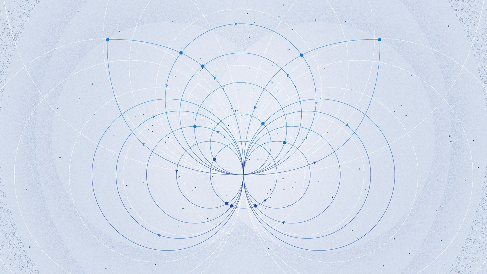
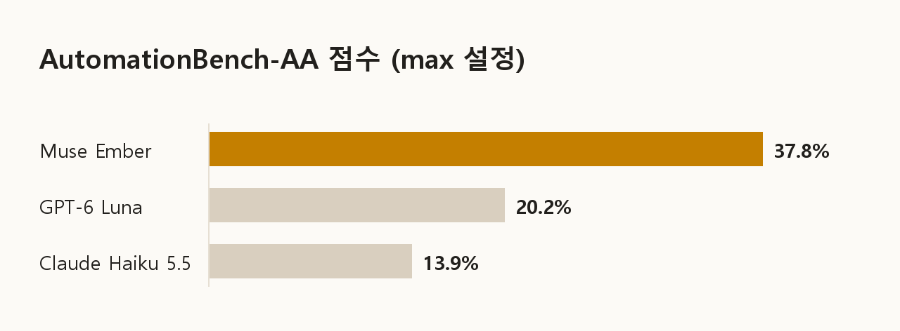
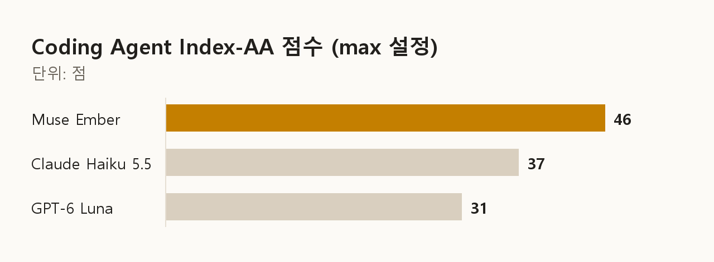

[Muse Ember](https://research.meta.ai/blog/muse-ember)는 Meta가 내놓은 가장 작고 효율적인 모델이다. 텍스트, 이미지, 오디오, 비디오를 넣으면 도구 호출, 코드 수정, 정보 추출 같은 에이전트 작업의 결과가 나온다. 에이전트 시스템에서 단순하고 반복적인 단계를 싼값에 대량으로 처리하려는 개발자와 기업이 Meta Model API로 쓴다.



*원문 대표 그림 (출처: Meta AI Research, https://research.meta.ai/blog/muse-ember)*

```요약
요약: Meta가 Muse Wonder Full로 훈련한 소형 모델 Muse Ember를 공개했고, Haiku 5.5의 최고 점수에 약 3분의 1 비용으로 맞춘다고 밝혔다.
```

> **숫자**: Artificial Analysis 지수 36, 지수 작업당 약 0.14달러

### 1. 반복 작업을 맡는 모델

Meta는 Muse Ember의 용도를 도구 호출, 코딩 하위 작업, 라우팅, 정보 추출, 긴 문서 분석처럼 에이전트가 하루 종일 되풀이하는 일로 잡았다. 에이전트는 토큰 대부분을 작고 정형화된 여러 단계에 쓰는데, 이 모델은 그 구간에 맞춰 만들어졌다는 설명이다. Meta 모델 라인업에서 맡는 역할은 다음과 같다.

1. Muse Wonder: 가장 어려운 문제를 맡는다.
2. Muse Spark: 코딩과 에이전트 워크플로를 맡는다.
3. Muse Ember: 대규모로 반복되는 코딩·에이전트 작업을 맡는다.

Ember는 Muse Wonder Full로 훈련한 첫 모델이다. 가장 어려운 문제는 Wonder가 계획을 세우고 Ember가 물량을 처리하는 조합을 권한다.

### 2. 비용 대비 성능

Meta에 따르면 Ember는 어떤 추론 설정에서도 Claude Haiku 5.5와 GPT-6 Luna보다 달러당 지능이 높다. Haiku의 최고 점수에는 약 3분의 1 비용으로 맞추고, Luna는 모든 설정에서 앞선다. Artificial Analysis 전체 리더보드에서도 더 적은 비용으로 더 높은 점수를 내는 모델은 없다고 한다. 다만 Ember의 비용은 제안된 가격을 기준으로 한 추정치다.

가격은 입력 100만 토큰당 0.10달러, 출력 0.50달러이고 캐시된 입력은 0.004달러다. 컨텍스트 창은 100만 토큰, 출력은 최대 51만 2천 토큰이어서 코드베이스나 문서 묶음을 한 번에 넣을 수 있다. 같은 회사의 Muse Spark 1.3과 견주면 지수는 36 대 37로 한 점 낮지만, 지수 작업당 비용은 0.14달러 대 2.39달러다.

### 3. 에이전트와 코딩 벤치마크

비교는 세 모델 모두 최대(max) 추론 설정으로 했다. 업무 자동화를 보는 AutomationBench-AA에서 Ember는 37.8로 Luna 20.2, Haiku 13.9를 크게 앞선다. 종단 간 에이전트 과제인 Agents' Last Exam은 61.6 대 57.1, 57.0으로 격차가 작다. 이 시험은 Meta 내부 평가의 Linux 하위 집합이다.

코딩에서는 Terminal-Bench 4.0이 40.9로 Haiku 39.2, Luna 16.4보다 높고, Coding Agent Index-AA는 46으로 37, 31을 앞선다. 반대로 실제 엔지니어링 과제를 병합 가능성으로 평가하는 FrontierCode 2.0-AA에서는 Haiku가 34.9, Ember가 27.2로 뒤진다. 어려운 코딩 문제에서는 상위 모델을 곁들이라는 Meta의 권고와 맞아떨어지는 결과다.



*업무 자동화 벤치마크에서 Ember가 두 경쟁 모델을 크게 앞선다.*



*실제 에이전트 하네스에서의 코딩 성능 비교다.*

### 4. 멀티모달과 안전성

Ember는 별도 모델 없이 스크린샷, 차트, 스캔 문서, 음성 메모, 회의 녹음, 영상을 직접 읽는다. 데스크톱 조작을 평가하는 OSWorld 2.1의 부분 점수는 69.5로 Haiku 68.9, Luna 50.5보다 높고, 이진 기준은 33.8 대 27.8, 17.0이다. 세밀한 시각 인식을 보는 PerceptionBench는 도구를 쓸 때 80.6으로 Haiku 78.6, Luna 62.8을 앞선다. 긴 문서 업무를 보는 GDP.pdf-AA는 22.8로 Luna와 같고 Haiku는 20.8이다. OSWorld와 PerceptionBench는 Meta 내부 평가다.

안전성은 Meta의 자체 프레임워크로 화학·생물, 사이버보안, 통제 상실 위험을 평가했고, 평가한 범주에서 고위험 기준 아래로 나왔다고 한다. 작은 모델이지만 같은 핵심 안전 훈련과 시험을 거쳤고, 웹페이지나 문서에 숨은 지시에 휘둘리지 않는지, 영향이 큰 행동 전에 사람의 입력을 구하는지도 살폈다. Ember는 Meta Model API와 Muse Code에서 바로 쓸 수 있다.

### 출처와 작성 방식

- [Introducing Our Smallest, Most Efficient Model: Muse Ember](https://research.meta.ai/blog/muse-ember) (Simon Willison’s Newsletter 소개)
- [Meta introduces Muse Ember to power cost-efficient AI agents](https://siliconangle.com/2026/11/09/meta-introduces-muse-ember-to-power-cost-efficient-ai-agents/) (Deep Learning Weekly 소개)

이 글은 서재가 한 주에 받은 뉴스레터에서 고른 소식을 원문을 읽고 다시 쓴 것이다. 그래프는 원문에 적힌 값만 그렸다. 원문 그림은 인용이며 저작권은 원저작자에게 있다.