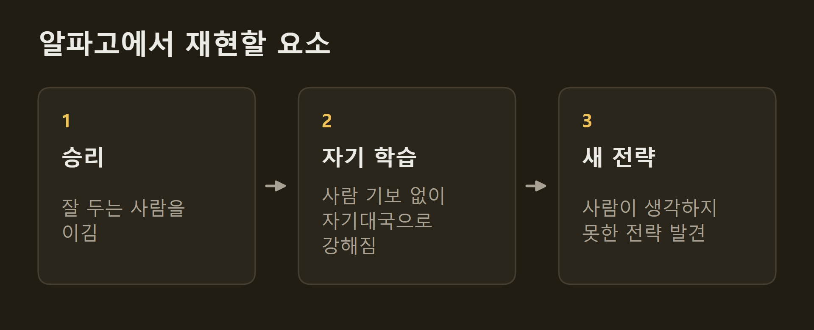
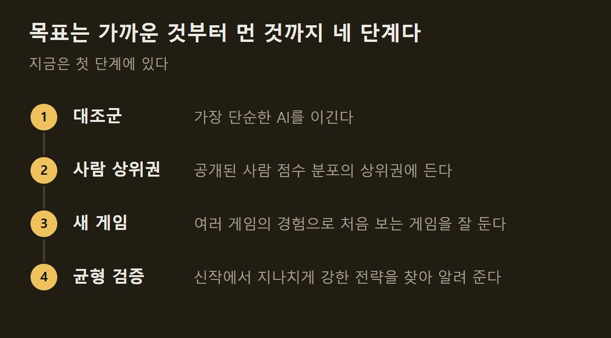
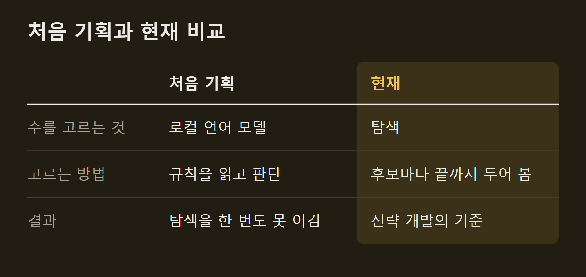

> 이 글은 직접 만들고 있는 개인 프로젝트의 개발 기록입니다. 저장소는 비공개입니다.

보드게임 가운데서도 한 판이 길고 규칙이 많은 유로게임을 가장 좋아한다. 그런데 이런 게임은 내가 두고 싶을 때 같이 둘 사람을 찾기가 어렵다. 이 프로젝트는 그 자리를 AI로 채우려는 시도이고, AI에 관심을 갖게 해 준 알파고를 내가 좋아하는 게임에서 다시 만들어 보려는 시도이기도 하다. 이 글에는 만들게 된 이유와 목표, 그리고 처음 기획에서 바뀐 것을 적는다.

```요약
요약: 같이 둘 사람을 찾기 어려운 무거운 유로게임을 사람 상위권 수준으로 두는 AI를 만들려는 프로젝트이며, 처음 기획한 언어 모델 방식은 접었고 여러 게임의 경험이 새 게임에 통하는지를 증명할 방법은 아직 정하지 못했다.
```

```용어
유로게임: 자원을 모으고 바꿔 점수를 쌓는 전략 보드게임. 주사위 운보다 계획의 비중이 크다.
룰마: 모임에서 게임 규칙을 익혀 와 다른 사람에게 설명하는 사람.
핸디캡: 실력 차이가 나는 사람끼리 둘 때 잘 두는 쪽에 주는 불리한 조건.
자기대국: AI가 자기 자신이나 다른 AI를 상대로 두는 대국.
언어 모델: 글을 읽고 쓰도록 학습한 AI 모델.
```

## 1. 두고 싶은 게임과 둘 수 있는 게임

보드게임은 기회가 될 때만 가끔 둔다. 무거운 유로게임은 한 판에 여러 시간이 들고 규칙을 익히는 데에도 품이 들어서, 내가 고른 게임을 같이 두겠다는 사람을 모으기가 쉽지 않다.

온라인 플랫폼으로도 해결되지 않았다. 내가 두고 싶은 게임이 올라와 있지 않은 경우가 많고, 올라와 있어도 결국 사람을 기다려야 한다. ==두고 싶은 게임을 두고 싶을 때 두려면 상대가 사람이 아니어야 했다.==

")

## 2. 알파고에서 얻은 목표

AI에 관심을 갖게 된 계기는 2016년 알파고와 이세돌 9단의 대국이었다. 그때 본 것을 내가 좋아하는 게임에서 재현해 보고 싶었다. 재현하고 싶은 것은 세 가지다.



바둑과 다른 점도 많다. 유로게임은 3~4명이 함께 두고, 남의 손패나 덱의 순서처럼 볼 수 없는 정보가 있으며, 승패보다 점수로 겨룬다. 게임마다 규칙이 전혀 달라서 엔진부터 게임 수만큼 만들어야 한다.

## 3. 규칙을 설명하는 사람에게 필요한 것

모임에서는 규칙을 익혀 와 설명하는 룰마를 자주 맡는다. 룰마에게는 두 가지가 필요하다.

첫째는 설명하기 전에 미리 한 판 돌려 보는 것이다. 규칙서를 읽은 것과 실제로 한 판을 끝까지 두어 본 것은 다르고, 내가 규칙을 제대로 이해했는지는 돌려 봐야 드러난다.

둘째는 그 게임에서 무엇이 강한 플레이인지 아는 것이다. 초보자와 잘 두는 사람이 한 판에 섞이면 핸디캡을 정해야 게임이 원활하게 진행되는데, 무엇이 강한지 모르면 초보자에게 방향을 알려 줄 수도 핸디캡의 크기를 정할 수도 없다. ==잘 두는 AI가 있으면 처음 설명하는 게임에서도 강한 플레이가 무엇인지 미리 볼 수 있다.==

## 4. 목표로 삼은 수준

목표는 사람 상위권 수준이다. 재는 기준은 공개된 사람 점수 분포로 잡았다. 예를 들어 SETI에서는 사람 상위 10%에 해당하는 점수를 첫 목표로 적어 두었다.

AI에게 바라는 것은 두 가지다. 하나는 강함이고, 다른 하나는 난이도를 고를 수 있는 것이다. 두는 방식이 사람 같지 않아도 점수가 높으면 되지만, 약한 상대부터 강한 상대까지 단계가 있어야 초보자와도 쓸 수 있다.



아직 첫 단계에 있다. 지금의 AI는 가장 단순한 대조군을 이기는 것까지만 확인했고, 사람과 견주어 잰 적은 없다.

## 5. 게임을 하나가 아니라 여럿 만드는 이유

보드게임을 잘 두는 사람은 처음 보는 게임에서도 금방 좋은 수를 찾는다. 여러 게임을 두면서 쌓은 경험이 새 게임에도 통하기 때문이다. ==이것이 AI에서도 되는지를 증명하고 싶었다.== 게임을 한두 개가 아니라 34개까지 만든 이유가 여기에 있다.

무엇을 보이면 증명한 것으로 볼지는 아직 정하지 못했다. 방향만 있고, 방법은 전략을 개발하면서 정할 생각이다.

더 먼 쓰임새도 있다. 새 게임을 바로 구현해 학습시킬 수 있게 되면, 보드게임 개발자가 만드는 신작에서 지나치게 강한 전략을 찾아내 출시 전에 균형을 잡는 데 쓸 피드백을 줄 수 있다. 지금은 저작권 문제가 있어 혼자 연구하는 용도로만 쓴다.

## 6. 처음 기획에서 바뀐 것

처음 기획은 언어 모델이 게임을 두는 것이었다. 규칙을 읽은 언어 모델이 사람처럼 판단해 수를 고르기를 기대했다. 유료 API는 비용 때문에 쓰지 않기로 했으므로 내 컴퓨터에서 도는 언어 모델을 썼다.

결과는 기대와 달랐다. 언어 모델로 만든 전략은, 후보 수마다 게임을 끝까지 두어 보고 평균 점수가 높은 수를 고르는 단순한 탐색 방식을 한 번도 이기지 못했다. 그래서 방향을 바꿨다. 언어 모델 전략은 모두 제거했고, 지금은 탐색 방식을 기준으로 삼아 그 위에서 전략을 개발한다.



## 출처와 작성 방식

- 근거: 프로젝트를 만든 사람의 기획 의도와 비공개 저장소의 개발 기록
- 그래프: 본문 내용을 정리해 VISER 주간 보고서의 그래프 양식으로 직접 그린 그림입니다.
- 화면: 이 프로젝트의 테이블에서 AI 대국을 진행하다가 찍은 것입니다. 화면 속 게임 그림은 인용이며 저작권은 출판사에 있습니다.
- 작성 기준일: 2026-10-13
