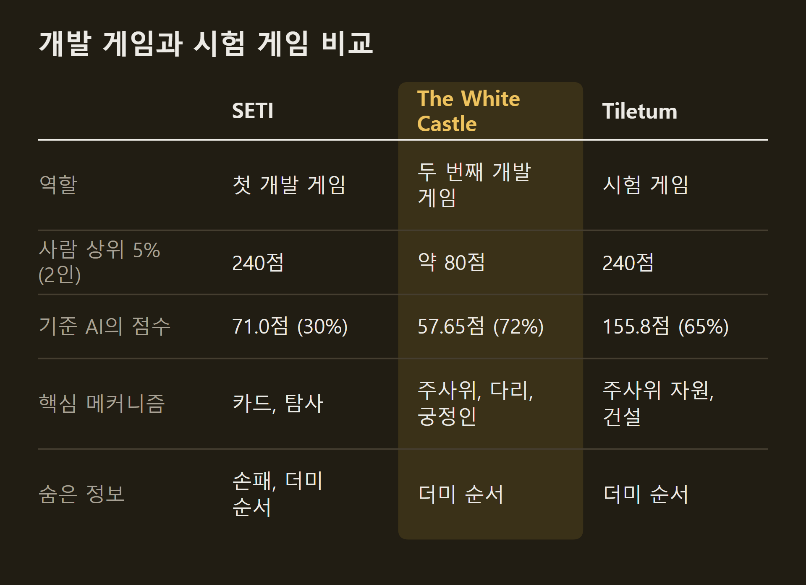
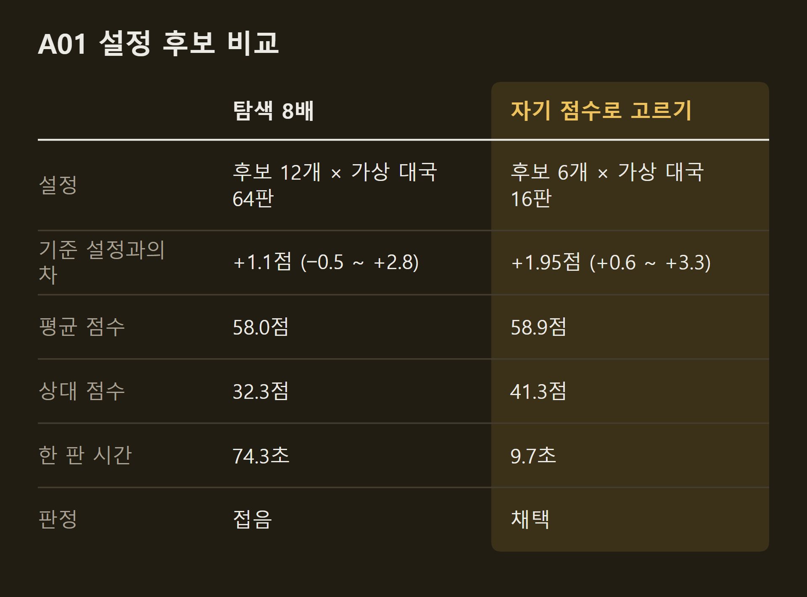
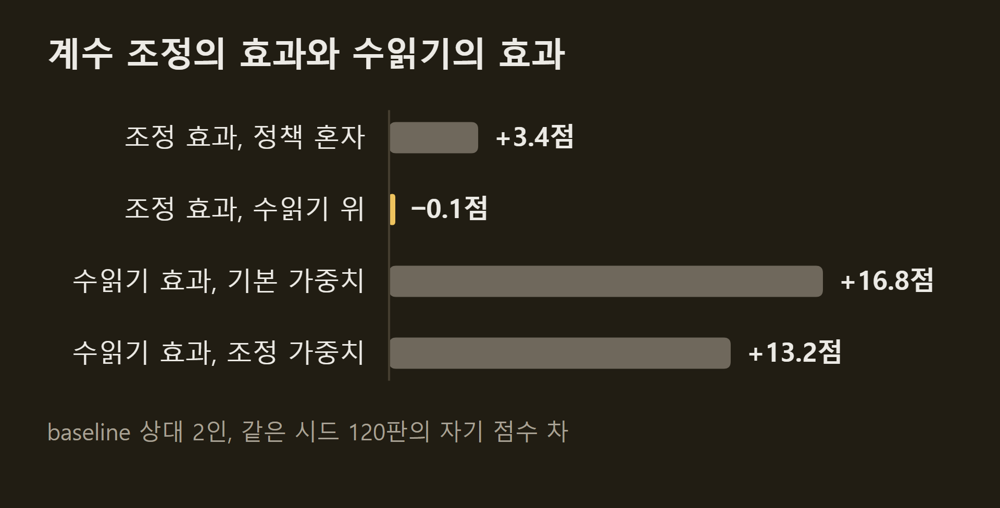
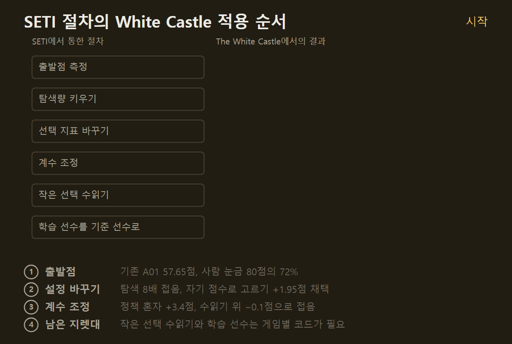
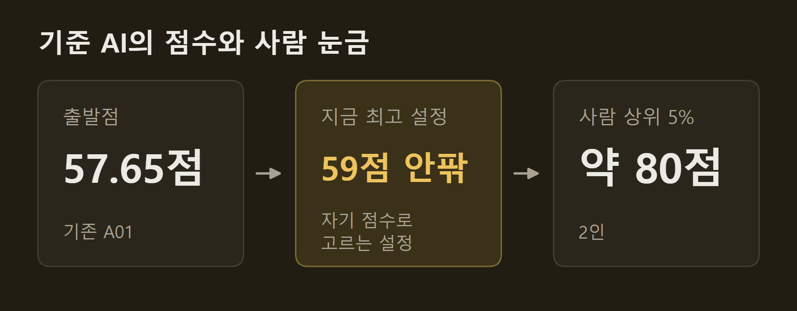

> 이 글은 직접 만들고 있는 개인 프로젝트의 개발 기록입니다. 저장소는 비공개이며, 본문의 수치는 저장소의 기록에서 가져왔습니다.

이 프로젝트의 전략 AI 계획은 두 단계다. 먼저 SETI 한 게임에서 사람 상위권에 닿는 방법을 찾고, 그다음 그 절차를 다른 게임에 게임별 코드 없이 옮겨 본다. SETI가 209.2점까지 온 상태에서 두 번째 단계를 시작했고, 이 글에는 두 번째 게임 The White Castle에서 하루 동안 돌린 네 단계의 결과와 그 답을 적는다.

```요약
요약: SETI에서 통한 절차를 게임별 코드 없이 두 번째 게임 The White Castle에 하루 동안 돌려 보니 기존 AI 57.65점 위에 자기 점수로 고르는 설정 하나만 1.95점으로 남았고, 탐색량 늘리기와 계수 조정은 수읽기가 이미 내는 이득과 겹쳐 효과가 없었으며, SETI에서 큰 도약을 낸 지렛대는 게임별 코드가 있어야 옮길 수 있었다.
```

```용어
A01: 후보 행동마다 게임 끝까지 두어 보고 평균 점수가 높은 수를 고르는 기준 AI다. 전략 대상 31개 게임 모두에 있다.
baseline: 한 수 앞만 보고 정해진 우선순위대로 두는 가장 단순한 AI다. 모든 실험의 상대이고, A01의 가상 대국에서 남은 수도 둔다.
사람 눈금: 플레이어가 자기 점수를 올리는 사이트에서 읽은 2인 상위 5% 점수다. The White Castle은 약 80점이다.
자기 점수: 상대와의 점수 차가 아니라 내 최종 점수다. 사람 눈금이 자기 점수라 판정의 잣대로 쓴다.
계수 조정: 정책이 선택지에 점수를 매길 때 쓰는 숫자들을 대국 결과로 조금씩 바꿔 가는 방법이다.
시드: 카드와 주사위의 순서, 준비물을 정하는 번호다. 같은 시드면 같은 판이 차려진다.
```

## 1. 개발 게임과 시험 게임

새 게임이 오면 같은 절차로 정해진 시간 안에 A01보다 강한 정책을 뽑는 것이 이 계획에서 말하는 제너럴리스트다. 그래서 사람 눈금이 있는 게임을 개발에 쓰고, 그중 일부는 손대지 않는 시험 게임으로 남긴다. 처음 보는 게임에서 '중수 이상'을 판정하려면 시험 게임에도 눈금이 있어야 하기 때문이다.

두 번째 개발 게임은 The White Castle로 정했다. 2인 상위 5%가 약 80점이고 기존 A01이 54점 안팎으로 눈금의 68% 자리에 있어 오르고 내리는 것이 보이며, 숨은 정보가 더미 순서뿐이고 한 판이 빠르다. 시험 게임은 Tiletum 하나로 정했다. 주사위 자원과 건설이 중심이라 개발 게임과 메커니즘이 다르고, 기존 A01이 155.8점으로 눈금 240점의 65% 자리에 있다.



이번 작업의 제약은 하루와 CPU 6스레드였다. 다른 작업이 GPU를 쓰는 중이라 학습이 있으면 CPU로 하기로 했다. 다행히 The White Castle은 A01이 baseline을 상대로 한 판 11초라, SETI의 점수 최우선 설정이 한 판 9분 가까이 걸리는 것과 달리 판정마다 120판씩 둘 수 있었다.

## 2. 출발점

같은 시드 60판씩 두어 기준선을 쟀다. baseline끼리는 44.4점이고, 기존 A01은 baseline을 상대로 57.65점에 60전 60승이었다. 후보와 가상 대국을 늘린 깊은 설정은 57.5점으로, 같은 시드에서 기존 A01과의 차가 −0.2점(−1.9 ~ +1.5)이었고 시간은 2.7배였다.

탐색량은 기본 설정에서 이미 찼다는 뜻이다. SETI에서도 탐색량의 효과가 작은 크기에서 다 찼었는데, 이 게임은 기본 설정부터 그 모양이다. 57.65점은 사람 눈금 80점의 약 72%다.

한 가지 눈에 띄는 것은 상대의 점수였다. A01을 상대한 baseline은 34.4점으로 baseline끼리 둘 때의 44.4점보다 10점 낮았다. 2인 The White Castle은 다리의 주사위 자리와 방, 궁정인 자리를 두고 겨루므로 상대의 세기가 내 점수를 깎는다. 사람 눈금은 사람끼리 둔 점수라, baseline 상대 점수가 사람 상대 점수보다 높게 나올 수 있다는 점을 적어 두고 5절에서 확인했다.

## 3. 설정만 바꾼 시도

코드 없이 A01의 설정만으로 더 얻을 것이 있는지 봤다. 후보는 둘이다. 하나는 후보 12개에 가상 대국 64판으로 탐색을 8배 늘린 것이고, 다른 하나는 후보를 고를 때 상대와의 점수 차 대신 자기 점수를 보는 것이다. 사람 눈금이 자기 점수라 잣대를 맞춰 본 것이다.



탐색 8배는 같은 시드 120판에서 1.1점(−0.5 ~ +2.8)으로 하한이 0을 넘지 못해 접었고, 시간은 74.3초로 8배 가까이 늘었다. 자기 점수로 고르는 설정은 1.95점(+0.6 ~ +3.3)으로 채택해 58.9점이 됐고, 시간은 기존과 같았다.

이 설정은 자기 점수를 2점 올리면서 상대 점수를 33.3점에서 41.3점으로 8점 올려 주었다. 점수 차는 23.7점에서 17.6점으로 줄고 120판 중 승리도 119판에서 114판으로 줄었다. 승률이나 다인 순위가 지표라면 점수 차로 고르는 쪽이 맞지만, 사람 눈금이 자기 점수이므로 이쪽을 택했다. 두 지표가 이렇게 갈리는 것 자체가 상호작용이 큰 게임이라는 뜻이다.

## 4. 계수 조정

SETI에서 정책의 계수 조정은 수읽기 위에서 효과가 없었지만, The White Castle의 baseline은 한 번도 조정하지 않은 손 가중치라 여지가 있을 수 있었다. 점수 계산에 쓰는 숫자 36개를 꺼내 공용 조정기로 1시간 동안 772세대를 돌렸고, 7번 교체됐다. 조정의 목표는 SETI의 교훈대로 맞대결 점수 차가 아니라 baseline을 상대한 자기 점수다.



조정한 가중치는 정책 혼자 둘 때 3.4점(+1.4 ~ +5.5) 올랐지만, 수읽기 위에서는 −0.1점(−1.7 ~ +1.4)이라 기본 가중치를 유지했다. 수읽기가 더하는 점수가 기본 가중치에서 16.8점, 조정 가중치에서 13.2점으로, 조정이 올린 만큼 수읽기의 몫이 줄었다. 수읽기가 이미 내고 있던 이득을 조정이 다시 낸 것이라 SETI의 계수 조정과 같은 모양이다.

## 5. 잣대 확인

강한 상대와 두면 점수가 얼마나 내려가는지도 쟀다. 채택한 설정끼리 30판(플레이어 점수 60개)을 두니 평균 55.6점으로, 같은 설정이 baseline을 상대로 낸 59.7점보다 약 4점 낮았다. 80점을 넘긴 점수는 60개 중 하나였다.

baseline 상대 점수를 잣대로 그대로 쓰되, 사람을 상대한 점수는 이보다 낮을 수 있다는 주석을 달았다. 목표까지 남은 거리는 baseline 상대로 약 20점, 강한 상대로 약 25점이다.

## 6. 코드 없는 절차의 답

계획에서 미리 적어 둔 질문은 "같은 절차가 다른 게임에서도 확인 시드에서 하한 0을 넘는 설정을 내는가"였다. The White Castle의 답은 '예, 다만 작다'이다.



기존 A01보다 나은 설정을 하한 0 위로 얻었지만 그 이득은 1.95점이고, SETI에서 큰 도약을 냈던 지렛대에서 나온 것이 아니다. 코드 없이 옮길 수 있는 두 지렛대(탐색량, 계수 조정)는 둘 다 이득이 없었고, 그 원인은 SETI 때와 같다. 탐색량은 작은 크기에서 이미 차고, 손 가중치의 조정은 수읽기가 이미 내는 이득과 겹친다.

SETI에서 실제로 점수를 올린 것은 기준 선수의 교체(11.7점과 8.9점)와 작은 선택의 수읽기(13.7점)였는데, 둘 다 게임별 코드가 필요하다. The White Castle은 플레이어 한 명이 한 판에 내리는 결정의 약 75%가 하위 단계(궁정인과 정원사, 전사의 배치, 효과 순서, 자원 선택)인데, AI가 받는 관측에 그 단계의 작업 큐가 없어 수읽기가 그 상황을 만들 수 없고 baseline이 대신 둔다. 작업 큐는 모든 행동이 공개된 정보라 숨은 정보가 아니고, 관측의 약속에 들어 있지 않을 뿐이다.



아래는 검토 중인 후보이고, 어느 쪽으로 갈지는 정하지 않았다.

- **관측에 작업 큐를 넣고 작은 선택을 수읽기로 고르는 방향.** 관측의 약속을 바꾸면 기존 기보를 다시 모아야 한다. 새 정책에게만 작업 큐를 주는 별도 창을 두면 기보는 그대로지만 "AI는 관측만 본다"는 원칙의 예외를 적어야 한다.
- **학습한 예측 모델을 기준 선수로 쓰는 방향.** 가상 대국 안에는 작업 큐가 있으므로 모든 결정을 학습 모델로 고를 수 있다. 관측 특징, 자기대국 자료, 모델 학습, 가상 대국 안의 평가 코드가 필요하고 한 판 시간이 5~10배가 된다.
- **3·4인으로 넓히기.** 사람 눈금이 2인뿐이라 기존 A01과의 상대 비교만 된다.

이 결과는 게임 하나에서 하루 동안 잰 것이다. 시험 게임 Tiletum에서는 아직 아무것도 재지 않았고, "코드 없는 절차의 이득은 A01 위 2점 정도"라는 답이 다른 게임에서도 같은지는 다음 게임에서 본다.

## 출처와 작성 방식

- 근거: 비공개 저장소의 The White Castle 전략 실험 기록(1~4단계)과 전략 AI 실행 계획, git 이력. 사람 눈금은 [goodat.games](https://goodat.games/)의 2인 백분위 표시를 읽은 값입니다.
- 표와 그래프: 저장소의 기록에 적힌 값으로 VISER 주간 보고서의 그래프 양식을 써서 직접 그린 그림입니다. "개발 게임과 시험 게임 비교"의 기준 AI 점수는 SETI가 baseline 상대 60판, The White Castle이 baseline 상대 60판, Tiletum이 baseline 상대 6판의 잠정값입니다. "A01 설정 후보 비교"와 "계수 조정의 효과와 수읽기의 효과"는 같은 시드 120판씩의 값이고, 한 판 시간은 1스레드로 둘 때의 값입니다.
- 움직이는 그림: 직접 그린 그림입니다. 값은 모두 실제 값이고, 칸의 상태(채택, 접음, 코드 필요)는 실험 기록의 판정을 옮긴 것입니다.
- 수치 기준일: 2026-10-19
