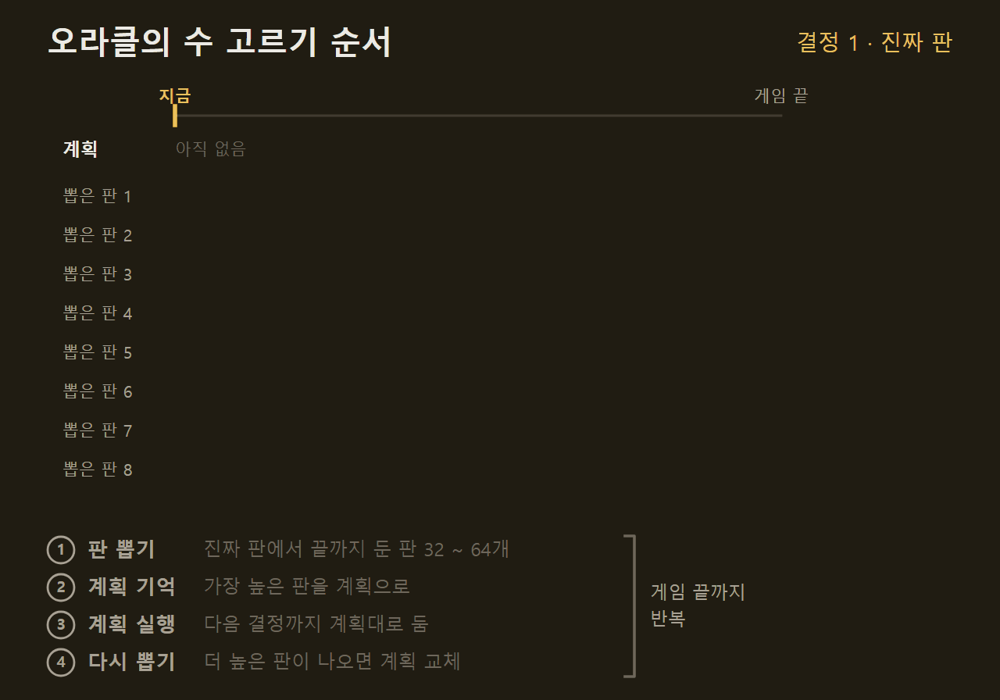
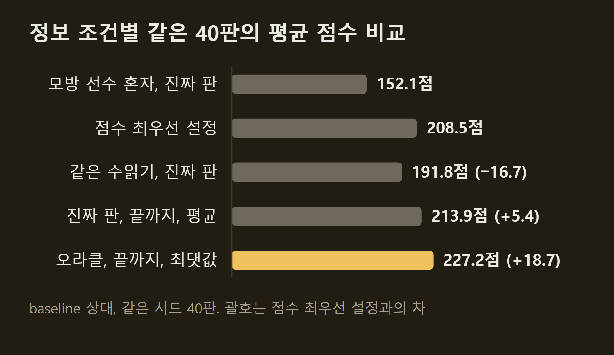

> 이 글은 직접 만들고 있는 개인 프로젝트의 개발 기록입니다. 저장소는 비공개이며, 본문의 수치는 저장소의 기록에서 가져왔습니다.

9편에서 SETI AI의 점수 최우선 설정은 209.2점이었고, 목표인 사람 2인 상위 5%의 240점까지 약 31점이 남아 있었다. 그 뒤 같은 틀에서 세 가지를 더 해 보고, 남은 31점이 어디에 있는지를 재려고 숨은 정보를 전부 아는 분석용 선수를 두었다. 이 글에는 그 측정의 결과와, SETI 작업을 여기서 한 번 마치기로 한 판단을 적는다.

```요약
요약: SETI AI의 점수 최우선 설정을 새 시드 묶음에서 206.5점으로 다시 재고, 상대 손패와 더미 순서를 전부 아는 분석용 선수를 두어 보니 227.2점으로 같은 판의 AI보다 18.7점 높았지만 정보 자체의 몫은 0이었고, 그 선수도 240점을 평균으로는 못 넘겨 평균 240점은 정책을 새로 만드는 별개 사업으로 남기고 SETI 1기를 마쳤다.
```

```용어
점수 최우선 설정: 시간보다 점수를 앞세운 설정이다. 큰 행동과 작은 선택 12종을 가상 대국으로 고르고, 가상 대국 안의 남은 수는 9편의 모방 선수가 둔다.
모방 선수: 수읽기가 고른 수를 정답으로 배운 선수다. 혼자 두면 약 150점이고, 수읽기 안에서 남은 수를 둘 때 가장 좋은 선수였다.
오라클: 상대 손패와 더미 순서까지 전부 아는 상태에서 두는 분석용 선수다. 실전에는 쓸 수 없고, 정보가 얼마나 값어치가 있는지 재는 데만 쓴다.
온도: 선수가 수를 고를 때 1순위 수만 둘지, 낮은 순위의 수도 섞어 둘지 정하는 값이다. 0이면 늘 1순위를 두고, 높을수록 다른 수가 자주 섞여 서로 다른 판이 나온다.
baseline: 한 수 앞만 보고 정해진 우선순위대로 두는 가장 단순한 AI다. 모든 측정의 상대다.
시드 묶음: 카드가 섞이는 순서와 준비물을 정하는 번호 60개다. 같은 묶음이면 같은 판 60개가 차려지므로 두 설정을 같은 판에서 견줄 수 있다.
95% 구간: 같은 실험을 되풀이했을 때 참값이 들어올 범위다. 이 범위의 아래쪽 끝이 0보다 클 때만 실제 이득으로 인정한다.
```

## 1. 새 시드 묶음의 출발점

채택 판정에 쓰던 시드 묶음을 바꿨다. 9편과 그 뒤의 채택 판정 여덟 번은 모두 같은 시드 묶음 60개에서 했는데, 같은 판에서 이긴 쪽을 거듭 고르면 그 판에 유리한 설정이 뽑힌다. 기록 전체를 넘겨 받은 별도의 검토(Claude, 별도 대화)가 이 점을 지적해서, 새 묶음 60개에서 점수 최우선 설정을 120판 다시 두었다.

새 묶음에서 점수 최우선 설정은 206.5점이다. 이전 묶음의 209.2점보다 2.7점 낮지만 묶음을 바꿀 때 생기는 차이의 범위 안이라, 점수가 내려간 것이 아니라 기준이 바뀐 것이다. 이후의 판정은 모두 이 120판과 같은 시드에서 했다.

같은 틀에서 세 가지를 더 해 봤지만 셋 다 수읽기 안에서는 오르지 않았다. 9편 끝에 예고한 2세대 모방 선수는 혼자 둘 때 올랐던 점수가 수읽기 안에서 사라졌고, 라운드마다 시작 전략을 가상 대국으로 다시 고르는 선수도 같은 모양이었다. 수읽기가 같은 정보를 이미 쓰고 있었기 때문이다.

| 시도 | 혼자 둘 때 | 수읽기 안에서 |
|---|---|---|
| 2세대 모방 선수 | +5.6점 | −2.3점 |
| 남은 점수 예측 모델 다시 배우기 | — | +1.0점 |
| 시작 전략 다시 고르기 | +5.3점 | −1.1점 |
{caption="같은 틀에서 더 해 본 세 가지의 점수 차"}

## 2. 숨은 정보를 다 아는 선수

남은 점수가 정보에 있는지 탐색에 있는지를 가르려고 오라클을 두었다. 오라클은 결정마다 진짜 판(상대 손패, 더미 순서까지)에서 모방 선수에게 게임 끝까지 두게 해 본다. 이때 모방 선수가 늘 1순위 수만 두면 같은 판만 나오므로, 온도 2.0으로 2순위와 3순위 수도 섞어 서로 다른 판을 32 ~ 64개 만든다. 그중 점수가 가장 높은 판을 계획으로 기억해 따라 두고, 다음 결정에서 다시 뽑아 더 높은 판이 나오면 계획을 바꾼다. 상대는 실제 baseline이고, 비교 대상은 같은 시드 40판의 점수 최우선 설정이다.



오라클은 40판 평균 227.2점으로 같은 판의 점수 최우선 설정 208.5점보다 18.7점(+12.0 ~ +24.9) 높았고, 240점을 넘긴 판은 40판 중 10판으로 점수 최우선 설정의 3판보다 많았다. 보드 점수가 10.9점, 종료 카드가 3.5점, 금색 타일이 3.0점 늘었다. 판을 뜯어 보면 신호가 어디서 나올지 알고 스캔을 더 하며, 초반에 탐사선과 수입 카드를 덜 사고 손패를 아꼈다가 5라운드에 행동을 1.5개 더 한다.

다만 정보 자체의 몫은 0이었다. 같은 진짜 판에서 모방 선수가 뽑기 없이 1순위 수로만 두면 152.1점으로, 아무것도 모르고 혼자 둔 150.2점과 1.9점(−8.6 ~ +12.7) 차이다. 정책은 세계를 알아도 고르는 수가 바뀌지 않았고, 18.7점은 전부 "진짜 판에서 여러 판을 끝까지 두어 보고 가장 좋은 판을 따르는 것"에서 나왔다.

## 3. 정보 없이 옮긴 장치의 실패

오라클의 장치를 정보 없이 점수 최우선 설정에 옮겨 봤다. 관측에서 있을 법한 판 10개를 뽑고, 판마다 게임 끝까지 두어 본 뒤, 모든 판에서 평균이 가장 좋은 계획을 따라 두는 방식이다. 결과는 60판에서 −21.5점(−28.0 ~ −14.6)이라 미리 적어 둔 중단 규칙으로 접었다.

실패의 모양은 계획이 자꾸 바뀌는 것이었다. 오라클은 한번 정한 계획을 93%의 결정에서 그대로 따랐지만, 이 선수는 네 번 탐색하면 세 번 계획이 바뀌었다. 판이 정해져 있지 않으면 "가장 좋은 판"이 탐색마다 달라지므로 계획을 기억하는 장치가 뜻을 잃는다. 별도의 검토는 손실의 약 60%가 작은 선택까지 판 10개의 평균으로 고른 설계 결함이라고 봤고, 이 점은 고치지 않고 접었다.

## 4. 정보와 수읽기의 분해

그래서 반대 방향으로 쟀다. 점수 최우선 설정의 수읽기는 그대로 두고, 수읽기가 보는 세계만 진짜 판으로 바꾼 것이다. 이 선수가 오르면 "정보를 지금의 수읽기에 넣으면 얼마가 되는가"의 답이 된다.



정보를 지금의 수읽기에 넣는 것은 오르지 않았다. 가상 대국을 300수에서 끊고 예측 모델로 채우는 설정 그대로 세계만 진짜로 바꾸면 191.8점으로 오히려 16.7점(−23.1 ~ −10.2) 낮았고, 가상 대국을 끝까지 두고 상대를 baseline으로 둔 설정(오라클이 뽑는 판들을 최댓값 대신 평균으로 쓰는 것)은 213.9점으로 +5.4점(−4.5 ~ +15.3)이라 0과 구분되지 않았다. 세계를 뽑는 쪽에 같은 변경을 한 대조군과 견주면 진짜 세계의 몫은 −12.4점(−19.7 ~ −4.9)이다.

이 때문에 오라클의 18.7점은 정보가 아니라 "정해진 미래에서 최댓값 판을 골라 계획으로 따르는 것"에서 나온다고 결론지었다. 오라클과 평균 설정의 차 13.4점(+4.9 ~ +21.4)이 그 몫의 아래쪽 끝이다. 상대 손패 추론이나 더미 추적처럼 숨은 정보를 추정하는 방법은 후보에서 뺐다.

## 5. 오라클의 상한과 사람 기준

오라클이 240점에 못 닿는 이유도 쟀다. 결정마다 뽑는 판을 4배(256판)로 늘리면 같은 20판에서 233.2점으로 7.0점(−0.1 ~ +15.1) 올랐고, 온도를 2.0에서 4.0으로 올려 더 다양한 수를 섞으면 233.0점으로 차이가 −0.3점(−7.1 ~ +6.2)이었다. 분포를 넓혀도 평균은 그대로이고 판별 편차만 커졌다.

| 같은 20판 | 평균 점수 | 240점 이상 |
|---|---|---|
| 점수 최우선 설정 | 201.1점 | 0판 |
| 오라클, 결정마다 64판 | 226.2점 | 5판 |
| 오라클, 결정마다 256판 | 233.2점 | 6판 |
| 오라클, 256판에 온도 4.0 | 233.0점 | 6판 |
| 오라클 세 실행의 판별 최고 | 240.3점 | 10판 |
{caption="오라클 설정별 평균 점수" pick="5"}

오라클 세 실행의 판별 최고를 모으면 평균 240.3점이다. 같은 판에서 더 높은 점수를 낸 실제 기보가 있으므로 어느 실행의 선택도 최적이 아니었고, 오라클은 미래를 알 뿐 최적을 찾는 장치가 아니다. 233점은 모방 선수의 수 분포의 한계가 아니라 "뽑은 판 중 최댓값"이라는 탐색 방식의 한계이고, 진짜 상한은 더 높지만 얼마인지는 모른다.

사람 기준도 다시 읽었다. 플레이어가 점수를 올리는 사이트의 2인전 기록 42,806개에서 240점은 상위 5.2%이지만, 2024년 기록만 보면(인원 구분 없음) 상위 5%는 224점이고 240점 이상은 2.2%다. 한편 점수 최우선 설정끼리 두면 플레이어 평균 192.1점으로 같은 판에서 baseline을 상대할 때의 207.4점보다 15.3점(−21.6 ~ −8.4) 낮다. 외계 종족은 더 일찍 열리지만 섹터와 금색 타일을 두고 겨루는 손해가 더 커서, baseline 상대 점수에는 빈 보드를 독점한 몫이 들어 있다. 사람 2인전 기록에서 206.5점은 82번째 백분위, 192.1점은 72번째 백분위다.

| | baseline 상대 | 같은 설정끼리 |
|---|---|---|
| 플레이어 평균 | 207.4점 | 192.1점 |
| 보드 점수 | 140.2점 | 129.6점 |
| 금색 타일 | 65.0점 | 56.4점 |
| 둘째 외계 종족이 열리는 라운드 | 3.7 | 2.8 |
{caption="상대에 따른 점수 최우선 설정의 점수"}

## 6. 1기 마무리의 판단

SETI 작업은 여기서 한 번 마친다. 점수 최우선 설정은 baseline 상대 206.5점, 같은 설정끼리 192.1점이고, 사람 2인전 기록의 72 ~ 82번째 백분위에 있다. 모방 선수를 넣은 뒤로 1절의 세 가지와 2 ~ 5절의 측정이 모두 0 이하였고, 남은 후보 둘의 기대는 각각 +0 ~ 4점 안팎이라 결론을 바꾸지 못한다.

평균 240점은 지금 틀의 목표로 두지 않는다. 숨은 정보를 다 아는 오라클도 227 ~ 233점이었고, 240점은 그 오라클의 탐색보다 높은 점수라서 숨은 정보 아래의 선수가 매판 그것을 넘으려면 정책의 질이 측정된 어떤 것보다 높아야 한다. 그러려면 정책과 가치 모델의 바탕을 자기대국 학습으로 새로 만들어야 하고, 이는 3 ~ 6주의 GPU 시간이 드는 별개 사업이라 따로 결정하기로 했다. 아직 시작 여부는 정하지 않았다.

이 작업에서 다른 게임에 옮겨 쓸 것은 넷이다.

- **점수를 크게 올린 것은 매번 정책의 질이었다.** 기준 선수를 바꾼 두 번(11.7점, 8.9점)과 작은 선택의 수읽기(13.7점)가 도약이었고, 탐색량과 계수 조정은 정책을 넘지 못했다.
- **판정 규칙이 잘못된 채택을 막았다.** 실험마다 기준을 미리 적고, 같은 시드에서 견주고, 95% 구간의 아래쪽 끝이 0보다 클 때만 채택하며, 60판 시점에 가망이 없으면 중단했다.
- **오라클은 정보의 몫과 탐색의 몫을 가르는 싼 측정이다.** 코드 반나절과 CPU 몇 시간으로 "숨은 정보 추정"이라는 큰 갈래를 닫았다.
- **약한 상대로 잰 점수에는 빈 보드를 독점한 몫이 들어 있다.** SETI에서는 15점이었다.

## 출처와 작성 방식

- 근거: 비공개 저장소의 SETI 전략 실험 기록(26 ~ 33단계, 31-A ~ 31-D, Hi 대 Hi 측정, 1기 마무리 절), 별도 검토 기록 둘, git 이력. 사람 기준은 [goodat.games](https://goodat.games/)의 SETI 2인전 점수 분포를 읽은 값입니다.
- 표와 그래프: 저장소의 기록에 적힌 값입니다. 그래프는 VISER 주간 보고서의 그래프 양식을 써서 직접 그렸습니다. "같은 틀에서 더 해 본 세 가지의 점수 차"는 같은 시드 120판씩의 값이고, 수읽기 안에서의 세 값은 모두 95% 구간이 0을 품습니다. "정보 조건별 같은 40판의 평균 점수 비교"의 다섯 값은 같은 시드 40판씩의 값입니다. "오라클 설정별 평균 점수"의 다섯 줄은 같은 시드 20판씩이고, 판별 최고는 세 오라클 실행 가운데 판마다 가장 높은 점수를 모은 값이라 상한의 추정치가 아니라 존재 증명입니다. "상대에 따른 점수 최우선 설정의 점수"는 같은 시드 30개에서 baseline 상대 60판과 같은 설정끼리 60개 플레이어 점수의 값이라, baseline 상대의 207.4점은 본문의 120판 평균 206.5점과 다른 묶음의 값입니다. 백분위는 2인전 기록 42,806개 전체 기준입니다.
- 움직이는 그림: 직접 그린 그림입니다. "오라클의 수 고르기 순서"의 판 수(32 ~ 64개), 온도 2.0, 한 판의 계획 교체 횟수(3 ~ 14번), 40판 평균 227.2점과 208.5점은 실제 값이고, 뽑은 판의 점수와 계획 점수(236점, 244점)는 설명을 위한 예시이며 화면에는 32개 중 8개만 그렸습니다.
- 수치 기준일: 2026-10-21
