> 이 글은 직접 만들고 있는 개인 프로젝트의 개발 기록입니다. 저장소는 비공개이며, 본문의 수치는 저장소의 기록에서 가져왔습니다.

11편까지는 SETI 전략 AI를 다뤘고, 이번에는 그 앞단에서 룰북과 카드를 읽는 도구를 고른다. 한국어 룰북은 단이 여럿이고 카드에는 작은 세로 글자가 있어서, 내 PC에서 돌아가는 OCR 후보 7종에 같은 그림을 넣고 어느 것이 잘 읽는지 재 보았다.

```요약
요약: 기본은 qwen3-vl:8b-instruct 하나가 낫다. 한국어 룰북 글자 F1 0.98, 실제 룰북 표 TEDS 0.86, 카드 좌상단 값 1.00으로 가장 높고, 쪽당 7.5초로 GPU 후보 중 가장 빠르다. 카드의 작은 세로 번호는 dots.ocr(0.87)로 다시 읽고, 구성물 상자는 dots.ocr 레이아웃에 gemma4:12b 짝짓기(F1 0.57)로 찾는다.
```

```용어
OCR: 그림 속 글자를 읽어 글로 바꾸는 일이다.
정밀도와 재현율: 후보가 낸 것 중 맞은 비율과, 정답 중 후보가 찾은 비율이다.
F1: 정밀도와 재현율을 합친 점수다. 둘 다 높아야 높고, 1이면 모두 맞았다는 뜻이다.
레이아웃: 쪽 안의 글, 그림, 표 자리를 상자로 나눈 결과다.
그라운딩: 모델이 그림 속 대상의 이름과 위치 상자를 함께 내는 방식이다.
```

## 1. 시험 조건과 후보 7종

후보는 모두 RTX 5080 16GB를 단 Windows 11 PC 한 대에서 Docker와 WSL 없이 돌렸다. GPU 후보는 다섯이다. Ollama의 qwen3-vl:8b-instruct, llama.cpp로 Surya OCR 2를 띄운 Marker v2, Unlimited-OCR, dots.ocr, 그 후속판 dots.mocr이다. CPU 후보는 PaddleOCR PP-OCRv5 한국어 모델과 영어 전용 Indra 둘이다.

후보가 낸 글이나 상자는 채점기 하나가 같은 규칙으로 정답과 견준다.

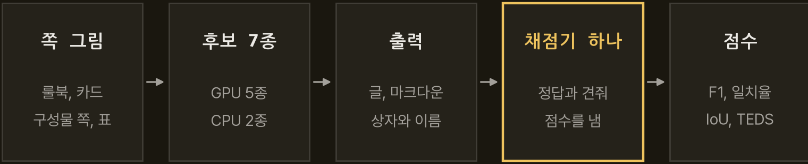

## 2. 룰북 본문과 카드 세트

룰북은 PDF에 들어 있는 글자 정보(글자층)를, 카드는 프로젝트의 규칙 JSON 값을 정답으로 썼다. WC는 Wondrous Creatures다.

| 세트 | 크기 | 내용 |
|---|---:|---|
| 한국어 룰북 | 12쪽 | SETI, Galactic Cruise, Windmill Valley, Tiletum |
| 영어 룰북 | 15쪽 | SETI, Luthier, Arcs, Endeavor Deep Sea, A Feast for Odin FAQ |
| SETI 카드 | 100장 | SETI 카드의 이름, 번호, 비용 |
| WC 카드 | 50장 | Wondrous Creatures 프랑스어판 카드의 인쇄 번호 |
{caption="룰북 본문과 카드 세트"}

판은 원본 파일 이름에 적힌 그대로이고, 쪽 번호는 PDF 첫 쪽을 1로 센다.

| 게임 | 쓴 자료와 판 | 쓴 쪽 / 카드 |
|---|---|---|
| SETI | 한국어 룰북 | 본문 5, 7, 11, 16쪽, 구성물 2쪽 |
| SETI | 영어 룰북 | 본문 5, 7, 11, 16쪽, 구성물 2쪽 |
| SETI | 2024 기본판 카드 그림(Tabletop Simulator 모드) | 기본 카드 100장, 인쇄 번호 1~137 사이 |
| Galactic Cruise | 한국어 룰북 v1.1 | 본문 6, 14, 19쪽, 구성물 4, 5쪽 |
| Galactic Cruise | 영어 훈련 매뉴얼 v26 | 구성물 4, 5쪽 |
| Galactic Cruise | 한국어 참조서 v1.1 | 표 7쪽 |
| Windmill Valley | 한국어 룰북 v1.0 | 본문 6, 9, 12쪽 |
| Tiletum | 한국어 룰북 v1 | 본문 8, 13쪽 |
| Luthier | 영어 룰북 | 본문 5, 9, 13쪽 |
| Arcs | 영어 룰북 최신판 | 본문 4, 8, 12쪽 |
| Endeavor: Deep Sea | 영어 룰북 | 본문 6, 10, 14쪽 |
| A Feast for Odin | 영어 FAQ | 1, 2쪽 |
| Wondrous Creatures | 프랑스어판 카드 그림(Tabletop Simulator 모드) | 생물 카드 126장 중 50장, 인쇄 번호 004~123 사이 |
| Ostia | 영어 룰북 | 1쪽 오른쪽 절반(구성물), 왼쪽 절반(표) |
| Sekigahara | 한국어 참조표 웹판 | 표 1쪽 |
{caption="세트에 쓴 룰북과 카드"}

출판사는 공식 사이트, 보드게임긱(BoardGameGeek) 판 기록, 한국어판 상품 쪽에서 확인했다. Wondrous Creatures 카드는 Super Meeple이 낸 프랑스어판이다.

| 게임 | 원판 출판사 | 한국어판 | 한국어판 출판사 |
|---|---|---|---|
| SETI | Czech Games Edition | 세티: 외계 지성체를 찾아서 | DiceTree Games |
| Galactic Cruise | Kinson Key Games | 갤럭틱 크루즈 | HIT Games |
| Windmill Valley | Board&Dice | 윈드밀 밸리 | HIT Games |
| Tiletum | Board&Dice | 틸레툼 | Midnight Jungle |
| Sekigahara | GMT Games | 세키가하라 | 코리아보드게임즈 |
| Luthier | Paverson Games | | |
| Arcs | Leder Games | | |
| Endeavor: Deep Sea | Burnt Island Games | | |
| A Feast for Odin | Feuerland Spiele | | |
| Wondrous Creatures | Bad Comet | | |
| Ostia | uchibacoya | | |
{caption="게임별 출판사와 한국어판"}

Endeavor: Deep Sea는 Grand Gamers Guild와 함께 냈고, A Feast for Odin 영어판과 FAQ는 Z-Man Games가, Arcs는 지금 Buried Giant Studios가 낸다. Midnight Jungle은 행복한바오밥의 상표다.

카드는 무작위로 골랐다(SETI 시드 11, Wondrous Creatures 시드 12). 룰북은 PDF를 200dpi 그림으로 바꾸고 긴 변을 2,200px 안으로 맞췄다.

한국어 룰북은 그림과 글이 섞이고 단이 둘 이상인 쪽을 골랐다. 다음 그림 오른쪽은 SETI 한국어 룰북 5쪽 위쪽이고, 왼쪽 작은 그림의 금색 상자가 잘라 온 자리다. 후보는 이런 쪽 전체를 한 장으로 받는다.

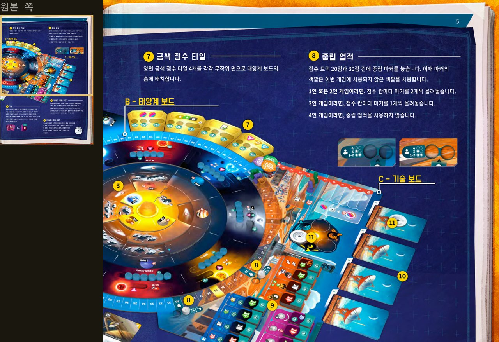

영어 룰북도 같은 방식이다. 오른쪽은 Luthier 영어 룰북 5쪽 위쪽이다.

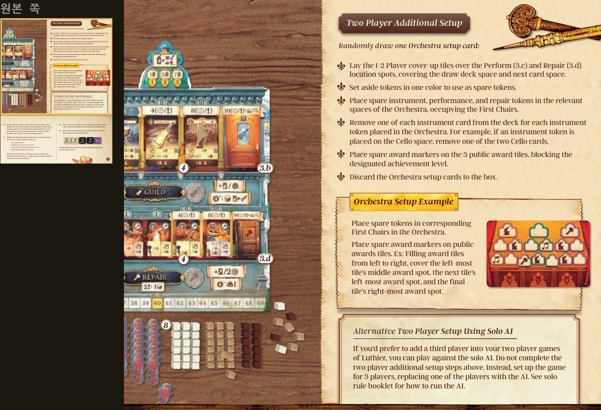

룰북은 단이 여럿이라 후보마다 읽는 순서가 다르다. 글자를 순서대로 견주는 글자 오류율(CER)은 내용을 다 읽어도 순서만 다르면 0.3~0.6까지 오른다. 그래서 순서를 보지 않는 글자 F1을 주 지표로 삼았다. 카드는 출력 안에 정답이 있는지로 채점하고, 이름과 번호만 본다. SETI 번호는 왼쪽 아래에 90도 돌려 찍힌 작은 글씨라 세로 글자를 읽는지 볼 수 있다.

## 3. 본문과 카드 결과

다음 그래프에서 룰북은 Indra 한국어를 빼면 모두 0.8을 넘어 차이가 작지만, 카드 번호는 0.00부터 0.90까지 벌어진다.

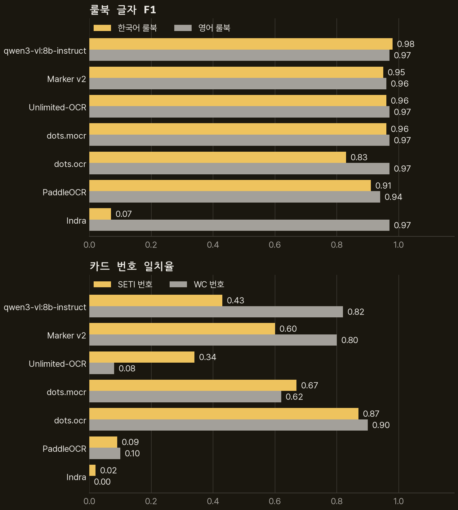

| 후보 | 장치 | 한국어 룰북 F1 | 영어 룰북 F1 | SETI 이름 / 번호 | WC 번호 |
|---|---|---:|---:|---:|---:|
| qwen3-vl:8b-instruct | GPU | 0.98 | 0.97 | 1.00 / 0.43 | 0.82 |
| Marker v2 + Surya OCR 2 | GPU | 0.95 | 0.96 | 1.00 / 0.60 | 0.80 |
| Unlimited-OCR | GPU | 0.96 | 0.97 | 0.25 / 0.34 | 0.08 |
| dots.mocr | GPU | 0.96 | 0.97 | 1.00 / 0.67 | 0.62 |
| dots.ocr | GPU | 0.83 | 0.97 | 0.99 / 0.87 | 0.90 |
| PaddleOCR PP-OCRv5 한국어 | CPU | 0.91 | 0.94 | 0.96 / 0.09 | 0.10 |
| Indra OCR 모드 | CPU | 0.07 | 0.97 | 0.97 / 0.02 | 0.00 |
{caption="후보별 룰북 글자 F1과 카드 일치율"}

글자 F1은 쪽마다 공백을 뺀 글자를 개수까지 세어 정답과 견주고 쪽 평균을 낸다. 글자는 유니코드 NFKC로 맞추고 마크다운 기호와 HTML 태그를 지운 뒤 센다.

$$
\begin{gathered}
|G_i \cap \hat{Y}_i| = \sum_{c} \min\big(G_i(c), \hat{Y}_i(c)\big) \\
P_i = \frac{|G_i \cap \hat{Y}_i|}{|\hat{Y}_i|}, \quad
R_i = \frac{|G_i \cap \hat{Y}_i|}{|G_i|} \\
F_1 = \frac{1}{N} \sum_{i=1}^{N} \frac{2 P_i R_i}{P_i + R_i}
\end{gathered}
$$

\(G_i\)와 \(\hat{Y}_i\)는 쪽 \(i\)의 정답과 출력에서 공백을 뺀 글자 모음(같은 글자가 여러 번 들어갈 수 있다), \(G_i(c)\)는 글자 \(c\)의 개수, \(N\)은 세트의 쪽 수다.

정답이 "보드게임", 출력이 "보드개임은"이면 겹친 글자는 3개다. 정밀도 3/5 = 0.6, 재현율 3/4 = 0.75이고 F1은 0.67이다.

카드 일치율은 정답 값이 출력 안에 들어 있는 카드의 비율이다. 대조군은 반 바퀴 떨어진 카드의 정답으로 같은 검사를 한 비율로, 숫자를 아무렇게나 많이 내도 맞는 정도다.

$$
\begin{gathered}
A_f = \frac{1}{K} \sum_{k=1}^{K} \mathbb{1}\big[\, g_{k,f} \sqsubseteq \hat{y}_k \,\big] \\
C_f = \frac{1}{|K_f'|} \sum_{k \in K_f'} \mathbb{1}\big[\, g_{k',f} \sqsubseteq \hat{y}_k \,\big] \\
k' = (k + \lfloor K/2 \rfloor) \bmod K
\end{gathered}
$$

\(g_{k,f}\)는 카드 \(k\)의 필드 \(f\) 정답, \(\hat{y}_k\)는 출력, \(K\)는 출력이 있는 카드 수, \(K_f'\)는 \(g_{k',f} \ne g_{k,f}\)인 카드다. \(\sqsubseteq\)는 이름이면 영문 소문자와 숫자만 남긴 부분 문자열, 번호와 비용이면 앞뒤가 숫자가 아닌 자리에 있음을 뜻한다.

10장 중 8장의 출력에 제 번호가 있으면 일치율은 0.8이고, 남의 번호가 우연히 든 카드가 1장이면 대조군은 0.1이다.

SETI 번호의 대조군은 0.01~0.02라 우연히 맞는 일이 거의 없다. 한 자리 숫자인 비용은 대조군이 0.08~0.45까지 올라 표에서 뺐다.

다음 그림은 가로축이 쪽당 시간, 세로축이 한국어 룰북 글자 F1이라 왼쪽 위일수록 빠르고 정확하다. 가로축은 10배마다 간격이 같은 로그 눈금이다.

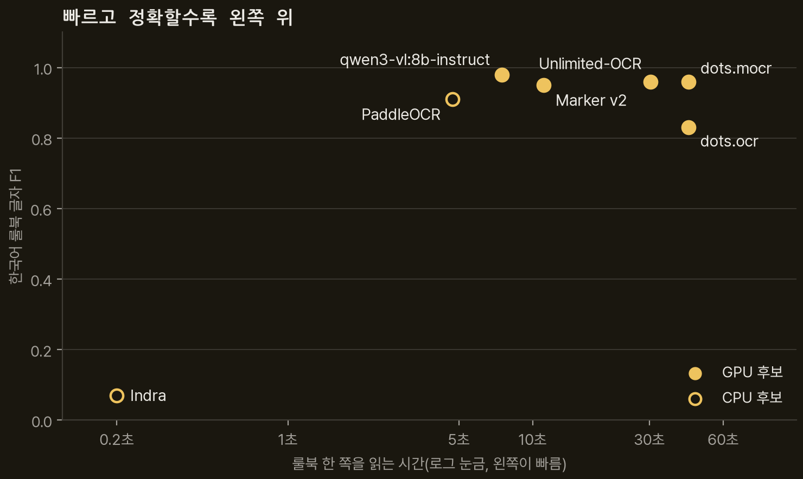

| 후보 | 룰북 쪽당 초 | 카드 장당 초 | 메모리 |
|---|---:|---:|---|
| qwen3-vl:8b-instruct | 7.5 | 1.0 | Ollama 7.8GB |
| Marker v2 + Surya OCR 2 | 11.1 | 3.2 | 장치 약 2.7GB |
| Unlimited-OCR | 30.3 | 3.7 | torch 9.0GB |
| dots.mocr | 43.4 | 6.0 | torch 8.9GB |
| dots.ocr | 43.3 | 7.1 | torch 8.0GB |
| PaddleOCR PP-OCRv5 한국어 | 4.7 | 0.8 | RSS 3.1GB |
| Indra OCR 모드 | 0.2 | 0.1 | RSS 0.7GB |
{caption="후보별 속도와 메모리"}

시간은 유난히 오래 걸린 몇 쪽에 끌려가지 않게 평균 대신 중앙값을 썼다.

$$
\tilde{t} = \operatorname{median}\{\, t_i : i \in I \,\}
$$

\(t_i\)는 쪽이나 카드 \(i\)의 처리 시간에서 모델 적재 시간을 뺀 값, \(I\)는 오류 없이 끝난 쪽이나 카드의 모음이다.

다섯 쪽이 3, 4, 5, 9, 40초 걸렸다면 중앙값은 5초, 평균은 12.2초다.

쪽당 초는 룰북 27쪽, 장당 초는 SETI와 WC 카드의 중앙값이고, 메모리는 후보마다 잰 방법이 달라 그대로 적었다. qwen3-vl:8b-instruct와 Marker v2는 한국어 룰북 12쪽에서 10.6초로 같았고, 영어 룰북 15쪽에서 5.9초와 12.7초로 갈렸다. dots.ocr과 dots.mocr은 한국어 룰북에서 57~62초까지 걸렸다.

한국어 룰북의 점수 차이는 읽기 순서와 글자 판독에서 나온다. 다음 그림의 금색 상자가 비교한 문단 7이고, 주황 점선 상자는 PaddleOCR 출력에 섞여 들어온 오른쪽 단의 문단 8이다. 아래 후보 출력의 초록 제목은 맞게 읽은 후보, 빨간 제목은 틀린 후보다. PaddleOCR은 셋째 줄 자리에 오른쪽 문단 첫 줄을 끼워 넣었고, Indra는 한자열을 냈다.

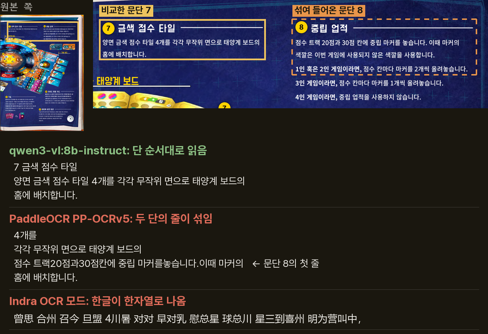

카드에서는 작은 숫자를 읽는지가 갈랐다. 다음 그림은 SETI 카드 ODINUS Mission의 비용 3과 번호 10을 후보별로 읽은 결과다. 둘 다 맞힌 후보는 dots.ocr 하나였고, Marker v2는 비용 옆 크레딧 아이콘을 8로 읽어 38을 냈다.

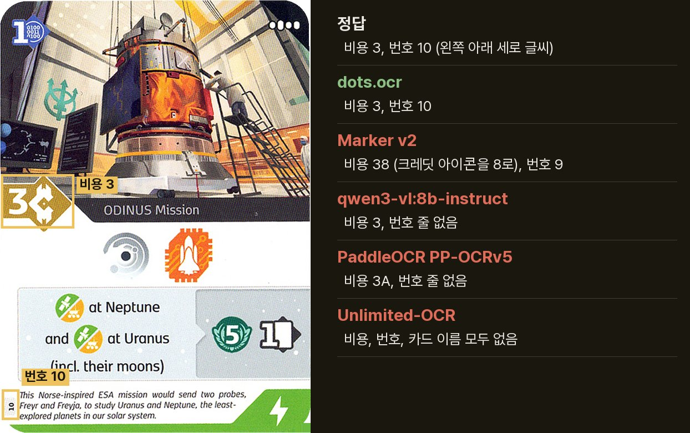

- qwen3-vl:8b-instruct: 기본 태그인 qwen3-vl:8b는 생각 과정부터 쓰다가 본문 없이 끝나는 쪽이 많아 OCR에 쓸 수 없었다.
- Marker v2: 가장 가볍지만 카드 100장 중 38장에서 비용 3과 아이콘을 38로 읽는 식으로 틀렸다.
- Unlimited-OCR: 그림 위주 카드에서는 글자를 버려 이름이 나온 카드가 100장 중 25장이다. SETI 룰북 여러 쪽을 한 번에 넣으면 영어 20쪽 안팎까지만 버텼다.
- dots.ocr: 한국어에서 같은 글자를 끝없이 되풀이하는 일이 잦아 느렸다.
- dots.mocr: 되풀이가 줄어 한국어 룰북은 dots.ocr보다 올랐지만 SETI 번호는 떨어졌다.
- PaddleOCR PP-OCRv5: 줄을 위에서 아래로만 이어서 단이 섞인다.
- Indra: 한국어는 한자열로 낸다.

## 4. 카드 한 장의 모든 필드

SETI 카드에 인쇄된 다른 필드도 저장해 둔 출력으로 다시 채점했다. 카드 이름 전체, 효과문(가운데의 규칙 문장), 설명문(아래쪽 기울임 글씨), 좌상단 값(왼쪽 위 큰 숫자), 아이콘 숫자(효과 아이콘 안의 숫자)다.

카드 이름과 좌상단 값은 규칙 JSON에 정답이 있어 100장을 채점했다. 효과문, 설명문, 아이콘 숫자는 10장을 그림을 보며 옮겨 적었고 사람이 아직 확인하지 않아, 수치보다 경향으로 읽어야 한다.

다음 그림의 초록 ○는 맞음, 빨강 ×는 틀림, 주황 △는 한두 글자 오자다.

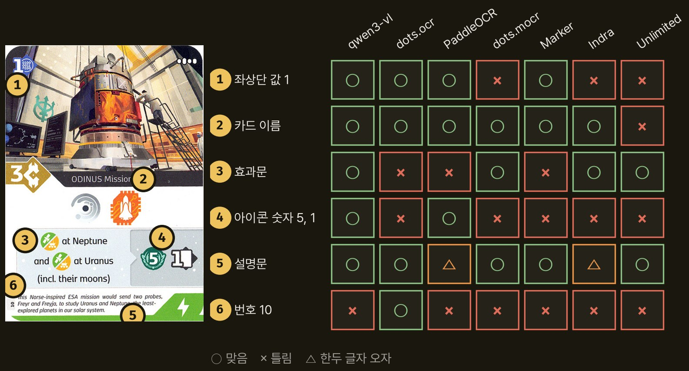

qwen3-vl:8b-instruct는 번호 10 하나만 빼고 모든 필드를 읽었다. dots.ocr은 번호를 읽은 유일한 후보지만 효과문 둘째 줄의 and와 아이콘 속 숫자 5를 놓쳤다. dots.mocr은 좌상단 값 1과 옆의 이진수 기호를 붙여 1010으로 읽었고, Marker v2는 아이콘 숫자 5를 9로 읽었다. PaddleOCR은 아이콘 숫자를 맞혔지만 그 숫자가 효과문 한가운데에 끼어 들어가 효과문은 틀림으로 셌다.

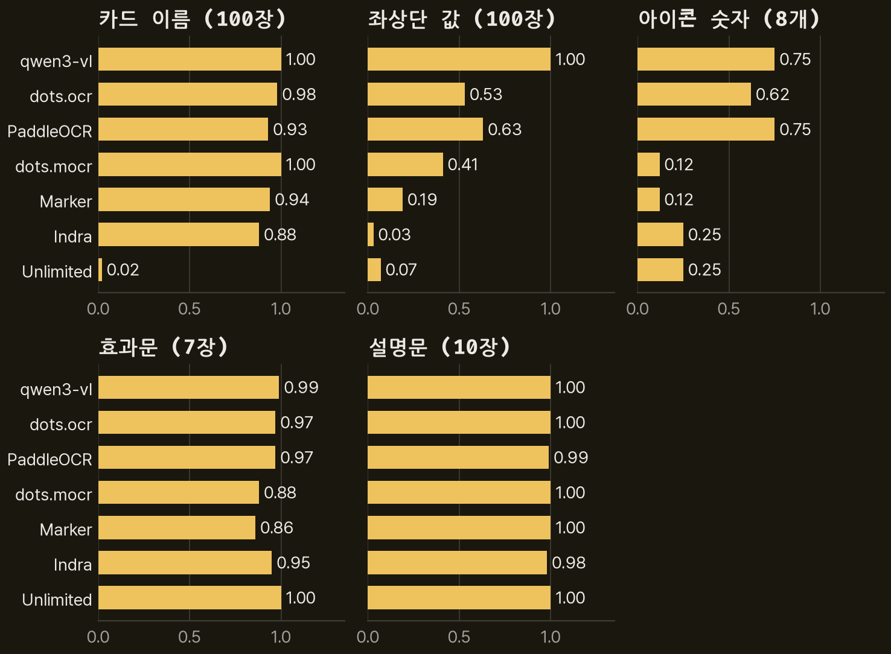

카드 이름은 출력 줄 하나가 정답과 똑같은지, 좌상단 값은 출력의 첫 숫자가 정답인지로 쟀다. 효과문과 설명문은 정답과 가장 비슷한 출력 구간의 틀린 글자 비율을 1에서 뺐다. 50글자에서 한 글자를 빠뜨리면 1 − 1/50 = 0.98이다.

- 설명문은 일곱 후보 모두 0.98 이상, 효과문은 0.86 이상이다. 사람 확인 전 정답 7장, 10장의 값이라 순위보다 대체로 읽는다고 보면 된다.
- 좌상단 값은 qwen3-vl:8b-instruct만 100장을 모두 맞혔고, PaddleOCR 0.63, dots.ocr 0.53, Marker v2와 Indra, Unlimited-OCR은 0.2 아래다.
- 아이콘 숫자는 1이 아닌 것 8개 중 qwen3-vl:8b-instruct와 PaddleOCR이 6개, dots.ocr이 5개, 나머지는 1~2개를 맞혔다.
- Unlimited-OCR은 카드 이름 띠를 대부분 건너뛰어 이름 정확 일치가 0.02다.

## 5. 구성물 그림과 이름 짝짓기

구성물 쪽 세트는 룰북의 구성물 목록 7쪽(Ostia, Galactic Cruise 한국어판과 영어판, SETI 한국어판과 영어판)이다. 후보는 구성물 128개마다 그림의 위치 상자와 "태양계 보드" 같은 인쇄된 이름을 함께 맞혀야 한다.

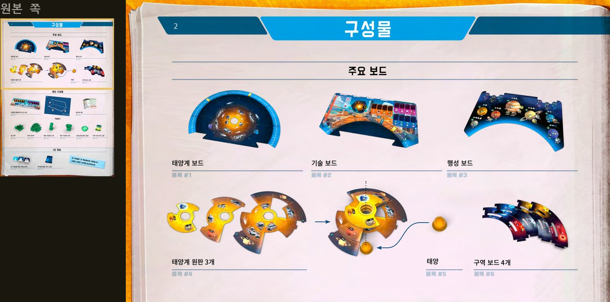

정답은 Codex가 1차로 단 라벨을 Claude Opus가 검토해 확정했고, 사용자는 아직 확인하지 않았다. Claude Fable이 라벨을 보지 않고 새로 단 결과와는 128개의 이름과 수량이 모두 같았다.

### 상자가 맞았는지 재는 IoU

상자가 맞았는지는 두 상자가 겹친 넓이를 합친 넓이로 나눈 IoU로 잰다. 1이면 두 상자가 같다.

$$
\mathrm{IoU} = \frac{\text{겹친 넓이}}{\text{합친 넓이}}
$$

다음 그림은 Galactic Cruise 한국어 룰북 4쪽에서 qwen3-vl:8b-instruct가 낸 상자 둘이다. 금색 실선이 정답, 파란 점선이 예측이고, 금색으로 칠한 곳이 겹친 부분이다. 왼쪽 기술 타일은 예측 상자가 조금 크지만 정답을 거의 덮어 IoU가 0.63이다. 오른쪽 회사 목표 마커는 작은 마커에 칸 전체만 한 상자를 그려 겹친 부분이 10분의 1뿐이다.

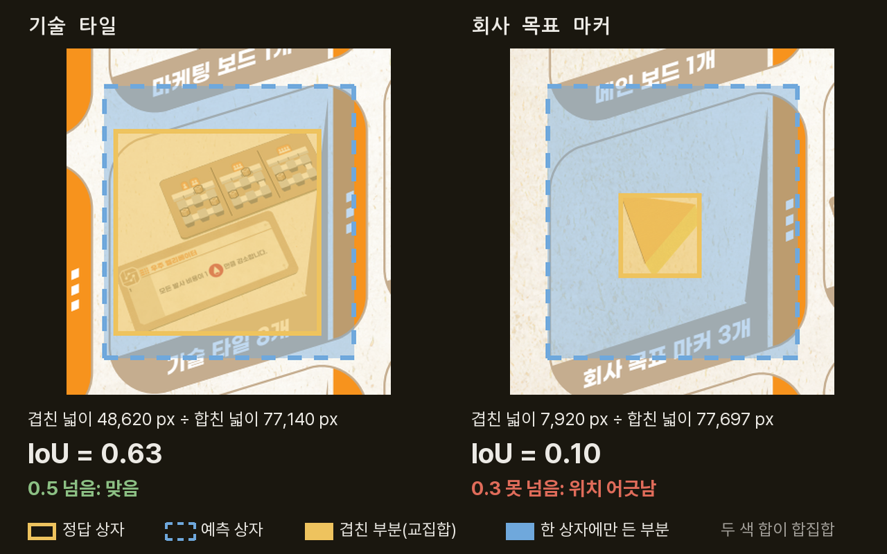

다음 움직이는 그림은 예측 상자가 정답 상자 쪽으로 다가갈 때 IoU가 어떻게 오르는지 보여 준다.

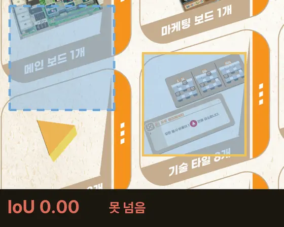

네 순간으로 끊으면 0.38은 0.3 기준만 넘고, 0.62는 0.5 기준도 넘는다.

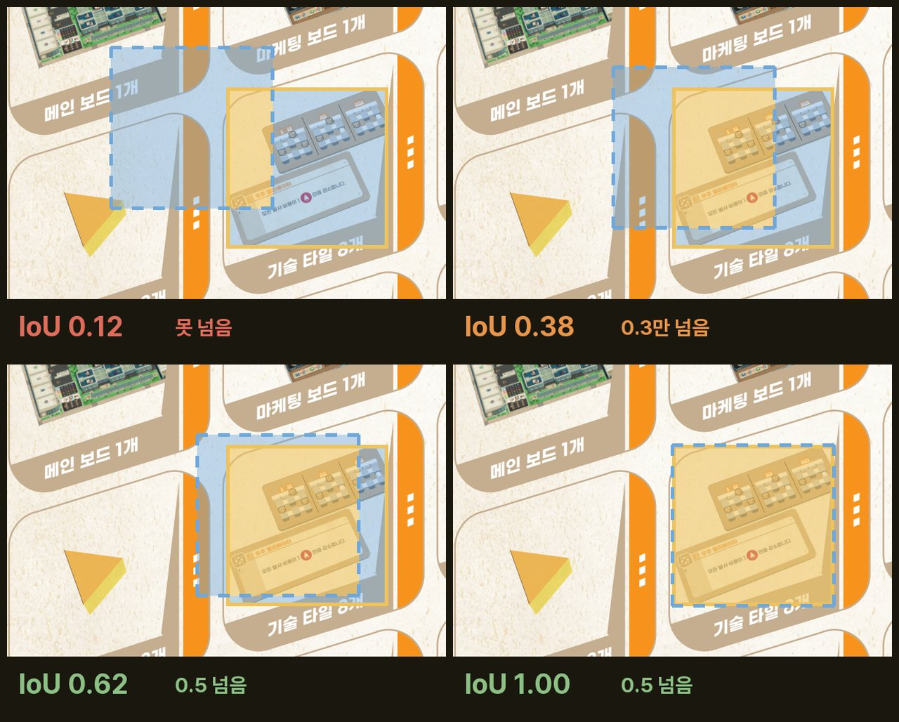

### 짝짓기 점수

정답 구성물마다 이름이 맞고 IoU가 0.5 이상인 예측이 있으면 맞힌 것으로 센다. 예측 하나는 정답 하나와만 짝짓고, 쪽 7개의 수를 더해 F1을 낸다.

$$
F_1 = \frac{2 \times \text{정밀도} \times \text{재현율}}{\text{정밀도} + \text{재현율}}
$$

F1이 가장 높은 방식은 예측 74개 중 58개가 맞아 정밀도 58 ÷ 74 = 0.78, 재현율 58 ÷ 128 = 0.45, F1 0.57이다.

이름은 수량 표기, 복수형, 대소문자, 기호를 지운 뒤 철자가 85% 이상 같으면 맞음이다. 상자를 보지 않고 이름만 맞힌 비율(이름만 재현율)도 냈다.

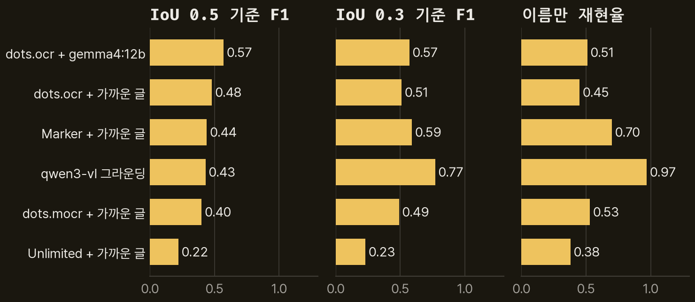

| 방식 | 재현율 | 정밀도 | F1 | 이름만 재현율 |
|---|---:|---:|---:|---:|
| dots.ocr 레이아웃 + gemma4:12b 짝짓기 | 0.45 | 0.78 | 0.57 | 0.51 |
| dots.ocr 레이아웃 + 가까운 글 규칙 | 0.42 | 0.56 | 0.48 | 0.45 |
| Marker JSON + 가까운 글 규칙 | 0.44 | 0.44 | 0.44 | 0.70 |
| qwen3-vl:8b-instruct 직접 그라운딩 | 0.43 | 0.42 | 0.43 | 0.97 |
| dots.mocr 레이아웃 + 가까운 글 규칙 | 0.38 | 0.41 | 0.40 | 0.53 |
| Unlimited-OCR 상자 + 가까운 글 규칙 | 0.34 | 0.16 | 0.22 | 0.38 |
{caption="구성물 짝짓기 방식별 점수"}

레이아웃 방식은 후보가 나눈 그림 상자와 글 상자를 받아, 이름표를 가장 가까운 그림에 붙이거나(가까운 글 규칙) 로컬 언어 모델 gemma4:12b가 짝을 고른다. 직접 그라운딩은 qwen3-vl:8b-instruct가 이름과 상자를 한 번에 낸다. 직접 그라운딩은 상자를 느슨하게 잡아, IoU 기준을 0.3으로 낮추면 F1이 0.43에서 0.77로 오른다.

### 게임별 차이

게임별 결과는 쪽의 배치에 따라 크게 갈렸다. GC는 Galactic Cruise다.

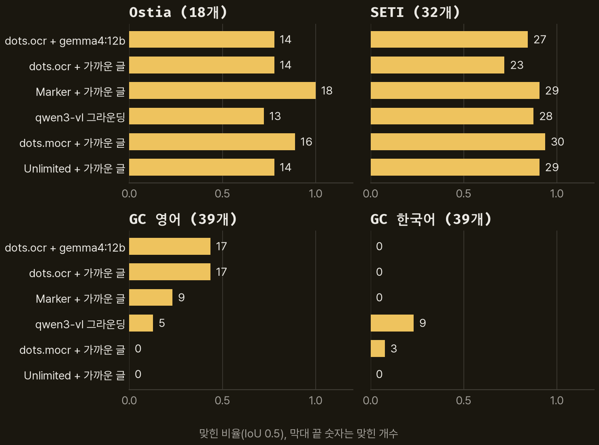

| 방식 | Ostia | GC 한국어 | GC 영어 | SETI |
|---|---:|---:|---:|---:|
| dots.ocr 레이아웃 + gemma4:12b 짝짓기 | 14/18 | 0/39 | 17/39 | 27/32 |
| dots.ocr 레이아웃 + 가까운 글 규칙 | 14/18 | 0/39 | 17/39 | 23/32 |
| Marker JSON + 가까운 글 규칙 | 18/18 | 0/39 | 9/39 | 29/32 |
| qwen3-vl:8b-instruct 직접 그라운딩 | 13/18 | 9/39 | 5/39 | 28/32 |
| dots.mocr 레이아웃 + 가까운 글 규칙 | 16/18 | 3/39 | 0/39 | 30/32 |
| Unlimited-OCR 상자 + 가까운 글 규칙 | 14/18 | 0/39 | 0/39 | 29/32 |
{caption="구성물 짝짓기 게임별 맞힌 수 / 정답 수"}

반듯한 격자 쪽은 레이아웃 방식이 대부분 맞혔다. 다음 그림은 Ostia 영어 룰북 1쪽 구성물 18개를 두 방식이 짝지은 결과로, 굵은 상자와 그 위 이름표가 정답이다.

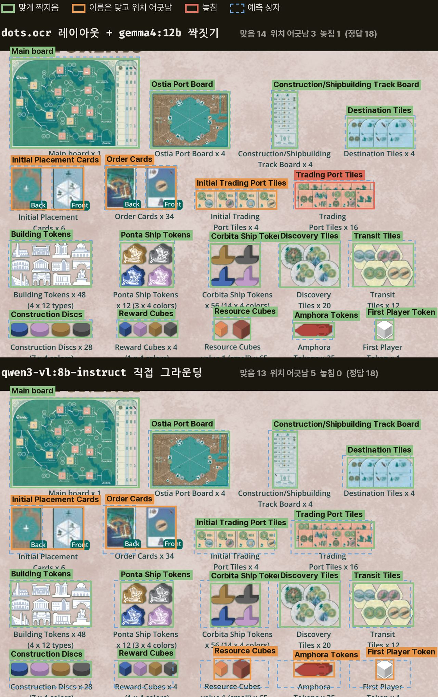

위 방식은 앞뒷면을 나눠 그린 카드 두 종과 시작 무역항 타일에서 상자를 그림 일부로만 잡았고, 무역항 타일은 놓쳤다. 아래 qwen3-vl:8b-instruct는 이름을 모두 냈지만 카드와 큐브, 토큰의 상자를 이름 글자까지 넓게 잡았다.

### Galactic Cruise 한국어판이 안 된 까닭

Galactic Cruise 한국어 룰북 4, 5쪽은 구성물이 하나씩 모서리가 둥근 칸에 들어 있고, 비스듬히 기운 칸이 5열로 빽빽하다. 이름표도 칸 아래 띠에 기울어진 글씨로 적혀 있다.

다음 그림은 4쪽 구성물 22개에 dots.ocr 레이아웃(왼쪽)과 qwen3-vl:8b-instruct 직접 그라운딩(오른쪽)의 상자를 겹친 것이다.

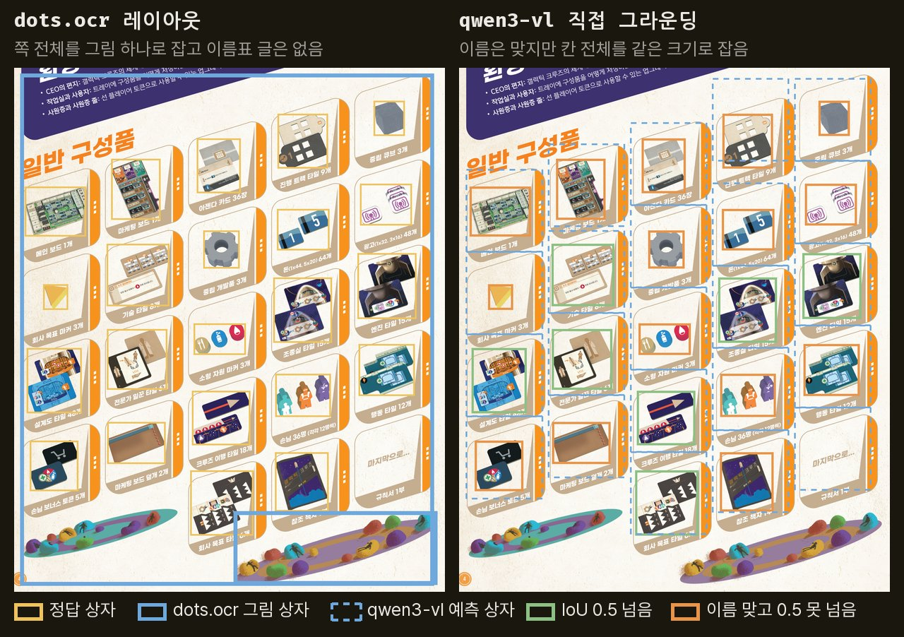

- dots.ocr 레이아웃: 4쪽에서 상자를 7개만 냈다. 그림 상자는 구성물 22개를 모두 품는 큰 상자 하나와 장식 그림 하나뿐이고, 기울어진 이름표는 글 상자로 하나도 나오지 않았다. 그래서 두 짝짓기 방식 모두 하나도 맞히지 못했다. 같은 gemma4:12b 짝짓기가 영어판 5쪽에서는 17개를 모두 맞혔으니, 이 쪽의 배치가 문제였다.
- Marker v2: 4쪽에서 그림 상자는 26개를 냈지만 이름표 글 상자가 하나도 없어 짝이 0개다. 영어판 4쪽에서는 이름표 글 상자를 23개 냈다.
- qwen3-vl:8b-instruct: 이름은 39개 중 36개를 맞혔다. 그런데 4쪽의 예측 상자 23개는 모두 폭 266~267px, 높이 290~291px로, 쪽을 고른 격자로 나눈 것처럼 이름표 띠까지 칸 전체를 잡았다. 정답 상자보다 1.5~9.8배 넓어 IoU는 0.10~0.64에 그쳤고, 22개 중 7개만 0.5를 넘었다. 5쪽까지 합치면 39개 중 9개이고, 기준을 0.3으로 낮추면 25개다.

정답 이름이 한국어라서 틀린 것은 아니다. 레이아웃 방식은 기울어진 칸을 나누지 못했고, 직접 그라운딩은 상자를 칸 단위로 크게 잡았다. 앞의 회사 목표 마커가 0.10인 것도 같은 까닭이다.

## 6. 룰북 표 인식

합성 한국어 표 25개는 규칙 JSON 값(Wondrous Creatures 생물 비용, SETI 카드 등)으로 만든 HTML이 곧 정답이다. 실제 룰북 표 3쪽(표 6개)은 Ostia 영어 룰북 1쪽 왼쪽 절반의 감찰관 타일 표, Sekigahara 한국어 참조표 1쪽, Galactic Cruise 한국어 참조서 v1.1 7쪽이고, Codex가 단 1차 라벨을 Claude Opus가 검토해 정답으로 썼다. 표에는 PaddleOCR 대신 같은 계열의 PP-StructureV3를 썼고, qwen3-vl에는 HTML로 내라고 지시했다.

다음 그림 왼쪽은 2단 머리와 합친 칸이 있는 합성 표이고, 오른쪽은 테두리 없이 아이콘과 설명이 3열로 이어지는 Galactic Cruise 참조서 표다. 아이콘 칸은 빈 칸으로 놓고 채점했다.

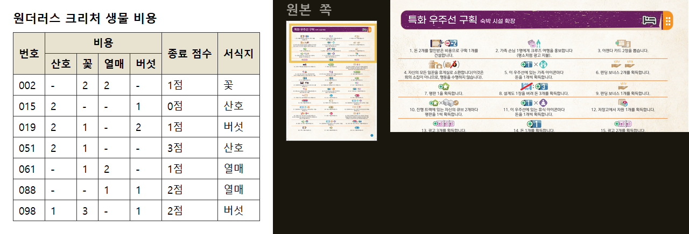

대부분의 후보가 실제 룰북 표에서 크게 떨어지고, qwen3-vl:8b-instruct만 둘 다 높다.

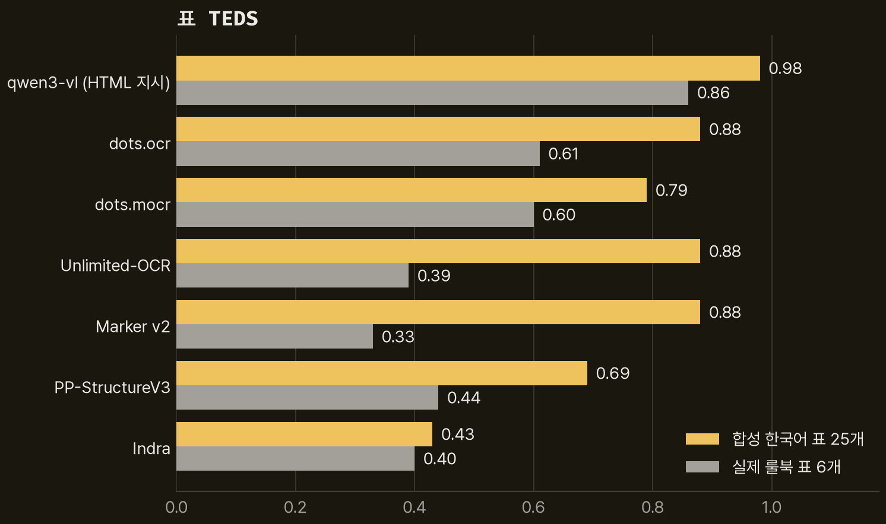

| 후보 | 합성 한국어 표 TEDS | 실제 룰북 표 TEDS | 합성 표 쪽당 초 |
|---|---:|---:|---:|
| qwen3-vl:8b-instruct (HTML 지시) | 0.98 | 0.86 | 3.5 |
| dots.ocr | 0.88 | 0.61 | 7.3 |
| dots.mocr | 0.79 | 0.60 | 9.2 |
| Unlimited-OCR | 0.88 | 0.39 | 5.2 |
| Marker v2 | 0.88 | 0.33 | 1.3 |
| PP-StructureV3 (CPU) | 0.69 | 0.44 | 4.3 |
| Indra (CPU) | 0.43 | 0.40 | 0.1 |
{caption="표 세트별 TEDS"}

TEDS는 표를 HTML 나무 구조로 놓고, 예측 표를 정답 표로 바꾸려면 칸을 몇 번 더하고 지우고 고쳐야 하는지(나무 편집 거리) 센 뒤 표 크기로 나눠 1에서 뺀 값이다. 한 쪽에 표가 여럿이면 정답 표마다 예측 표를 하나씩 짝짓고, 쪽 점수를 세트 안에서 평균한다.

$$
\begin{gathered}
\mathrm{TEDS}(T_a, T_b) = 1 - \frac{\mathrm{EditDist}(T_a, T_b)}{\max(|T_a|, |T_b|)} \\
S = \frac{1}{M} \sum_{m=1}^{M} \mathrm{TEDS}\big(T_m, \hat{T}_{\pi(m)}\big)
\end{gathered}
$$

\(\mathrm{EditDist}\)는 칸 추가, 삭제, 내용 수정의 비용 합, \(|T|\)는 나무의 마디 수, \(M\)은 쪽의 정답 표 수, \(\pi\)는 TEDS 합이 가장 크게 짝짓는 헝가리안 짝짓기이고 짝이 없는 정답 표의 TEDS는 0이다. 마크다운 표는 HTML로 바꿔 채점했다. ParseBench 순위표가 쓰는 GTRM은 채점기가 공개 표 세트에서만 돌아가서 이 글의 두 세트에는 값이 없다.

예를 들어 마디가 20개인 정답 표에서 칸 하나를 빠뜨리고 한 칸의 글자를 틀리면 고칠 일이 2번이라 TEDS는 1 − 2/20 = 0.9다.

Marker v2는 실제 룰북 표 3쪽 중 2쪽에서 표를 만들지 않고 글로 풀어 내 점수가 낮았다.

## 7. 종합 평가와 추천

다음 그림은 지금까지의 수치를 모은 것이다. 정확도 칸은 클수록, 쪽당 초와 메모리 칸은 작을수록 진한 금색이고, 흰 테두리가 가장 좋은 값이다. dots.ocr의 구성물 칸은 gemma4:12b 짝짓기를 붙인 값, PaddleOCR의 표 칸은 PP-StructureV3 값이다.

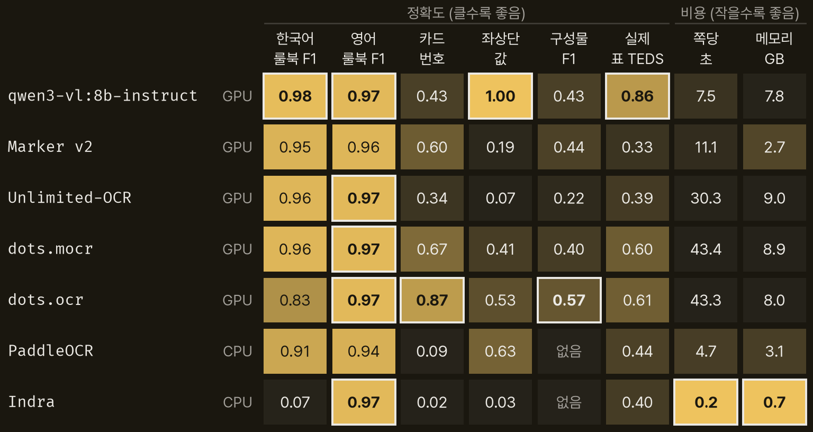

설치와 실행의 번거로움은 직접 잰 값이 아니라, 이번에 돌려 본 방식을 보고 나눈 것이다.

| 후보 | 번거로움 | 이번에 돌린 방식 |
|---|---|---|
| qwen3-vl:8b-instruct | 적음 | Ollama에서 모델을 받아 부른다 |
| PaddleOCR PP-OCRv5, Indra | 적음 | CPU용 파이썬 패키지를 설치한다 |
| Marker v2 + Surya OCR 2 | 보통 | llama.cpp 서버를 띄우고 Marker가 부른다 |
| Unlimited-OCR, dots.ocr, dots.mocr | 많음 | 후보마다 가상 환경을 만들어 torch로 돌린다 |
{caption="후보별 실행 방식"}

용도별 추천은 다음과 같다.

- 룰북 본문 읽기: qwen3-vl:8b-instruct. 한국어 룰북 0.98로 가장 높고 GPU 후보 중 가장 빠르다.
- 카드 이름과 문장: qwen3-vl:8b-instruct. 이름 정확 일치 1.00, 효과문 0.99, 설명문 1.00이다. 문장 필드는 사람 확인 전 정답 7~10장의 값이고 후보 간 차이가 작다.
- 그림에 박힌 숫자: qwen3-vl:8b-instruct. 좌상단 값을 100장 모두 맞혔다. 아이콘 숫자는 사람 확인 전 정답 8개뿐이다.
- 카드의 작은 세로 번호: dots.ocr. SETI 0.87, WC 0.90으로 가장 높다.
- 구성물 위치까지 찾기: dots.ocr 레이아웃에 gemma4:12b 짝짓기(F1 0.57). 이름 목록만 필요하면 qwen3-vl:8b-instruct 직접 그라운딩(이름만 재현율 0.97), 반듯한 격자 쪽은 Marker v2(Ostia 18개 모두)도 좋다. 칸이 기울어진 Galactic Cruise 한국어판은 어느 방식도 39개 중 9개 이하라 사람이 상자를 다는 편이 빠르다.
- 표 읽기: qwen3-vl:8b-instruct에 HTML로 내라고 지시한다. 실제 룰북 표 0.86으로 다음 순위 dots.ocr 0.61보다 크게 높다.
- 빠르게 대량 처리: 영어만이면 Indra(쪽당 0.2초, 0.97), 한국어가 섞이면 qwen3-vl:8b-instruct(7.5초)다.
- GPU 없는 환경: PaddleOCR PP-OCRv5(한국어 룰북 0.91, 쪽당 4.7초). SETI 카드 번호가 0.09라 카드 번호에는 쓸 수 없다.

그래서 qwen3-vl:8b-instruct 하나를 기본으로 둔다. Ollama 하나로 돌아 설치도 쉽다. 약점인 카드 세로 번호(0.43)와 구성물 상자(F1 0.43)는 다른 후보로 메운다. 카드 번호만 dots.ocr로 다시 읽으면 SETI 카드 100장에 12분쯤 걸린다. 구성물은 qwen3-vl:8b-instruct 그라운딩의 이름 목록을 dots.ocr 레이아웃과 gemma4:12b 짝짓기의 상자에 이름으로 맞춘다. 이 조합은 수치에서 끌어낸 제안이고 묶어서 시험하지는 않았다.

## 8. 한계와 재현 방법

- 디지털 PDF를 그림으로 바꾼 것만 썼고, 기울고 잡음이 있는 실제 스캔은 시험하지 않았다.
- 룰북 정답인 PDF 글자층에는 그림 속 글자가 섞여 있어 어떤 후보도 1.0이 되지 않는다.
- dots.ocr, dots.mocr, Unlimited-OCR은 flash-attn 없이 Transformers로만 돌려 쟀다.
- 카드 정답은 그림을 보고 옮겨 적은 것이라, 실물과 다른 부분이 있어도 가려내지 못한다.
- 카드 효과문, 설명문, 아이콘 숫자의 정답 10장과 구성물, 실제 룰북 표의 정답은 사람이 확인하기 전이다.
- 카드 번호는 앞뒤가 숫자가 아닐 때만 맞음으로 세지만, 번호 55인 SETI 카드 한 장은 설명문의 "55 years" 때문에 qwen3-vl:8b-instruct와 Marker v2에서 맞음으로 셌다. 대조군 수준의 차이라 순위는 바뀌지 않는다.

재현하려면 후보마다 가상 환경을 만들고, 세트와 정답을 만든 뒤 후보별 실행기를 차례로 돌린다.

## 출처와 작성 방식

- 근거: 비공개 OCR 비교 저장소의 결과 문서와 진행 기록입니다.
- 표: 결과 문서의 표에서 보드게임 세트의 열만 골라 옮겼습니다. 점수는 둘째 자리, 초는 첫째 자리까지 반올림했습니다.
- 룰북: 출판사가 배포하는 PDF를 썼습니다. 받은 곳은 다음과 같습니다.
  - SETI: Czech Games Edition의 [한국어 룰북](https://filemanager.czechgames.com/storage/files/seti-search-for-extraterrestrial-intelligence/rules/SE%20rulebook%20KO%2010.pdf)과 [영어 룰북](https://filemanager.czechgames.com/storage/files/seti-search-for-extraterrestrial-intelligence/rules/seti-rules-en.pdf)
  - Galactic Cruise: HIT Games [자료실의 한국어 룰북과 참조서 v1.1](https://hitgames.kr/bbs/board.php?bo_table=m04_01&wr_id=155), 디자이너가 보드게임긱에 올린 [영어 훈련 매뉴얼](https://boardgamegeek.com/filepage/293417/galactic-cruise-training-manual-rulebook)
  - Windmill Valley: HIT Games [자료실의 한국어 룰북 v1.0](https://hitgames.kr/bbs/board.php?bo_table=m04_01&wr_id=142)
  - Tiletum: 행복한바오밥 [게임 설명서 게시판](https://www.happybaobab.com/article/게임-설명서/12/261/)에 공식 한국어 설명서가 있습니다. 세트에 쓴 v1은 다른 경로로 받았고 파일 크기가 달라 같은 판인지는 확인하지 못했습니다.
  - Luthier: Paverson Games 계정이 보드게임긱에 올린 [영어 룰북](https://boardgamegeek.com/filepage/301687/luthier-rules-english)
  - Arcs: Buried Giant Studios의 [영어 룰북](https://buriedgiant.com/arcs/Arcs_Base_Rulebook.pdf)
  - Endeavor: Deep Sea: Burnt Island Games [게임 쪽](https://www.burntislandgames.com/endeavordeepsea)의 [영어 룰북](https://www.burntislandgames.com/_files/ugd/69e02c_0ddb009651864556b89ed5ffb6ff5000.pdf)
  - A Feast for Odin: Z-Man Games 홈페이지의 A Feast for Odin 영어 FAQ입니다. 파일을 내려받는 서버의 보안 인증서가 만료돼 누르면 경고가 떠서 링크는 달지 않았습니다.
  - Ostia: uchibacoya [게임 쪽](https://uchibacoya.com/item-ostia.html)의 [영어 룰북](https://uchibacoya.com/images/ostia-rulebook-english.pdf)
  - Sekigahara: 코리아보드게임즈 규칙서 게시판의 한국어 참조표입니다. 게시판이 로그인해야 열려 글 주소는 확인하지 못했습니다.
- 카드: Tabletop Simulator 창작마당 모드에서 받은 그림이고, 저작권은 해당 출판사와 저작자에게 있습니다.
- 그림: 쪽과 카드 그림은 일부를 잘라 실었습니다. 비교 그림의 출력은 후보가 낸 글 그대로이고, 상자 그림은 정답과 예측 파일을 채점기 규칙으로 다시 그렸습니다.
- 수치 기준일: 2026-10-21
