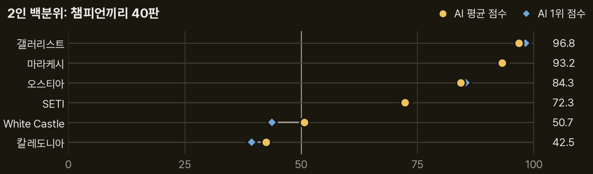
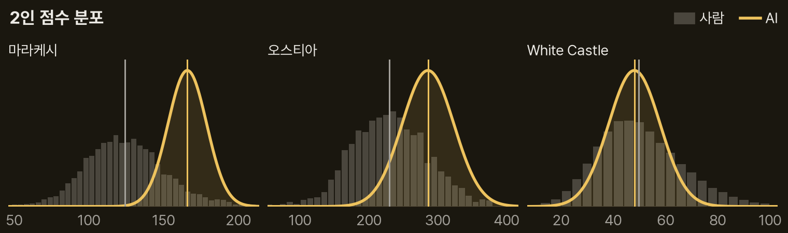
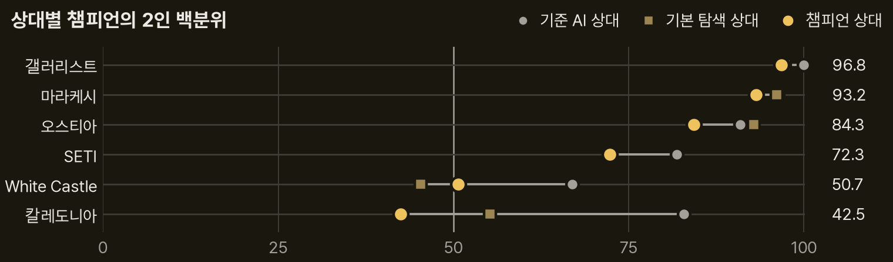
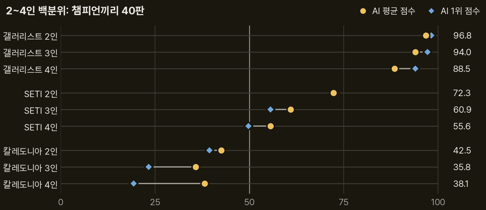
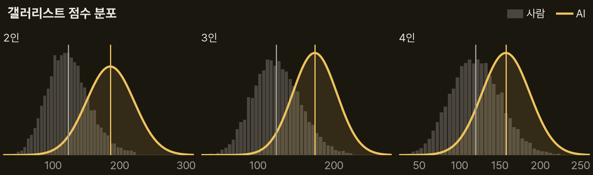
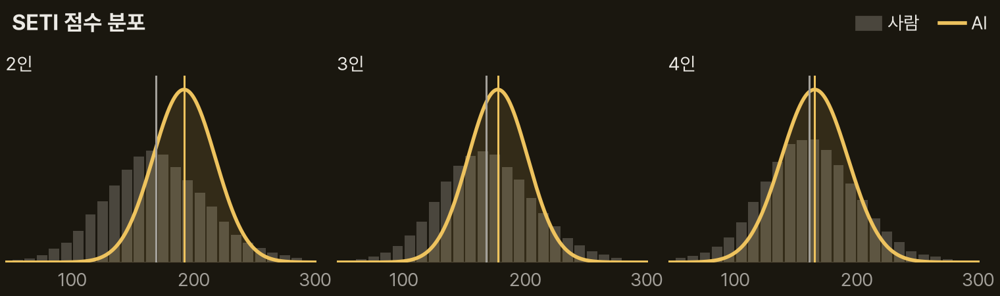
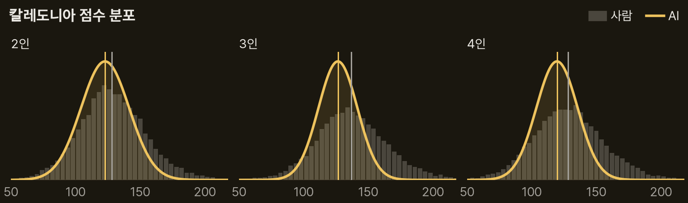
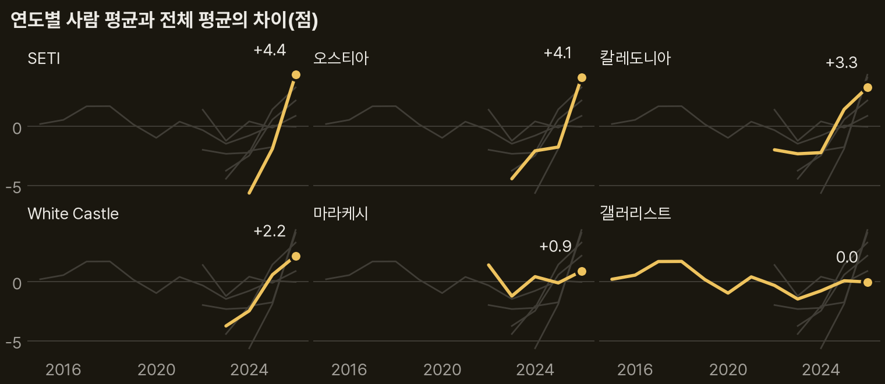

> 이 글은 직접 만들고 있는 개인 프로젝트의 개발 기록입니다. 저장소는 비공개이며, 본문의 수치는 저장소의 기록에서 가져왔습니다.

11편까지는 AI 점수를 사람의 2인 기록과만 견줬다. 사람 점수는 인원에 따라 높낮이가 달라서 3인과 4인으로 넓히려면 같은 인원끼리 견줘야 한다. 이번에는 여섯 게임에서 같은 규칙으로 고른 가장 강한 AI, 곧 챔피언끼리 2인 40판을 두었고, 그중 세 게임은 3인과 4인도 40판씩 두었다. 그리고 그 점수를 같은 인원의 사람 기록에 놓았다. 글의 중심은 챔피언끼리 맞붙은 이 판들이다.

```요약
요약: 챔피언끼리 둔 2인 판의 평균 점수는 사람 2인 기록에서 갤러리스트가 상위 3.2%(백분위 96.8), 마라케시 상위 6.8%, 오스티아 상위 16%, SETI 상위 28%였고, White Castle은 사람 가운데(50.7), 칼레도니아는 그보다 낮은 42.5였다. 인원을 늘리면 갤러리스트는 3인 94.0, 4인 88.5로 사람 상위권에 남았고, SETI는 60.9, 55.6으로 사람 가운데 가까이 내려왔으며, 칼레도니아는 35.8, 38.1로 2인과 비슷했다.
```

```용어
챔피언: 게임마다 가장 강한 설정의 AI다. 기본 탐색의 계산량을 네 배로 늘렸고, SETI만 따로 고른 설정이다.
기본 탐색: 둘 수 있는 수마다 게임 끝까지 가상으로 두어 보고 평균 점수가 가장 높은 수를 고르는 AI의 기본 설정이다.
기준 AI: 한 수 앞만 보고 정해진 우선순위대로 두는 가장 단순한 AI다.
백분위: 사람 100명 가운데 AI 점수보다 낮은 점수를 낸 사람의 수다. 96.8이면 사람 100명 중 96.8명보다 높아 상위 3.2%이고, 50이면 사람 가운데다.
1위 점수 백분위: 판마다 1위를 한 AI의 점수를 평균 내어, 같은 인원 사람 판에서 1위를 한 사람들의 점수 가운데 어디쯤인지 잰 백분위다.
하락률: 상대가 기준 AI일 때보다 강한 AI일 때 점수가 몇 % 떨어지는지다.
95% 구간: 같은 실험을 되풀이했을 때 참값이 들어올 것으로 보는 범위다.
```

## 1. 대상 게임과 대국 조건

대상은 탐색 AI가 있는 여섯 게임의 기본판이다. 확장은 넣지 않았다.

| 게임 | 원제 | 엔진 판본 | 출판사 |
|---|---|---|---|
| 갤러리스트 | The Gallerist | 2022 영문판 | Eagle-Gryphon Games |
| 마라케시 | Marrakesh | 영문 기본판 | Queen Games |
| 오스티아 | Ostia | 일문 개정판 | uchibacoya |
| SETI | SETI | 영문판 | Czech Games Edition |
| White Castle | The White Castle | 갱신판 영문 | Devir |
| 칼레도니아 | Clans of Caledonia | 2026-06-03 영문 | Karma Games |
{caption="대상 게임과 엔진 판본"}

한국어판은 SETI가 DiceTree Games의 「세티: 외계 지성체를 찾아서」, The White Castle이 아스모디코리아의 「백로성」이다.

챔피언은 게임마다 따로 손보지 않고 규칙 하나로 정했다. 기본 탐색이 한 수를 고를 때 두어 보는 가상 대국의 수를 네 배로 늘리고, 후보 수를 미리 추리는 게임은 후보 상한도 네 배로 늘렸다. SETI만은 11편에서 가장 좋았던 점수 우선 설정을 그대로 썼다. 탐색량을 늘려도 점수가 오르지 않았고, 한 판이 약 1,000초라 네 배로는 시간 안에 둘 수 없었다.

| 인원 | 게임 수 | 게임당 판 수 |
|---|---|---|
| 2인 | 6 | 40 |
| 3인 | 3 | 40 |
| 4인 | 3 | 40 |
{caption="인원별 대국 수"}

같은 설정의 AI끼리는 시드가 같으면 같은 판이 나온다. 그래서 서로 다른 시드 40개로 한 판씩 두었다. 한 판에 걸리는 시간에는 상한을 두었다. 2인은 평소 한 판 시간의 다섯 배로, 갤러리스트 35분, White Castle 30분, SETI 83분이었다. 3인과 4인은 2인 상한의 1.5배와 2배로 두었다. 상한에 걸린 판은 버리고 다음 시드로 다시 두었다. 갤러리스트 2인에서 두 판이 걸렸고 3인과 4인은 한 판도 없었다. 모든 판은 규칙대로 끝났고, 기록을 처음부터 다시 재생한 최종 상태가 실제와 같았다.

한 판 평균 시간은 칼레도니아 3인 103초, 4인 160초, 갤러리스트 3인 893초, 4인 1,632초, SETI 3인 1,770초, 4인 2,508초였다.

## 2. 사람 기록과 백분위

사람 점수는 [goodat.games](https://goodat.games/)의 게임별 점수 분포에서 읽었다. 화면 아래 BGG 표기로 보아 BoardGameGeek에 올라온 플레이 기록이다. 인원 필터(2, 3, 4)를 건 분포의 표본 수와 평균은 여섯 게임의 모든 필터에서 사이트 머리글의 값과 맞았다.

AI 점수는 같은 인원의 사람 기록 전체와 견줬다. 사람 기록에는 그 게임을 처음 해 본 사람의 점수도 들어 있다. 백분위는 실제 기록으로 셌고, 같은 점수는 반만 센다.

$$
P(x) = 100 \times \frac{N_{<x} + \tfrac{1}{2} N_{=x}}{N}
$$

\(N\)은 사람 점수의 수, \(N_{<x}\)와 \(N_{=x}\)는 \(x\)보다 낮은 점수와 같은 점수의 수다. 예를 들어 SETI 4인에서 AI 평균 165.4점을 사람 4인 기록 53,433개에 놓으면 55.6이다.

1위 점수 백분위는 사이트의 최종 순위 필터로 같은 인원 판에서 1위를 한 사람의 점수만 모으고, 그 분포에 판마다 1위 AI 점수의 평균을 놓았다.

## 3. 2인 비교: 여섯 게임

금색 점은 챔피언끼리 둔 판의 평균 점수, 파란 마름모는 판마다 1위를 한 AI 점수의 평균이 사람 판 1위 점수 가운데 차지하는 백분위다. 오른쪽 숫자는 금색 점의 값이다.



| 게임 | AI | 백분위 | 하락률 |
|---|---|---|---|
| 갤러리스트 | 186.0 | 96.8 | 17.8 |
| 마라케시 | 165.9 | 93.2 | 5.9 |
| 오스티아 | 285.8 | 84.3 | 6.2 |
| SETI | 192.1 | 72.3 | 7.0 |
| White Castle | 48.1 | 50.7 | 12.7 |
| 칼레도니아 | 122.8 | 42.5 | 19.1 |
{caption="2인 AI 평균 점수, 백분위, 하락률"}

AI 열은 챔피언끼리 둔 판의 평균 점수다. 하락률(%)은 챔피언끼리 둔 판의 점수가 챔피언이 기준 AI와 둔 판보다 얼마나 낮은지이고, 식은 아래 "상대에 따른 점수"에 있다. 사람 2인 기록의 평균 점수와 표본 수는 갤러리스트 122.6점(14,509개), 마라케시 124.2점(8,184개), 오스티아 229.4점(1,928개), SETI 169.0점(42,806개), White Castle 49.8점(89,076개), 칼레도니아 128.1점(11,146개)이다.

판마다 1위를 한 AI 점수의 백분위(파란 마름모)는 갤러리스트, 마라케시, 오스티아, SETI에서 평균 점수의 백분위와 1.4 이하로 차이가 났다. 칼레도니아는 39.4로 3.1, White Castle은 43.7로 7.0 낮았다.

갤러리스트는 AI 점수 80개 가운데 75%가 사람 2인 기록의 상위 10% 경계(164점)보다 높았다. White Castle은 AI 평균이 사람 평균보다 1.7점 낮지만 백분위는 50.7로 사람 가운데다. 사람 점수가 높은 쪽으로 길게 퍼져 있어 사람 평균이 가운데 값보다 높기 때문이다.



회색 막대는 사람 점수의 분포, 금색 곡선은 AI 점수 80개의 평균과 표준편차로 그린 정규 곡선이다. 세로선은 각각의 평균이다. AI 점수의 표준편차는 갤러리스트를 뺀 다섯 게임에서 사람의 0.49~0.73배라 곡선이 사람 분포보다 좁다. 갤러리스트만 1.14배로 사람보다 넓었다. 오스티아는 2인 표본이 1,928개로 적어 막대가 고르지 않다.

### 상대에 따른 점수: 기준 AI, 기본 탐색, 챔피언

같은 챔피언이라도 누구와 두느냐에 따라 점수가 달라진다. 약한 상대에게서는 점수를 쉽게 벌고, 강한 상대는 점수를 빼앗는다. 그래서 상대를 세 가지로 바꿔 챔피언 점수의 2인 백분위를 견줬다.

- 기준 AI: 챔피언과 둔 판에서 기준 AI가 얻은 평균 점수를 사람 2인 기록에 놓으면 SETI 0.3, 칼레도니아 2.7, 마라케시 5.9, White Castle 7.5, 갤러리스트 14.4, 오스티아 39.6이다. 오스티아를 뺀 다섯 게임에서 사람 하위 15% 안의 점수다.
- 기본 탐색: 기본 탐색끼리 둔 판의 평균 점수를 놓으면 칼레도니아 29.3, White Castle 50.7, 오스티아 76.6, 마라케시 80.3, 갤러리스트 94.7이다. SETI는 이 기록이 없다.
- 챔피언: 이 글의 중심인 챔피언끼리 대결이고, 세 상대 가운데 가장 강하다.

기준 AI의 값은 챔피언에게 견제를 받은 판의 점수라, 기준 AI끼리 둘 때보다 낮을 수 있다. 판 수는 기준 AI 상대가 SETI 120판, 나머지 40판이고, 기본 탐색 상대는 마라케시와 White Castle이 40판, 앞선 측정 기록을 쓴 갤러리스트가 80판, 오스티아와 칼레도니아가 120판이다.



회색 점은 기준 AI 상대, 어두운 금색 네모는 기본 탐색 상대, 금색 점은 챔피언 상대일 때 챔피언 점수의 백분위다. 칼레도니아는 기준 AI 상대 82.9에서 챔피언 상대 42.5로 가장 크게 내려갔다. 마라케시, 오스티아, 갤러리스트는 6.6 이하로 조금만 내려갔다. 갤러리스트는 기준 AI 상대 평균 226.5점이 사람 2인 최고 기록 225점보다 높아, 강한 상대에게 점수를 잃어도 사람 기록에서의 위치가 거의 그대로다.

White Castle은 기본 탐색 상대 평균이 46.5점(백분위 45.3)으로 챔피언 상대 48.1점보다 오히려 낮았지만, 그 차이는 95% 구간(43.8~49.3점) 안이다. 이 게임에서는 상대가 기본 탐색만 되어도 점수가 이미 다 내려간다.

이 하락이 게임의 상호작용, 곧 상대가 내 점수를 얼마나 깎을 수 있는지와 이어지는지도 보았다. 상대가 기준 AI일 때보다 강한 AI일 때 점수가 몇 % 떨어지는지를 하락률로 정의했다.

$$
\text{하락률} = \frac{\bar{s}_{\text{약한 상대}} - \bar{s}_{\text{강한 상대}}}{\bar{s}_{\text{약한 상대}}}
$$

\(\bar{s}\)는 그 상대와 둔 판의 평균 점수다. 칼레도니아 챔피언은 기준 AI 상대 151.8점, 챔피언 상대 122.8점이라 하락률이 19.1%다.

같은 값을 기본 탐색에서도 앞선 측정 기록으로 구했다. 약한 상대로는 기준 AI 대신, 기본 탐색이 안에서 쓰는 수 고르기 규칙만으로 두는 AI를 썼다. 기본 탐색의 하락률은 오스티아 2.6%, 마라케시 4.0%, 갤러리스트 11.0%, White Castle 14.8%, 칼레도니아 18.8%이고, SETI는 기록이 없다. 두 하락률 모두 오스티아와 마라케시가 가장 작고 칼레도니아가 가장 크다.

하락률이 클수록 2인 백분위가 낮은 경향이 있다. 순위 상관은 기본 탐색 하락률 −0.60(게임 5개), 챔피언 하락률 −0.43(게임 6개)이다. 갤러리스트는 하락률이 두 번째로 큰데 백분위가 가장 높아 이 경향에서 벗어난다. BGG에는 상호작용을 따로 매기는 공식 항목이 없어 바깥 지표와는 견주지 않았다.

## 4. 3인과 4인 비교: 갤러리스트, SETI, 칼레도니아

챔피언 셋 또는 넷이 한 판에 앉아 40판씩 두어 점수를 3인 120개, 4인 160개 얻었다. 점과 마름모의 뜻은 2인 그림과 같다.



| 대상 | AI | 사람 | 백분위 |
|---|---|---|---|
| 갤러리스트 2인 | 186.0 | 122.6 | 96.8 |
| 갤러리스트 3인 | 174.9 | 124.3 | 94.0 |
| 갤러리스트 4인 | 157.5 | 119.9 | 88.5 |
| SETI 2인 | 192.1 | 169.0 | 72.3 |
| SETI 3인 | 177.5 | 168.1 | 60.9 |
| SETI 4인 | 165.4 | 161.0 | 55.6 |
| 칼레도니아 2인 | 122.8 | 128.1 | 42.5 |
| 칼레도니아 3인 | 126.5 | 136.8 | 35.8 |
| 칼레도니아 4인 | 119.5 | 128.2 | 38.1 |
{caption="인원별 평균 점수와 백분위"}

AI와 사람 열은 평균 점수다. 사람 표본은 갤러리스트 3인 16,523, 4인 21,076, SETI 3인 49,470, 4인 53,433, 칼레도니아 3인 13,948, 4인 19,345개다.



갤러리스트는 세 인원 모두 AI 곡선이 사람 분포의 오른쪽 끝에 있고, 두 평균은 35점 넘게 떨어져 있다.



SETI는 인원이 바뀌어도 사람 분포의 모양이 비슷한데 AI 곡선만 왼쪽으로 옮겨 와, 4인에서는 두 평균선이 거의 겹친다.



칼레도니아는 세 인원 모두 AI 평균선이 사람 평균선 왼쪽에 있고, AI 곡선이 사람 분포보다 훨씬 좁다. 3인에서 사람 평균이 136.8점으로 올라 차이가 가장 벌어졌다. 인원별 그림의 파란 마름모, 곧 1위 점수 백분위는 2인 39.4, 3인 23.3, 4인 19.3으로 평균 점수의 백분위보다 더 낮다. 사람 판의 1위 점수는 인원이 늘수록 140.6, 156.8, 154.1점으로 오르는데, AI 1위 점수는 곡선이 좁은 만큼 평균보다 크게 높지 않아 133.3, 140.1, 136.4점으로 거의 그대로이기 때문이다.

## 5. 결과의 오차 범위

AI 평균 점수의 95% 구간은 다음 식으로 구했다.

$$
\bar{s} \pm 1.96 \frac{\sigma}{\sqrt{n}}
$$

\(\sigma\)는 AI 점수의 표준편차, \(n\)은 점수의 수(판 수 × 인원)다. SETI 4인은 평균 165.4점, 표준편차 27.3점, 점수 160개라 161.1~169.6점이고, 이 양 끝을 사람 분포에 놓으면 백분위 구간은 51.4~59.8이다. 40판에서 백분위 구간의 폭은 1.7~13.4였다. 이 계산은 한 판 안의 점수들을 서로 독립으로 보았으므로 실제 구간은 조금 더 넓을 수 있고, 사람 분포의 표본 오차는 넣지 않았다.

## 6. 기록 연도와 사람 점수

사이트에서 연도를 고르면 인원 필터가 풀려, 연도별 분포는 모든 인원을 합친 기록으로만 읽었다. 그림은 표본 500개 이상인 해의 평균에서 전체 평균을 뺀 값이다. 금색 선이 그 게임이고 회색 선은 나머지 다섯 게임이다.



나온 지 얼마 안 된 게임일수록 사람 점수가 해마다 올랐다. SETI는 2024년 160.2점에서 2026년 170.2점, White Castle은 2023년 44.7점에서 50.6점, 칼레도니아는 2024년 128.7점에서 134.2점, 오스티아는 2025년 201.3점에서 207.2점이 되었다. 갤러리스트와 마라케시는 1~2점 안에서 움직였다. 최근 기록만으로 다시 재지는 않았지만, 사람 점수가 오른 게임에서는 AI 백분위가 이 글의 값보다 낮아질 수 있다.

## 7. 종합

챔피언끼리 둔 판의 점수는 2인 사람 기록에 놓으면 여섯 게임 가운데 넷에서 위쪽(백분위 72.3~96.8)이었고, White Castle과 칼레도니아는 사람 가운데와 그 아래(50.7, 42.5)였다. 게임 사이의 이 차이는 강한 상대가 점수를 얼마나 깎는 게임인지와 함께 움직였다.

찾은 내용은 다섯 가지다.

1. 상대가 점수를 적게 깎는 게임일수록 AI가 사람 기록에서 높은 자리에 있었다. 하락률이 6% 안팎인 마라케시와 오스티아는 백분위 93.2, 84.3이었고, 12.7%와 19.1%인 White Castle과 칼레도니아는 50.7, 42.5였다(순위 상관 −0.43). 갤러리스트만 하락률 17.8%에도 96.8로 예외다. 기준 AI 상대 평균 226.5점이 사람 2인 최고 기록 225점보다 높아, 견제로 점수를 잃어도 사람 상위권에 남는다.
2. 사람 가운데 아래인 두 게임은 낮은 까닭이 다르다. 칼레도니아는 기준 AI를 상대하면 백분위가 82.9까지 올라 차이의 대부분이 챔피언끼리의 견제에서 온다. White Castle은 기준 AI를 상대해도 66.9에 그치고 앞선 측정에서 계산량을 늘려도 점수가 오르지 않아, 남은 차이를 AI 실력의 한계로 본다.
3. 인원이 늘 때 백분위는 AI 점수가 사람 점수보다 더 많이 떨어지는 게임에서 내려갔다. 갤러리스트는 2인에서 4인으로 가며 AI 평균이 15% 내려가고 사람 평균은 2% 내려가 백분위가 96.8에서 88.5가 되었고, SETI도 AI 14%, 사람 5%로 72.3에서 55.6이 되었다. 칼레도니아는 AI 평균 119.5~126.5점, 사람 평균 128.1~136.8점으로 둘 다 크게 움직이지 않아 36~43에 머물렀다.
4. 챔피언끼리 둔 판의 점수는 사람보다 좁게 흩어진다. 2인 표준편차가 갤러리스트를 뺀 다섯 게임에서 사람의 0.49~0.73배였고, 갤러리스트만 1.14배였다. 그래서 1위 점수는 평균보다 크게 높지 않고, 사람 1위 점수가 인원에 따라 오르는 칼레도니아 4인에서는 1위 점수 백분위가 19.3으로 평균 점수 백분위 38.1의 절반이다.
5. 사람 기록은 나온 지 얼마 안 된 게임일수록 해마다 올랐다. 같은 AI 점수라도 최근 기록과 견주면 백분위가 이 글의 값보다 낮아질 수 있다.

다음에는 사람 가운데 아래인 두 게임을 고친다. 칼레도니아는 강한 상대의 견제에서 점수를 지키는 수 고르기를, White Castle은 약한 상대에게서도 점수를 더 내는 탐색을 먼저 본다.

## 8. 한계

- 점수 높이를 견준 것이지 실력 순위가 아니다. 사람과 AI가 한 판에서 겨룬 결과가 아니다.
- 사람 기록에는 확장, 판본, 상대 수준이 섞여 있고, 그 게임을 처음 해 본 사람의 점수도 들어 있다. 확장 사용 여부는 거를 수 없다.
- 마라케시, 오스티아, White Castle은 3인과 4인 판을 두지 않았다.
- 상관 계수는 게임이 5~6개뿐이라 참고용이다. SETI는 네 배 규칙 대신 11편에서 고른 설정을 썼다.

## 출처와 작성 방식

- 근거: 비공개 저장소의 챔피언끼리 대결 기록(2인 여섯 게임, 3인과 4인 세 게임, 각 40판)과 분석 기록. 사람 기준은 [goodat.games](https://goodat.games/)의 게임별 점수 분포를 인원, 최종 순위, 기록 연도 필터로 나눠 2026-10-22과 2026-10-23에 읽은 값입니다.
- 출판사와 엔진 판본: 저장소의 게임별 기록과 12편의 출판사 표에서 옮겼습니다. 한국어판은 SETI와 The White Castle만 기록이 있습니다.
- 표와 그래프: 저장소의 기록에 적힌 값으로 직접 그렸습니다. AI 점수 곡선은 평균과 표준편차로 그린 정규 곡선입니다. 모든 백분위는 같은 인원의 사람 기록 전체 기준이고, 1위 점수 백분위는 같은 인원 사람 판의 1위 점수 기준입니다.
- 수치 기준일: 2026-10-23
