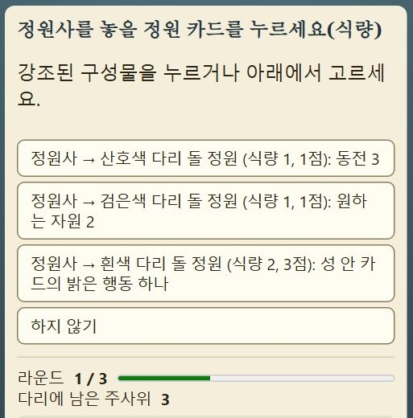
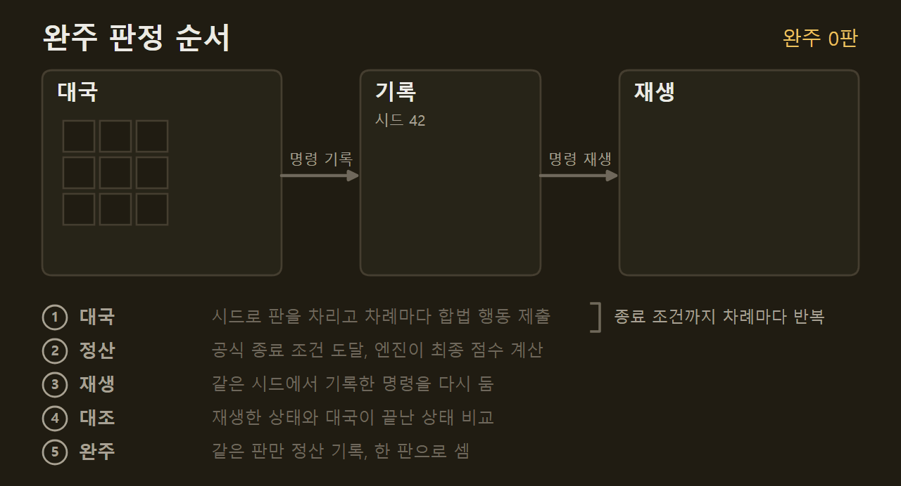
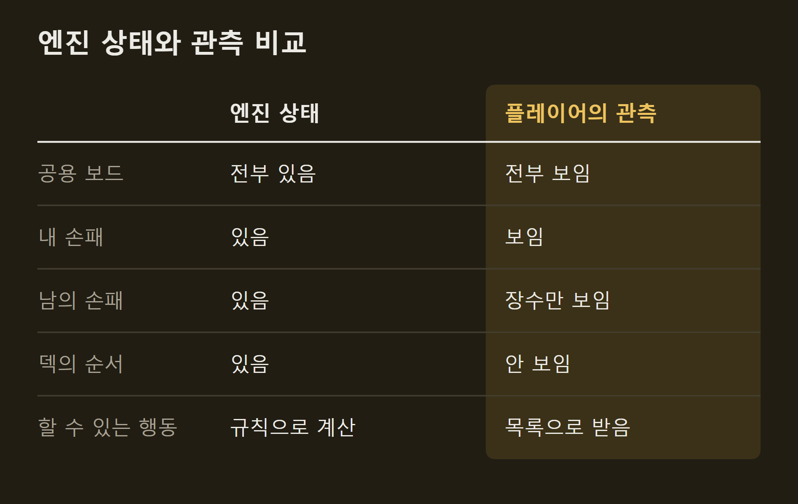
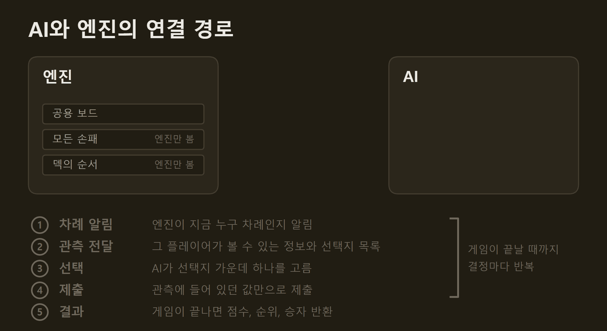
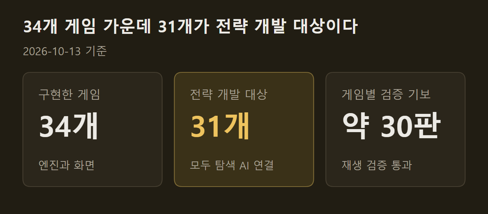

> 이 글은 직접 만들고 있는 개인 프로젝트의 개발 기록입니다. 저장소는 비공개이며, 본문의 수치는 저장소의 기록에서 가져왔습니다.

무거운 유로게임은 한 판에 2~3시간이 걸리고 규칙서가 수십 쪽이다. 이 프로젝트는 그런 게임을 혼자서도 한 판 제대로 두기 위해 만들고 있다. 사람은 웹 브라우저에서 자기 자리를 두고, 나머지 자리는 내 컴퓨터에서 도는 AI가 맡는다. 지금까지 34개 게임의 규칙 엔진과 화면을 만들었고, 이 글은 그 전체 구조를 설명한다.

```요약
요약: 무거운 유로게임 34종을 사람 한 명과 로컬 AI가 함께 두도록 만든 프로젝트이며, 엔진이 규칙과 점수를 맡고 AI는 자기 차례에 보이는 것만 받지만 AI의 실력은 아직 사람과 견주어 재지 못했다.
```

```용어
유로게임: 자원을 모으고 바꿔 점수를 쌓는 전략 보드게임. 주사위 운보다 계획의 비중이 크다.
엔진: 게임의 상태를 들고 규칙에 따라 행동을 처리하고 점수를 계산하는 프로그램.
관측: 한 플레이어가 자기 차례에 볼 수 있는 정보만 모은 것. 남의 손패나 덱의 순서는 들어 있지 않다.
합법 행동: 지금 상태에서 규칙상 할 수 있는 행동. 엔진이 목록으로 만들어 준다.
baseline: 정해진 우선순위대로만 두는 가장 단순한 AI. 다른 AI를 견줄 때 대조군으로 쓴다.
```

## 1. 만들려는 것

화면은 한국어 웹 페이지다. 게임 목록에서 게임을 고르면 그 게임의 서버가 켜지고 테이블이 열린다. 공용 보드는 창 크기에 맞춰 전체가 보이고, 개인판은 별도 창으로 연다. 자리마다 사람이 둘지 AI가 둘지 정하고, 대국은 저장했다가 이어 두거나 처음부터 다시 재생할 수 있다.

")

대상은 Grand Austria Hotel, The Gallerist, SETI, Kanban EV, Vinhos Deluxe, Arcs 같은 게임이다. 대부분 2~4인용이고 Ra, Hamburg, Nusfjord는 5인까지, Sekigahara는 2인 전용이다. 솔로 규칙과 확장은 대부분 뺐다.

AI는 두 가지다. baseline은 정해진 우선순위대로만 두는 대조군이다. 다른 하나는 후보 행동마다 게임을 끝까지 두어 보고 평균 점수가 가장 높은 수를 고르는 탐색 AI다. 두 가지 모두 언어 모델을 부르지 않는다.

## 2. 엔진의 역할

규칙, 상태, 공식 점수는 엔진 하나가 관리한다. 화면도 AI도 상태를 직접 고치지 못하고, 엔진이 내준 합법 행동 가운데 하나를 골라 제출할 뿐이다. 사람이 화면에서 누른 것과 AI가 고른 것이 같은 창구로 들어가므로, 사람에게만 되거나 AI에게만 되는 행동이 생기지 않는다.



==엔진이 한 판을 끝냈다고 해서 바로 완주로 세지 않는다.== 한 판이 끝나면 처음 시드에서 기록된 명령을 다시 재생해 대국이 끝난 상태와 같은 상태가 되는지 비교하고, 같을 때만 공식 정산을 기록해 한 판으로 센다.



엔진은 34개 게임 모두 Rust로 되어 있다. 처음에는 Python으로 만들었다가 전부 옮겼고, 화면과 서버와 검증 도구는 Python으로 남겼다.

## 3. AI가 받는 것

보드게임에는 남의 손패, 뒤집힌 타일, 덱의 순서처럼 볼 수 없는 정보가 있다. AI가 엔진의 상태를 통째로 읽으면 그 정보까지 보고 두게 되고, 그렇게 얻은 승률은 사람과 둘 때 의미가 없다. 그래서 AI는 자기 차례에 관측과 합법 행동 목록만 받는다.



사람이 보는 화면도 같은 관측으로 그린다. 아래는 Kanban EV 대국에서 플레이어 1의 시점으로 본 개인판이다. 자기 손의 카드는 앞면이 보이고, 플레이어 2의 손패는 장수만 적혀 있다.

'으로만 나온다. (게임 그림의 저작권은 출판사 Eagle-Gryphon Games에 있다)")

모든 게임의 AI는 같은 경로 하나로만 게임과 만난다.

1. 엔진이 지금 누구 차례인지 알려 준다.
2. 그 플레이어의 관측을 만든다. 관측에는 결정의 번호와 선택지 목록이 들어 있다.
3. AI가 선택지 가운데 하나를 고른다.
4. 관측에 들어 있던 값만으로 제출한다.
5. 게임이 공식 종료 조건에 닿으면 플레이어별 점수, 순위, 승자를 돌려준다.

1~4는 게임이 끝날 때까지 결정마다 되풀이된다. 자기 차례가 올 때마다 관측을 새로 받고, 하나를 골라 제출한다. 5의 결과는 게임이 끝났을 때 한 번만 돌아온다.



==34개 게임이 이 경로를 똑같이 지키는지 같은 검사 코드 하나로 확인했다.== 게임과 인원 조합마다 baseline 한 판과 무작위 합법 행동 두 판을 두었고, 마지막 실행에서 282판에 위반은 0건이었다. 이 검사는 경로가 연결되어 있는지만 본다. 비공개 정보가 관측에 새는지는 별도의 누출 검사가 맡고, 규칙이 옳은지와 AI가 강한지는 이 검사로 알 수 없다.

경로를 하나로 맞추는 데에도 시간이 들었다. 처음 검사했을 때는 대국 결과를 돌려주는 모양이 게임에 따라 네 가지였고, 14개 게임은 공용 평가 코드가 결과를 읽지 못했다. 게임을 하나씩 따로 만들면서 생긴 차이였고, 공통 모양을 정해 맞춘 뒤에야 한 코드로 모든 게임을 돌릴 수 있었다.

## 4. 실행 환경

장비는 데스크톱 한 대다. Ryzen 7 9800X3D 8코어, RAM 32GB, RTX 5080이다. 유료 API는 쓰지 않는다. 지금의 AI 두 가지는 CPU에서만 계산하므로 그래픽 카드도 쓰지 않는다. 초기에 로컬 언어 모델로 수를 고르는 전략을 만들어 보았으나 탐색 AI를 이기지 못해 모두 제거했다.

지금은 34개 게임의 엔진, 화면, 저장과 재생이 동작한다. 그 가운데 31개를 전략 개발 대상으로 정했고 31개 모두에 탐색 AI가 붙어 있다.



==탐색 AI가 얼마나 잘 두는지는 아직 사람과 견주어 재지 못했다.== 지금 있는 전적은 대부분 baseline을 상대로 한 여섯 판이고, baseline은 사람 수준이 아니다. 21개 게임은 사람이 직접 두어 보고 남긴 의견이 아직 없다. 일부 게임의 카드와 타일 수치는 실물이 아니라 스캔한 그림에서 읽은 값이다.

## 출처와 작성 방식

- 근거: 비공개 저장소의 개발 현황 문서, 게임별 규칙 기록, 검사 기록, git 이력
- 그래프: 저장소의 기록에 적힌 값으로 VISER 주간 보고서의 그래프 양식을 써서 직접 그린 그림입니다.
- 움직이는 그림: 직접 그린 그림입니다. 시드 번호, 점수, 결정 번호, 선택지 수는 설명을 위한 예시입니다.
- 화면: 이 프로젝트의 테이블에서 AI 대국을 진행하다가 찍은 것입니다. 화면 속 게임 그림은 인용이며 저작권은 각 출판사에 있습니다.
- 수치 기준일: 2026-10-13
