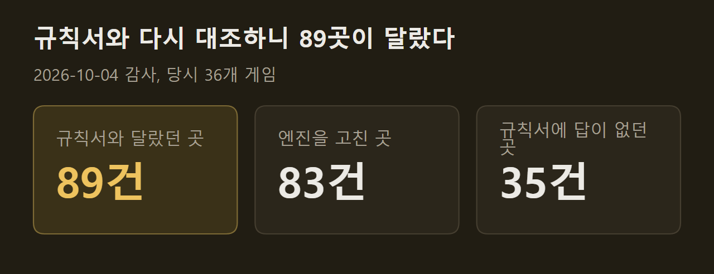
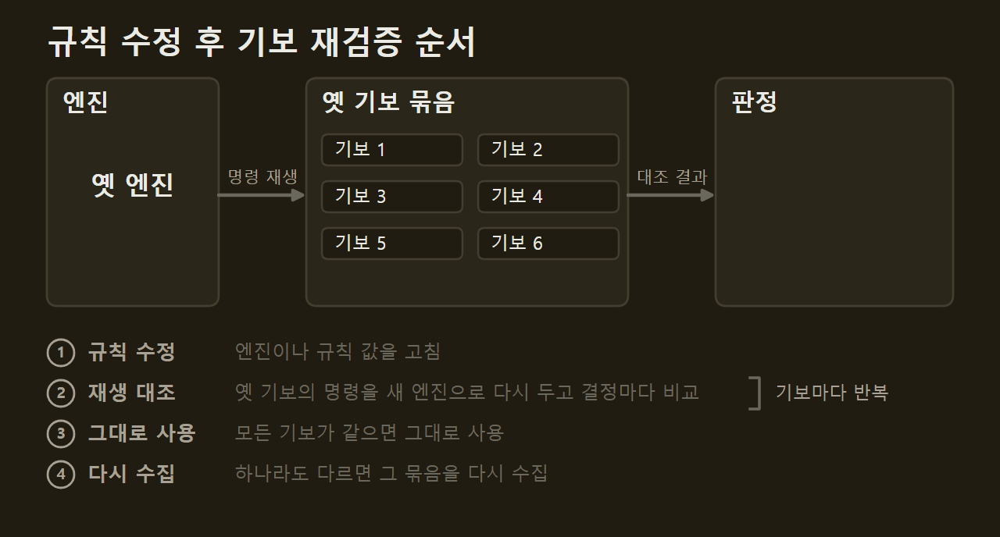

> 이 글은 직접 만들고 있는 개인 프로젝트의 개발 기록입니다. 저장소는 비공개이며, 본문의 수치는 저장소의 기록에서 가져왔습니다.

AI가 아무리 잘 두어도 엔진의 규칙이 틀렸으면 그 실력은 다른 게임의 실력이다. 그런데 규칙서를 끝까지 읽어도 엔진을 만들 만큼 정해지지 않는 곳이 게임마다 나온다. 이 글에는 그런 곳을 짐작으로 채우지 않으려고 정한 방법과, 그렇게 하고도 틀렸던 것을 적는다.

```요약
요약: 규칙서가 정하지 않은 곳을 엔진이 짐작으로 채우지 않도록 근거의 순서와 기록 방법을 정했고, 규칙서와 다시 대조해 89곳을 찾아 고쳤지만 무작위 대국이 한 번도 밟지 못한 경로는 고정 국면 테스트로만 확인했다.
```

```용어
공식 답: 디자이너, 개발자, 출판사가 낸 정오표와 FAQ, 공식 계정으로 쓴 답글.
규칙 기록: 게임마다 두는 문서. 어떤 규칙을 무슨 근거로 어떻게 정했는지 적는다.
구성물: 카드, 타일, 보드처럼 게임 상자에 들어 있는 것.
기보: 한 판에서 제출된 명령을 처음부터 끝까지 적은 기록.
무작위 대국: 합법 행동 가운데 아무것이나 골라 끝까지 두는 대국. 엔진의 결함을 찾는 데 쓴다.
```

## 1. 규칙서의 한계

사람끼리 둘 때는 규칙서에 없는 상황이 나오면 그 자리에서 합의하고 넘어간다. 엔진은 그럴 수 없다. 카드 더미가 바닥났을 때, 두 효과가 동시에 걸렸을 때, 낼 수 있는 것이 하나도 없을 때 무엇을 할지가 코드에 적혀 있어야 한다.

문제가 생기는 곳은 세 가지였다. 규칙서 문장이 두 가지로 읽히는 곳, 카드와 타일에 인쇄된 값을 옮기다 틀리는 곳, 그리고 내가 문장을 잘못 읽은 곳이다. 앞의 둘은 방법을 정해 줄였고, 마지막은 나중에 다시 대조해서 찾았다.

## 2. 근거의 순서

근거에는 순서를 두었다. 공식 답이 규칙서 문장보다 우선한다. 규칙서에도 오류가 있고, 디자이너가 나중에 고쳐 답한 곳이 많기 때문이다. The White Castle에는 디자이너의 답 20건을, Kanban EV에는 21건을 반영했고, Vinhos Deluxe는 47개 글타래의 답을 인용했다. Cuzco처럼 공식 답이 하나도 없는 게임도 있다.

| | 근거 | 처리 |
|---|---|---|
| 1. 공식 답 | 디자이너·출판사의 답, 정오표 | 그대로 구현 |
| 2. 규칙서 | 규칙서에 답이 있음 | 적힌 대로 구현 |
| 3. 근거 없음 | 규칙서를 읽어도 답이 없음 | 직접 정하고 내 결정으로 표시 |
{caption="근거별 규칙 처리"}

어려운 것은 세 번째인 근거 없음이다. 처음에는 근거가 없으면 엔진이 그 자리에서 대국을 멈추게 했다. 틀린 규칙으로 계속 두는 것보다 멈추는 쪽이 낫다고 보았다. 그런데 멈춘 판은 끝나지 않고, 끝나지 않은 판으로는 아무것도 잴 수 없다. 그래서 내가 정하되 규칙 기록에 공식 답이 아니라 내 결정이라고 적는 것으로 바꿨다. ==엔진이 따르는 규칙 가운데 어느 것이 공식이고 어느 것이 내 결정인지는 규칙 기록에서 구분된다.==

자주 나오는 경우에는 일반 처리를 하나 정해 두었다. 더미나 공급이 모자라면 더 채우지 않고 남은 만큼만 쓴다.

## 3. 구성물의 값을 옮기는 일

규칙서에는 카드 한 장 한 장의 값이 실려 있지 않은 경우가 많다. 그런 값은 구성물을 스캔한 그림에서 읽었다. 한 번 읽은 값은 다른 방법으로 한 번 더 읽어 대조했다. 처음에 한 번만 읽고 넘어갔던 네 게임의 값도 나중에 다시 읽어 고쳤다. 규칙서 부록의 글자, 인쇄 색의 분류, 규칙서의 준비 그림이 두 번째 근거가 됐다.

")

Vinhos Deluxe는 이렇게 대조한 187개 검사에서 불일치가 없었다. 다만 두 번 읽었다는 것은 같은 스캔을 다른 방법으로 읽었다는 뜻인 경우가 있다. 실물 상자와 직접 맞춰 본 것이 아니므로, 스캔이 실물과 다르면 그 차이는 찾지 못한다.

## 4. 규칙 재대조

게임이 30개를 넘은 뒤, 모든 게임의 엔진을 규칙서와 처음부터 다시 대조했다. 당시 36개 게임에서 규칙서와 다르다고 확정한 곳이 89건 나왔다.



89건 가운데 83건은 엔진을 고쳤다. 틀린 모양은 다양했다. SETI는 놓을 수 있는 말을 8개로 제한하고 있었는데 규칙서에는 그런 한도가 없었다. Stroganov는 이동 보너스 하나로 두 번 움직였고, Wondrous Creatures는 같은 점수 칸의 보상을 두 번 주었다. Sekigahara는 성에 남긴 블록의 정체가 상대의 관측에 들어 있었다. 마지막 것은 규칙 오류이면서 비공개 정보가 새는 결함이기도 했다.

따로 센 35건은 규칙서를 다시 읽어도 답이 나오지 않는 곳이다. 16건은 엔진을 바꿨고 19건은 그대로 두었다. 모두 내 결정으로 규칙 기록에 적었다. ==규칙을 한 번 옮기고 따로 한 번 더 대조한 뒤에도 게임당 2~3군데가 틀려 있었다.==

## 5. 무작위 대국 검사

고친 엔진은 무작위 대국으로 훑었다. 36개 게임에서 약 1만 9천 판을 두면서 판마다 선택지가 0개인 국면이 없는지, 엔진이 스스로 내준 행동을 거부하지 않는지, 공식 종료에 닿는지, 따로 계산한 점수와 엔진의 점수가 같은지를 보았다.

결함은 7개 게임에서 나왔다. SETI에서는 손으로 돌아온 카드가 버림 더미에 두 번 들어갔다. Vinhos Deluxe와 The White Castle은 저장한 판을 불러오면 합법 행동의 순서가 달라졌다. The Gallerist에서는 아무도 행동할 수 없는 교착이 균등 무작위 120판 가운데 65판에서 나왔고, 규칙서에 없는 상황이어서 전원 패배로 끝내기로 정했다.

==무작위 대국에서 결함이 0건이라는 것은 그 판수가 지나간 범위에서 0건이라는 뜻이다.== 고친 규칙 가운데 여러 곳은 무작위 대국에서 한 번도 발동하지 않았다. 그런 경로는 국면을 손으로 만들어 넣은 테스트로만 확인되어 있다.

## 6. 규칙 수정 후 기보 재검증

규칙이 바뀌면 그 전에 모은 기보는 다른 게임의 기록이 된다. 그래서 엔진을 고칠 때마다 옛 기보를 새 엔진으로 다시 재생해 본다. 기보마다 기록된 명령을 처음부터 다시 두고, 결정마다 상태와 합법 행동이 기록과 같은지 비교한다. 묶음 안의 기보가 모두 같으면 그대로 쓰고, 한 판이라도 다르면 그 묶음을 다시 모은다.



위 감사 뒤에는 36개 게임 가운데 32개의 기보를 다시 모았다. 이 비용 때문에 순서도 바꿨다. 애매한 규칙을 찾고 공식 답을 다시 조사하는 일을 기보를 모으기 직전에 끝내도록 했다.

## 출처와 작성 방식

- 근거: 비공개 저장소의 게임별 규칙 기록, 규칙 감사 기록, 무작위 대국 기록
- 그래프: 저장소의 기록에 적힌 값으로 VISER 주간 보고서의 그래프 양식을 써서 직접 그린 그림입니다.
- 움직이는 그림: 직접 그린 그림입니다. 묶음 안의 기보 수와 어긋나는 기보의 번호는 설명을 위한 예시입니다.
- 화면: 이 프로젝트의 테이블에서 AI 대국을 진행하다가 찍은 것입니다. 화면 속 게임 그림은 인용이며 저작권은 출판사에 있습니다.
- 감사와 무작위 대국의 수치는 게임이 36개이던 때의 값입니다. 그 뒤 2개를 제거해 지금은 34개입니다.
- 수치 기준일: 2026-10-13
