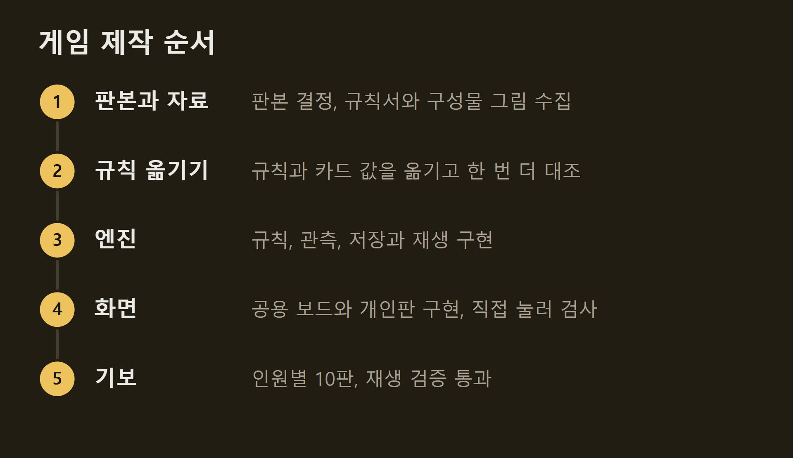
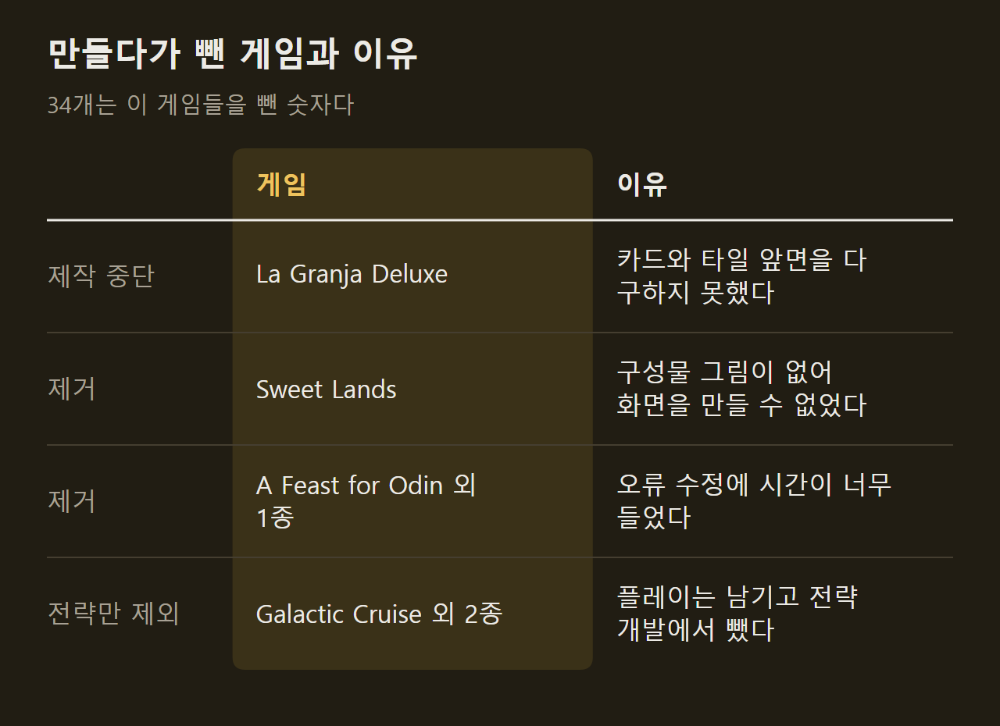
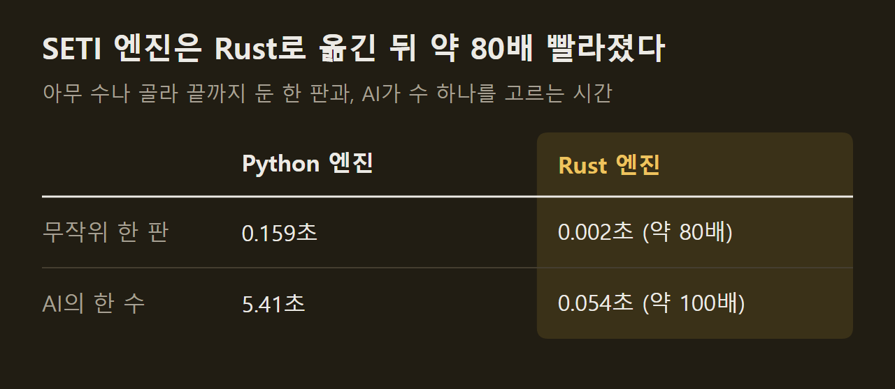

> 이 글은 직접 만들고 있는 개인 프로젝트의 개발 기록입니다. 저장소는 비공개이며, 본문의 수치는 저장소의 기록에서 가져왔습니다.

지금 둘 수 있는 게임은 34개다. 모두 같은 순서로 만들었고, 도중에 규칙 엔진을 Python에서 Rust로 전부 옮겼다. 이 글에는 게임 하나를 만드는 순서와 만들다 버린 게임, 그리고 엔진의 언어를 바꾼 이유와 결과를 적는다.

```요약
요약: 한 달 동안 같은 순서로 게임 34개를 만들고 규칙 엔진을 Python에서 Rust로 모두 옮겨 SETI 엔진이 약 80배 빨라졌지만, 기존 기보와 같은 결과를 내도록 옮긴 엔진들은 빠른 설계를 따르지 못했다.
```

```용어
판본: 같은 게임이라도 쇄와 언어에 따라 규칙과 구성물이 다르다. 그 가운데 구현 대상으로 고른 하나.
기보: 한 판에서 제출된 명령을 처음부터 끝까지 적은 기록.
가상 대국: AI가 수를 고르려고 머릿속에서 끝까지 두어 보는 대국.
Rust: 실행 속도가 빠른 프로그래밍 언어.
무작위 대국: 합법 행동 가운데 아무것이나 골라 끝까지 두는 대국. 수를 고르는 계산이 없어 엔진의 속도만 잴 수 있다.
```

## 1. 게임 하나를 만드는 순서

게임은 모두 같은 순서로 만든다. 순서를 문서로 적어 두고, 게임을 만들 때마다 얻은 교훈을 그 문서에 더했다.



범위도 처음에 정해 두었다. 솔로 규칙과 확장을 빼고 기본판의 다인 플레이만 만든다. 완료 기준은 인원별로 검증한 기보 10판이다. 2인부터 4인까지 두는 게임이면 30판이다.

화면에는 공통 조건이 있다. 공용 보드 전체가 스크롤 없이 한 창에 보여야 하고, 개인판은 별도 창으로 연다. 이 조건만 지키면 배치와 표현은 게임마다 다르게 했다.

## 2. 게임 34개의 제작 과정

처음 만든 게임은 Grand Austria Hotel이다. 그 뒤로 공용 코드가 쌓이면서 새 게임이 재사용하는 것이 늘었다. 서버, 저장과 재생, 두 창을 맞추는 화면 틀, 기보 검증 도구는 게임이 달라도 같은 것을 쓴다. 한때는 이틀 동안 열 게임을 함께 만들었다.

")

==게임마다 새로 써야 하는 것은 결국 규칙이었다.== 화면과 도구는 다시 쓸 수 있었지만, 규칙을 옮기는 일과 엔진은 게임마다 새로 해야 했다.

## 3. 만들다가 뺀 게임

만들기 시작한 게임이 모두 남은 것은 아니다.



La Granja Deluxe는 엔진을 짜던 도중에 멈췄다. 규칙서는 있었지만 그 판본의 카드와 타일 앞면을 다 구하지 못했다. 이때 얻은 교훈은 순서에 반영했다. 코드를 쓰기 전에 그 판본의 모든 구성물 값을 구할 수 있는지부터 확인한다. 구판과 총 장수가 같다는 것은 근거가 되지 못한다.

끝까지 만들고 나서 뺀 게임도 있다. A Feast for Odin과 Undaunted: Stalingrad는 완성한 뒤에도 오류가 계속 나와 고치는 데 시간이 너무 들었다. 전략 개발로 넘어가려고 두 게임을 제거했다. 같은 이유로 세 게임은 플레이는 남기고 전략 개발 대상에서만 뺐다.

## 4. Rust 전환

엔진은 처음에 Python으로 만들었다. 사람이 두는 데에는 충분했다. 문제는 AI였다. 지금의 AI는 수 하나를 고르려고 가상 대국을 여러 판 두는데, Python 엔진으로는 한 수에 몇 초씩 걸렸다.

먼저 SETI 하나를 옮겨 보았다. Python 코드를 줄 단위로 그대로 옮긴 첫 결과는 6.2배였다. 기대보다 낮았다. 원인을 재어 보니 시간은 규칙 계산이 아니라 자료의 모양에서 나가고 있었다. 상태를 Python처럼 이름표가 붙은 사전 모양으로 들고 있으면, 상태를 복사하고 합법 행동 목록을 만들 때마다 문자열을 새로 만든다.



전환을 마친 뒤 SETI에서 두 가지를 쟀다. 하나는 엔진만의 속도다. 합법 행동 가운데 아무것이나 골라 끝까지 두는 무작위 대국 한 판이 0.159초에서 0.002초가 됐다. 다른 하나는 AI가 수 하나를 고르는 시간이다. 가상 대국을 여러 판 두고 고르는 데 5.41초가 걸리던 것이 0.054초가 됐다. SETI의 결과를 보고 모든 게임을 옮기기로 정했고, 3일 뒤에 마지막 Python 엔진을 지웠다. 화면, 서버, 검증 도구는 Python에 그대로 두었다. 기준은 하나였다. ==수백만 번 도는 코드는 Rust로, 한 번 도는 코드는 그 일에 가장 편한 도구로 짠다.==

## 5. 옮기는 동안 지킨 것

엔진을 옮긴다고 게임이 달라지면 안 된다. 그래서 Python 엔진이 남긴 기록을 Rust 엔진이 그대로 재현하는지를 통과 조건으로 삼았다. SETI는 무작위 대국 300판의 198,050단계에서 합법 행동 목록과 상태가 모두 같았고, 저장되어 있던 기보 217판의 237,124개 명령을 재생한 최종 상태도 모두 같았다.

같은 결과를 내려면 Python의 세부 동작까지 그대로 옮겨야 했다. 난수 생성기를 비트 단위로 맞췄고, 실수를 더하는 순서와 사전의 키 순서도 재현했다.

여기에는 대가가 있다. ==기존 기보와 같은 결과를 내도록 옮긴 엔진은 Python과 같은 모양의 상태를 그대로 들고 있어서, 빠른 설계를 따르지 못한다.== 행동과 구성물을 작은 정수로 두고 상태를 평평하게 만드는 설계는 처음부터 Rust로 만든 게임에만 적용했다. Keyper가 그 첫 게임이다. 옮겨 온 게임들을 그 설계로 다시 짜는 일은 하지 않았고, 게임마다 얼마나 빨라졌는지도 SETI처럼 따로 재지 않았다.

## 출처와 작성 방식

- 근거: 비공개 저장소의 새 게임 제작 문서, 제작 실패 기록, Rust 전환 기록, git 이력
- 그래프: 저장소의 기록에 적힌 값으로 VISER 주간 보고서의 그래프 양식을 써서 직접 그린 그림입니다.
- 화면: 이 프로젝트의 테이블에서 AI 대국을 진행하다가 찍은 것입니다. 화면 속 게임 그림은 인용이며 저작권은 각 출판사에 있습니다.
- 수치 기준일: 2026-10-13
