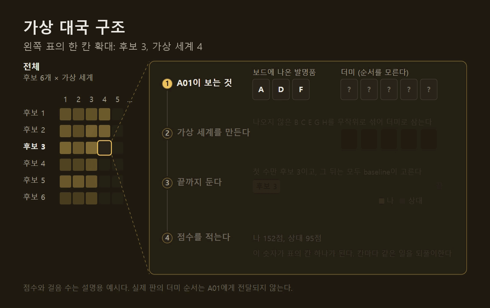
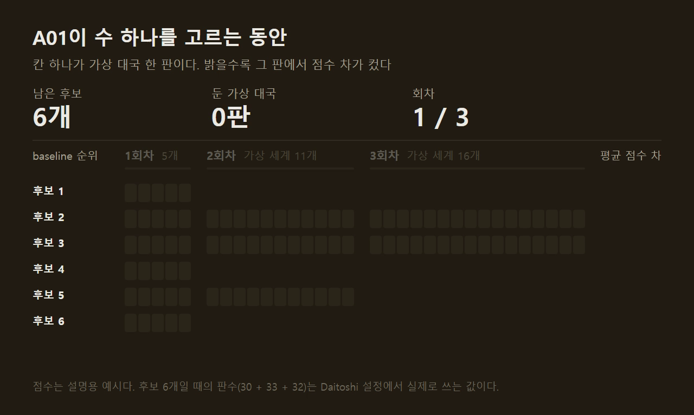
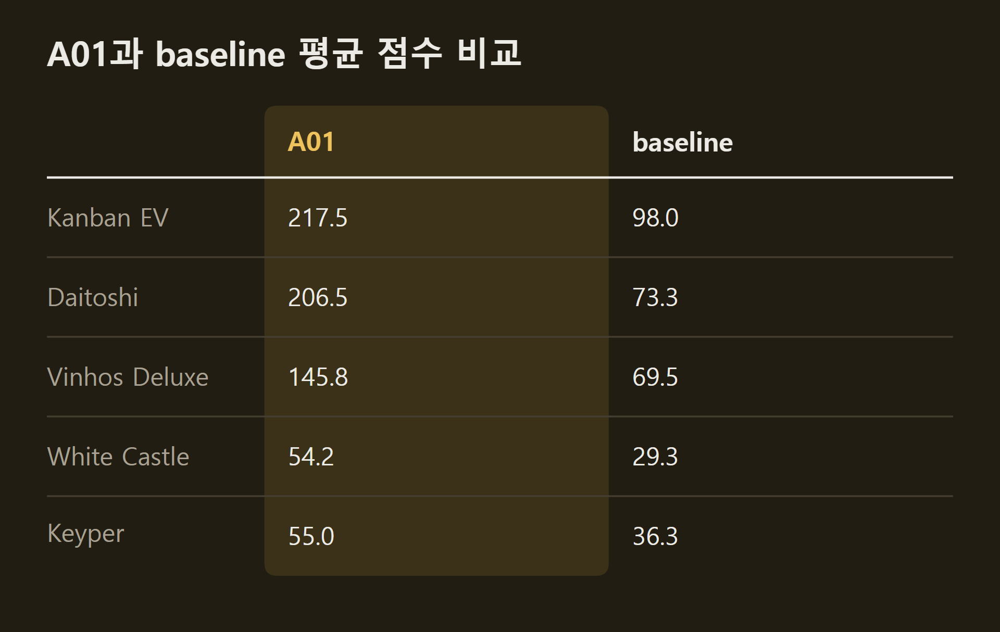
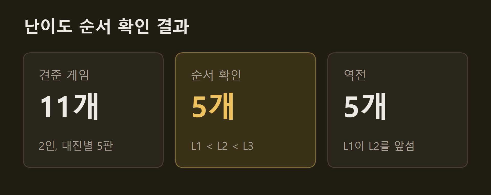

> 이 글은 직접 만들고 있는 개인 프로젝트의 개발 기록입니다. 저장소는 비공개이며, 본문의 수치는 저장소의 기록에서 가져왔습니다.

새 전략을 만들면 무엇보다 나은지를 재야 한다. 그 기준으로 쓰는 AI가 A01이다. 학습한 것이 없고 게임에 대한 지식도 거의 없지만, 지금까지 만든 것 가운데 가장 잘 둔다. 이 글에는 A01이 수를 고르는 방법과, 전략 개발을 시작하기 전에 31개 게임에 A01을 붙이면서 찾은 것을 적는다.

```요약
요약: 후보 행동마다 게임을 끝까지 두어 보고 고르는 A01을 전략 개발 대상 31개 게임 모두에 붙여 비교의 기준으로 삼았지만, 전적은 약한 대조군을 상대로 한 게임당 6판뿐이고 난이도 순서는 견준 11개 게임 중 5개에서만 확인됐다.
```

```용어
A01: 후보 행동마다 가상 대국을 두어 평균 점수가 높은 수를 고르는 AI. 새 전략을 견주는 기준이다.
baseline: 한 수 앞만 보고 정해진 우선순위대로 두는 가장 단순한 AI. 대조군이다.
가상 세계: 볼 수 없는 정보를 지금까지 본 것과 모순되지 않게 채워 넣은 가상의 판.
가상 대국: 가상 세계에서 게임이 끝날 때까지 두어 보는 대국.
이어 두기 정책: 가상 대국 안에서 모든 플레이어의 수를 대신 골라 주는 빠르고 단순한 규칙.
```

## 1. A01이 수를 고르는 방법

A01은 판을 보고 좋은지 나쁜지를 평가할 줄 모른다. 대신 후보 수를 하나씩 두어 본 다음 게임을 끝까지 진행하고, 그렇게 나온 점수로 고른다. Daitoshi를 예로 든다. 이 게임은 자기 차례에 둘 수 있는 행동이 평균 7개이고 많을 때는 167개다.

**후보를 줄인다.** 모든 행동을 끝까지 두어 볼 수는 없다. baseline이 매긴 우선순위에서 위쪽 6개만 후보로 남긴다. 둘 수 있는 행동이 하나뿐이면 계산 없이 그것을 둔다.

후보 하나를 한 번 두어 보는 것이 가상 대국 한 판이다. 아래 그림은 그 한 판을 확대한 것이다.



**가상 세계를 만든다.** 더미의 순서처럼 A01이 볼 수 없는 정보가 있다. 이 정보를 지금 보이는 것과 모순되지 않게 채운 판이 가상 세계다. Daitoshi에서는 발명품 가운데 이미 보드에 나온 것을 뺀 나머지를 무작위로 섞어 더미의 순서로 삼는다. A01은 실제 판의 숨은 정보를 읽지 않고, 그 자리에 앉은 사람이 볼 수 있는 것만 받는다.

**끝까지 둔다.** 가상 세계에서 후보를 둔다. 그 뒤의 수는 내 것이든 상대 것이든 baseline이 대신 골라 게임이 끝날 때까지 진행한다. 끝나면 모든 플레이어의 최종 점수가 나오고, Daitoshi에서는 내 점수와 다른 플레이어의 점수 차이를 그 판의 결과로 적는다. 내 최종 점수만 적는 게임도 있다.

한 판으로는 알 수 없다. 더미가 어떻게 섞였느냐에 따라 같은 수의 결과가 달라지기 때문이다. 그래서 섞는 순서를 바꾼 가상 세계를 여러 개 만들어 평균을 낸다.



**같은 가상 세계에서 견준다.** 후보들은 같은 가상 세계에서 둔다. 후보마다 다른 세계를 쓰면 더미가 유리하게 섞인 후보가 좋아 보인다.

**절반씩 버린다.** 가망 없는 후보에 계산을 쓰지 않으려고 세 번에 나눠 둔다. 후보 6개를 5판씩 두어 평균이 낮은 3개를 버리고, 남은 3개를 11판씩 더 두어 1개를 버리고, 남은 2개를 16판씩 더 둔다. 모두 95판이다. 평균은 그때까지 둔 판 전체로 낸다.

**고른다.** 끝까지 남은 2개 가운데 평균이 높은 것을 실제 판에 둔다. 그림의 예시에서는 baseline이 가장 높게 매긴 후보 1이 첫 회차에 탈락하고 후보 3이 남는다.

==A01이 아는 것은 게임의 규칙과 baseline의 우선순위뿐이다.== 수가 좋은지는 끝까지 두어 본 점수에서만 나온다.

후보의 수와 가상 대국의 수는 게임마다 다르게 정했고, 시간이 아니라 판수로 고정했다. 그래야 같은 판에서 항상 같은 수가 나오고, 컴퓨터가 바쁠 때와 한가할 때 결과가 달라지지 않는다.

## 2. 31개 게임에 붙이기

A01은 게임마다 따로 만들어야 하는 부분이 있다. 무엇이 숨은 정보이고 어떻게 채워야 모순이 없는지가 게임마다 다르기 때문이다. 전략 개발을 앞두고 점검했을 때 전략 개발 대상 31개 가운데 16개에는 이 부분이 없었고, 그 16개 게임에 모두 만들었다.

")

만든 뒤에는 게임마다 2인으로 A01과 baseline을 여섯 판씩 붙였다. 시드 세 개에 플레이어 번호를 바꿔 두 판씩이다. 16개 게임 가운데 15개에서 A01이 여섯 판을 모두 이겼고 Keyper에서만 5승 1패였다.



==이 점수 차는 A01이 강하다는 증거가 아니라 연결이 됐다는 확인에 가깝다.== baseline은 한 수 앞만 보는 약한 상대이고, 여섯 판은 전략을 비교하기에 모자란 판수다.

A01이 모든 결정을 가상 대국으로 고르는 것도 아니다. 보상을 차례로 받는 도중의 하위 선택처럼 관측만으로 판을 복원하기 어려운 결정은 baseline이 대신 고른다. 가상 대국으로 고르는 결정의 비율은 Nusfjord에서 90%, Men-Nefer에서 42%로 게임에 따라 크게 다르다.

## 3. 붙이면서 찾은 것

가상 대국을 수천 판 돌리면 사람이 두어서는 잘 나오지 않는 일이 나온다.

The Gallerist에서는 가상 대국이 끝나지 않았다. 이어 두기 정책이 같은 행동을 되풀이해 걸음 상한에 걸렸고, 그러면 A01이 오류를 내며 실제 대국까지 멈췄다. A01끼리 둔 15판 가운데 1판에서 나왔다. 끝나지 않은 가상 대국은 모두 0점인 대국으로 세도록 고쳤고, 같은 구조를 가진 다른 게임에도 같은 처리를 넣었다. 다른 게임에서 실제로 얼마나 나오는지는 재지 않았다.

Arcs에서는 방금 한 이동을 취소하는 행동이 후보에 들어 있어서 A01이 두고 취소하기를 끝없이 반복했다. 되돌리는 행동은 후보에서 뺐다.

Daitoshi에서는 다른 종류의 것이 나왔다. A01이 특정 발명품 두 개를 한 건물에 모아 거의 매 차례 생산하는 방법을 찾아, 2인 대국에서 150점에서 265점을 냈다. 규칙서에는 이를 막는 문장이 없고 엔진에도 없다. ==규칙을 잘못 옮긴 것인지 원래 게임이 그런 것인지는 아직 확인하지 못했다.== 어느 쪽이든 다시 볼 곳을 AI가 가리킨 첫 사례다.

## 4. 난이도 검증

A01에는 탐색에 쓰는 양과 이어 두기 정책을 달리한 세 단계 L1, L2, L3를 두었다. 단계가 높을수록 잘 둘 것이라고 기대했다.



11개 게임에서 L1과 L2, L2와 L3를 2인으로 다섯 판씩 붙였다. 두 대진 모두 높은 단계가 앞선 게임은 5개였다. 5개 게임에서는 오히려 L1이 L2를 앞섰다. 다섯 판은 결론을 내리기에 적은 판수이고, 원하는 순서가 나올 때까지 판을 늘리거나 설정을 고치지는 않기로 미리 정해 두었다. 그래서 결과를 그대로 적고, 난이도 검증은 새 게임의 완료 기준에서 뺐다.

Grand Austria Hotel 하나에서는 따로 실험을 했다. A01을 강하게 만들려고 네 가지를 시도했는데 실력이 오른 것은 한 수 앞을 내다보는 방법 하나뿐이었다. 계수를 자동으로 조정하는 실험은 여섯 세대 동안 기존 값을 한 번도 교체하지 못했다.

## 5. 지금 있는 것과 없는 것

전략 개발을 시작할 준비는 여기까지다. 31개 게임에 같은 방식의 기준 AI가 있고, 게임마다 검증된 기보가 있고, 엔진이나 전략 코드를 고친 뒤에 기보가 여전히 맞는지 다시 증명하는 도구가 있다.

없는 것도 분명하다. A01을 사람과 견준 기록이 없다. 전적의 상대는 거의 baseline뿐이다. 난이도는 절반 넘는 게임에서 순서가 확인되지 않았다. 여러 게임에서 얻은 경험을 새 게임에 옮기는 방법은 시작하지 않았다.

## 출처와 작성 방식

- 근거: 비공개 저장소의 전략 AI 준비 점검 기록, A01 제작 기록, 난이도 검증 기록
- 그래프: 저장소의 기록에 적힌 값으로 VISER 주간 보고서의 그래프 양식을 써서 직접 그린 그림입니다.
- 움직이는 그림: 직접 그린 그림입니다. 후보 6개와 회차별 판수는 Daitoshi의 실제 설정이고, 점수와 더미의 글자, 걸음 수는 설명을 위한 예시입니다.
- 화면: 이 프로젝트의 테이블에서 AI 대국을 진행하다가 찍은 것입니다. 화면 속 게임 그림은 인용이며 저작권은 출판사에 있습니다.
- 수치 기준일: 2026-10-13
