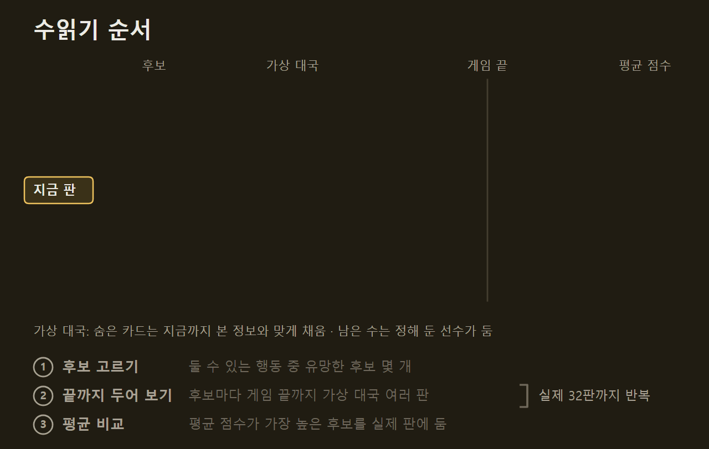
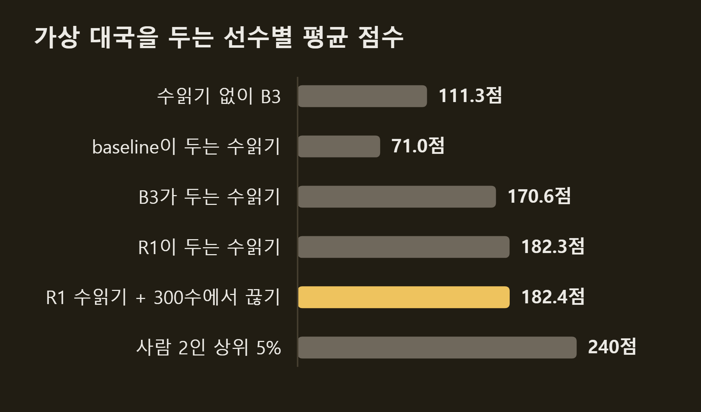
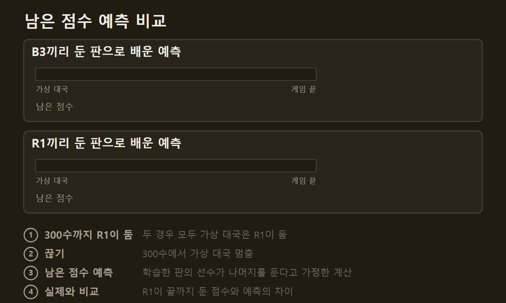
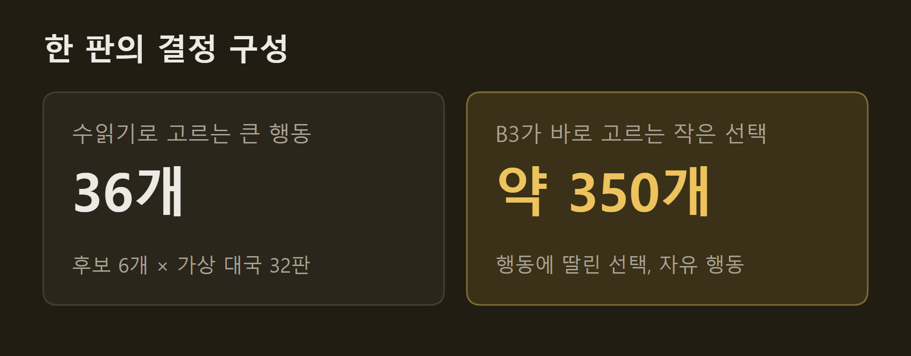
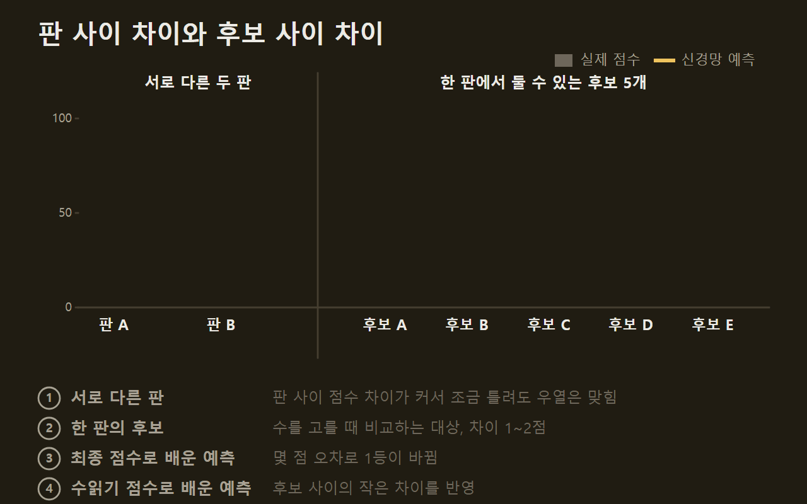
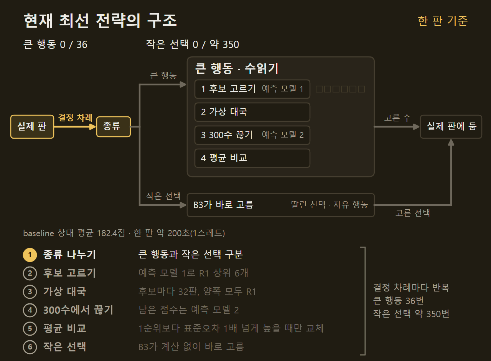

> 이 글은 직접 만들고 있는 개인 프로젝트의 개발 기록입니다. 저장소는 비공개이며, 본문의 수치는 저장소의 기록에서 가져왔습니다.

기준 AI A01을 31개 게임에 붙인 다음, 한 게임을 골라 전략을 깊이 파고들기 시작했다. 첫 대상은 외계 신호를 찾는 보드게임 SETI다. 목표는 사람끼리 둔 2인 판의 상위 5% 점수인 240점이다. 이 글에는 AI가 수를 어떻게 고르게 만들었는지와, 그중 무엇이 점수를 올렸고 무엇이 올리지 못했는지를 적는다.

```요약
요약: SETI에서 후보 수마다 게임 끝까지 두어 보는 수읽기에 학습한 선수와 남은 점수 예측을 더해 평균 점수를 111점에서 182점으로 올렸지만, 신경망에 모든 결정을 맡긴 실험은 실패했고 사람 상위 5%의 240점까지는 약 58점이 남았다.
```

```용어
baseline: 한 수 앞만 보고 정해진 우선순위대로 두는 가장 단순한 AI. 모든 실험의 상대다.
B3: 선택지마다 사람이 정한 기준으로 점수를 매겨 바로 고르는 AI. 계산이 거의 없다.
큰 행동: 한 차례에 하나만 하는 행동. 탐사선 발사, 망원경 관측, 카드 내기, 기술 연구 등이다. 룰북의 주 행동.
작은 선택: 큰 행동에 딸려 나오는 선택과, 차례 중 아무 때나 할 수 있는 자유 행동.
수읽기: 후보 수마다 게임 끝까지 가상으로 두어 보고, 평균 점수가 가장 높은 수를 고르는 방법.
예측 모델: 지금 판에서 끝까지 가면 몇 점을 더 얻을지 예측하는 신경망. 가치 함수라고도 부른다.
R1: 후보마다 둔 뒤의 판을 예측 모델로 평가해 바로 고르는 AI.
```

## 1. 바로 두기와 수읽기

먼저 SETI에서 AI가 무엇을 골라야 하는지부터 보자. 플레이어는 자기 차례에 큰 행동을 하나만 한다. 탐사선을 발사하거나, 망원경으로 관측하거나, 카드를 내거나, 기술을 연구하는 식이다. 큰 행동을 하면 그에 딸린 작은 선택이 따라온다. 망원경으로 관측하면 신호를 어느 섹터에 표시할지 고르고, 기술을 연구하면 어느 기술을 가져갈지 고른다. 여기에 에너지를 써서 탐사선을 옮기거나 모은 데이터를 컴퓨터에 놓는 것처럼, 차례 중 아무 때나 할 수 있는 자유 행동도 있다. 이 글에서는 딸린 선택과 자유 행동을 묶어 작은 선택이라고 부른다.

AI가 수를 고르는 방법은 크게 두 가지다. 하나는 판을 보고 바로 두는 것이다. B3가 그렇다. 선택지마다 "이 행동은 몇 점짜리인가"를 사람이 정한 기준으로 매기고 가장 높은 것을 고른다. 빠르지만 기준을 사람이 정한 만큼만 둔다.

다른 하나는 수읽기다. 후보 수를 몇 개 골라, 그 수를 둔 다음 게임이 끝날 때까지 가상으로 두어 본다. 상대의 손패처럼 볼 수 없는 정보는 지금까지 본 것과 어긋나지 않게 채운다. 같은 후보도 카드가 섞이는 방식에 따라 결과가 달라지므로 여러 번 두어 보고 평균을 낸다.



모든 실험은 baseline을 상대로 2인 60판을 두어 평균 점수로 비교했다. 채택 기준은 대국 전에 문서에 먼저 적어 두고, 결과를 본 뒤에는 바꾸지 않았다.

출발점은 수읽기 없이 바로 두는 B3로, 111.3점이었다. B3의 기준 113개를 자동으로 다듬어 보기도 했지만 점수는 오르지 않았다. 기준 몇 개를 조금 바꿔서는 1등 선택지가 거의 바뀌지 않았고, 크게 바꾼 기준은 내 점수를 올리기보다 상대 점수를 깎는 쪽으로 움직였다.

## 2. 수읽기 안의 선수

수읽기에는 숨은 질문이 하나 있다. 가상 대국에서 남은 수는 누가 두는가. 후보를 하나 둔 뒤에도 게임 끝까지는 수백 번의 결정이 남아 있고, 그 결정을 대신 내려 줄 선수가 필요하다.

앞 편의 A01은 이 선수로 baseline을 썼고 71.0점이었다. 수읽기를 하는데도 바로 두는 B3보다 40점 낮다. 가상 대국 안의 baseline이 엉성하게 두니, 어느 후보가 좋은지 판단도 엉성해진 것이다. 같은 수읽기에서 선수만 B3로 바꾸자 170.6점이 됐다. 반면 후보와 두어 보는 판수를 늘렸을 때는 2점 남짓 오르는 데 그쳤다.

그래서 선수를 더 잘 두는 쪽으로 바꾸었다. R1은 판을 보고 "이대로 가면 몇 점을 더 얻을지" 예측하는 신경망을 쓴다. 후보마다 둔 뒤의 판을 이 예측 모델로 평가해 가장 좋은 수를 고른다. 예측 모델은 B3끼리 둔 판의 결과로 먼저 배우고, 수읽기가 확실하게 고른 수를 따라 하도록 한 번 더 배웠다. R1 혼자 두면 142.8점으로 B3보다 33점 높다. 이 R1을 수읽기 안의 선수로 쓰자 182.3점이 됐다.



값은 단계마다 다른 시드에서 쟀다. ==수읽기의 실력은 몇 번 읽느냐보다 가상 대국을 누가 두느냐에 달려 있었다.==

## 3. 가상 대국 중간에 끊기

R1을 선수로 쓰자 한 판에 6~7분이 걸렸다. 가상 대국을 끝까지 두는 데 시간이 대부분 들었다. 그래서 가상 대국을 300수에서 끊고, 남은 점수는 예측 모델로 채우기로 했다.

처음에는 B3끼리 둔 판으로 배운 예측 모델을 썼다. 시간은 절반이 됐지만 점수가 4.8점 떨어졌다. 이 모델은 "남은 수를 B3가 두면 몇 점이 나오는가"를 배웠는데, 가상 대국은 B3보다 잘 두는 R1이 두고 있었다. 그러니 남은 점수를 늘 낮게 봤다. 실제로 R1이 둔 판에서 평균 7.8점 낮게 봤다.

R1끼리 20,000판을 두어 예측 모델을 다시 학습했다. 엔진이 빨라 8.6분이면 충분했다. 새 모델은 평균적으로 거의 치우치지 않았다. 이 모델로 끊으니 점수는 끝까지 둘 때와 비슷하게 나오고(+4.9점) 시간은 절반이 됐다. 이것을 지금의 최고 설정으로 정했다.



==남은 점수 예측도 가상 대국을 두는 선수를 기준으로 배워야 했다.==

## 4. 신경망에 모든 결정 맡기기

지금까지 수읽기는 큰 행동에만 썼다. 한 판에 수읽기로 고르는 큰 행동은 36번이고, 그보다 훨씬 많은 작은 선택 약 350번은 B3가 바로 고른다.



지금까지 점수를 올린 것은 매번 더 잘 두는 선수였다. 그래서 더 큰 신경망 예측 모델을 만들어 이 350개까지 모두 맡겨 보았다. 보드 상태, 상대의 공개 정보, 내 손패와 시장의 카드까지 824개 항목을 입력으로 넣었다. R1끼리 100,000판을 두어 장면 135만 개를 모으고, GPU로 20초 만에 학습했다. 남은 점수는 이전 모델보다 조금 더 정확하게 맞혔다.

그런데 실제로 두게 하자 89.5점이 나왔다. 같은 조건의 R1(144.2점)보다 55점 낮다. 큰 행동만 맡겨도 111.8점이었다.

원인은 두 가지였다. 첫째, 카드 입력이 잡음이 됐다. 후보마다 손패의 카드 한 장이 바뀌는 식으로 입력 수백 개가 조금씩 흔들렸고, 이 흔들림이 후보 사이의 실제 차이보다 컸던 것으로 본다. 카드 입력을 빼자 111.8점이 124.1점이 됐다.

둘째, 점수를 대략 맞히는 것만으로는 수를 고를 수 없었다. 이 신경망은 남은 점수를 평균 14점쯤 틀린다. 앞으로 30점을 더 얻을 판과 90점을 더 얻을 판을 비교한다면 10점쯤 틀려도 어느 판이 좋은지는 맞힌다. 그런데 수를 고를 때 비교하는 것은 지금 판에서 둘 수 있는 후보들이고, 이들을 둔 뒤의 판은 55점, 56점, 57점처럼 1~2점 차이뿐이다. 예측이 몇 점만 틀려도 1등이 바뀐다.



게임 최종 점수로 배운 모델은 모두 이 문제를 겪었다. R1의 모델은 후보마다 수읽기로 잰 점수로 배웠기 때문에 후보 사이의 작은 차이를 훨씬 잘 가렸다. ==점수를 대략 맞히는 것과 더 나은 수를 고르는 것은 다른 능력이었다.==

큰 신경망도 수읽기 점수로 다시 배우게 했지만 141.3점으로 R1을 넘지 못했다. 모은 결정이 2만 개라 학습한 결정에만 잘 맞고 처음 보는 결정에는 덜 맞았다. 여기서 멈추고 최고 설정을 유지했다.

## 5. 현 상황

지금 최선의 전략을 한 그림으로 정리하면 아래와 같다. 실제 판에서 결정할 차례가 오면 먼저 큰 행동인지 작은 선택인지 나눈다. 큰 행동은 R1이 후보 6개를 고르고, 후보마다 가상 대국 32판을 R1끼리 두다가 300수에서 끊고 남은 점수를 예측해 평균이 가장 높은 수를 고른다. 작은 선택은 B3가 바로 고른다. 학습한 신경망은 둘이다. 하나는 R1이 후보를 평가할 때, 다른 하나는 끊은 뒤 남은 점수를 채울 때 쓴다.



이 전략은 baseline 상대 평균 182.4점으로, 목표 240점의 약 76%다. 같은 전략끼리 두게 해도 175.0점으로 7점쯤 낮아질 뿐이라, 약한 상대로 잰 점수가 실력을 크게 부풀리지는 않았다.

남은 약 58점은 지금 방식이 보지 못하는 곳에 있다고 본다. 그림처럼 지금은 결정을 하나씩 따로 고르고, 작은 선택 약 350번은 수읽기 없이 둔다. 그래서 큰 행동과 딸린 선택을 한 묶음으로 짜는 차례 안의 조합도, 임무나 금색 타일처럼 여러 차례에 걸친 계획도 직접 보지 못한다. 다음에는 한 차례를 통째로 수읽기 하거나, 여러 차례 앞을 내다보거나, 마지막 몇 수를 끝까지 모두 따져 보는 방법을 검토하고 있다. 어느 쪽으로 갈지는 아직 정하지 않았다.

사람과 직접 둔 기록은 아직 없고, 이 실험은 SETI 하나에서만 했다.

## 출처와 작성 방식

- 근거: 비공개 저장소의 SETI 전략 실험 기록과 git 이력
- 그래프: 저장소의 기록에 적힌 값으로 VISER 주간 보고서의 그래프 양식을 써서 직접 그린 그림입니다. "가상 대국을 두는 선수별 평균 점수"의 값은 단계마다 다른 시드에서 잰 것입니다.
- 움직이는 그림: 직접 그린 그림입니다. 결정 수(36번, 약 350번), 후보 6개, 가상 대국 32판, 300수, 평균 7.8점·0.4점 치우침, −4.8점·+4.9점, 182.4점과 한 판 시간은 실제 값이고, 그 밖의 행동 이름과 점수는 설명을 위한 예시입니다.
- 수치 기준일: 2026-10-15
