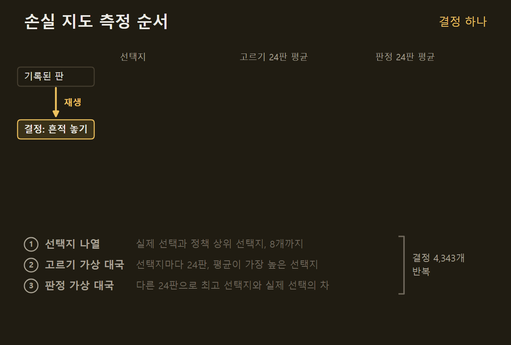
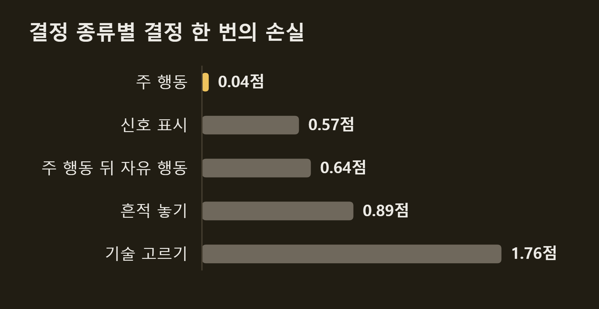
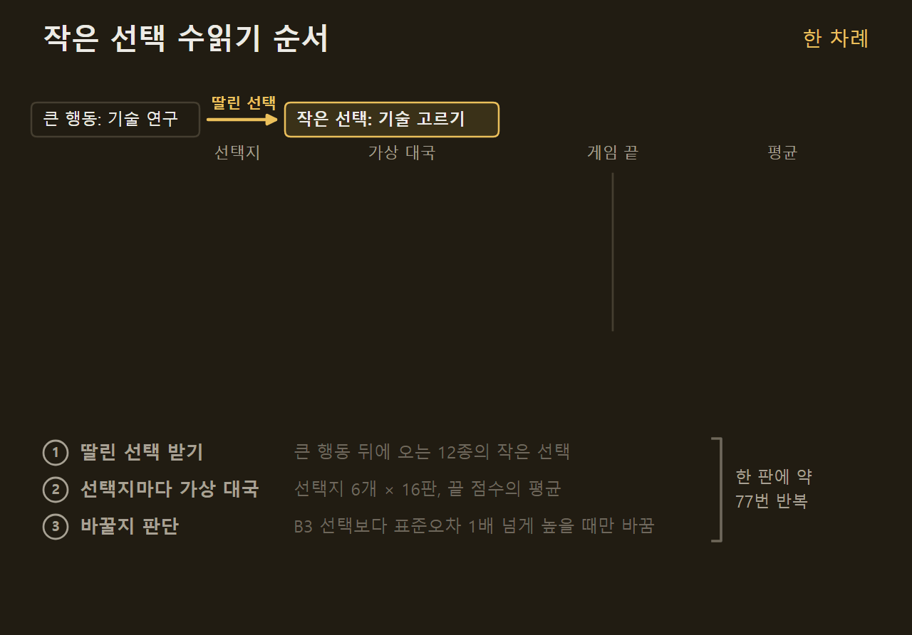
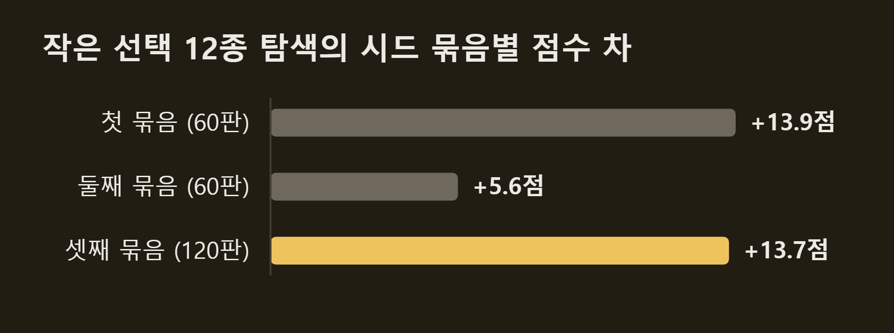
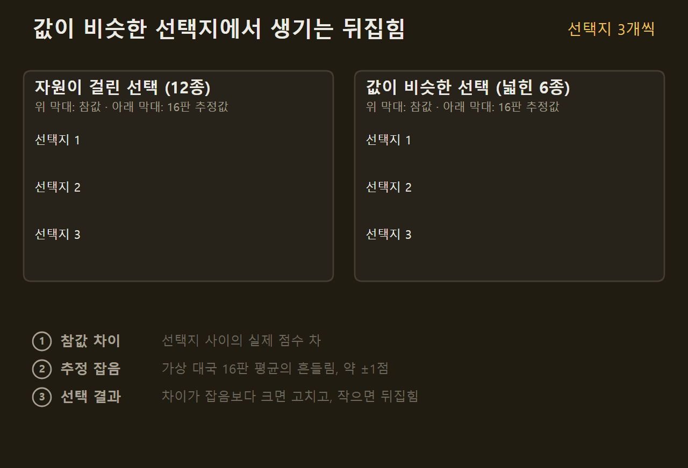
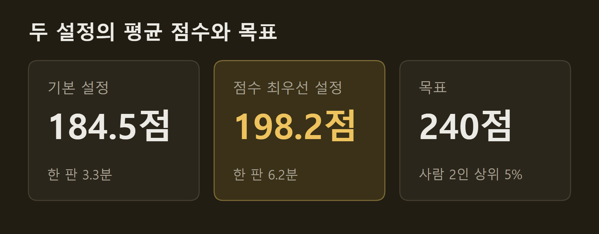

> 이 글은 직접 만들고 있는 개인 프로젝트의 개발 기록입니다. 저장소는 비공개이며, 본문의 수치는 저장소의 기록에서 가져왔습니다.

앞 편에서 SETI AI는 baseline 상대 평균 182점까지 올랐고, 목표인 사람 2인 상위 5%의 240점까지 약 58점이 남아 있었다. 그 뒤 남은 점수가 어디에 있는지를 재고, 거기서 점수를 가져오는 방법을 열두 가지 넘게 시험했다. 이 글에는 그 측정과, 통한 방법 하나와 통하지 않은 방법들을 적는다.

```요약
요약: SETI AI가 잃는 점수가 큰 행동이 아니라 한 판 350번의 작은 선택에 있다는 것을 손실 지도로 확인하고 그중 12종을 수읽기로 고르게 해 평균 점수를 184.5점에서 198.2점으로 올렸지만, 한 판 시간이 두 배가 됐고 수읽기를 예측 모델로 대신하거나 18종으로 넓히는 시도는 모두 실패했다.
```

```용어
baseline: 한 수 앞만 보고 정해진 우선순위대로 두는 가장 단순한 AI다. 모든 실험의 상대다.
B3: 선택지마다 사람이 정한 기준으로 점수를 매겨 바로 고르는 AI다. 작은 선택은 기본적으로 B3가 맡는다.
R1: 후보를 둔 뒤의 판을 예측 모델로 평가해 바로 고르는 AI다. 수읽기 안에서 남은 수를 두는 선수다.
작은 선택: 큰 행동(한 차례에 하나만 하는 행동)에 딸려 나오는 선택과 차례 중 아무 때나 할 수 있는 자유 행동이다. 한 판에 약 350번 나온다.
수읽기: 후보마다 게임 끝까지 가상으로 두어 보고 평균 점수가 가장 높은 수를 고르는 방법이다.
시드: 카드가 섞이는 순서와 준비물을 정하는 번호다. 같은 시드면 같은 판이 차려진다.
금색 타일: 게임 시작 때 공개되는 공유 목표 타일이다. 조건을 많이 채울수록 끝에 점수가 커진다.
```

## 1. 결정 종류별 손실 지도

앞 편까지는 막힌 곳을 짐작으로 골라 고쳤다. 이번에는 AI가 실제로 둔 60판을 다시 재생하면서, 결정마다 "다른 선택지를 골랐으면 몇 점을 더 얻었을까"를 쟀다. 결정 하나마다 정책이 매긴 상위 8개 선택지를 같은 가상 대국으로 두어 보고, 가장 좋은 선택지와 실제 선택의 차를 손실로 적었다. 가장 좋은 선택지를 고르는 가상 대국과 그 차를 재는 가상 대국을 따로 두어, 잡음이 큰 쪽이 뽑혀 손실이 부풀지 않게 했다.



결정 4,343개를 재는 데 약 2시간이 걸렸고, 결과는 분명했다. 수읽기로 고르는 큰 행동은 결정 하나에 0.04점을 잃어 더 고칠 것이 없었다. 반면 B3가 바로 고르는 작은 선택은 종류에 따라 결정 하나에 0.4~1.8점을 잃었다.



다만 이 지도를 판당 점수로 더하면 178점이 나오는데, 그 값은 얻을 수 있는 점수가 아니다. 가상 대국의 남은 수를 R1이 두므로 R1이 쓰지 않는 자유 행동이 결정마다 거듭 손실로 잡혔고, 특히 5라운드에 몰렸다. 그래서 이 지도에서 가져간 것은 순서와 방향까지다. 큰 행동은 끝났고, 남은 점수는 작은 선택 쪽에 있다.

## 2. 설정으로 더 얻을 수 없는 것

작은 선택에 손을 대기 전에, 새 코드 없이 설정만 바꿔 얻을 수 있는 것을 먼저 치웠다. 가상 대국을 300수가 아니라 500수까지 두면 긴 계획이 잡히는지, 초반 결정에 가상 대국을 더 주면 나아지는지, R1이 B3의 점수를 섞는 비중을 바꾸면 어떤지 같은 것들이다. 이 가운데 어느 것도 수읽기 위에서 점수를 올리지 못했다.

| | 점수 차 | 판정 |
|---|---|---|
| 가상 대국 500수 | −3.0점 | 유지 |
| 초반 배분 늘림 | −1.8점 | 유지 |
| 사전 비중 0.8 | +0.7점 | 유지 |
| 한 번만 오는 결정 3종 탐색 | +2.9점 | 잠정, 채택 안 함 |
| 자유 행동을 학습 가치로 | −12.9점 (R1 혼자) | 멈춤 |
| 가중치 묶음 고르기 | 여지 −0.9점 | 접음 |
| 증류 2회차 | −0.6점 | 유지 |
{caption="설정 실험 결과 비교"}

여기서 반복해서 본 것이 하나 있다. R1 혼자 둘 때 좋아진 변경이 수읽기 안에서는 거의 남지 않았다. 예를 들어 B3 점수의 비중을 올리면 R1 혼자서는 3.9점이 올랐지만 수읽기 위에서는 0.7점이었다.

앞 편의 방법으로 수읽기가 고른 수를 R1이 다시 배우는 증류를 한 번 더 했을 때도 같았다. R1 혼자서는 4.2점이 올랐으나 수읽기 위에서는 0.6점이 내려갔다. 큰 이득은 B3에서 학습한 R1로 선수의 종류가 바뀔 때 왔고, 같은 종류 안에서 다듬는 것으로는 더 나오지 않았다.

## 3. 작은 선택 12종의 수읽기

수읽기 도구에는 작은 선택 가운데 12종을 큰 행동처럼 수읽기로 고르는 기능이 이미 있었다. 카드 효과, 기술 고르기, 소득, 착륙과 궤도, 이정표, 시작 소득, 패스할 때의 카드, 신호와 흔적처럼 자원이 바로 걸린 선택들이다. 이 12종은 한 판에 약 77번 나오고, 선택지마다 가상 대국 16판을 두면 한 판 시간이 두 배가 된다.

이 큰 행동으로 기술 연구를 한 직후이고, 다음은 어느 기술을 가져갈지 고르는 작은 선택이다. (게임 그림의 저작권은 출판사 Czech Games Edition에 있다)")

작은 선택의 수읽기는 큰 행동의 수읽기와 같은 방법을 선택지 6개에 적용한다. 다른 점은 B3의 선택을 기준으로 두고, 가장 좋은 선택지가 그보다 표준오차 1배 넘게 높을 때만 바꾼다는 것이다.



첫 60판에서는 13.9점이 올랐고 두 번째 60판에서는 5.6점이 올랐다. 두 번째 묶음은 95% 구간이 0을 포함해, 대국 전에 정한 기준대로 채택하지 않았다. 60판 비교의 구간은 약 ±7점이라 +5~10점의 이득은 60판으로는 가려낼 수 없었기 때문에, 세 번째는 120판으로 다시 쟀다. 결과는 +13.7점(95% 구간 +9.0 ~ +18.5)으로, 같은 시드에서 기본 설정은 184.5점, 작은 선택을 수읽기한 설정은 198.2점이었다.



이 설정을 '점수 최우선 설정'으로 채택했다. 한 판 시간이 3.3분에서 6.2분으로 늘어나므로 기본 설정은 그대로 두고, 시간을 써도 되는 자리에서만 쓴다. 늘어난 점수는 금색 타일 쪽 6.4점과 보드 점수 6.7점이었고, 금색 타일 쪽 이득은 세 묶음에서 6.0점, 5.1점, 6.4점으로 세 번 다 나왔다.

B3는 작은 선택을 수읽기의 답과 74% 일치하게 고르고 있었고, 결정 하나의 손실은 약 1점이었다. 그런데도 판당 14점이 나온 것은 횟수 때문이다. 결정 하나의 손실이 작아도 77번이 쌓이면 판의 점수가 바뀐다.

## 4. 수읽기를 예측 모델로 대신하기

한 판 시간이 두 배가 된 것이 걸려, 같은 이득을 싸게 얻는 길을 찾았다. 수읽기가 작은 선택에서 고른 답 17,694개를 모아, 선택지의 결과 판을 보고 순위를 매기는 예측 모델을 학습했다. 이 모델이 B3보다 나은 종류에서만 B3 대신 쓰게 할 생각이었다.

학습에 쓰지 않은 판에서 재 보니 전체로는 B3가 더 나았다. B3의 손실이 결정 하나 1.045점, 새 모델이 1.080점이었다. 관문을 넘은 7종만 배치해 60판을 두자 2.05점이 내려갔고, 선택지마다 결과 판의 특징을 계산하느라 시간은 1.5배가 됐다. 작은 선택의 이득은 선택지마다 가상 대국으로 그 뒤를 두어 본 데서 왔고, 결과 판의 특징으로 배운 모델로는 옮겨지지 않았다.

## 5. 18종으로 넓히기

12종이 통했으니 더 넓히면 더 얻을 것으로 보였다. 수읽기가 다루지 않던 종류 가운데 결정 수가 많은 6종, 즉 관측 선택, 섹터 처리, 큰 행동 뒤의 자유 행동, 큰 행동 마무리의 두 시점, 승점 선택을 더해 18종으로 늘렸다. 이 6종은 한 판에 약 200번 나오고, 손실 자료로 계산한 상한은 +24점이었다.

| | 기본 설정 | 점수 최우선 설정 | 18종 탐색 |
|---|---|---|---|
| 탐색하는 작은 선택 | 없음 | 12종, 판당 약 77회 | 18종, 판당 약 280회 |
| 평균 점수 | 184.5점 | 198.2점 | 192.9점 |
| 같은 시드의 점수 차 | −13.7점 | 기준 | −3.4점 |
| 한 판 시간 | 3.3분 | 6.2분 | 13.8분 |
{caption="작은 선택 탐색 범위별 비교" pick="3"}

120판 결과는 −3.4점(95% 구간 −8.3 ~ +1.4)이었고 한 판 시간은 13.8분이 됐다. 이 6종은 선택지들의 값이 거의 같아서 자료에서 계산한 손실의 대부분이 잡음이었고, 수읽기가 잡음 때문에 B3의 맞는 선택을 뒤집는 쪽이 더 많았던 것으로 본다. 아래 그림은 그 차이를 선택지 셋의 예로 보인다. 참값의 차이가 잡음보다 크면 수읽기가 B3의 틀린 선택을 고치고, 작으면 잡음이 가장 크게 올린 선택지가 뽑혀 맞는 선택이 뒤집힌다.



작은 선택의 수읽기는 12종에서 멈춘다.

## 6. 현 상황

지금 설정은 둘이다. 기본 설정은 184.5점에 한 판 3.3분이고, 점수 최우선 설정은 198.2점에 한 판 6.2분이다. 목표 240점의 약 83%다.



이번 묶음에서 배운 것은 세 가지다.

- **큰 행동의 수읽기는 다 찼다.** 결정 하나의 손실이 0.04점이라 후보를 늘리거나 더 많이 두어 봐도 나올 것이 없다.
- **작은 선택의 수읽기는 자원이 걸린 곳에서만 통한다.** 값이 비슷한 선택지들 사이에서는 수읽기가 잡음으로 맞는 선택을 뒤집는다.
- **같은 틀 안에서 모델을 다듬어도 수읽기 점수는 움직이지 않는다.** 선수의 종류가 바뀔 때만 크게 올랐다.

정리하면, 이번 묶음에서 점수를 올린 것은 작은 선택 12종의 수읽기 하나였고, 그 값은 184.5점에서 198.2점으로 한 판 시간 두 배와 맞바꾼 것이다. 같은 틀에서 설정과 모델로 더 얻을 수 있는 것은 여기까지였다. 남은 약 42점이 어디에 있는지는 다음 편에서 다룬다. 사람과 직접 둔 기록은 아직 없고, 이 실험은 SETI 하나에서만 했다.

## 출처와 작성 방식

- 근거: 비공개 저장소의 SETI 전략 실험 기록(10~18단계)과 git 이력
- 그래프와 표: 저장소의 기록에 적힌 값입니다. 그래프는 VISER 주간 보고서의 그래프 양식을 써서 직접 그렸습니다. "작은 선택 탐색 범위별 비교"에서 기본 설정과 점수 최우선 설정은 같은 시드 120판씩의 값이고, 18종 탐색은 다른 시드 120판에서 점수 최우선 설정과 짝지은 값입니다(그 시드의 점수 최우선 설정은 196.3점). 한 판 시간은 프로세스 7개로 둘 때의 값입니다.
- 움직이는 그림: 직접 그린 그림입니다. 선택지 8개, 가상 대국 24판씩 두 묶음, 결정 4,343개와 종류별 평균 손실, 선택지 6개와 가상 대국 16판, 한 판 약 77번, 한 판 3.3분과 6.2분, 12종 +13.7점과 18종 −3.4점은 실제 값입니다. 선택지의 이름과 한 결정 안의 점수(171.2점 등, 56.9점 등, 52.0점 등)는 설명을 위한 예시입니다.
- 화면: 점수 최우선 설정이 둔 판의 기록을 이 프로젝트의 재생 화면으로 연 것입니다. 게임 그림의 저작권은 출판사 Czech Games Edition에 있습니다.
- 수치 기준일: 2026-10-17
