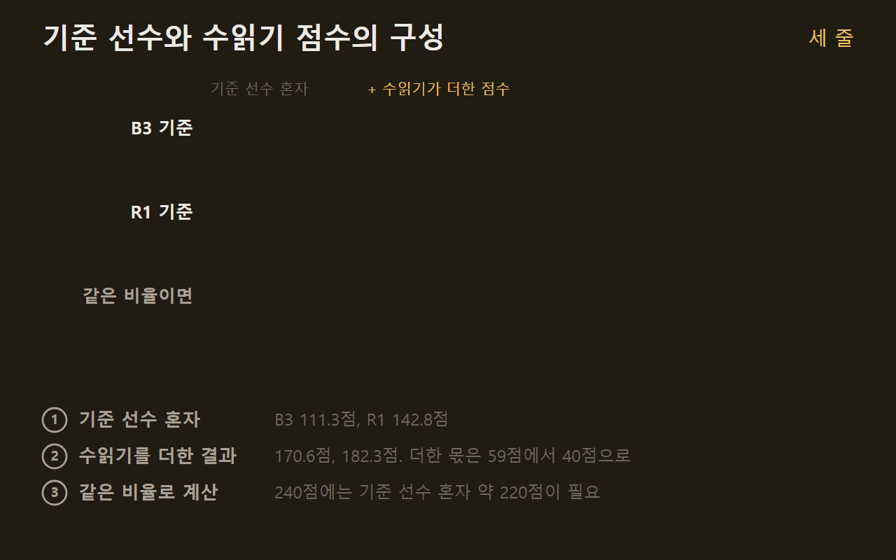
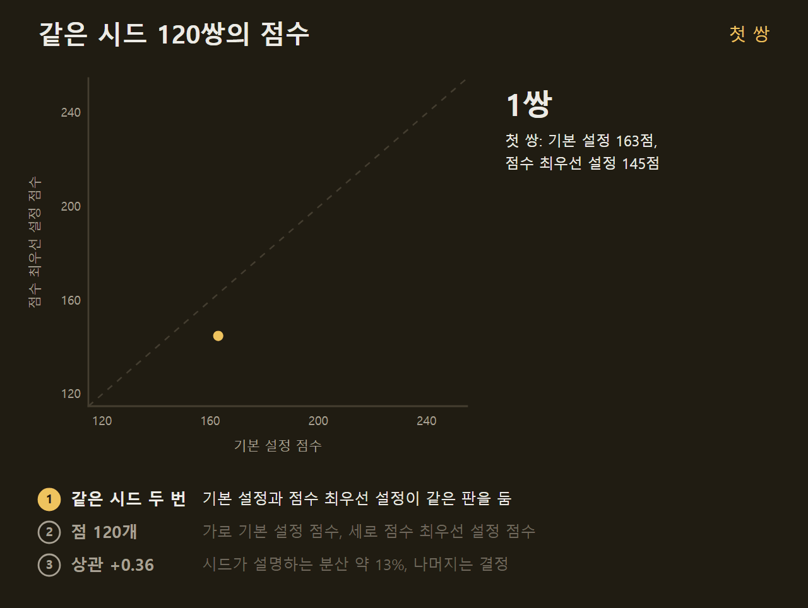
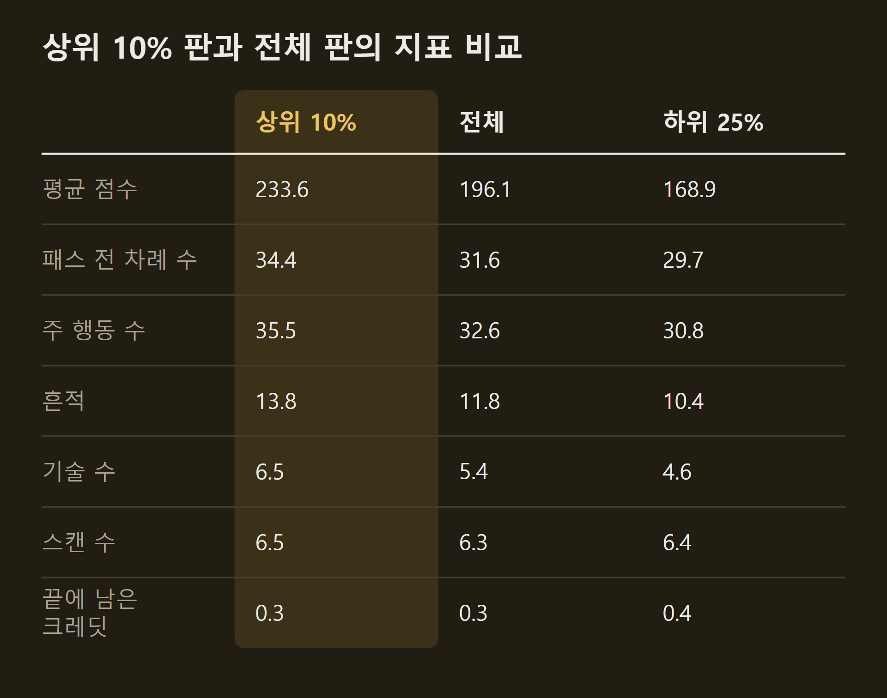
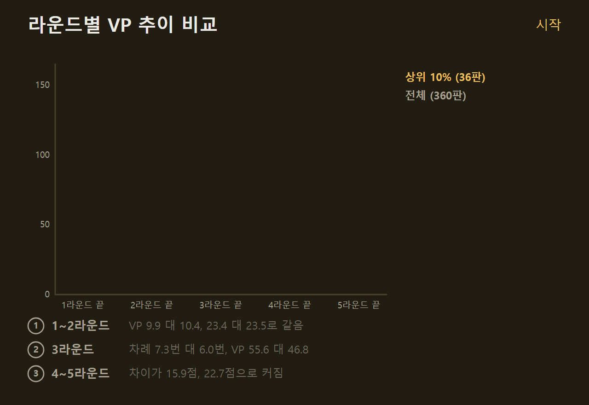
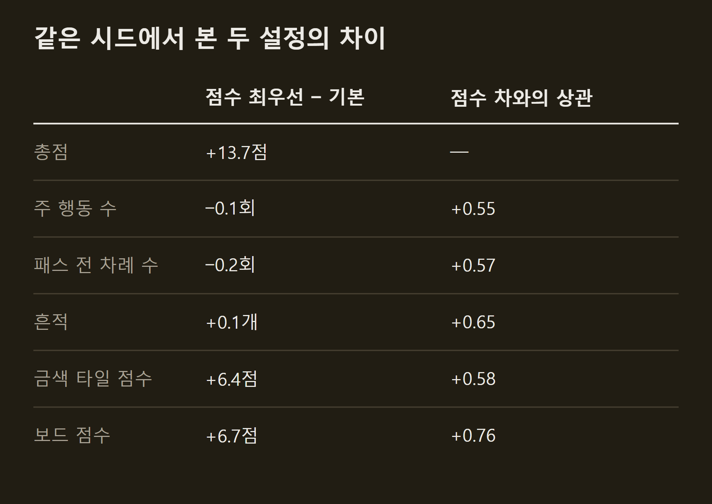

> 이 글은 직접 만들고 있는 개인 프로젝트의 개발 기록입니다. 저장소는 비공개이며, 본문의 수치는 저장소의 기록에서 가져왔습니다.

앞 편에서 SETI AI는 점수 최우선 설정으로 198.2점까지 올랐고, 목표 240점까지 약 42점이 남았다. 설정으로 얻을 것은 다 썼으므로 다음은 새 구조를 짓는 일인데, 그 전에 지금 틀이 왜 여기서 멈추는지와 남은 점수가 어디에 있는지를 먼저 쟀다. 이 글에는 그 진단과 검토 중인 방향을 적는다.

```요약
요약: SETI AI의 점수 최우선 설정은 198.2점으로 240점까지 약 42점이 남았는데, 같은 틀에서는 선수를 다시 학습해도 오르지 않았고, 기록을 재 보니 점수 변동의 약 87%는 시드가 아니라 AI 자신의 결정에서 왔으며, 상위 판은 2라운드까지 평균 판과 같다가 3라운드부터 차례와 흔적을 더 가져갔다.
```

```용어
기준 선수: 수읽기의 가상 대국에서 남은 수를 두는 AI다. 사람이 정한 기준으로 두는 B3와 학습한 예측 모델로 두는 R1을 썼다.
점수 최우선 설정: 큰 행동과 작은 선택 12종을 수읽기로 고르는 설정이다. 한 판 6.2분에 평균 198.2점이다.
시드: 카드가 섞이는 순서와 준비물을 정하는 번호다. 같은 시드면 같은 판이 차려진다.
흔적: 외계 생명의 흔적 표시다. 탐사와 관측으로 얻어 외계 종족 판에 놓으면 점수와 보상이 나온다.
상관: 두 값이 함께 움직이는 정도다. +1이면 완전히 같이 움직이고 0이면 관계가 없다.
금색 타일: 게임 시작 때 공개되는 공유 목표 타일이다. 조건을 많이 채울수록 끝에 점수가 커진다.
```

## 1. 같은 틀의 한계

지금 틀의 점수는 기준 선수의 실력이 정한다. 수읽기는 기준 선수가 두는 가상 대국으로 후보를 평가하므로, 기준 선수가 보지 못하는 수는 수읽기도 보지 못한다. 앞 편들의 숫자를 나란히 놓으면 이 관계가 보인다.



기준 선수가 B3일 때 수읽기는 59점을 더했고, R1일 때는 40점을 더했다. 기준 선수가 32점 오르는 동안 최종 점수는 12점 올랐고, 수읽기가 더하는 몫은 줄었다. 이 비율대로라면 240점은 기준 선수 혼자서 220점 가까이 둘 때 나온다. 남은 일은 수읽기를 더 잘하는 것이 아니라 수읽기 없이도 잘 두는 선수를 만드는 것이다.

같은 틀 안에서 선수를 다시 학습하는 것으로는 거기에 닿지 못했다. 수읽기가 고른 수로 R1을 다시 학습하고 남은 점수 예측 모델도 다시 학습했지만, 수읽기 위에서는 0.6점이 내려갔다. 가상 대국은 300수, 즉 1라운드 남짓을 두고 끊은 뒤 예측 모델이 남은 점수를 채우는데, 그 모델은 남은 점수를 평균 14.6점 틀리고 1라운드에서는 19점 틀린다. 초반 투자의 값은 이 틀에서 거친 추정으로만 평가된다.

## 2. 종료 점수 카드의 여지

끝에 점수가 되는 카드를 AI가 제대로 쓰지 못하는지도 확인했다. 점수 최우선 설정의 240판을 재생해 보니, 종료 점수 카드는 한 판에 2.75장이 손에 들어오고 1.20장을 내며(장당 평균 6.2점) 1.03장을 자원으로 바꿔 쓴다. 끝까지 손에 남기는 카드는 거의 없다.

안 낸 카드를 모두 냈다고 치면 판당 9.0점이 상한인데, 그 대부분은 조건이 맞아야 점수가 되는 카드라 상한은 느슨하다. 카드를 내는 비용과 그 행동 대신 못 한 행동까지 치면 실제 여지는 판당 5점 미만으로 봤다. 여기서는 더 가져올 것이 없어 접었다.

## 3. 운과 결정의 몫

점수가 판마다 20점 넘게 흔들리는데, 그 변동이 카드 운인지 AI의 결정인지를 먼저 갈라야 했다. 같은 시드와 같은 순서를 두 설정이 각각 둔 120쌍에서 두 점수의 상관을 재면 운의 몫이 나온다. 시드가 점수를 정한다면 같은 시드의 두 점수는 같이 움직여야 한다.



상관은 +0.36이었다. 한 설정의 판 간 표준편차가 약 23점인데, 같은 시드에서 두 설정의 점수 차는 표준편차가 26점이었다. 시드가 설명하는 분산은 약 13%이고, 나머지는 AI의 결정과 수읽기의 무작위성이다.

이는 남은 점수가 시드가 아니라 결정에 있다는 뜻이다. 상위 10% 판의 평균은 233.6점이라, 자기 상위 10%처럼 매번 두면 37점이 오른다.

## 4. 상위 판의 모습

그러면 상위 판은 무엇이 다른가. 점수 최우선 설정의 360판을 재생해 라운드별 큰 행동 수, 패스하기 전의 차례 수, 기술, 소득, 흔적, 끝에 남은 자원을 셌다. 사람 상위권의 전략 글이 말하는 것들이다. 그 글들은 큰 콤보가 아니라 매 차례의 효율, 1~2라운드의 소득과 핵심 기술, 그리고 흔적이 효율의 지표라는 점을 공통으로 꼽는다.



상위 판은 차례와 큰 행동을 세 번 더 하고 흔적을 두 개 더 가져간다. 늘어난 행동은 관측이 아니라 카드 내기, 연구, 착륙이었다. 관측은 큰 행동의 19%를 차지하는데도 점수와 상관이 없었고, 교환은 하위 판에서 더 많았다. 끝에 남는 자원은 어느 판이나 크레딧 0.3, 에너지 0.3 수준이라, 자원을 흘려서 지는 것이 아니다.

갈리는 시점도 분명했다. 2라운드 끝까지는 상위 10%와 전체의 점수가 23.4점 대 23.5점으로 같다. 3라운드에서 차례가 7.3번 대 6.0번으로 벌어지고 기술이 3.4개 대 2.7개로 앞서기 시작해, 그 차이가 끝까지 커진다.



1~2라운드가 균일한 것은 AI의 초반이 고정적이라는 뜻이다. 모든 판이 같은 기술 두 개를 사고, 2라운드 끝의 기술 수와 소득도 상위 판과 평균 판이 거의 같다. 그 초반이 최적인지는 변동이 없어서 이 자료로는 알 수 없다.

작은 선택의 수읽기가 올린 13.7점도 같은 자료로 다시 봤다. 같은 시드에서 기본 설정과 견주면 큰 행동 수와 차례 수는 같고, 금색 타일 쪽 6.4점과 보드 6.7점이 늘었다. 행동 수가 같은 채로 효과 선택만 좋아졌다. 그런데 같은 시드에서 점수 최우선 설정이 기본 설정을 크게 이긴 판은 흔적, 차례, 큰 행동이 더 많은 판이었다.



차례와 흔적은 어느 설정도 평균적으로 올리지 못했지만, 점수 차를 가장 잘 설명하는 지표다. 남은 점수는 매 차례의 효율, 즉 판당 400번 가까운 결정 하나하나의 질에 있다고 본다.

## 5. 검토 중인 방향

이 진단으로 후보의 순서가 정해졌다. 아래는 검토 중인 것들이고, 어느 쪽으로 갈지는 아직 정하지 않았다.

- **모든 결정을 두는 신경망 선수를 대량 자기대국으로 키우는 방향.** 큰 행동만이 아니라 작은 선택까지 한 모델이 고르고, 수읽기가 만든 답을 목표로 수만 판 규모에서 세대를 거듭해 학습한다. 지금까지의 학습 자료는 결정 1만 개 안팎이었고, 카드 이름을 입력으로 넣으면 그 크기에서는 잡음이 됐다. 카드는 이름 대신 비용과 효과 같은 속성으로 넣는 것을 검토하고 있다.
- **여러 결정 깊이의 트리 탐색.** 가치망으로 잎을 평가하는 깊은 탐색이다. 큰 행동의 수읽기가 이미 다 찼고 이 게임이 긴 콤보보다 매 차례의 효율로 점수를 내므로 후순위로 뒀다.
- **점수를 직접 최대화하는 강화학습.** 최종 점수만으로 선수를 학습하는 방식은 앞 편에서 후보를 가리지 못했고, 수읽기의 답으로 배우는 쪽이 늘 나았다. 보조 수단으로만 본다.
- **사람 상위권 기보 모방.** 기보가 없어 지금은 할 수 없다.

어느 방향이든 세대마다 선수 혼자 두는 점수와 함께 판당 차례 수와 흔적 수를 잰다. 점수보다 잡음이 적은 지표라 변화를 일찍 볼 수 있다. 이 길이 240점을 보장하지는 않는다. 사람과 직접 둔 기록은 아직 없고, 이 실험은 SETI 하나에서만 했다.

## 출처와 작성 방식

- 근거: 비공개 저장소의 SETI 전략 실험 기록(19~21단계)과 효율 진단 도구의 결과, git 이력. 사람 상위권의 전략은 BoardGameGeek의 글 [Musings on SETI strategy](https://boardgamegeek.com/thread/3385582/musings-on-seti-strategy)와 [TheTablePriest의 안내](https://thetablepriest.com/beginners-guide-to-playing-seti-board-game/)를 참고했습니다.
- 표: 저장소의 기록에 적힌 값으로 VISER 주간 보고서의 그래프 양식을 써서 직접 그린 그림입니다. "같은 시드에서 본 두 설정의 차이"는 기본 설정과 점수 최우선 설정이 같은 시드 120판씩을 둔 기록에서, "상위 10% 판과 전체 판의 지표 비교"는 점수 최우선 설정의 360판에서 계산했습니다.
- 움직이는 그림: 직접 그린 그림입니다. "기준 선수와 수읽기 점수의 구성"의 네 값(111.3점, 170.6점, 142.8점, 182.3점)은 단계마다 다른 시드에서 잰 실제 값이고, 마지막 줄의 약 220점과 약 20점은 두 측정값의 비율을 그대로 늘려 계산한 값이며 측정값이 아닙니다. "같은 시드 120쌍의 점수"의 점 120개는 같은 시드 120판씩의 실제 점수이고, "라운드별 VP 추이 비교"의 값은 점수 최우선 설정 360판의 실제 평균입니다.
- 수치 기준일: 2026-10-17
