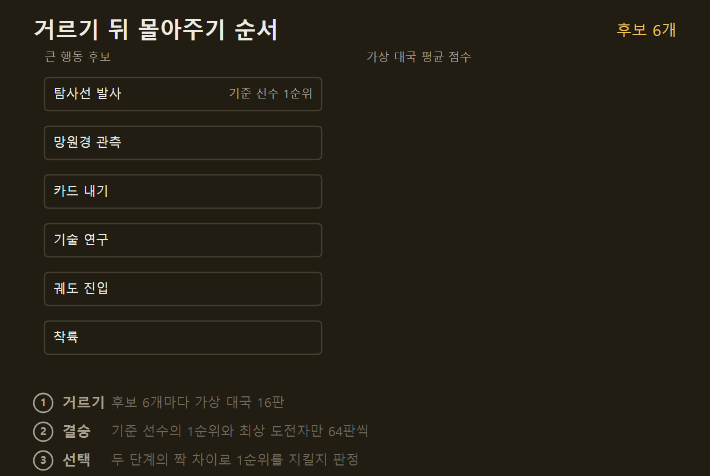
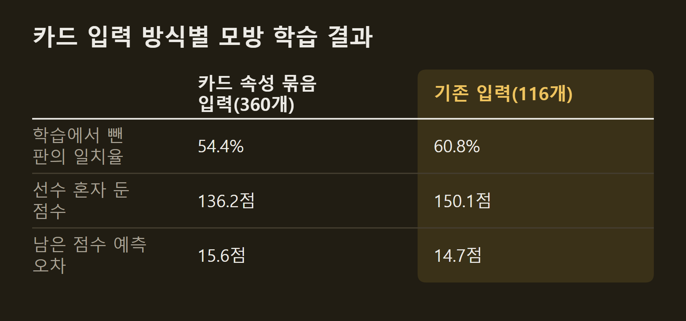
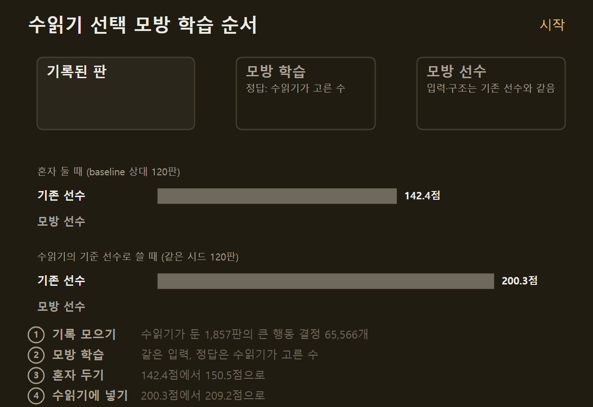
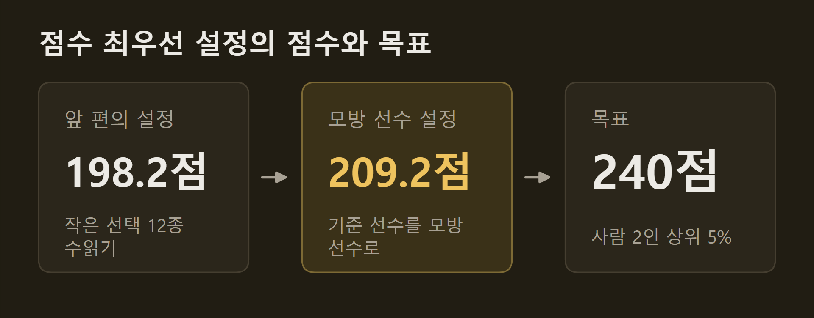
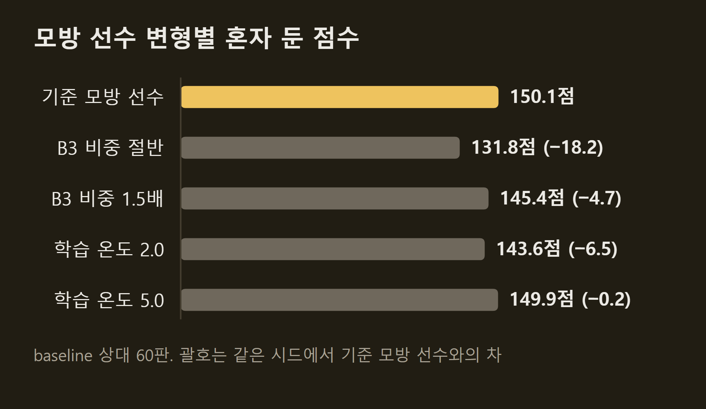
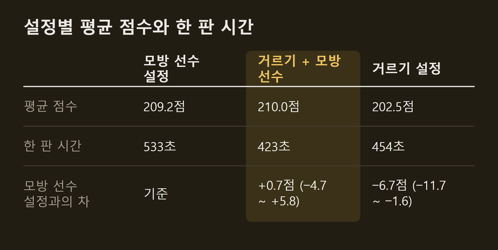

> 이 글은 직접 만들고 있는 개인 프로젝트의 개발 기록입니다. 저장소는 비공개이며, 본문의 수치는 저장소의 기록에서 가져왔습니다.

앞 편에서 SETI AI의 점수 최우선 설정은 198.2점이었고, 남은 점수는 카드 운이 아니라 매 차례의 효율에 있다고 봤다. 그 뒤로 수읽기 예산을 다시 배치하고, 앞 편에서 검토하던 카드 속성 입력을 시험하고, 그 실험의 대조군에서 나온 새 선수를 수읽기에 넣었다. 이 글에는 그 다섯 단계의 결과와 지금 검토 중인 방향을 적는다.

```요약
요약: SETI AI의 수읽기 예산을 거르기 뒤 몰아주기로 다시 배치해 202.5점을 더 적은 시간에 냈고, 카드를 속성으로 넣는 입력은 실패했지만 그 대조군이었던 '수읽기가 고른 수를 그대로 배운 선수'를 수읽기의 기준 선수로 넣자 209.2점으로 올랐으며, 그 선수의 손잡이를 다시 맞추거나 두 이득을 합치는 것으로는 더 오르지 않았다.
```

```용어
수읽기: 후보 수마다 게임 끝까지 가상으로 두어 보고 평균 점수가 가장 높은 수를 고르는 방법이다.
기준 선수: 수읽기의 가상 대국에서 남은 수를 두는 AI다. 지금까지는 최종 점수를 예측하도록 학습한 모델로 두는 R1을 썼다.
점수 최우선 설정: 시간보다 점수를 앞세운 설정이다. 앞 편에서는 작은 선택 12종까지 수읽기로 고르는 설정이 198.2점이었다.
모방 학습: 정답으로 적힌 선택을 그대로 맞히도록 모델을 학습하는 방법이다. 여기서는 수읽기가 고른 수가 정답이다.
시드: 카드가 섞이는 순서와 준비물을 정하는 번호다. 같은 시드면 같은 판이 차려진다.
95% 구간: 같은 실험을 되풀이했을 때 참값이 들어올 범위다. 하한이 0보다 클 때만 이득으로 인정한다.
```

## 1. 수읽기 예산의 재배치

작은 선택의 가상 대국을 두 배로 늘리면 점수가 더 올랐다. 작은 선택마다 16판 두던 가상 대국을 32판으로, 마지막 라운드 큰 행동의 가상 대국을 32판에서 64판으로 늘리니 같은 시드 120판에서 앞 편의 설정보다 6.65점(95% 구간 +2.3 ~ +11.1) 올라 200.3점이 됐다. 다만 한 판 시간이 376초에서 551초로 1.46배가 됐다.

같은 정밀도를 더 적은 시간에 얻으려고 예산을 두 단계로 나눴다. 먼저 후보 전부를 적은 가상 대국으로 거른 뒤, 기준 선수가 첫손에 꼽은 수와 거르기에서 가장 좋았던 도전자 둘에만 많은 가상 대국을 몰아 준다. 큰 행동은 16판으로 거른 뒤 64판씩, 작은 선택은 8판으로 거른 뒤 32판씩이다.



이 배치는 같은 시드 120판에서 앞 편의 설정보다 8.82점(+4.7 ~ +13.1) 올라 202.5점이 됐고, 한 판 454초로 가상 대국을 두 배로 늘린 설정의 83% 시간이었다. 두 설정의 차이는 2.2점(−2.5 ~ +6.9)으로 구분되지 않는다. 정밀도는 거르는 판수가 아니라 결승에 남은 둘의 판수에서 나온다.

## 2. 카드 속성 입력의 실패

앞 편에서 검토하던 "카드를 이름 대신 속성으로 넣는 입력"은 모든 지표에서 기존 입력보다 나빴다. 수읽기가 둔 1,857판에서 큰 행동 결정 65,566개를 꺼내, 카드를 비용과 효과 같은 속성 묶음으로 넣는 입력 360개와 기존 입력 116개를 같은 방법으로 학습했다. 학습의 정답은 둘 다 수읽기가 고른 수다.



학습에서 뺀 판에서 수읽기의 선택을 맞히는 비율은 54.4% 대 60.8%, 선수 혼자 둔 점수는 136.2점 대 150.1점, 남은 점수 예측의 오차는 15.6점 대 14.7점으로 속성 묶음이 모두 뒤졌다. 카드 묶음 입력을 끄면 오차가 기존 모델과 같아졌다. 판 1만 개 규모의 자료에서 입력을 넓히면 과적합만 생기므로, 입력은 기존 계열로 간다.

## 3. 수읽기의 선택을 모방한 선수

실패한 실험의 대조군이 지금까지 가장 좋은 선수가 됐다. 기존 입력으로 수읽기의 선택을 모방한 선수는 기존 기준 선수와 입력, 신경망 구조, 크기가 같고 학습 신호만 다르다. 기존 선수는 판의 최종 점수를 예측하도록 배웠고, 모방 선수는 그 판에서 수읽기가 고른 수를 맞히도록 배웠다.



혼자 둘 때 모방 선수는 120판 평균 150.5점으로 기존 선수의 142.4점보다 8.1점(+1.5 ~ +14.7) 높았다. 이 선수를 수읽기의 기준 선수로 넣으니 같은 시드 120판에서 8.9점(+4.1 ~ +13.7) 올라 209.2점이 됐고, 한 판 시간은 533초로 기존 선수 때와 같았다. 실험 전의 예상은 0 ~ +4점이었다. 선수 혼자 둘 때의 이득 4점 정도가 수읽기 위에서 사라진 적이 두 번 있었기 때문이다.

이번 이득이 남은 이유는 신호가 달랐기 때문으로 본다. 사라졌던 두 번은 같은 신호(최종 점수 예측)의 재조정이었고, 모방 선수는 수읽기의 선택이라는 다른 신호로 배웠다. 같은 시드 120쌍의 차이를 재 보니 패스하기 전의 차례가 1.13번, 탐사선 발사가 0.48번, 소득 카드가 0.50장 늘었고, 라운드 끝 점수는 1~2라운드가 같다가 3라운드에서 2.3점, 끝에서 4.5점 벌어졌다. 앞 편에서 좋은 판의 신호로 꼽은 차례 수와 3라운드부터 갈리는 모양이 그대로다.



큰 도약은 기준 선수의 종류가 바뀔 때 왔다. 기준 선수를 B3에서 R1으로 바꿨을 때 170.6점에서 182.3점으로, 작은 선택 12종을 수읽기로 고르게 했을 때 13.7점, 이번에 모방 선수로 바꿨을 때 8.9점이다. 반면 같은 선수의 재학습, 가상 대국을 더 길게 두기, 라운드별 예산 이동은 수읽기 점수를 움직이지 못했다.

## 4. 손잡이 재조정과 2세대

모방 선수의 손잡이를 다시 맞추는 것으로는 더 얻을 것이 없었다. 모방 선수는 B3의 점수를 0.4의 비중으로 더해 수를 고르는데, 이 비중은 기존 선수에서 맞춘 값이라 모방 선수에서 다시 쟀다. 학습 때 정답의 분포를 퍼뜨리는 온도도 2.0과 5.0으로 바꿔 봤다.



B3 비중을 절반으로 줄이면 18.2점이 떨어졌고, 1.5배로 늘려도 4.7점 떨어졌다. 온도는 2.0이 6.5점 낮았고 5.0은 0.2점 차이로 잡음 안이다. 모방 선수가 작은 선택과 자유 행동에서는 B3의 판단에 기대고 있어, 그 비중을 줄이면 점수가 크게 빠진다.

남은 지렛대는 자료다. 209.2점 설정이 둔 120판의 선택(결정 4,337개, 처음 자료의 6.6%)을 모방 선수에서 이어 배운 2세대 선수는 혼자 둘 때 60판 평균 159.5점으로 모방 선수보다 9.4점(+0.8 ~ +17.5) 높았다. 다만 다른 시드 60판에서는 1.7점이었고 합산 120판은 5.6점(−0.6 ~ +11.5)이라, 60판에서 본 큰 값이 다시 나오지 않는 모양이 앞 편의 작은 선택 실험과 같았다. 수읽기 안에 넣었을 때의 판정은 아직 하지 않았다.

## 5. 두 축을 합친 설정

예산 재배치와 모방 선수는 서로 다른 축이라 둘을 합친 설정을 쟀다. 판정 기준은 결과를 보기 전에 적었다. 모방 선수 설정과의 차가 하한 0을 넘으면 채택, 하한이 −5 위이고 평균이 양수이면 '잠정 이득'으로 적되 시간이 90% 이하이면 자기대국과 학습 자료를 만드는 용도로만 쓴다.



합친 설정은 같은 시드 120판에서 210.0점으로 모방 선수 설정보다 0.7점(−4.7 ~ +5.8) 높았고, 한 판 423초로 79% 시간이었다. 기준대로 잠정 이득이고, 점수 최우선 설정은 모방 선수 설정 그대로, 자료 생성용 설정은 합친 설정이다. 72판까지의 중간 읽기는 4.5점이었는데 120판에서 0.7점으로 줄었으니, 중간 읽기로 판정하지 않는 규칙이 맞았다.

두 이득은 더해지지 않았다. 모방 선수의 이득은 거르기 설정 위에서도 7.5점(+2.2 ~ +12.4)으로 남았지만, 거르기의 이득은 기존 선수 위에서 2.2점이던 것이 모방 선수 위에서 0.7점이 됐다. 같은 시드 120쌍에서 차례 수, 큰 행동 수, 라운드별 점수는 모두 차이가 없었다. 거르기는 두는 모양을 바꾸지 않고 같은 판을 더 적은 시간에 둔다.

## 6. 검토 중인 방향

다음 실험은 사전 등록까지 끝났고 아직 돌리지 않았다. 2세대 모방 선수를 점수 최우선 설정의 기준 선수로 넣어 같은 시드 120판을 두고, 하한이 0을 넘으면 채택한다. 채택되면 같은 고리를 되풀이한다. 채택된 설정이 둔 판에서 3세대를 배우고, 혼자 둘 때의 점수로 거른 뒤 수읽기 위에서 판정한다. 두 세대 연속으로 혼자 둘 때의 점수가 오르지 않으면 멈춘다.

그다음은 남은 점수 예측 모델이다. 가상 대국을 300수에서 끊고 남은 점수를 채우는 이 모델은 기존 선수의 자기대국으로 배운 것이라, 모방 선수의 자기대국 2만 판으로 다시 배우면 예측이 맞을 수 있다. 목표 240점까지는 약 31점이 남았고, 이 실험은 아직 SETI 하나에서만 했다. 다음 편에서는 같은 절차를 두 번째 게임에 옮긴 결과를 적는다.

## 출처와 작성 방식

- 근거: 비공개 저장소의 SETI 전략 실험 기록(20·22~25단계)과 효율 진단 도구의 짝 비교 결과, git 이력
- 표와 그래프: 저장소의 기록에 적힌 값으로 VISER 주간 보고서의 그래프 양식을 써서 직접 그린 그림입니다. "설정별 평균 점수와 한 판 시간"의 세 설정은 같은 시드 120판씩의 값이고, 한 판 시간은 프로세스 7개로 둘 때의 값입니다. "모방 선수 변형별 혼자 둔 점수"는 같은 시드 60판씩의 값입니다. "점수 최우선 설정의 점수와 목표"의 198.2점과 209.2점은 서로 다른 시드 묶음에서 잰 값입니다.
- 움직이는 그림: 직접 그린 그림입니다. "거르기 뒤 몰아주기 순서"의 후보 6개와 판수(16판, 64판)는 실제 설정이고, 후보의 이름과 점수(171.2점 등)는 설명을 위한 예시입니다. "수읽기 선택 모방 학습 순서"의 1,857판, 결정 65,566개, 142.4점, 150.5점, 200.3점, 209.2점은 실제 값입니다.
- 수치 기준일: 2026-10-19
