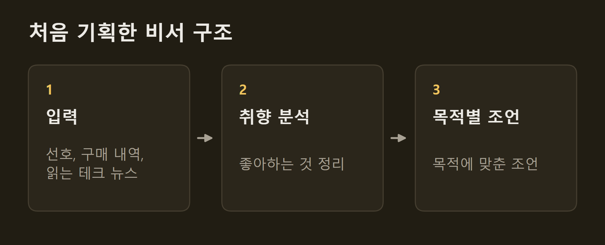
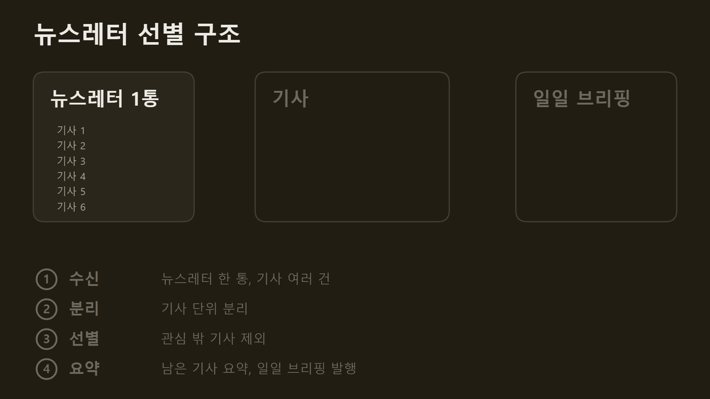
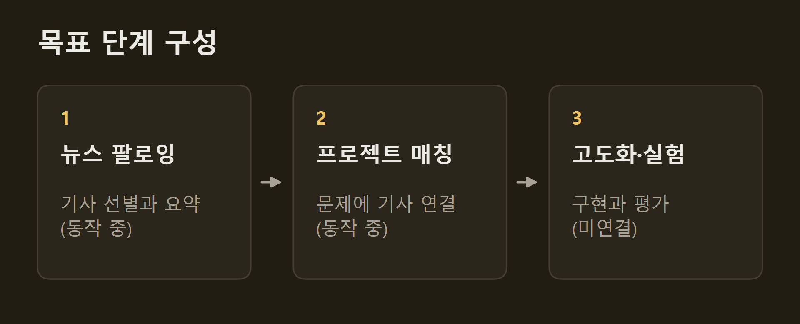
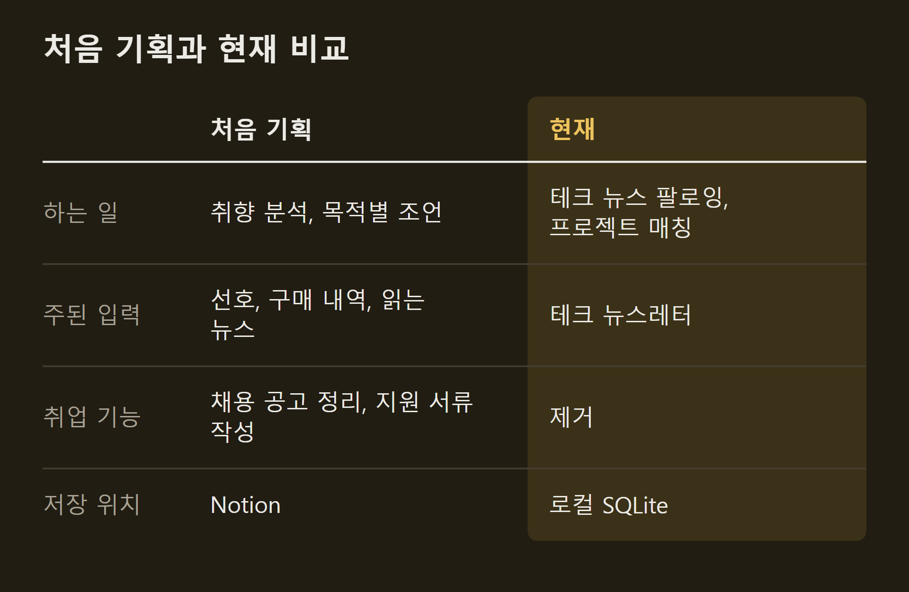

> 이 글은 직접 만들고 있는 개인 프로젝트의 개발 기록입니다. 저장소는 비공개입니다.

VISER는 나 한 사람을 위한 개인비서다. 처음에는 내 선호와 구매 내역, 내가 읽는 테크 뉴스를 넣으면 취향을 분석해 목적에 맞게 조언해 주는 비서를 기획했다. 지금은 범위를 좁혀, 최신 테크 뉴스를 따라가고 그 기술을 앞으로 개발할 프로젝트에 자동으로 매칭하는 비서가 되었다. 이 글에는 처음 기획과 지금의 목표, 그 사이에 바뀐 것을 적는다.

```요약
요약: 처음에는 선호와 구매 내역, 읽는 뉴스로 취향을 분석해 조언하는 비서를 기획했지만, 지금은 최신 테크 뉴스를 따라가고 그 기술을 앞으로 개발할 프로젝트에 매칭하는 비서로 좁혔으며, 매칭한 기술로 프로젝트를 고도화하는 단계는 아직 연결하지 않았다.
```

```용어
뉴스레터: 매체나 개인이 정기적으로 메일로 보내는 소식 모음. 한 통에 기사 여러 건이 들어 있다.
일일 브리핑: 전날부터 들어온 기사를 골라 요약한 하루치 페이지. 기사마다 관심 점수를 누를 수 있다.
주간 보고서: 한 주의 기사 가운데 고른 것을 기사 형식으로 다시 쓴 보고서.
코딩 에이전트: 사람의 지시를 받아 코드를 읽고 고치고 테스트까지 실행하는 AI 도구.
매칭: 내가 적어 둔 프로젝트의 문제와 관련된 기사를 원문 근거와 함께 연결하는 것.
```

## 1. 처음 기획한 비서

처음 기획한 것은 나를 아는 조언자였다. 내가 무엇을 좋아하는지, 무엇을 샀는지, 어떤 테크 뉴스를 읽는지를 넣으면 VISER가 내 취향을 분석하고, 내가 목적을 주면 그 취향에 맞춰 조언한다.

이름도 여기서 왔다. 개인비서의 "비서"를 영문자로 옮겨 VISER라고 붙였다.



처음에는 유튜브 영상 요약, 채용 공고 정리, 지원 서류 작성, 텔레그램으로 할 일을 받는 기능까지 여러 가지를 만들었다. 메일에서 구매 내역과 테크 뉴스를 모으는 기능도 이때 붙였다. ==입력을 넓게 받아 나에 대한 정보를 모으는 것이 처음의 방향이었다.==

## 2. 혼자 만들 수 있다고 본 이유

메일 수집, 본문 파싱, 모델 호출, 웹 페이지 발행까지 이어지는 시스템은 혼자서 만들고 유지하기에 손이 많이 간다. 이 규모를 혼자 시작한 것은 코딩 에이전트 덕분이다. 구현과 테스트를 코딩 에이전트에게 맡길 수 있게 되면서, 혼자 쓸 도구를 혼자 만들어 운영할 수 있다고 판단했다.

## 3. 뉴스레터를 읽는 문제

여러 입력 가운데 매일 실제로 쓰게 된 것은 테크 뉴스였다. 그전에는 메일함의 뉴스레터를 직접 열어 읽고, 기술 유튜브 영상을 보는 방식으로 최신 기술을 따라갔다.

문제는 뉴스레터가 내 관심에 맞춰 만들어지지 않는다는 점이다. 한 통에 기사가 여러 건 들어 있어도 내 관심이나 커리어와 맞는 것은 그중 일부다. 그것을 매번 직접 골라내야 했고, 고르는 일이 밀리면 메일은 읽지 않은 채로 쌓였다. VISER는 이 일을 대신한다.



이렇게 고르고 요약한 기사는 하루치 페이지 한 장으로 발행된다.

")

## 4. 피드백 방식

VISER가 만든 보고서는 내가 직접 고치지 않는다. 마음에 들지 않는 곳이 있으면 의견을 남기고, VISER가 그 의견을 반영해 다시 만든다. 일일 브리핑에서는 기사마다 관심 점수를 누르고, 주간 보고서에서는 고칠 점을 글로 적는다.

## 5. 지금의 목표

지금의 VISER가 하려는 일은 세 단계다.

첫째는 최신 테크 뉴스를 따라가는 것이다. 관심과 맞지 않는 기사를 거르고, 남은 기사를 요약해 하루치 페이지 한 장으로 본다. 한 주의 기사 가운데 고른 것은 주간 보고서로 다시 쓴다.

둘째는 그 기술을 앞으로 개발할 프로젝트에 자동으로 매칭하는 것이다. 내가 프로젝트의 문제나 기획을 먼저 적어 두면, VISER가 그 문제와 관련된 기사를 원문 근거와 함께 연결한다. 지금은 보드게임 AI 프로젝트의 문제를 등록해 두었다. 기사에서 아이디어를 자동으로 만들어 내지는 않는다.

셋째는 매칭한 기술로 프로젝트를 고도화하고 실험하는 것이다. 기사에서 찾은 방법을 프로젝트에 구현하고, 평가를 통과한 것만 반영하는 데까지 가려고 한다.



지금은 첫째와 둘째가 동작한다. 일일 브리핑과 주간 보고서가 발행되고 있고, 이 블로그의 Weekly 구역 글도 VISER의 주간 보고서를 옮겨 실은 것이다. ==셋째는 아직 연결하지 않았다.== VISER가 제 역할을 하는지 잴 기준도 아직 정하지 못했다.

## 6. 처음 기획에서 바뀐 것

취향을 분석해 조언하는 비서에서, 테크 뉴스를 따라가고 프로젝트에 매칭하는 비서로 바뀌었다. 그 과정에서 두 가지를 크게 바꿨다.

**취업 기능을 뺐다.** 채용 공고 정리와 지원 서류 작성 기능을 모두 뺐다. 매일 쓰는 뉴스 처리 하나에 집중하기 위해서다.

**Notion에서 로컬 데이터베이스로 옮겼다.** 처음에는 수집한 기사와 점수를 Notion에 쌓았다. 옮긴 이유는 둘이다. 외부 서비스에 기대는 부분을 줄이고 싶었고, 저장한 기사를 검색하고 평가하려면 데이터가 내 컴퓨터에 있어야 했다.



## 출처와 작성 방식

- 근거: 프로젝트를 만든 사람의 기획 의도와 비공개 저장소의 개발 기록
- 그래프: 본문 내용을 정리해 VISER 주간 보고서의 그래프 양식으로 직접 그린 그림입니다.
- 움직이는 그림: 직접 그린 그림입니다. 기사 수와 남는 기사는 설명을 위한 예시입니다.
- 화면: VISER가 발행한 일일 브리핑 페이지를 찍은 것입니다. 화면 속 기사 제목은 인용이며 저작권은 원문 매체에 있습니다.
- 작성 기준일: 2026-10-14
