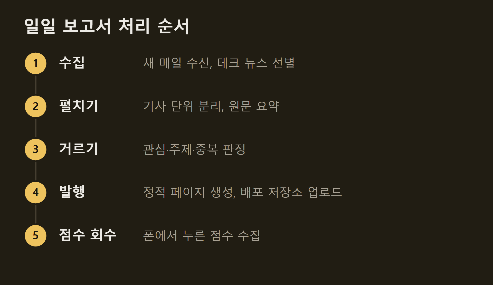
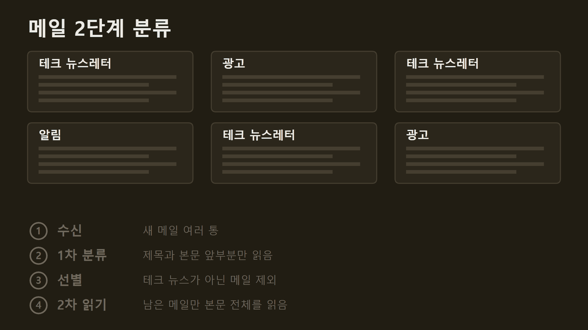
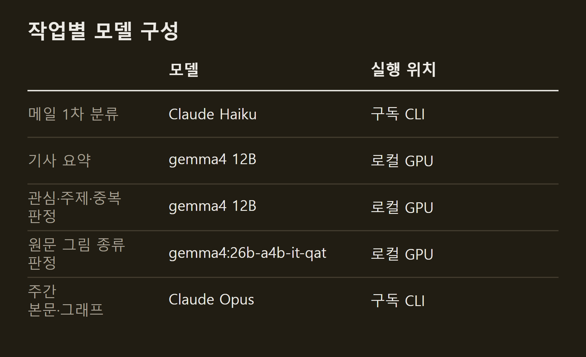
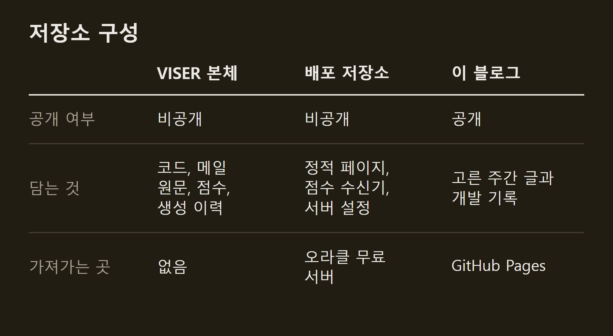
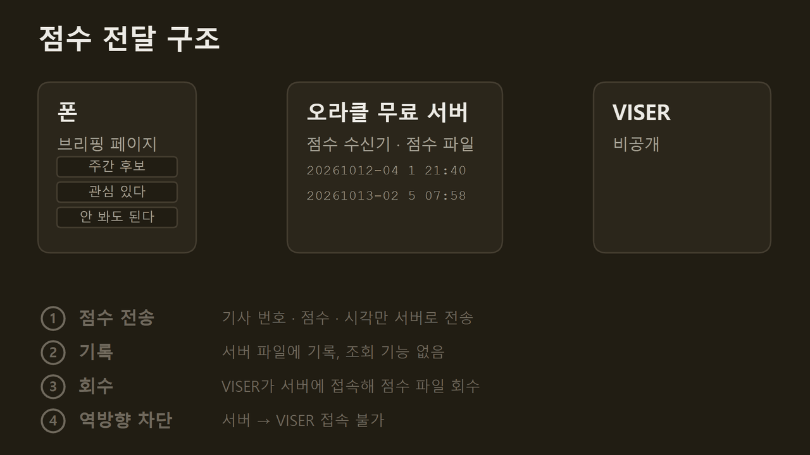

> 이 글은 직접 만들고 있는 개인 프로젝트의 개발 기록입니다. 저장소는 비공개이며, 본문의 수치는 저장소의 기록에서 가져왔습니다.

VISER는 메일함에 쌓인 뉴스레터를 가져와 기사 단위로 나누고, 내 관심과 맞지 않는 것을 거른 뒤 요약해 웹 페이지로 발행한다. 나는 그 페이지를 폰으로 읽고 점수를 누르며, 점수는 다음 실행 때 VISER로 돌아온다. 이 글은 그 전체 구조와, 구조를 그렇게 정한 이유를 설명한다.

```요약
요약: VISER는 뉴스레터를 받아 로컬 모델로 거르고 요약한 뒤 웹 페이지로 발행하며, 공개 서버에는 페이지와 점수를 받는 기능만 두었고, 지금은 사람이 직접 실행해야 돌아간다.
```

```용어
정적 페이지: 서버가 요청마다 만들지 않고 미리 만들어 둔 HTML 파일. 서버는 파일을 내주기만 한다.
로컬 모델: 외부 서비스가 아니라 내 컴퓨터의 GPU에서 돌리는 언어 모델.
구독 CLI: Claude 구독 계정으로 명령줄에서 모델을 부르는 방식. 호출마다 요금이 나가는 API와 달리 구독의 사용 한도 안에서 쓴다.
배포 저장소: 공개 서버가 가져가는 페이지만 담은 git 저장소.
점수 수신기: 페이지에서 누른 점수를 받아 파일에 적어 두는 작은 서버 프로그램.
```

## 1. 일일 처리 순서

VISER는 터미널에서 여는 실행 메뉴로 움직인다. 버튼은 일일 보고서, 주간 보고서, 블로그, 로그 네 가지다. 매일 누르는 것은 "일일 보고서" 하나이고, 그 안에서 아래 다섯 단계가 차례로 돈다.



일일 보고서는 로컬 모델을 켜는 것으로 시작해 끄는 것으로 끝난다. 로컬 모델을 켜지 않으면 기사 요약이 Claude Opus로 넘어가 구독 한도를 쓴다.

==수집이 끝나지 않으면 발행하지 않는다.== 메일을 다 받지 못한 채 발행하면, 그날이 기사가 적은 날처럼 보이기 때문이다.

주간 보고서는 "주간 보고서" 버튼으로 만든다. 한 주 동안 일일 브리핑에서 "주간 후보"로 누른 기사를 모아 Claude Opus가 기사 형식으로 다시 쓰고, 자동 검사를 통과하면 발행한다.

## 2. 뉴스레터를 입력으로 고른 이유

입력은 Gmail로 받는 뉴스레터다. 웹을 직접 수집하거나 RSS를 모으는 방법도 있었지만 뉴스레터를 골랐다. 이유는 셋이다.

- 이미 구독하고 있었다. 읽던 것이 메일함에 쌓이고 있었으므로 그대로 입력으로 쓰면 됐다.
- RSS 수집은 익숙하지 않았다.
- 뉴스레터는 편집자가 한 번 고른 목록이다. 웹에서 무작위로 모으는 것보다 정제된 기사가 여러 분야에서 고르게 들어올 것이라고 판단했다.

Gmail 권한은 읽기 전용만 받았다. VISER는 메일을 읽을 수만 있고 지우거나 고칠 수는 없다.

메일을 모두 모델에 넘기지는 않는다. 먼저 제목과 본문 앞부분만 보고 테크 뉴스인지 가른 뒤, 테크 뉴스로 확인된 메일만 본문 전체를 읽는다. 버릴 메일까지 통째로 넘기면 모델 사용량만 늘어난다.



## 3. 폴더 구조

저장소의 폴더는 아래와 같다.

```text
VISER/
├── monitor.py              실행 메뉴 (일일 보고서 · 주간 보고서 · 블로그 · 로그)
├── src/
│   ├── config.py           설정
│   ├── llm.py              Claude 호출
│   ├── sources/            외부와 주고받는 코드 (Gmail, 웹, 로컬 모델, git, DB)
│   └── tasks/              받아 온 내용을 처리하는 코드 (파서, 선별, 보고서 · 페이지 생성)
├── lm_function/            모델에게 맡기는 판정별 프롬프트와 평가 예시
│   ├── article_gate/       관심 기술 판정
│   ├── article_summary/    기사 요약
│   ├── single_topic/       한 통이 글 한 편인 뉴스레터 판정
│   └── photo_judge/        원문 그림 판정
├── tests/                  자동 테스트
├── dataset/                보존하는 자료
│   ├── raw/                메일 원문
│   ├── reports/            주간 보고서 Markdown
│   ├── system/             DB(뉴스 · 점수 · 생성 이력)
│   └── archive/            옛 문서 보관
├── runtime/                캐시와 로그
├── docs/                   기능별 문서
├── *.config.json           출처 · 주제 필터 설정
└── AGENTS.md               코딩 에이전트 작업 지침
```

**`src/sources`와 `src/tasks`.** `src/sources`에는 Gmail에서 메일을 받아 오거나 웹 페이지를 내려받거나 모델을 부르는 것처럼, 외부 서비스와 주고받는 코드를 모았다. `src/tasks`에는 받아 온 내용을 기사로 나누고, 고르고, 보고서로 만드는 코드를 모았다. 어떤 뉴스레터의 형식이 바뀌어 기사를 잘못 나누면 `src/tasks`의 그 뉴스레터 파서만 고치면 된다.

**`lm_function`.** 모델에게 맡기는 판정은 판정마다 폴더를 따로 두고, 프롬프트와 평가용 예시를 함께 넣었다. 프롬프트를 바꾸면 같은 예시로 다시 돌려 결과가 나빠지지 않았는지 확인한다.

## 4. 작업별 모델 구성

모델은 세 가지로 부른다. 내 GPU에서 도는 로컬 모델, Claude 구독 CLI, 그리고 유료 API다. 매일 도는 작업은 로컬 모델과 구독 CLI가 맡고, 유료 API는 쓰지 않는다.



기사 요약과 관심, 주제, 중복 판정은 하루에도 여러 번 돈다. 이 일을 로컬 모델에 맡긴 이유는 둘이다. 구독 한도를 아끼고, 쓴 만큼 요금이 나가는 유료 API를 피하려는 것이다. 구독 한도는 Claude Opus가 쓰는 주간 보고서 본문과 그래프에 남겨 둔다.

원문 그림의 종류를 가리는 일에는 더 큰 gemma4:26b-a4b-it-qat를 쓴다. 주간 보고서에 실을 그림 후보에서 표지나 장식 그림을 빼는 데까지만 맡고, 어떤 그림을 실을지는 Claude Opus가 그림을 직접 보고 정한다.

## 5. 저장소와 서버 구성

저장소는 셋이다. VISER 본체에는 코드와 메일 원문, 점수, 생성 이력이 있다. 배포 저장소에는 정적 페이지와 점수 수신기, 서버 설정만 있다. 지금 읽고 있는 이 블로그도 저장소 하나다. 블로그는 Hugo로 만들어 GitHub에 올리며, 내가 고른 주간 글과 개발 기록만 들어 있다.



인터넷에 열려 있는 것은 오라클 무료 서버 한 대이고, 이 서버는 배포 저장소만 가져간다. 서버가 해킹당하더라도 개인 자료가 새지 않도록, 서버가 가져가는 저장소에는 처음부터 페이지만 넣었다.

폰에서 누른 점수가 VISER로 돌아오는 과정은 아래 그림과 같다.



폰에서 점수 버튼을 누르면 페이지는 기사 번호와 점수, 누른 시각만 서버로 보낸다. 서버의 점수 수신기는 받은 점수를 파일에 적어 둘 뿐이고, 적힌 내용을 꺼내 주는 기능은 없다. 누군가 서버에 들어오더라도 가져갈 것이 없게 하려는 것이다.

적힌 점수는 VISER가 가져온다. 일일 보고서를 실행하면 VISER가 서버에 접속해 점수 파일을 내려받는다. 반대로 서버에서 VISER로 접속하는 경로는 없다. ==연결은 항상 VISER 쪽에서 시작한다.== 그래서 서버가 해킹당하더라도 VISER에 있는 메일 원문이나 점수 기록까지 닿지 못한다.

")

이 블로그에 글을 올릴 때도 같은 경로를 쓴다. 주간 보고서 페이지에서 블로그에 실을 글을 체크하면 그 체크가 점수와 함께 서버에 쌓인다. 실행 메뉴에서 "블로그" 버튼을 누르면 체크한 글 목록이 나오고, 내가 확정한 글만 블로그에 올라간다.

## 6. 정리

수집부터 발행, 점수 회수, 블로그 게시까지 버튼 몇 개로 이어진다. 지금은 내가 직접 버튼을 눌러야 돈다. 추후에는 맥미니처럼 상시 돌아가는 PC에서 매일 구동할 예정이다.

## 출처와 작성 방식

- 근거: 비공개 저장소의 코드 주석, 실행 설정 문서, 개발 기록
- 그래프: 저장소의 기록에 적힌 값으로 VISER 주간 보고서의 그래프 양식을 써서 직접 그린 그림입니다.
- 움직이는 그림: 직접 그린 그림입니다. 메일 종류와 통 수, 점수 파일에 적힌 기사 번호와 점수, 시각은 설명을 위한 예시입니다.
- 화면: VISER가 발행한 주간 보고서 페이지를 찍은 것입니다. 화면 속 기사 제목은 인용이며 저작권은 원문 매체에 있습니다.
- 수치 기준일: 2026-10-14
