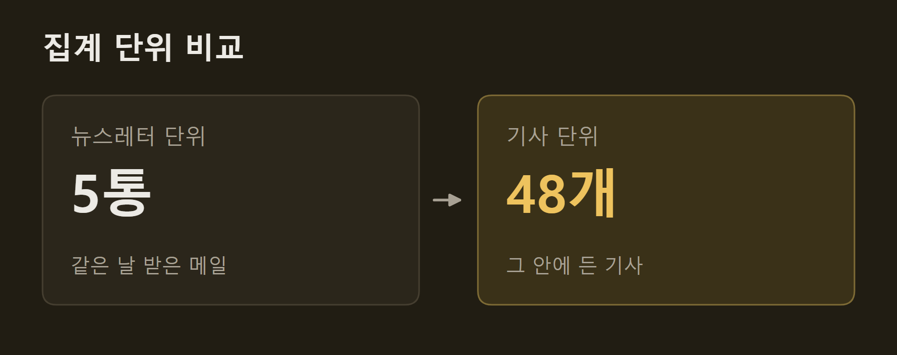
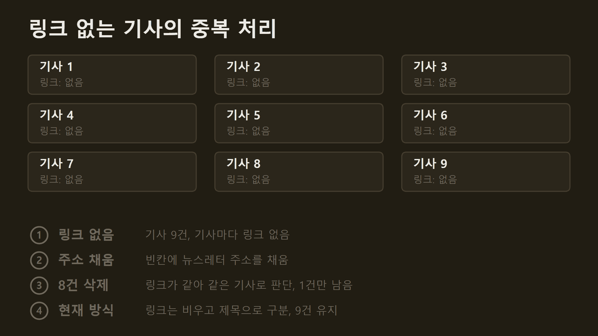
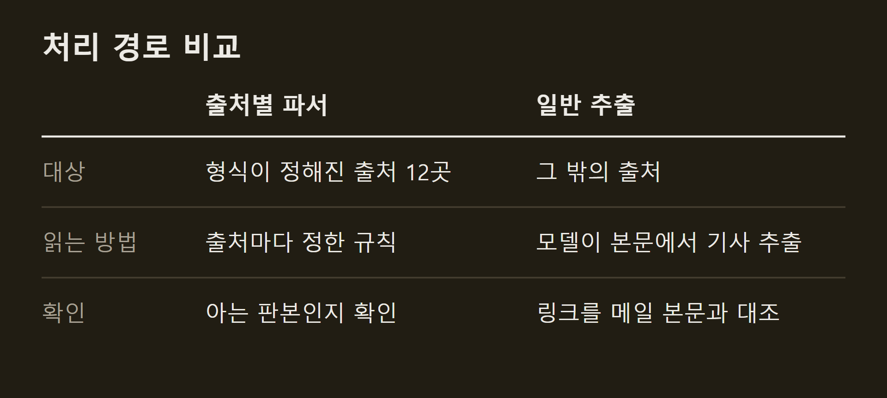
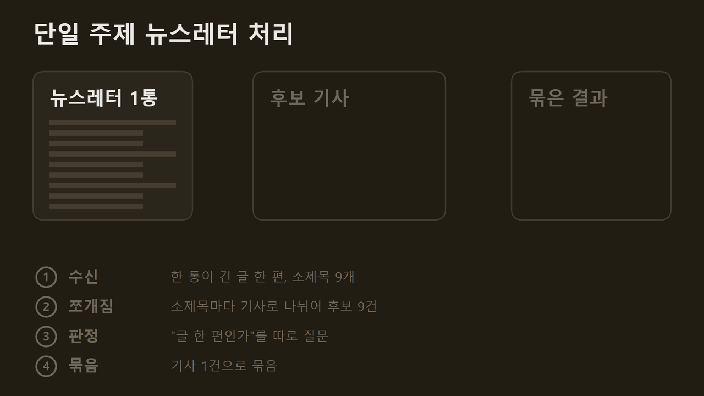
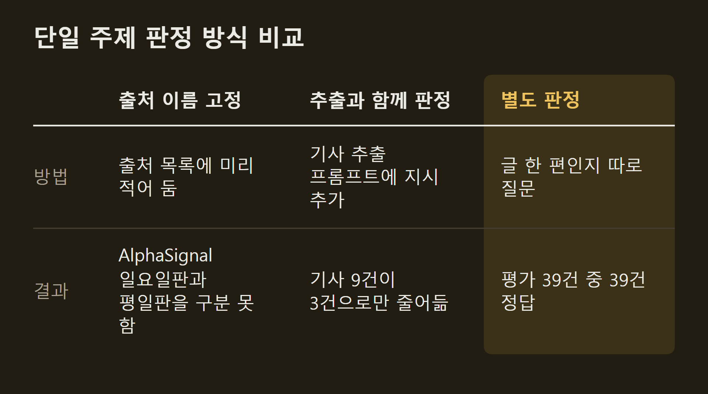
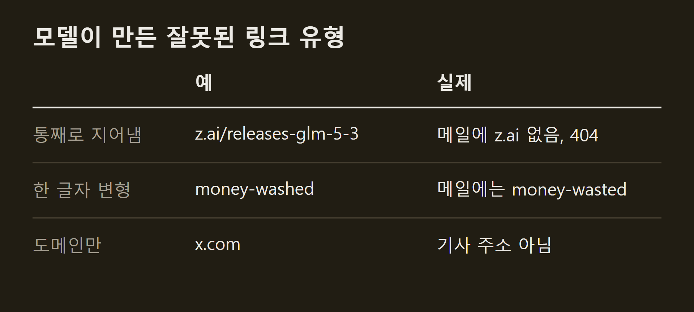
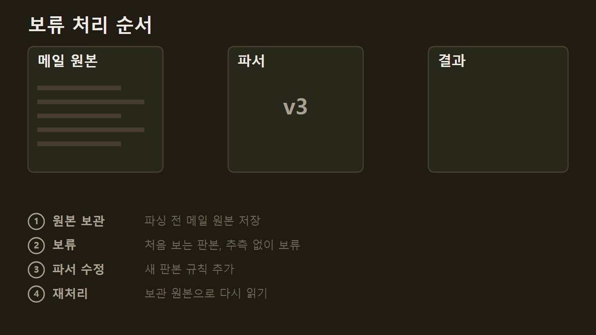

> 이 글은 직접 만들고 있는 개인 프로젝트의 개발 기록입니다. 저장소는 비공개이며, 본문의 수치는 저장소의 기록에서 가져왔습니다.

VISER의 입력은 뉴스레터다. 뉴스레터는 출처마다 형식이 다르고, 한 통에 기사가 몇 건 들어 있는지도 제각각이다. 이 글은 메일 한 통을 받아 기사 목록으로 바꾸는 구조와, 그 구조를 만들면서 바꾼 판단을 설명한다.

```요약
요약: VISER는 뉴스레터를 한 통이 아니라 그 안의 기사 단위로 읽고, 한 통이 글 한 편이면 하나로 묶으며, 모델이 쓴 링크는 메일 본문과 대조하고, 읽지 못한 메일은 버리지 않고 보류했다가 파서를 고친 뒤 다시 읽는다.
```

```용어
파서: 메일 본문을 읽어 기사의 경계와 제목, 링크를 가려내는 코드.
다이제스트: 여러 소식을 짧게 모아 한 통으로 보내는 뉴스레터.
단일 주제 뉴스레터: 한 통이 긴 글 한 편인 뉴스레터. 소제목이 있어도 다루는 주제는 하나다.
판본: 같은 출처의 메일이라도 호마다 달라지는 본문 형식.
보류: 메일을 읽지 못했을 때 버리지 않고 따로 남겨 두는 상태.
```

## 1. 기사 단위 집계

처음에는 뉴스레터 한 통을 한 줄로 셌다. 그날 들어온 뉴스레터가 5통이면 브리핑도 5줄이었다. 그런데 그 5통 안에는 기사가 48개 들어 있었다. 뉴스레터는 그 자체가 목차여서, 한 통을 한 줄로 세면 아무리 잘 요약해도 표지만 보는 셈이었다.



==그래서 뉴스레터가 아니라 기사 하나하나를 세기로 했다.== 점수도 기사마다 누른다. 한 통에 관심 있는 기사 1건과 관심 없는 기사 9건이 섞여 있으면, 그 뉴스레터에 점수 하나를 매길 수 없기 때문이다.

이때 실수가 하나 있었다. 어떤 뉴스레터는 기사마다 링크가 따로 없다. 빈칸을 두지 않으려고 뉴스레터 주소를 대신 넣었더니, AlphaSignal 한 통의 기사 9건이 모두 같은 링크를 갖게 됐다. VISER는 링크가 같은 기사를 같은 기사로 보고 하나만 남긴다. 그래서 9건 중 8건이 사라졌다. 지금은 링크가 없으면 비워 두고, 같은 기사인지는 제목으로 판단한다.



## 2. 처리 경로

메일을 기사로 나누는 경로는 둘이다.



형식을 확인한 출처 12곳은 전용 파서로 읽는다. AlphaSignal, Simon Willison, Turing Post, SemiAnalysis, Claude Code 메일 같은 곳이다. 이 출처들은 형식이 정해져 있지만 출처마다 그 형식이 다르다. 어디서 기사가 시작하고 끝나는지, 어떤 링크가 원문인지를 출처별 규칙으로 정해 두면 같은 메일은 언제 읽어도 같은 결과가 나온다.

그 밖의 출처는 모델이 메일 본문에서 기사를 뽑는다. 처음 보는 출처도 이 경로로 들어온다.

## 3. 한 통이 글 한 편인 뉴스레터

기사 단위로 나누자 반대 문제가 생겼다. Interconnects처럼 한 통이 긴 글 한 편인 뉴스레터는 소제목마다 기사로 쪼개졌다. 어느 날은 후보 69개 중 23개가 이런 뉴스레터 두 통에서 나왔고, 브리핑의 여러 칸이 같은 이야기로 채워졌다. 이 두 통을 각각 하나로 묶자 후보는 48개가 되었다.



어떤 뉴스레터를 묶을지 정하는 방법은 세 번 바꿨다.



처음에는 묶을 출처를 이름으로 적어 두었다. 그런데 AlphaSignal은 평일에는 다이제스트를 보내고 일요일에는 글 한 편을 보낸다. 실제로 받은 23통 중 3통이 일요일판이었다. 이름으로 정하면 평일판을 묶거나 일요일판을 쪼개게 된다.

다음에는 기사를 뽑는 프롬프트에 "글 한 편이면 쪼개지 마라"는 지시를 더했다. 하지만 같은 프롬프트에 "기사를 빠짐없이 담아라"는 지시가 함께 있었고, 모델은 앞의 지시를 따랐다. 더 큰 모델인 Opus로 바꿔도 9건이 3건으로 줄었을 뿐 1건이 되지는 않았다.

마지막으로 판정만 따로 떼어 "이 메일은 글 한 편인가"를 묻는 질문 하나로 바꿨다. 같은 Haiku 모델이 평가용 메일 39건을 모두 맞혔다. 문제는 모델이 아니라 한 프롬프트에 서로 부딪히는 지시를 넣은 데 있었다. 지금 쓰는 구독 CLI 경로에서는 39건 중 37건을 맞힌다.

==판정하지 못하면 묶지 않는다.== 모델 호출이 실패했을 때 묶는 쪽을 고르면, 그 뉴스레터의 기사가 모두 한 건으로 합쳐져 브리핑에서 사라지고 되살릴 수 없다. 묶지 않으면 소제목이 기사로 나뉘어 보일 뿐이고, 나중에 다시 판정할 수 있다.

## 4. 링크 확인

모델이 기사를 뽑을 때 링크도 함께 적는다. 프롬프트에는 "본문에 없는 내용을 지어내지 말라"고 적어 두었지만, 실제로 메일에 없는 주소가 브리핑에 두 건 실렸다. 저장된 기사를 다시 살펴보니 잘못된 링크는 세 가지 유형이었다.



지금은 모델이 적은 링크를 메일 본문에 실제로 있는 주소와 대조하고, 없으면 버린다. 뉴스레터는 링크를 추적용 주소로 감싸서 보내는 경우가 많아서, 감싼 주소를 풀어낸 원래 주소와도 대조한다. 대조를 거친 링크만 브리핑에 싣는다.

## 5. 보류와 재처리

파서는 아는 형식만 읽는다. 기사 경계를 확정할 수 없으면 길이나 위치로 짐작하지 않는다. ==확정할 수 없으면 추측하지 않고 보류한다.== 짐작으로 읽은 기사는 틀려도 티가 나지 않고, 그날 브리핑에 그대로 실린다.

보류한 메일을 버리지 않으려고, 메일은 파싱하기 전에 원본부터 저장한다. 그래서 파서를 고친 뒤 같은 원본으로 다시 읽을 수 있다.



예를 들어 Claude Code 주간 메일이 2주 치를 묶어 보낸 호는 마지막 문구가 평소와 달라 보류됐다. 파서가 두 가지 문구를 모두 받도록 고친 뒤 보관해 둔 원본으로 다시 읽었고, 기사 15건을 얻었다. 고치기 전에 읽던 메일들은 고친 뒤에도 같은 결과가 나오는지 확인한다.

## 6. 정리

VISER는 뉴스레터를 기사 단위로 읽는다. 한 통이 글 한 편이면 하나로 묶고, 판정이 어려우면 묶지 않는다. 모델이 쓴 링크는 메일 본문에 있을 때만 쓴다. 읽지 못한 메일은 보류해 두었다가 파서를 고친 뒤 다시 읽는다.

## 출처와 작성 방식

- 근거: 비공개 저장소의 코드 주석, 개발 기록, 평가 기록
- 그래프: 저장소의 기록에 적힌 값으로 VISER 주간 보고서의 그래프 양식을 써서 직접 그린 그림입니다.
- 움직이는 그림: 직접 그린 그림입니다. 각각 AlphaSignal 한 통의 기사 9건, Interconnects 한 통의 소제목 9개, Claude Code 주간 메일의 보류 사례를 바탕으로 했습니다. 기사 번호, 파서 판본 이름, 줄 모양은 설명을 위한 예시입니다.
- 수치 기준일: 2026-10-14
