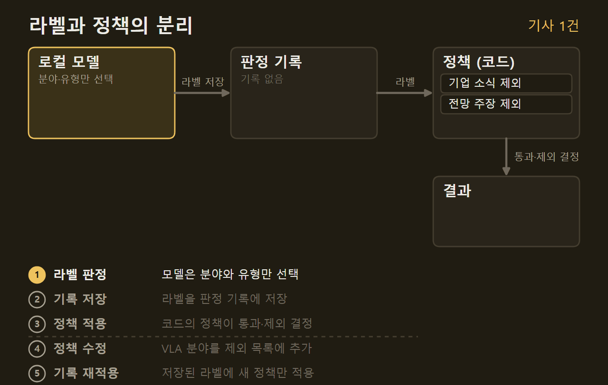
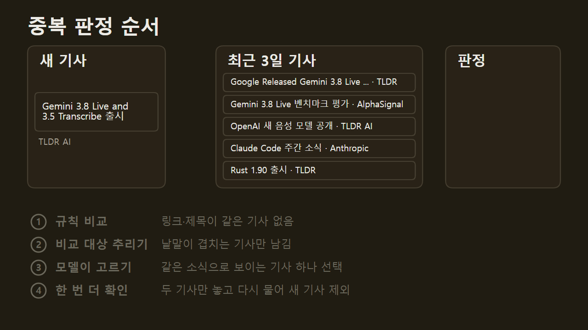
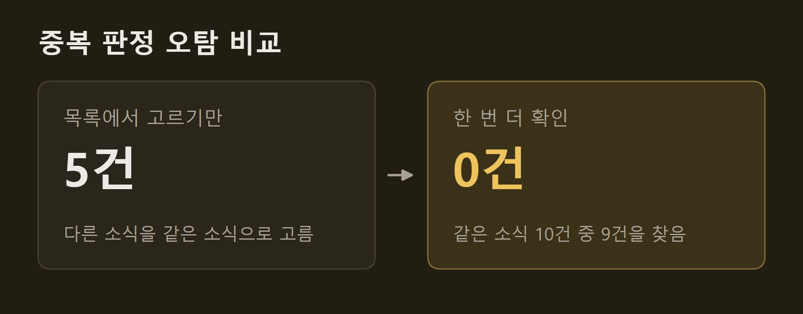
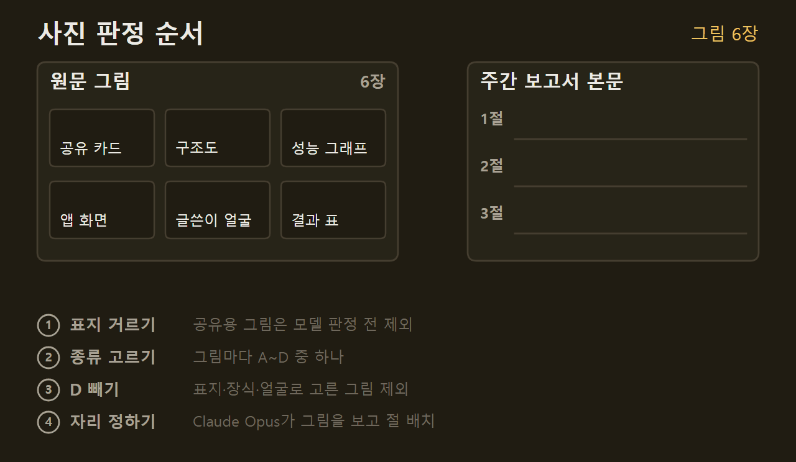
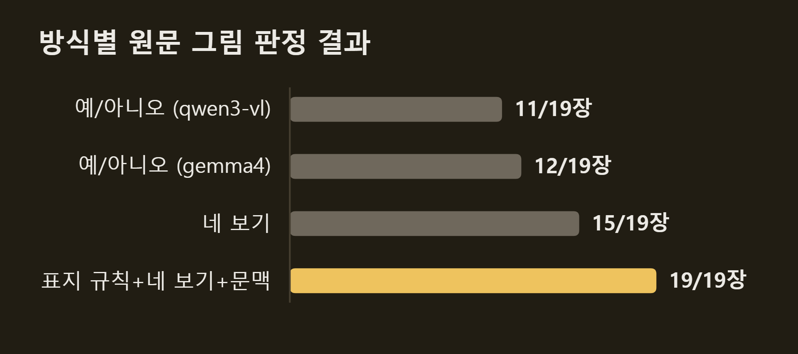
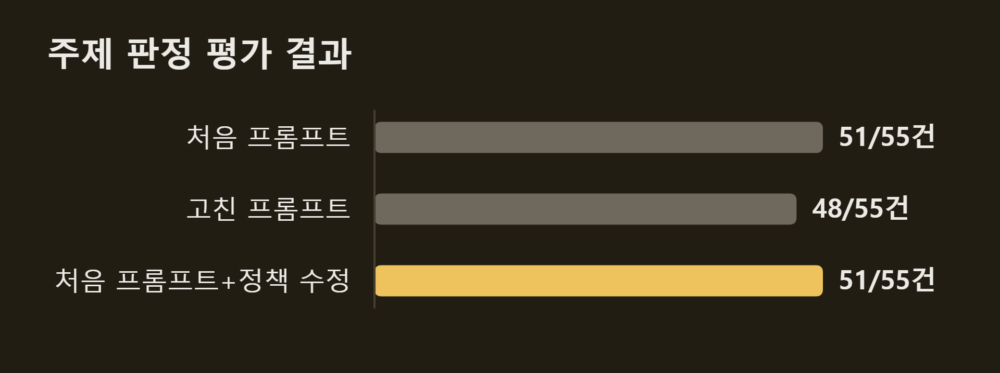

> 이 글은 직접 만들고 있는 개인 프로젝트의 개발 기록입니다. 저장소는 비공개이며, 본문의 수치는 저장소의 기록에서 가져왔습니다.

VISER는 기사를 고르고 거르는 여러 단계에서 모델에게 판단을 맡긴다. 이 기사가 관심 분야인지, 앞서 낸 기사와 같은 소식인지, 원문의 그림을 실어도 되는지 같은 질문이다. 이 글은 그 판정들을 어디에 두었는지, 모델의 답을 어떻게 쓰는지, 모델이 답하지 못했을 때 무엇을 하는지 설명한다.

```요약
요약: VISER는 판정마다 질문을 하나로 좁혀 모델에게 묻고, 모델의 답은 라벨로만 받아 기사를 낼지 뺄지는 코드에 적은 정책이 정하며, 판정하지 못했을 때는 되살릴 수 없는 결과를 만들지 않는 쪽을 고른다.
```

```용어
판정: 모델에게 기사나 그림을 보여 주고 정해진 보기 가운데 하나를 고르게 하는 일.
라벨: 판정에서 모델이 고른 보기. 예: 분야 "LLM", 유형 "기술 내용".
정책: 라벨을 보고 기사를 낼지 뺄지 정하는 규칙. 모델이 아니라 코드에 적는다.
판정 기록: 같은 기사를 다시 묻지 않도록 저장해 둔 판정 결과.
고정 표본: 프롬프트를 고치기 전과 후를 비교하려고 정해 둔 기사 묶음. 기사마다 기대하는 답을 미리 적어 둔다.
오탐: 같은 소식이 아닌데 같은 소식으로 판정한 경우.
```

## 1. 판정 위치

VISER가 모델에게 판정을 맡기는 곳은 다섯 곳이다. #3에서 다룬 "한 통이 글 한 편인가" 판정은 빼고 적었다.

| | 묻는 것 | 모델 |
|---|---|---|
| 관심 판정 | 관심 분야와 글 유형 | gemma4:12b-it-q8_0 |
| 주제 판정 | 기사 범주와 모델 계열 | gemma4:12b-it-q8_0 |
| 중복 판정 | 앞서 낸 기사와 같은 사건인지 | gemma4:12b-it-q8_0 |
| 사진 판정 | 원문 그림의 종류 | gemma4:26b-a4b-it-qat |
| 주간 1차 선별 | 해설 글을 쓸 내용이 있는지 | Claude Opus |
{caption="판정별 질문과 모델"}

관심 판정은 메일에서 기사를 뽑은 직후, 요약하기 전에 돈다. 기사 제목과 본문 앞 1,500자를 보고 관심 분야와 글 유형을 고른다. 여기서 빠진 기사는 요약하지 않으므로, 도입할 때 기준으로 기사 한 건당 29초를 아꼈다. 주제 판정과 중복 판정은 그날 브리핑에 실을 기사를 고를 때 돌고, 사진 판정과 주간 1차 선별은 주간 보고서를 만들 때 돈다.

판정은 질문마다 따로 둔다. 관심 판정을 처음 만들 때 기사를 뽑는 프롬프트에 항목을 하나 더 얹는 방법도 있었지만 그렇게 하지 않았다. 그 프롬프트는 "기사를 빠짐없이 담아라"를 요구하는 자리여서, 같은 자리에 "관심 없는 기사는 빼라"를 넣으면 두 지시가 부딪힌다. #3의 단일 주제 판정에서 겪은 문제와 같다.

관심, 주제, 중복 판정은 기사 요약과 같은 로컬 모델을 쓴다. 판정과 요약이 한 실행에서 이어 돌기 때문이다. 다른 모델을 고르면 기사마다 GPU에 두 모델을 번갈아 올려야 하고, 그 시간이 기사 수만큼 늘어난다.

## 2. 라벨과 정책의 분리

모델은 라벨만 답하고, 기사를 낼지 뺄지는 코드에 적은 정책이 정한다. 관심 판정이라면 모델은 "분야: LLM, 유형: 기업 소식"처럼 답하고, 코드가 "기업 소식은 뺀다"는 정책을 보고 결정한다.

이렇게 나눈 이유는 판정 기록이다. VISER는 같은 기사를 다시 묻지 않도록 판정 결과를 저장해 두고, 모델과 프롬프트와 입력이 모두 같을 때만 그 기록을 다시 쓴다. 정책을 프롬프트에 적으면 정책을 고칠 때마다 프롬프트가 바뀌고, 저장한 판정 기록을 모두 버려야 한다.



==정책을 바꿔도 모델에게 다시 묻지 않는다.== 로봇을 관심에서 뺄 때 관심 판정과 주제 판정 모두 프롬프트는 그대로 두고 정책만 고쳤다. 관심 판정은 로봇 행동을 내는 모델인 VLA 분야를 빼도록 했고, 주제 판정은 로봇이나 VLA를 언급한 기사를 그전처럼 VLM·VLA 기사로 남기지 않고 빼도록 했다. 저장된 주제 판정 644건에 이 로봇 제외 규칙을 다시 적용하자 14건이 통과에서 제외로 바뀌었다. 모델 호출은 한 번도 없었다.

정책에는 사람이 정한 기준을 적는다. 기업 소식과 근거 없는 전망은 빼고, 출시 공지는 본문이 200자 미만일 때만 뺀다. 길이만으로 빼지 않는 것은 실제로 한 줄짜리 기사 3건이 모두 관심 분야였기 때문이다. 기사마다 링크가 없어 본문을 받지 못했을 뿐, 내용이 없는 기사가 아니었다.

## 3. 판정 실패 시 처리

모델은 답하지 않거나 보기에 없는 답을 낼 때가 있다. 로컬 모델 서버가 GPU에 모델을 올리지 못해 오류를 낸 날도 있었다. 이때의 처리는 판정마다 다르다.

| | 처리 | 결과 |
|---|---|---|
| 관심 판정 | 메일째 보류 | 원문으로 다시 처리 |
| 주제 판정 | 그 기사만 그날 제외 | 다음 실행에서 다시 판정 |
| 중복 판정 | 중복이 아닌 것으로 보고 유지 | 같은 소식이 두 번 실릴 수 있음 |
| 사진 판정 | 미확인으로 표시 | 그 그림은 싣지 않음 |
| 주간 1차 선별 | 글자 수 기준만 적용 | 후보를 남김 |
{caption="판정 실패 시 처리"}

처리는 달라도 기준은 하나다. ==되살릴 수 없는 결과를 만들지 않는다.==

관심 판정은 보기에 없는 답이 오면 같은 기사로 한 번 더 묻는다. 그래도 답을 얻지 못하면 그 메일을 보류한다. 메일 원본은 저장되어 있으므로 나중에 다시 처리할 수 있다. 관심 판정을 처음 만들었을 때는 판정하지 못하면 통과였고, 얼마 뒤 지금처럼 보류로 바꿨다.

주제 판정은 판정하지 못한 기사만 그날 브리핑에서 빼고, 그 결과를 판정 기록에 남기지 않는다. 그래서 다음 실행에서 다시 묻는다. 판정할 기사가 전부 보류이면 발행을 멈춘다. 그때는 기사 하나의 문제가 아니라 로컬 모델이 응답하지 않는 상태이고, 그대로 진행하면 기사가 0건인 페이지가 나간다.

중복 판정과 주간 1차 선별은 반대로 기사를 남긴다. 판단하지 못한 기사를 중복으로 지우면 멀쩡한 기사가 아무 표시 없이 사라진다. 1차 선별에 실패했다고 후보를 모두 빼면 그 주 보고서가 아예 없어진다.

사진 판정은 종류를 판정하지 못한 그림을 싣지 않는다. 발행 전 검사가 판정되지 않은 그림이 본문에 있는지 확인하고, 있으면 발행을 막는다.

## 4. 중복 판정

같은 소식을 여러 뉴스레터가 함께 다룬다. 구글이 새 Gemini 모델을 내면 TLDR AI와 TLDR이 각각 기사로 보내는 식이다. 거르지 않으면 브리핑에 같은 소식이 두 번 실린다.

VISER는 새 기사마다 앞서 낸 기사와 같은 소식인지 확인한다. 쉬운 경우는 규칙으로 거른다. 링크가 같거나 제목이 거의 같으면 같은 기사로 본다. 규칙으로 가려지지 않으면 로컬 모델에게 묻는다.



모델에게 물을 때는 최근 3일 동안 낸 기사 가운데 새 기사와 낱말이 많이 겹치는 12건을 목록으로 보여 주고, 이 중에 같은 소식이 있으면 고르게 한다. 12건으로 줄이는 것은 모델에게 한 번에 보여 줄 수 있는 글의 양에 한계가 있기 때문이다.

처음에는 제목이 어느 정도 비슷한 기사만 모델에게 물었다. 그러자 제목 표현이 다른 같은 소식을 놓쳤다. "Gemini 3.8 Live and 3.5 Transcribe 출시"와 "Google Released Gemini 3.8 Live …"는 같은 출시 소식인데, 제목이 비슷하지 않다고 보고 모델에게 묻지도 않았다. 지금은 제목이 비슷하지 않아도 낱말이 겹치는 기사를 모델에게 보여 준다.

반대 방향의 실수도 있었다. 목록에서 고르게만 하자 모델이 다른 소식을 같은 소식으로 골랐다. 여러 소식을 모은 요약 글과 그 안에 들어 있는 소식 하나, 모델 출시 소식과 그 모델을 평가한 글이 그랬다. 둘은 주제가 같지만 같은 기사는 아니다. 그래서 모델이 하나를 고르면, 고른 두 기사만 나란히 놓고 "같은 소식인가"를 한 번 더 묻는다.



기사 97건으로 시험했다. 목록에서 고르기만 할 때는 다른 소식을 같은 소식으로 고른 경우가 5건이었고, 한 번 더 확인하자 0건이 되었다. 같은 소식 10건 중 9건은 그대로 찾았다. 다만 이 97건을 보며 고쳤기 때문에, 다른 날 기사에서도 같은 결과가 나오는지는 아직 확인하지 않았다.

## 5. 사진 판정

주간 보고서에는 원문 기사의 그림을 함께 싣는다. 원문 페이지에는 그림이 여러 장 있다. 내용을 설명하는 구조도나 그래프도 있고, 기사 맨 위의 표지 그림이나 글쓴이 얼굴 사진도 있다. 사진 판정은 이 가운데 실을 만한 그림만 남기는 일이다.

처음에는 모델에게 "이 그림에 구체적인 정보가 있는가"를 예와 아니오로 물었다. 그러자 실어야 할 그림까지 버렸다. 앱 화면이나 예시를 확대한 그림처럼 수치가 없는 그림을 "정보 없음"으로 답했다. 본문이 설명하는 그림인데도, 모델은 정보가 있는지를 수치가 있는지로 좁게 판단했다.

그래서 질문을 "이 그림은 무엇인가"로 바꾸고 보기 네 개를 주었다.

| | 예 | 처리 |
|---|---|---|
| A 도식 | 구조도, 처리 흐름도 | 싣는다 |
| B 그래프·표 | 수치 그래프, 결과 표 | 싣는다 |
| C 화면·예시 | 앱 화면, 출력 예시, 사진 | 싣는다 |
| D 표지·장식 | 공유 카드, 로고, 인물 얼굴 | 뺀다 |
{caption="사진 판정의 네 보기"}

D로 답한 그림만 빼고 나머지는 모두 남긴다. 앱 화면은 C에 해당하므로 이제 버려지지 않는다.

모델은 답을 문장으로 쓰지 않고 A~D 가운데 글자 하나만 고른다. 정확히는 모델이 다음에 쓸 글자로 A, B, C, D가 나올 확률을 읽어 가장 높은 것을 답으로 삼는다. 그래서 "잘 모르겠다" 같은 보기 밖의 답이 나오지 않는다.

여기에 두 가지를 더했다. 표지는 모델에게 묻기 전에 규칙으로 거른다. 원문 페이지 본문에는 없고 링크 공유용으로만 지정된 그림, 그림 설명이 기사 제목과 같은 그림이 표지다. 또 모델에게 그림만 보여 주지 않고 기사 제목과 그림 바로 앞 문단을 함께 준다. 문맥 없이 물었을 때는 본문의 예시 그림 2장을 표지로 골랐다.



주간 보고서 한 주 치의 원문 그림 19장(본문 그림 16장, 표지 3장)으로 비교했다.



예와 아니오로 물었을 때는 19장 중 11~12장을 맞혔다. 네 보기로 바꾸자 15장, 표지 규칙과 문맥까지 더하자 19장을 모두 맞혔다. 남은 그림 가운데 무엇을 어디에 실을지는 본문을 쓰는 Claude Opus가 그림을 직접 보고 정한다.

## 6. 판정 기록과 평가

모델에게 묻는 데는 시간이 든다. 그래서 판정 결과를 저장해 두고, 같은 기사가 다시 들어오면 저장한 결과를 쓴다. 이것이 판정 기록이다.

저장한 결과를 다시 쓰려면 모델과 프롬프트, 기사 내용이 모두 그때와 같아야 한다. 프롬프트를 한 글자라도 고치면 같은 기사에도 답이 달라질 수 있으므로 다시 묻는다. 판정에 실패한 결과는 아예 저장하지 않는다. 그래서 다음 실행에서 저절로 다시 묻게 된다.

프롬프트를 고칠 때는 고친 것이 실제로 나아졌는지 확인한다. 이때 고정 표본을 쓴다. 기사 묶음을 정해 두고 기사마다 "이렇게 판정해야 한다"는 기대 답을 적어 둔다. 그리고 고치기 전과 후의 프롬프트로 같은 묶음을 판정해, 기대 답과 맞은 수를 비교한다.



주제 판정은 기사 55건으로 평가했다. 처음 프롬프트는 55건 중 51건이 기대 답과 같았다. 프롬프트를 고치자 48건으로 줄었다. 고친 프롬프트가 로봇 동작을 내는 모델에 관한 연구를 로봇 분야로 분류해 뺐기 때문이다. 그래서 고친 프롬프트는 쓰지 않고, 처음 프롬프트를 그대로 둔 채 정책만 고쳤다. 결과는 다시 51건이었다.

모델의 답은 같은 질문에도 매번 조금씩 다를 수 있다. 실제로 같은 프롬프트와 같은 기사로 다시 돌렸을 때 결과가 1건 달라진 적이 있다.

## 7. 정리

VISER는 판정마다 질문을 하나로 좁혀 모델에게 묻는다. 모델은 라벨만 답하고, 기사를 낼지 뺄지는 코드의 정책이 정한다. 판정하지 못했을 때는 판정마다 처리가 다르지만, 되살릴 수 없는 결과를 만들지 않는 쪽을 고른다는 기준은 같다.

## 출처와 작성 방식

- 근거: 비공개 저장소의 코드 주석, 커밋 기록, 평가 기록
- 그래프: 저장소의 기록에 적힌 값으로 VISER 주간 보고서의 그래프 양식을 써서 직접 그린 그림입니다.
- 움직이는 그림: 직접 그린 그림입니다. 처리 순서는 실제와 같습니다. 라벨과 정책의 분리 그림의 라벨 값, 중복 판정 그림의 최근 기사 목록(Gemini 출시 기사 두 건은 실제 사례), 사진 판정 그림의 그림 6장과 그 종류는 설명을 위한 예시입니다.
- 수치 기준일: 2026-10-14
