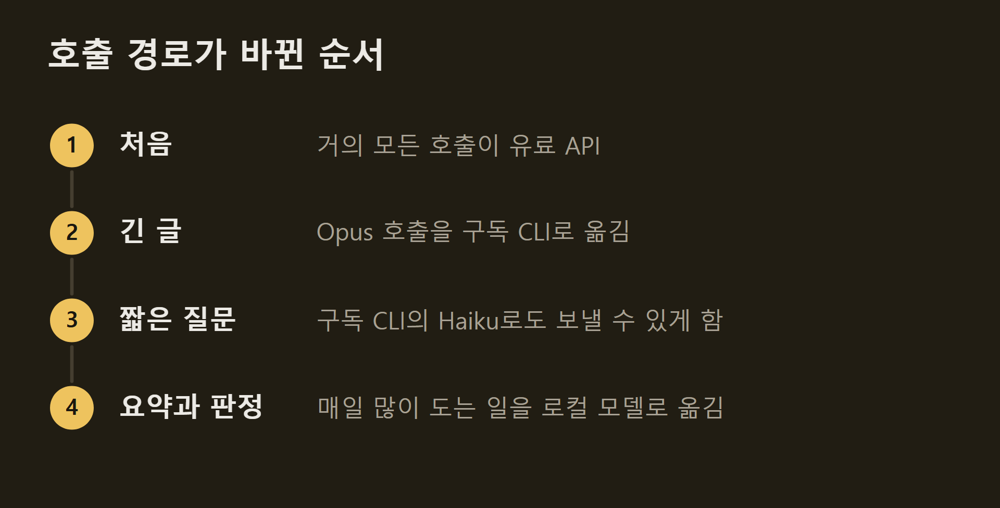
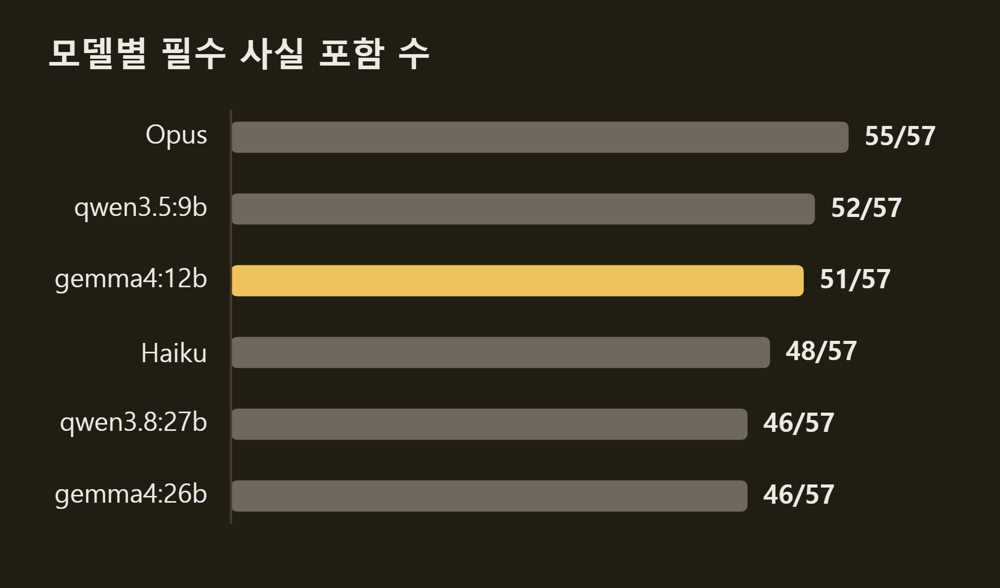
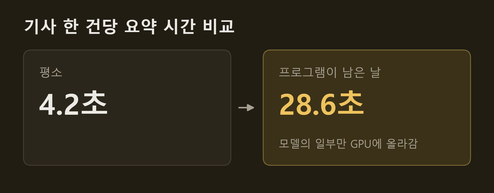
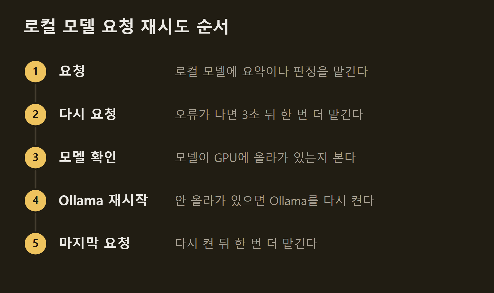
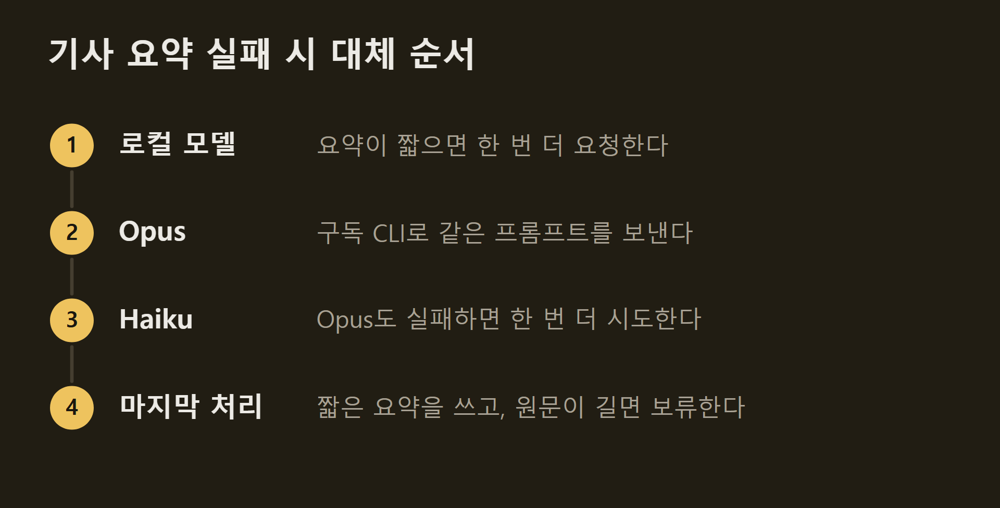

---
title: "VISER 개발 #5: 모델 호출 경로"
date: 2026-10-14T12:00:00+09:00
description: "VISER는 매일 많이 하는 작은 일은 내 PC의 로컬 모델에, 가끔 하는 긴 글은 구독으로 쓰는 Claude Opus에 맡기고, 유료 API는 매일 쓰지 않는다."
tags: []
series: ["viser"]
draft: false
---

> 이 글은 직접 만들고 있는 개인 프로젝트의 개발 기록입니다. 저장소는 비공개이며, 본문의 수치는 저장소의 기록에서 가져왔습니다.

모델에게 일을 시키면 돈이 든다. VISER는 하루에도 수십 건의 기사를 요약하고, 기사마다 관심 분야인지, 이미 낸 소식인지를 묻는다. 처음에는 이 일을 모두 유료 API로 했다. 지금은 일의 크기와 횟수에 따라 맡기는 곳을 나눈다. 이 글은 지금 어떤 일을 어디에 맡기는지, 왜 그렇게 나눴는지, 나누면서 생긴 문제를 어떻게 풀었는지 설명한다.

```요약
요약: VISER는 매일 많이 하는 작은 일은 내 PC의 로컬 모델에, 가끔 하는 긴 글은 구독으로 쓰는 Claude Opus에 맡기고, 유료 API는 매일 쓰지 않는다.
```

```용어
유료 API: 프로그램에서 모델을 부를 때마다 쓴 양만큼 요금이 나가는 방식.
구독 CLI: 매달 내는 Claude 구독으로 명령줄에서 모델을 부르는 방식. 요금은 따로 나가지 않지만 구독의 사용 한도를 쓴다.
로컬 모델: 외부 서비스가 아니라 내 PC의 그래픽 카드에서 돌리는 모델. Ollama라는 프로그램으로 켠다.
필수 사실: 요약을 평가할 때 "이 기사 요약에는 꼭 들어가야 한다"고 미리 정해 둔 사실.
```

## 1. 모델을 부르는 세 곳

VISER가 모델을 부르는 곳은 세 군데다.

| | 비용 | 단점 |
|---|---|---|
| 유료 API | 쓴 만큼 요금 | 잔액이 떨어지면 멈춤 |
| 구독 CLI | 구독료 안에서 사용 | 내 Claude 사용량과 한도를 나눠 씀 |
| 로컬 모델 | 추가 비용 없음 | 내 PC의 GPU 메모리를 차지 |
{caption="호출 경로 비교"}

유료 API는 쓴 만큼 돈이 나간다. 구독 CLI는 이미 내고 있는 구독 안에서 쓰지만, 내가 직접 Claude를 쓰는 것과 같은 한도를 나눠 쓴다. VISER가 많이 쓰면 내가 쓸 몫이 줄어든다. 로컬 모델은 추가 비용이 없지만, 내 PC에서 돌릴 수 있는 크기의 모델만 쓸 수 있다.

==어느 한 곳에 모든 일을 맡기지 않고, 일마다 맞는 곳을 고른다.==

## 2. 지금의 일 분담

지금은 일을 이렇게 나눠 맡긴다.

| | 맡는 곳 | 이유 |
|---|---|---|
| 기사 3~4줄 요약 | 로컬 모델 | 하루 수십 번 |
| 관심·주제·중복 판정 | 로컬 모델 | 하루 수십 번 |
| 메일 분류, 기사 찾기 | 구독 CLI (Haiku) | 짧은 질문 |
| 뉴스레터 한 문장 요약 | 구독 CLI (Opus) | 로컬 모델로는 부족 |
| 주간 보고서 본문·그래프 | 구독 CLI (Opus) | 긴 글 |
{caption="일별 호출 경로"}

기준은 두 가지다. 하루에 몇 번 하는 일인지, 그리고 얼마나 잘해야 하는 일인지다.

기사 요약과 판정은 하루에 수십 번 한다. 이 일을 유료 API에 맡기면 요금이 계속 나가고, 구독에 맡기면 그만큼 한도를 쓴다. 그래서 로컬 모델에 맡긴다.

메일이 테크 뉴스인지 가르고 그 안에서 기사를 찾는 일은 구독 CLI의 작은 모델인 Haiku가 한다. 답이 짧은 질문이라 작은 모델로 충분하다.

뉴스레터 한 통을 한 문장으로 줄이는 일과 주간 보고서를 쓰는 일은 Opus가 한다. 횟수는 적지만 잘 써야 하는 일이다. 뉴스레터 한 문장 요약은 로컬 모델로 옮기려다 그만두었는데, 이유는 4절에 적었다.

## 3. 분담이 바뀐 과정

처음부터 이렇게 나눈 것은 아니다. 문제가 생길 때마다 하나씩 옮겼다.



먼저 긴 글을 쓰는 일을 구독 CLI로 옮겼다. 긴 글은 Opus가 쓰는데, Opus를 유료 API로 부르면 비싸다. 반면 구독에는 Opus 사용이 이미 들어 있다.

짧은 질문은 한동안 유료 API에 남겨 두었다. 구독 CLI는 부를 때마다 Claude Code의 기본 안내문이 약 1만 8천 토큰씩 붙어서, 답이 몇 글자뿐인 질문에 쓰기는 아까웠다. 그런데 어느 날 API 키에 문제가 생기자 VISER 전체가 멈췄다. 메일에서 기사를 찾는 첫 단계가 바로 이 짧은 질문이었다. 그 뒤로는 짧은 질문도 구독 CLI의 Haiku로 보낼 수 있게 했다. 유료 API 하나에 막혀 전체가 멈추는 일을 없앤 것이다.

마지막으로 매일 많이 도는 요약과 판정을 로컬 모델로 옮겼다. 이때는 옮겨도 품질이 괜찮은지 먼저 확인했다.

## 4. 로컬 모델로 옮겨도 되는지 확인한 방법

기사 요약은 처음에 Opus가 썼다. 로컬 모델이 그만큼 쓸 수 있는지 직접 비교했다.

요약은 정답 문장이 하나가 아니다. 같은 내용을 다른 문장으로 써도 맞는 요약이다. 그래서 문장을 비교하지 않고, 기사마다 "요약에 꼭 들어가야 하는 사실"을 미리 정해 두었다. 그리고 모델마다 요약에 그 사실이 몇 개 들어갔는지 셌다. 기사 12건에서 필수 사실 57개를 정했다.



Opus가 55개로 가장 많았고, 로컬 모델 중에서는 qwen3.5:9b가 52개, gemma4:12b가 51개였다. 그중 gemma4:12b를 골랐다. qwen3.5:9b는 한 건에서 한자를 섞었고, gemma4:12b는 그런 실수가 없었다.

비교하면서 알게 된 것이 셋 있다.

1. 큰 모델이 더 낫지 않았다: 같은 계열에서 12B 모델은 51개, 더 큰 26B 모델은 46개였다. 큰 모델은 기사 앞부분을 자세히 쓰다가 정해진 3~4줄 안에서 뒷부분을 빠뜨렸다.
2. 채점 기준도 점검해야 한다: 어떤 기사의 필수 사실 중 하나가 "모방 학습"이었는데, 한 모델은 이것을 영어 그대로 "imitation learning"이라고 썼다. 내용은 맞는데, 처음 채점은 한국어 "모방 학습"만 찾아서 빠졌다고 셌다. 이런 경우를 맞은 것으로 고쳐 세자 Opus와 로컬 모델의 점수 차이가 6개에서 3개로 줄었다. 채점이 틀렸다면 로컬 모델을 실제보다 낮게 보고 잘못 골랐을 것이다.
3. 하지 말라고 쓰면 오히려 한다: 프롬프트에 "한자는 쓰지 않는다"를 넣자 한자가 섞인 요약이 1건에서 3건으로 늘었다. 그래서 나오면 안 되는 것은 프롬프트로 부탁하지 않고 코드로 거른다.

뉴스레터 한 통 전체를 한 문장으로 줄이는 일은 같은 방식으로 비교해 보고 로컬 모델로 옮기지 않았다. gemma4:12b는 "최신 AI 기술의 성능 향상과 도구들이 발표되었다"처럼 뭉뚱그려 써서, 들어가야 할 낱말 16개 중 7개만 담았다. Opus는 15개를 담았다. 대신 Opus에게 기사 원문 7만 자를 주지 않고, 로컬 모델이 만든 요약 목록 4천 자만 준다. 그만큼 구독 한도를 덜 쓴다.

## 5. 로컬 모델을 쓰며 생긴 문제

로컬 모델로 옮긴 뒤에는 내 PC가 문제를 일으켰다. 세 가지가 있었다.

**꺼져 있는 날.** 로컬 모델은 Ollama라는 별도 프로그램으로 켠다. Ollama가 꺼져 있으면 요약이 Opus로 넘어가 구독 한도를 쓴다. 실제로 Ollama가 꺼진 날 기사 3건이 모두 그랬다. 그래서 매일 누르는 "일일 보고서" 버튼이 처음에 Ollama를 켜고, 마지막에 끄게 했다.

**덜 꺼진 날.** Ollama를 새 판으로 올린 뒤, 모델을 실제로 돌리는 보조 프로그램이 꺼지지 않고 남았다. 끄는 코드가 보조 프로그램의 바뀐 이름을 몰랐기 때문이다. 남은 프로그램이 그래픽 카드 메모리를 절반 넘게 붙잡고 있어서, 다음 실행은 모델을 그래픽 카드에 다 올리지 못했다.



기사 한 건 요약이 4.2초에서 28.6초로 느려졌다.

**올리다 실패하는 날.** 모델을 그래픽 카드에 올리다가 오류가 나는 경우도 있다. 기록을 보니 74번 중 5번이었다. 이때는 아래 순서로 다시 시도한다.



Ollama를 다시 켜는 것은 10분에 한 번까지만 한다. 오류의 원인은 아직 찾지 못했다.

## 6. 실패했을 때의 순서

그래도 실패할 때가 있다. 이때는 정해 둔 순서대로 다음 곳에 넘긴다. 기사 요약은 이 순서를 따른다.



세 곳이 모두 실패하면 로컬 모델이 처음에 만든 짧은 요약이라도 쓴다. 한 건 때문에 같은 메일의 다른 기사 요약까지 저장되지 않는 일을 막으려는 것이다. 짧은 요약은 다음 실행에서 고칠 수 있다.

넘길 때는 정해 둔 곳으로만 넘기고, 넘겼다는 사실을 화면에 적는다. ==어떤 경로가 실패해도 유료 API로 몰래 넘어가지 않는다.==

## 7. 정리

VISER는 일의 횟수와 중요도에 따라 맡기는 곳을 나눈다. 매일 많이 하는 요약과 판정은 로컬 모델이, 짧은 분류는 Haiku가, 잘 써야 하는 긴 글은 Opus가 한다. 로컬 모델로 옮길 때는 같은 기사로 품질을 비교했고, 옮긴 뒤 생긴 PC 쪽 문제는 하나씩 고쳤다. 실패하면 정해 둔 순서로 넘기되, 유료 API로 몰래 넘어가지 않는다.

## 출처와 작성 방식

- 근거: 비공개 저장소의 코드 주석, 커밋 기록, 평가 기록
- 그래프: 저장소의 기록에 적힌 값으로 VISER 주간 보고서의 그래프 양식을 써서 직접 그린 그림입니다.- 수치 기준일: 2026-10-14
