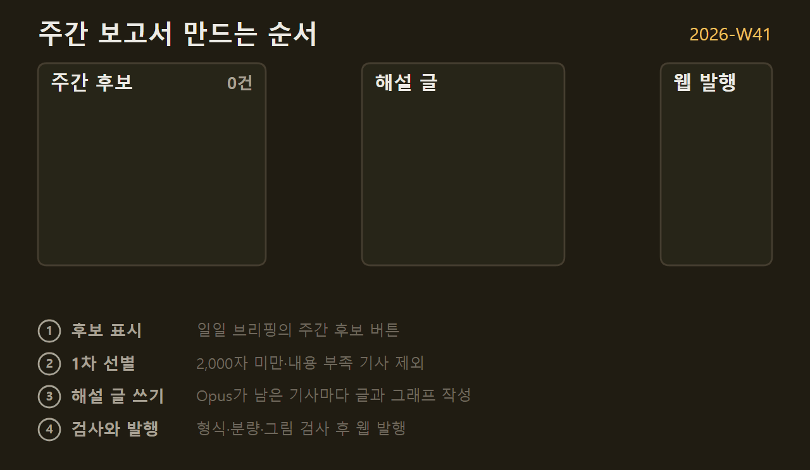
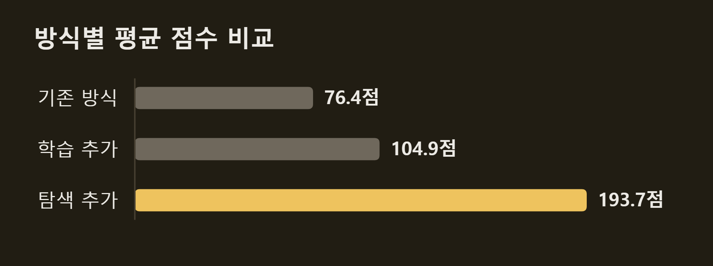
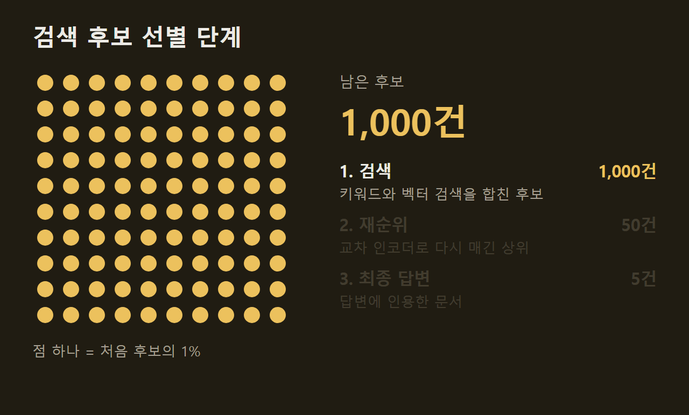

---
title: "VISER 개발 #6: 주간 보고서와 그래프"
date: 2026-10-14T13:00:00+09:00
description: "VISER의 주간 보고서는 한 주 동안 고른 기사를 Opus가 해설 글로 다시 쓰고, 그래프는 Opus가 그릴 내용만 정하면 VISER가 같은 모양으로 그리며, 후보가 줄어드는 것처럼 대상이 실제로 바뀌는 내용만 움직이는 그래프로 보여 준다."
tags: []
series: ["viser"]
draft: false
---

> 이 글은 직접 만들고 있는 개인 프로젝트의 개발 기록입니다. 저장소는 비공개이며, 본문의 수치는 저장소의 기록에서 가져왔습니다.

VISER는 매일 일일 브리핑을 낸다. 그중 더 깊게 읽고 싶은 기사는 일주일에 한 번 주간 보고서로 다시 정리한다. 이 블로그의 Weekly 구역에 올라가는 글도 이 주간 보고서에서 나온다. 이 글은 주간 보고서가 만들어지는 순서와, 보고서에 들어가는 그래프를 어떻게 그리는지 설명한다.

```요약
요약: VISER의 주간 보고서는 한 주 동안 고른 기사를 Opus가 해설 글로 다시 쓰고, 그래프는 Opus가 그릴 내용만 정하면 VISER가 같은 모양으로 그리며, 후보가 줄어드는 것처럼 대상이 실제로 바뀌는 내용만 움직이는 그래프로 보여 준다.
```

```용어
주간 후보: 일일 브리핑에서 "주간 보고서에서 자세히 보고 싶다"고 표시한 기사.
해설 글: 기사를 처음 보는 사람도 읽을 수 있게 다시 쓴 글. 요약 상자, 용어 상자, 소제목, 그림으로 이뤄진다.
틀: 그래프 모양을 미리 정해 둔 그리기 함수. 큰 숫자, 가로 막대, 비교 표 같은 것이 있다.
정지본: 움직이는 그래프의 모든 단계를 한 장에 담은 그림. 인쇄할 때 쓴다.
```

## 1. 주간 보고서 만드는 순서

주간 보고서는 아래 순서로 만들어진다.



시작은 일일 브리핑이다. 기사마다 점수 버튼이 있고, 그중 "주간 후보"를 누른 기사가 주간 보고서의 재료가 된다.

주간 후보라고 모두 쓰지는 않는다. 원문이 2,000자보다 짧은 기사는 먼저 뺀다. 나머지는 Opus에게 "그림 두 장과 소제목 세 개를 채울 만큼 내용이 있는가"를 묻고, 부족하다는 기사를 뺀다. 출시 안내처럼 사실 한두 개로 끝나는 글은 해설 글로 늘려 쓸 내용이 없기 때문이다.

남은 기사마다 Opus가 해설 글을 한 편씩 쓴다. 다 쓰면 VISER가 형식과 분량, 그림이 규칙에 맞는지 검사하고, 통과하면 웹 페이지로 발행한다. 보고서 본문을 내가 직접 고치지는 않는다. 고칠 점이 있으면 의견을 적고, VISER가 그 의견을 반영해 다시 만든다.

## 2. 해설 글 형식

주간 보고서는 기사 한 건을 해설 글 한 편으로 쓴다. 한 편은 아래 순서로 이뤄진다.

1. 제목: "이름: 무엇인지" 모양으로 쓴다. 성과를 단정하는 문장이나 질문은 쓰지 않는다.
2. 도입: 이 대상이 무엇을 하는 것인지 먼저 설명한다. 분야를 모르는 사람도 도입만 읽고 무엇인지 말할 수 있어야 한다.
3. 요약 상자와 용어 상자: 한 문장 요약과, 본문을 읽는 데 필요한 용어 3~5개를 적는다.
4. 소제목 3~6개: 짧은 명사구로 쓴다. 절마다 기억할 문장을 하나까지 강조한다.

")

분량은 원문을 모두 우리말로 옮긴 양의 절반을 넘지 않는다. 원문을 문장마다 옮기지 않고, 절마다 독자가 알아야 할 것 하나를 먼저 정한 뒤 그것을 설명하는 데 필요한 문장만 쓴다. 설치 명령이나 설정값 목록처럼 찾아볼 때만 필요한 내용은 "원문에 정리되어 있다"는 한 문장으로 대신한다.

원문에 구조도나 비교 그림이 있으면 그 그림을 싣는다. 어떤 그림을 어느 절에 넣을지는 Opus가 그림을 직접 보고 정한다. 원문 그림을 고르는 방법은 #4에 적었다.

## 3. 그래프 구조

해설 글에는 VISER가 직접 그린 그래프도 들어간다. 그래프는 Opus와 VISER가 나눠서 만든다. Opus는 무엇을 그릴지 정하고, VISER는 그것을 그림으로 그린다.

예를 들어 기사에 "기존 방식은 76.4점, 학습을 더하자 104.9점, 탐색까지 더하자 193.7점"이라는 내용이 있다고 하자. Opus는 이것을 보고 다섯 가지만 정한다.

1. 그래프 종류: 가로 막대그래프
2. 막대 이름: 기존 방식, 학습 추가, 탐색 추가
3. 막대 값: 76.4점, 104.9점, 193.7점
4. 강조할 막대: 탐색 추가
5. 제목: 방식별 평균 점수 비교

VISER에 미리 만들어 둔 그리기 함수가 이것을 받아 아래 그림을 그린다.



색, 글자 크기, 막대 굵기, 여백은 그리기 함수가 정한다. Opus는 이것을 정할 수 없다. 그래서 어느 기사의 그래프든 같은 모양으로 나온다. 그리기 함수는 가로 막대 말고도 큰 숫자 칸, 단계 목록, 비교 표 같은 것이 있다.

==무엇을 그릴지는 모델이 정하고, 어떻게 보일지는 VISER가 정한다.==

처음부터 이렇게 나눈 것은 아니다. 한때는 Opus가 그래프 코드를 처음부터 끝까지 직접 썼다. 기사마다 자유롭게 그릴 수는 있었지만, 그림마다 색과 글자 크기가 달랐고 글자가 서로 겹치거나 그림 밖으로 잘리는 일이 있었다. 값이 두 개뿐인데 막대그래프로 그리는 일도 있었다. "3시간에서 9시간으로 늘었다"는 내용은 문장 하나로 충분한데, 막대 두 개는 자리만 차지한다. 그래서 그림 모양은 VISER가 정하고, 값이 두 개면 막대 대신 큰 숫자 칸을 쓰게 했다.

Opus가 정한 내용은 짧은 코드로 VISER에 전달된다. 이 코드는 그대로 실행하지 않는다. 그림을 그리는 기능 외에는 쓰지 못하게 먼저 검사하고, VISER와 분리된 환경에서 실행한다. 그래도 완전히 막았다고 말할 수는 없다. 코드의 재료가 외부 뉴스레터 원문이기 때문이다. 그림 안의 글자가 넘치면 VISER가 글자를 줄여 맞추고, 그래도 안 되면 Opus에게 한 번 고치게 한다. 그래도 실패하면 그 그래프는 뺀다.

그래프에는 기사에 있는 값만 쓴다. 기사가 "절반으로 줄였다"고 썼으면 그 표현대로 그리고, 기사에 없는 숫자로 바꿔 계산하지 않는다.

## 4. 움직이는 그래프

주간 보고서의 그래프는 대부분 움직이지 않는다. 움직이는 그래프는 후보가 단계마다 걸러져 줄어드는 내용 하나에만 쓴다. 예를 들어 검색 결과 1,000건을 다시 순위를 매겨 50건으로 줄이고, 그중 5건을 답변에 쓴다는 기사라면 아래처럼 그린다.



점 하나가 처음 후보의 1%다. 단계가 넘어갈 때마다 걸러진 점이 흐려지고, 오른쪽의 남은 후보 수가 바뀐다. 장면마다 그림 속 대상이 실제로 줄어들기 때문에 움직임이 내용을 전한다.

처음에는 처리 단계를 한 줄씩 강조해 가는 그래프도 움직이게 만들었다. 하지만 같은 목록에서 강조할 줄만 옮겨 가는 그림은 움직여도 새로 전하는 것이 없었다. ==강조만 옮겨 가는 그림은 움직이지 않는다.== 그런 내용은 정지된 단계 목록으로 그리고, 반복되는 과정이면 옆에 반복 표시를 단다. 인쇄할 때는 움직이는 그래프도 마지막 장면을 정지 그림으로 보여 준다.

## 5. 보고서 저장 위치

처음에는 기사 항목과 점수, 보고서 본문을 Notion에 저장했다. 지금은 이것을 모두 내 PC의 데이터베이스(SQLite) 하나에 저장하고, Notion은 쓰지 않는다. 웹 페이지와 Markdown 파일은 이 데이터베이스에서 꺼내 만든 사본이다. 같은 주의 보고서를 다시 만들어도 이전 판은 지우지 않고 남겨 둔다.

## 6. 블로그 게시

주간 보고서 페이지의 기사마다 "블로그" 체크 칸이 있다. 체크한 기사만 블로그 글로 바꿔 올린다. 체크가 서버를 거쳐 VISER로 돌아오는 과정은 #2에 적었다.

블로그로 옮길 때는 글을 다시 쓰지 않고 그림만 블로그에 맞게 바꾼다. 그래프는 이미지 파일(PNG)로 바꿔 싣는다. 휴대폰의 일부 브라우저가 어두운 화면 설정에서 그래프의 색을 다른 색으로 바꿨기 때문이다. 움직이는 그래프는 그대로 싣고, 원문 그림에는 출처를 적는다.

## 7. 정리

주간 보고서는 한 주 동안 고른 기사를 Opus가 해설 글로 다시 쓴 것이다. 그래프는 Opus가 무엇을 그릴지 정하고 VISER가 같은 모양으로 그린다. 움직이는 그래프는 후보가 줄어드는 것처럼 그림 속 대상이 실제로 바뀌는 내용에만 쓴다.

VISER 개발 기록은 이 글로 마친다.

## 출처와 작성 방식

- 근거: 비공개 저장소의 코드 주석, 커밋 기록, 평가 기록
- 그래프: 저장소의 기록에 적힌 값으로 VISER 주간 보고서의 그래프 양식을 써서 직접 그린 그림입니다.
- 움직이는 그림: 직접 그린 그림입니다. 주간 보고서 만드는 순서 그림의 후보 5건과 제외 2건은 2026-W41의 실제 건수입니다. 검색 후보 선별 단계 그림의 수치(1,000건, 50건, 5건)는 설명을 위한 예시입니다.
- 그래프 예시: 방식별 평균 점수 비교 그림과 그 값은 주간 보고서 프롬프트에 실린 예시입니다.
- 화면: VISER가 발행한 주간 보고서 페이지를 찍은 것입니다. 화면 속 기사 내용은 인용이며 저작권은 원문 매체에 있습니다.
- 수치 기준일: 2026-10-14
